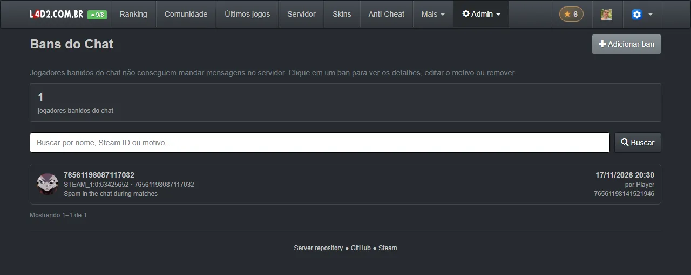
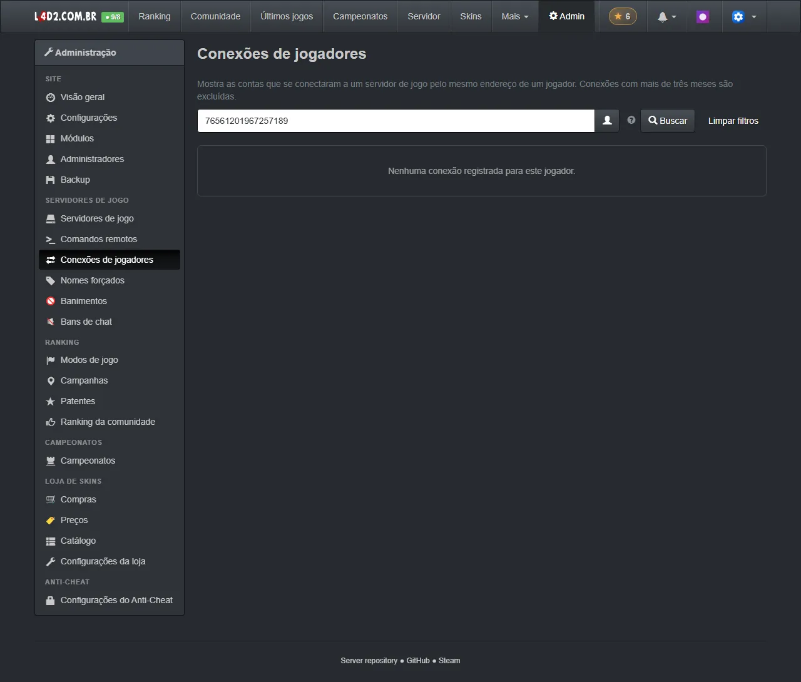

# Moderação

🌐 [English](moderation.md) | **Português** | [Español](moderation.es.md)

As ferramentas que um administrador tem para lidar com os jogadores: punições no ranking, banimentos do chat do site, comandos enviados a um servidor de jogo e as contas que compartilham um endereço.

[Voltar ao manual](README.pt.md)

## Conteúdo

- [Punições](#punições)
- [Banimentos do chat](#banimentos-do-chat)
- [Comandos remotos](#comandos-remotos)
- [Conexões de jogadores](#conexões-de-jogadores)

## Punições

Uma punição tira experiência de um jogador em uma temporada.

1. Abra a página do jogador, com a temporada selecionada no seletor de período.
2. Ao lado de **Punição**, clique em **Editar**.
3. Digite quantos pontos de experiência o jogador deve perder. O sugerido é 150.

- Um número acima de zero adiciona uma punição. Várias punições na mesma temporada se somam.
- `0` remove todas as punições daquele jogador naquela temporada.
- A punição é subtraída da experiência do jogador naquela temporada, que nunca fica abaixo de zero. Ela aparece na página do jogador.
- Ela não passa para a próxima temporada e não vale para os rankings de um ano ou de todos os tempos.

As punições precisam do módulo de ranking.

## Banimentos do chat

Com o módulo de chat do site ligado, os jogadores logados podem escrever no chat de um servidor de jogo pela [página do servidor ao vivo](live-server.pt.md#escrevendo-no-chat-pelo-site). **Administração > Bans de chat** impede um jogador de fazer isso.

A página lista todos os banimentos, com o jogador, a data, o motivo e quem baniu. Busque por nome, Steam ID ou motivo. Clique em um banimento para ver os detalhes, mudar o motivo ou removê-lo.

**Adicionar ban** pede o jogador e um motivo:

- Digite um Steam ID em qualquer formato ou um link de perfil, ou escolha na lista. **Últimas mensagens no chat** lista quem escreveu no chat do site na última hora, então o jogador que acabou de se comportar mal está a um clique. Quando você digita um ID, a lista mostra o ID no lugar do nome.
- O motivo é opcional, com até 300 caracteres. O jogador banido vê o motivo no lugar da caixa de chat.

Um banimento vale para o chat do site de todos os servidores de jogo. Ele não silencia o jogador dentro do jogo; isso é feito com as ferramentas do servidor de jogo.

## Comandos remotos

Com o módulo de comandos remotos ligado, os administradores podem enviar comandos do SourceMod do site para um servidor de jogo, sem RCON.

1. Escolha o servidor.
2. Digite o comando: `sm_command`, `!command` ou `/command`, com os argumentos. `!forcestart` e `/forcestart` são enviados como `sm_forcestart`. Um comando não pode conter `;` e tem no máximo 256 caracteres.
3. Clique em **Enviar**.

O comando entra em uma fila. O servidor de jogo pergunta ao site pelos comandos na fila na próxima verificação e executa o comando. Se nenhum servidor de jogo o pegar em 5 minutos, ele é descartado.

Todo comando fica registrado no **Registro de auditoria**: o comando, o administrador, o servidor, quando foi enviado e se foi entregue ao servidor de jogo, e quando. Os contadores mostram quantos comandos foram enviados e quantos foram entregues.

Os administradores também podem enviar um comando pela caixa de chat da página do servidor ao vivo, e o botão **Terminal** de lá ajuda a montar um.

## Conexões de jogadores

Com o módulo do servidor ao vivo ligado, os servidores de jogo informam o endereço de onde cada jogador se conecta. **Administração > Conexões de jogadores** encontra as contas que se conectaram pelo mesmo endereço de um jogador, o que muitas vezes indica uma segunda conta.

Digite o Steam ID ou o link do perfil do jogador e clique em **Buscar**. A página mostra:

- quantas conexões o jogador tem e quantas outras contas usaram o mesmo endereço;
- cada conta, com os Steam IDs dela, quando foi vista pela primeira e pela última vez, e quantas conexões ela tem.

O endereço em si nunca aparece. Conexões com mais de três meses são excluídas.

As mesmas contas aparecem na página do jogador como [Contas relacionadas](players.pt.md#contas-relacionadas), para todo visitante ou só para administradores, conforme [Configurações > Privacidade](administration.pt.md#privacidade).
