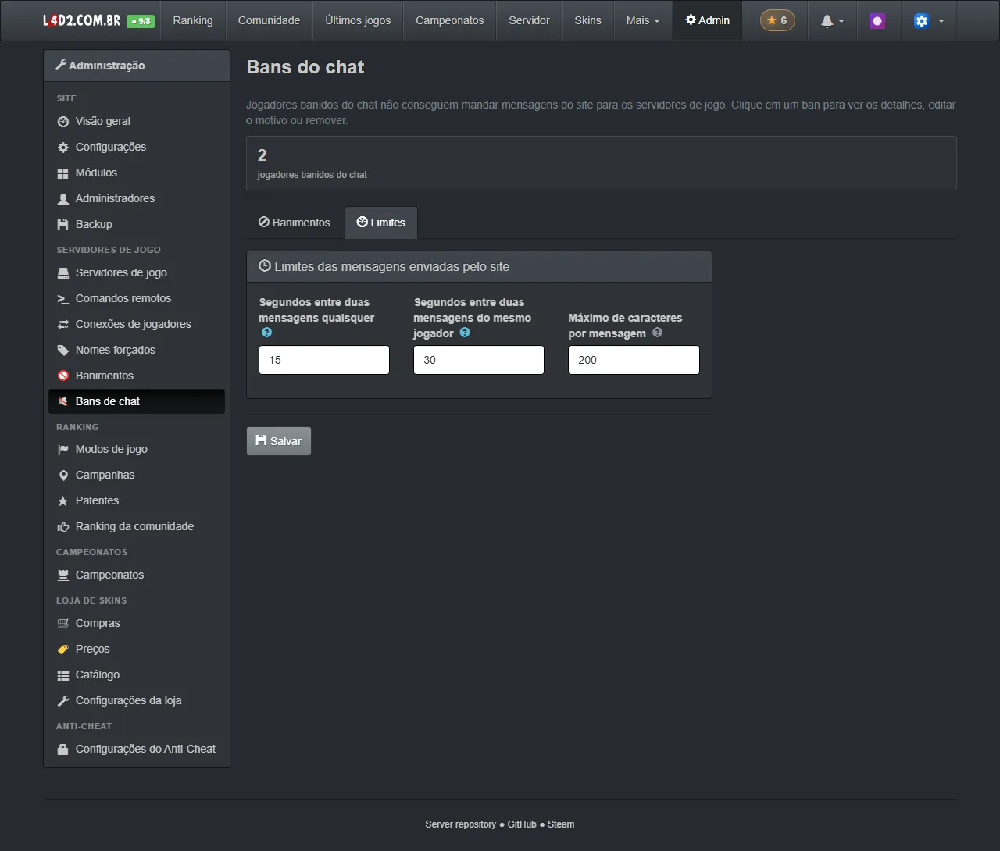
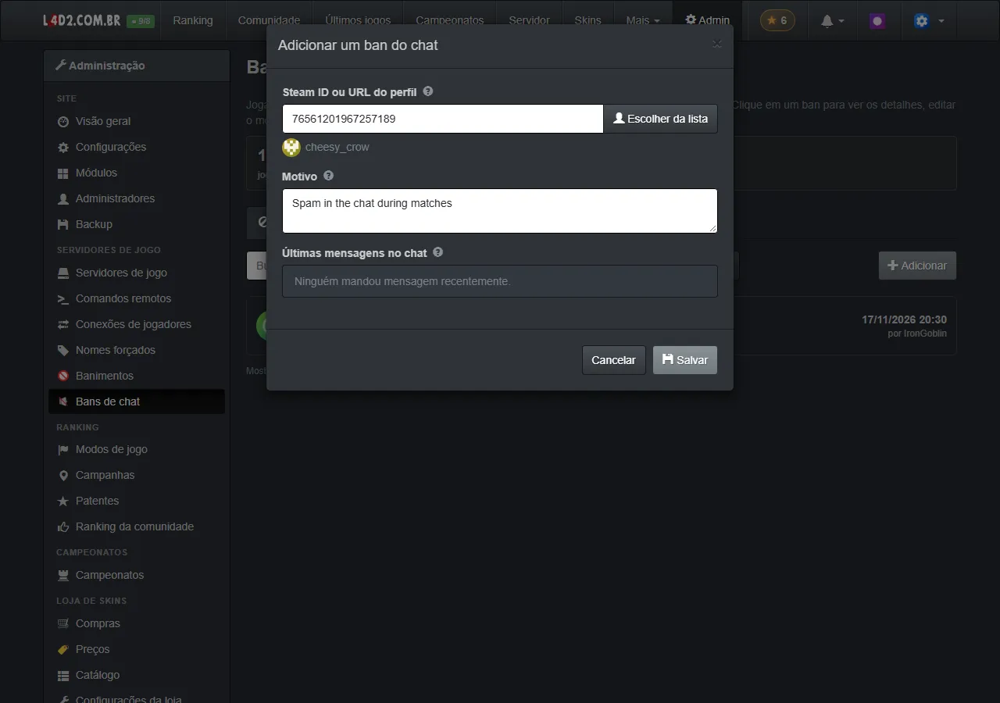
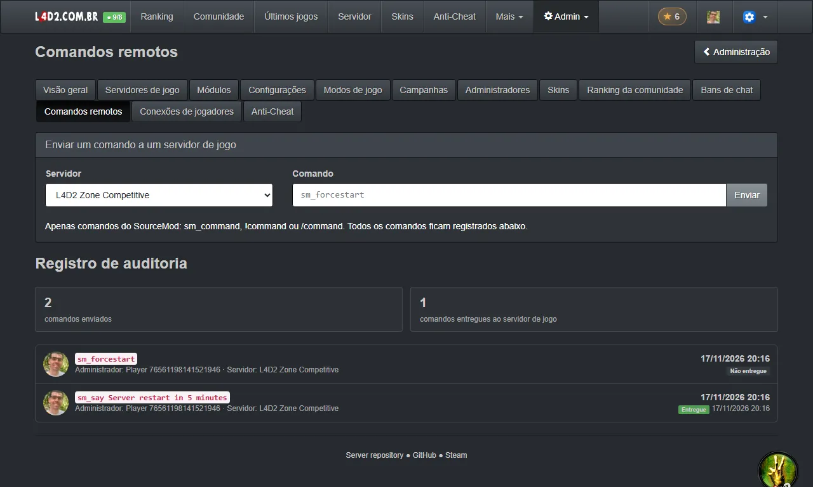
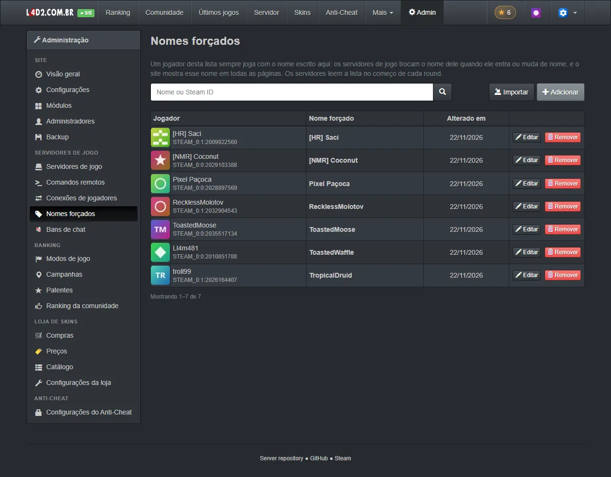
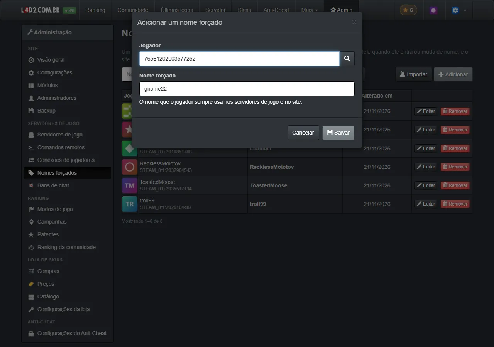
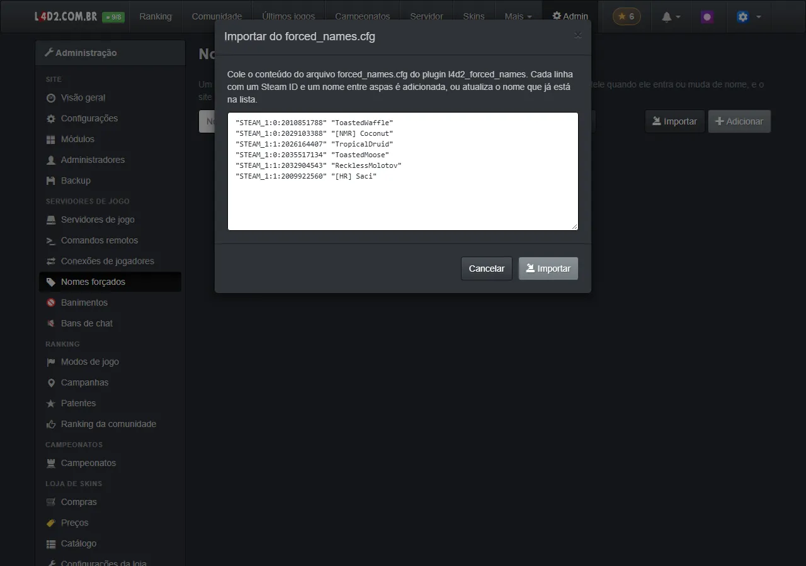

# Moderação

🌐 [English](moderation.md) | **Português** | [Español](moderation.es.md)

As ferramentas que um administrador tem para lidar com os jogadores: punições no ranking, banimentos do chat do site, comandos enviados a um servidor de jogo e as contas que compartilham um endereço.

[Voltar ao manual](README.pt.md)

## Conteúdo

- [Punições](#punições)
- [Banimentos do chat](#banimentos-do-chat)
- [Comandos remotos](#comandos-remotos)
- [Conexões de jogadores](#conexões-de-jogadores)
- [Nomes forçados](#nomes-forçados)

## Punições

Uma punição tira experiência de um jogador em uma temporada.

1. Abra a página do jogador, com a temporada selecionada no seletor de período.
2. Ao lado de **Punição**, clique em **Editar**.
3. Digite quantos pontos de experiência o jogador deve perder. O sugerido é 150.

- Um número acima de zero adiciona uma punição. Várias punições na mesma temporada se somam.
- `0` remove todas as punições daquele jogador naquela temporada.
- A punição é subtraída da experiência do jogador naquela temporada, que nunca fica abaixo de zero. Ela aparece na página do jogador.
- Ela não passa para a próxima temporada e não vale para os rankings de um ano ou de todo o período.

As punições precisam do módulo de ranking.

## Banimentos do chat

Com o módulo de chat do site ligado, os jogadores logados podem escrever no chat de um servidor de jogo pela [página do servidor ao vivo](live-server.pt.md#escrevendo-no-chat-pelo-site). **Administração > Bans de chat** impede um jogador de fazer isso. O painel **Limites das mensagens enviadas pelo site** define os segundos entre duas mensagens quaisquer num servidor de jogo (15 por padrão), os segundos entre duas mensagens do mesmo jogador (30) e o máximo de caracteres por mensagem (200, que também é o máximo que o chat do jogo aceita). 0 desliga uma pausa, e os administradores não estão sujeitos às pausas.

A página lista todos os banimentos, com o jogador, a data, o motivo e quem baniu. Busque por nome, Steam ID ou motivo. Clique em um banimento para ver os detalhes, mudar o motivo e **Salvar**, ou removê-lo.

**Adicionar**, à direita da busca, abre uma janela que pede o jogador e um motivo:

- Digite um Steam ID em qualquer formato ou um link de perfil, ou escolha na lista. **Últimas mensagens no chat** lista quem escreveu no chat do site na última hora, então o jogador que acabou de se comportar mal está a um clique. Quando você digita um ID, o nome e a foto do jogador aparecem abaixo do campo depois de um instante.
- O motivo é opcional, com até 300 caracteres. O jogador banido vê o motivo no lugar da caixa de chat.

Um banimento vale para o chat do site de todos os servidores de jogo. Ele não silencia o jogador dentro do jogo; isso é feito com as ferramentas do servidor de jogo.

## Comandos remotos

Com o módulo de comandos remotos ligado, os administradores podem enviar comandos do SourceMod pelo site a um servidor de jogo, sem RCON.

1. Escolha o servidor.
2. Digite o comando: `sm_command`, `!command` ou `/command`, com os argumentos. `!forcestart` e `/forcestart` são enviados como `sm_forcestart`. Um comando não pode conter `;` e tem no máximo 256 caracteres.
   Ou clique no botão do terminal ao lado da caixa: ele lista os comandos do terminal da página ao vivo com o que cada um faz e pede cada argumento passo a passo (modo de jogo, campanha, time, duração, motivo; o nome do jogador é digitado, já que esta página não lista quem está conectado). O comando montado preenche a caixa, e você ainda pode editá-lo antes de enviar.
3. Clique em **Enviar**.

O comando entra em uma fila. O servidor de jogo pede ao site os comandos da fila na próxima verificação e executa o comando. Se nenhum servidor de jogo o pegar em 5 minutos, ele é descartado.

Todo comando fica registrado no **Registro de auditoria**: o comando, o administrador, o servidor, quando foi enviado e se foi entregue ao servidor de jogo, e quando. O registro mostra 50 comandos por página, os mais recentes primeiro, e os contadores mostram quantos comandos foram enviados e quantos foram entregues no total. O registro também lista o `sm_aac sync` que o site envia a cada servidor de jogo depois de uma alteração nas [Configurações do Anti-Cheat](anti-cheat.pt.md#para-administradores); esse é enviado mesmo com este módulo desligado.

Os administradores também podem enviar um comando pela caixa de chat da página do servidor ao vivo, e o botão **Terminal** de lá ajuda a montar um.

## Conexões de jogadores

Com o módulo do servidor ao vivo ligado, os servidores de jogo informam o endereço de onde cada jogador se conecta. **Administração > Conexões de jogadores** encontra as contas que se conectaram do mesmo endereço que um jogador, o que muitas vezes indica uma segunda conta.

Digite o Steam ID ou o link do perfil do jogador e clique em **Buscar**, ou clique no botão de jogador ao lado do campo e escolha na [busca de jogadores](administration.pt.md#a-busca-de-jogadores); a busca é feita assim que você escolhe. A página mostra:

- quantas conexões o jogador tem e quantas outras contas usaram o mesmo endereço;
- cada conta, com o Steam ID dela (o SteamID64 aparece ao passar o mouse), quando foi vista pela primeira e pela última vez, e quantas conexões ela tem.

O endereço em si nunca aparece. Conexões com mais de três meses são excluídas.

As mesmas contas aparecem na página do jogador como [Contas relacionadas](players.pt.md#contas-relacionadas), para todo visitante ou só para administradores, conforme [Configurações > Privacidade](administration.pt.md#privacidade).

## Nomes forçados

**Administração > Nomes forçados** guarda uma lista de jogadores que sempre devem usar um nome fixo.

- No site, o nome forçado substitui o nome do jogador em todos os lugares: os rankings, a página do jogador, as partidas e suas estatísticas, o servidor ao vivo, o chat, o ranking da comunidade, as páginas do jogo e a administração. A busca de jogadores também encontra o jogador pelo nome forçado. Os nomes usados antes continuam na lista de nomes anteriores.
- Nos servidores de jogo, o plugin `l4d2_forced_names` troca o nome do jogador quando ele entra e toda vez que ele muda de nome. Com `l4d2_forced_names_hub 1`, o plugin lê esta lista no começo de cada round e junta com o arquivo `configs/forced_names.cfg`; quando os dois têm o mesmo jogador, vale o nome do site.

A lista mostra 20 jogadores por página e tem busca por nome ou Steam ID. **Adicionar** abre uma janela com o jogador (em qualquer formato de Steam ID, ou escolhido na busca de jogadores) e o nome; **Editar** muda o nome de um jogador que já está na lista, e **Remover** tira o jogador depois de uma confirmação. **Importar** recebe o conteúdo de um arquivo `forced_names.cfg`: cada linha com um Steam ID e um nome entre aspas é adicionada, ou atualiza o nome que já está na lista, e uma mensagem diz quantos foram adicionados, atualizados e ignorados.

Os nomes forçados fazem parte do cadastro de jogadores do site: cada um fica guardado no perfil do jogador, com quem o definiu e quando, e adicionar, editar ou remover um muda o [nome do jogador](players.pt.md#o-nome-do-jogador) em todas as páginas na hora. A página, a importação e a lista lida pelos servidores de jogo funcionam como antes.

Os servidores de jogo leem a lista em `GET <site>/api/forced-names` com o token deles, como descrito em [Conectando um servidor de jogo](../game-server.pt.md).
