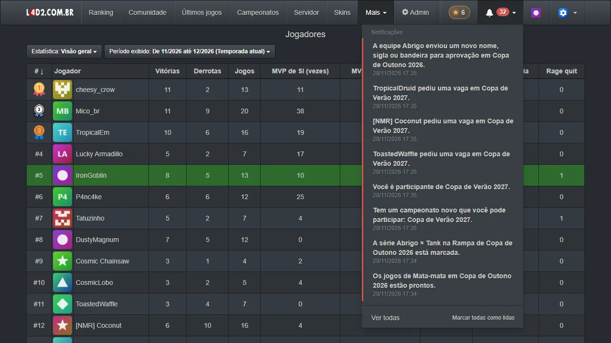
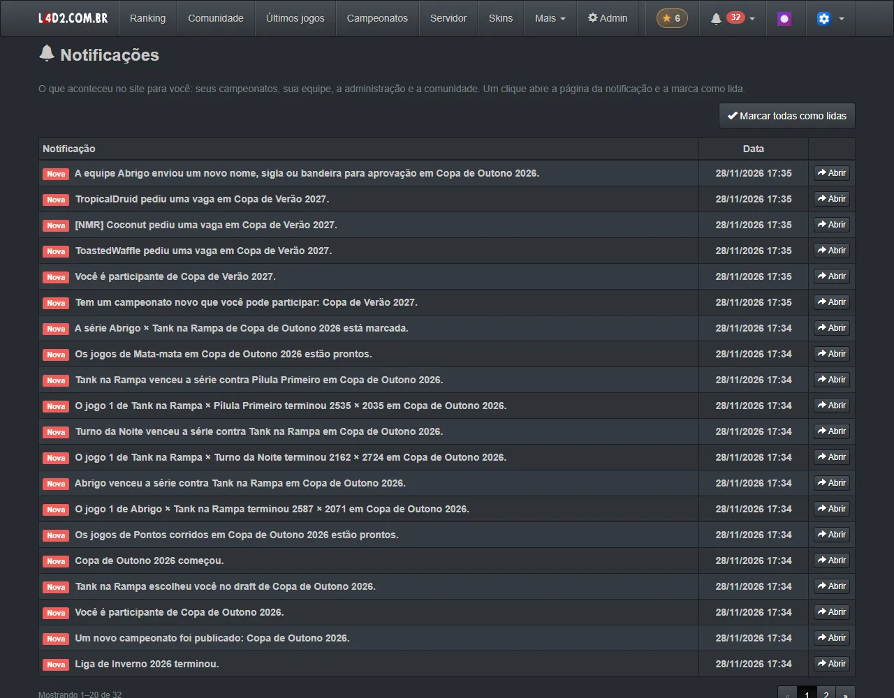

# Notificações

🌐 [English](notifications.md) | **Português** | [Español](notifications.es.md)

O site avisa cada jogador conectado do que aconteceu e diz respeito a ele: um campeonato em que pode participar, um pedido de participação respondido, a vez dele no draft, uma série marcada, uma punição, um presente. Os administradores também são avisados do que precisa da atenção deles, como um novo pedido de participação ou uma identidade de equipe esperando aprovação.

[Voltar ao manual](README.pt.md)

## Conteúdo

- [O sino](#o-sino)
- [A página de notificações](#a-página-de-notificações)
- [Quem recebe o quê](#quem-recebe-o-quê)
- [Por quanto tempo ficam guardadas](#por-quanto-tempo-ficam-guardadas)

## O sino

Um jogador conectado vê um sino na barra do topo, ao lado da foto. Um número vermelho no sino conta as notificações ainda não lidas. Visitantes que não entraram não veem o sino.

Um clique no sino abre as 8 notificações mais recentes. As não lidas ficam em negrito, com uma marca vermelha à esquerda. Um clique em uma abre a página dela, por exemplo a página do campeonato ou a área do capitão, e a marca como lida.

No fim da lista:

| Link | O que faz |
|---|---|
| Ver todas | Abre a página de notificações. |
| Marcar todas como lidas | Pede confirmação e marca todas as notificações como lidas. O número no sino volta para zero. |

## A página de notificações

**Ver todas** abre `/notifications`, a lista completa da mais nova para a mais antiga, 20 por página. As não lidas têm o selo vermelho **Nova**. **Abrir** vai para a página da notificação e a marca como lida. **Marcar todas como lidas**, no topo, faz o mesmo que o link do sino.

O texto de cada notificação aparece no idioma escolhido pelo jogador, e os jogadores citados aparecem com o nome atual.

## Quem recebe o quê

| Evento | Quem recebe |
|---|---|
| Um campeonato é publicado, ou as inscrições dele abrem | Todos. Quando o campeonato aceita pedidos de participação: "Tem um campeonato novo que você pode participar". |
| Um jogador pede uma vaga, ou cancela o pedido | Os administradores. |
| Um pedido de participação é aprovado ou recusado | O jogador que pediu. |
| Um jogador é adicionado aos participantes, removido deles ou colocado em uma equipe | Esse jogador. |
| Um jogador vira capitão ou vice-capitão | Esse jogador, com um link para a área do capitão. |
| A ordem do draft é sorteada, ou uma escolha é feita | Os capitães; o jogador escolhido; o capitão e o vice da equipe da vez. |
| Uma equipe envia um novo nome, sigla ou bandeira | Os administradores. |
| O novo nome, sigla ou bandeira é aprovado ou recusado | O capitão e o vice da equipe. |
| Os jogos de uma fase são criados | Os jogadores das equipes da fase. |
| Uma data é proposta ou recusada, uma campanha é vetada ou escolhida | O capitão e o vice da outra equipe. |
| Uma série é marcada, um jogo termina, uma série é vencida ou decidida por W.O. | Os jogadores das duas equipes. |
| O campeonato começa, termina ou é cancelado | Os participantes e os jogadores das equipes. |
| Um jogador vira administrador | Esse jogador. |
| Uma punição é dada ou removida | Esse jogador. |
| Um banimento do chat é dado ou removido | Esse jogador. |
| Um jogador é banido dos servidores, ou o banimento é retirado | Esse jogador. |
| Uma conta compartilha um endereço IP com uma conta banida (veja [Banimentos](bans.pt.md#contas-relacionadas-e-alertas)) | Os administradores. |
| Um jogador é bloqueado de votar no ranking da comunidade, ou desbloqueado | Esse jogador. |
| Um nome forçado é definido ou removido | Esse jogador. |
| Uma skin é dada de presente ou reembolsada | Esse jogador. |
| Uma nova temporada começa | Todos. A primeira temporada, criada na configuração do site, não envia esse aviso. |
| O backup automático falha, ou a verificação dele falha | Os administradores. Um backup iniciado à mão mostra o resultado na tela. |

Uma notificação para todos ou para os administradores é lida por cada pessoa separadamente: quando um administrador a lê, ela continua não lida para os outros.

## Por quanto tempo ficam guardadas

Notificações com mais de 90 dias são apagadas uma vez por dia, junto com o registro de quem as leu.

[Voltar ao manual](README.pt.md)
