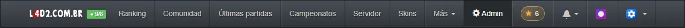

# Qué es la aplicación

🌐 [English](overview.md) | [Português](overview.pt.md) | **Español**

L4D2 PlayStats Hub es un sitio web para una comunidad competitiva de Left 4 Dead 2. Tus servidores de juego envían las estadísticas de cada mapa jugado, y el sitio las convierte en un ranking, un historial de partidas, una página para cada jugador, una vista de la partida en curso y más: campeonatos, los baneos de los servidores de juego, una tienda de skins de armas y un ranking votado por los jugadores. La [guía de los módulos](../modules.es.md) lista todas las funciones.

Lo instalas una sola vez, en una máquina que controlas. Es un solo programa y un solo archivo de base de datos. Varios servidores de juego pueden alimentar el mismo sitio.

[Volver al manual](README.es.md)

## Contenido

- [Lo que ve un visitante](#lo-que-ve-un-visitante)
- [Cómo encajan las partes](#cómo-encajan-las-partes)
- [Palabras usadas en este manual](#palabras-usadas-en-este-manual)
- [Quién puede hacer qué](#quién-puede-hacer-qué)
- [Lo que el sitio no hace](#lo-que-el-sitio-no-hace)

## Lo que ve un visitante

El menú de arriba de cada página lleva a las funciones. Una función que el administrador desactivó no aparece en el menú, y los elementos que no caben en el ancho de la ventana pasan a **Más**.



| Elemento del menú | Qué abre | Página del manual |
|---|---|---|
| Ranking | Los 100 mejores jugadores de la temporada actual. | [Ranking](ranking.es.md) |
| Comunidad | El ranking votado por los jugadores. | [Ranking de la comunidad](community-ranking.es.md) |
| Últimas partidas | Todas las partidas, de la más reciente a la más antigua. | [Partidas](matches.es.md) |
| Campeonatos | Los campeonatos en curso y los terminados. | [Campeonatos](championships.es.md) |
| Servidor | La partida en curso en tus servidores de juego. | [Servidor en vivo](live-server.es.md) |
| Skins | La tienda de skins de armas. | [Tienda de skins de armas](skin-shop.es.md) |
| Anti-Cheat | La página que ofrece el programa Anti-Cheat y le dice a un jugador que inició sesión si debe usarlo. | [Anti-Cheat](anti-cheat.es.md) |
| Más > Jugadores | Todos los jugadores del período, con una vista general o los totales de cualquier estadística, para cualquier temporada, año o todo el tiempo. | [Jugadores](players.es.md) |
| Más > Patentes | Los niveles de patente. | [Patentes](patents.es.md) |
| Más > Baneos | Los jugadores baneados de los servidores de juego ahora. | [Baneos](bans.es.md) |
| Más > Comandos | Todos los comandos de los servidores de juego, con ejemplos. | [Comandos del servidor de juego](commands.es.md) |
| Admin | El área de administración, solo para administradores. | [Administración](administration.es.md) |
| Estrellas | Cuántas estrellas puede gastar en la tienda el jugador que inició sesión. | [Tienda de skins de armas](skin-shop.es.md) |
| Campana | Lo que ocurrió que le concierne al jugador que inició sesión, con las no leídas contadas. | [Notificaciones](notifications.es.md) |
| Torre | El área del capitán, para el capitán o vicecapitán de un campeonato. | [Campeonatos > El área del capitán](championships.es.md#el-área-del-capitán) |
| Avatar | La página del jugador que inició sesión. | [Jugadores](players.es.md) |
| Configuración (engranaje) | Tema, idioma, iniciar y cerrar sesión. | [Idiomas, temas y teléfonos](languages-and-themes.es.md) |

El inicio de sesión se hace con Steam. Los visitantes no necesitan iniciar sesión para ver el ranking, las partidas o el servidor en vivo. Hay que iniciar sesión para comprar skins, votar en el ranking de la comunidad, usar el chat del sitio, pedir participar en un campeonato y liderar un equipo, recibir notificaciones y administrar el sitio.

## Cómo encajan las partes

```text
 game server 1 ─┐
 game server 2 ─┼─ plugins ──>  L4D2 PlayStats Hub  ──>  visitors, in a browser
 game server N ─┘               (site + API + jobs)  ──>  players, inside the game
                                        │
                                   one database
```

1. Un jugador termina un mapa en uno de tus servidores de juego. El plugin `l4d2_playstats` escribe un archivo de estadísticas de ese mapa.
2. Los plugins de PlayStats envían el archivo al sitio, junto con un token que dice de qué servidor de juego vino. Mientras hay una partida en curso también envían el marcador, los jugadores y los eventos, cada pocos segundos.
3. El sitio guarda el archivo tal como llegó y arma las partidas a partir de los archivos: los mapas de la misma campaña jugados uno tras otro forman una partida.
4. Los rankings, las páginas de los jugadores y las estrellas de la tienda de skins se calculan a partir de las partidas.
5. Cuando una regla cambia (por ejemplo, qué modos de juego cuentan), el administrador puede reconstruir todas las partidas a partir de los archivos guardados.

El servidor de juego siempre llama al sitio. El sitio nunca se conecta al servidor de juego, así que el servidor de juego puede estar detrás de un router y no hace falta contraseña de RCON. La instalación de los plugins se describe en [Conectar un servidor de juego](../game-server.es.md).

## Palabras usadas en este manual

| Palabra | Significado |
|---|---|
| Archivo de estadísticas | El archivo que el servidor de juego escribe al final de cada mapa. El sitio guarda cada archivo que recibe. |
| Mapa | Un mapa de una campaña, como `c2m3_coaster`. Cada mapa es un archivo de estadísticas. |
| Partida | Mapas de la misma campaña jugados uno tras otro por los mismos equipos. Consulta [Partidas](matches.es.md#cómo-los-archivos-se-convierten-en-partidas). |
| Partida de ranking | Una partida que cuenta para el ranking. Se muestra como **Competitiva**. Una partida que no cuenta se muestra como **Casual**. Qué partidas cuentan lo deciden los [modos de juego](game-modes-and-campaigns.es.md). |
| Temporada | Un período de una cantidad fija de meses. El ranking vuelve a empezar en cada temporada. Consulta [Temporadas e historia](seasons-and-history.es.md). |
| Experiencia (XP) | Los puntos del ranking: victorias, derrotas, rage quits, MVP y tank wipes. Consulta [Ranking](ranking.es.md#cómo-se-calcula-la-experiencia). |
| Patente | Un nivel del 1 al 15 que da la experiencia. Consulta [Patentes](patents.es.md). |
| MVP de SI | El jugador que hizo más daño a los infectados especiales en una mitad de ronda. |
| MVP de CI | El jugador que mató más infectados comunes en una mitad de ronda. |
| LVP de FF | El jugador que hizo más fuego amigo en una mitad de ronda. No da puntos. |
| Tank wipe | Una mitad de ronda en la que el jugador, como Tank, derribó a todos los supervivientes y seguía vivo al final. Suma experiencia, pero no da estrellas. Consulta [Ranking](ranking.es.md#tank-wipes). |
| Rage quit | Un jugador que estaba en el primer mapa de una partida y no está en el último. |
| Estrella | La moneda de la tienda de skins. Una estrella por cada MVP de SI y cada MVP de CI en partidas de ranking. |
| Servidor de juego | Un servidor de Left 4 Dead 2 registrado en el sitio. Cada uno tiene un identificador y una clave. |
| Token | El identificador y la clave de un servidor de juego, escritos como `identifier:key`. Los plugins lo envían en cada solicitud. |
| Módulo | Una función que el administrador puede activar o desactivar. Consulta [Administración](administration.es.md#módulos). |

## Quién puede hacer qué

| Quién | Puede |
|---|---|
| Cualquier visitante | Ver el ranking, las partidas, los jugadores, las patentes, el servidor en vivo, el ranking de la comunidad, el catálogo de la tienda, los campeonatos, los baneos, la página de comandos y la página del Anti-Cheat. |
| Un jugador que inició sesión | Todo lo anterior, y además: comprar y equipar skins, votar en el ranking de la comunidad (después de suficientes partidas), escribir en el chat del sitio, pedir participar en un campeonato y leer las notificaciones. |
| Un capitán o vicecapitán | Todo lo anterior, y además el área del capitán: el draft, el nombre, el tag y la bandera del equipo, las fechas, los vetos y las campañas. |
| Un administrador | Todo lo anterior, y además: el área de administración, los castigos, editar el marcador de un mapa, cambiar un jugador en una partida, regalar skins, los reembolsos, los campeonatos, los baneos, los baneos del chat, los nombres forzados y los comandos remotos. |

El primer administrador es la cuenta de Steam que termina la [configuración inicial](first-run.es.md). Los demás administradores se agregan en [Administración > Administradores](administration.es.md#administradores).

## Lo que el sitio no hace

- No ejecuta ni configura tu servidor de juego. Los plugins y sus ajustes están del lado del servidor de juego.
- No conserva la partida en vivo después de que el programa se reinicia. La partida en curso se guarda solo en memoria.
- No ejecuta más de una copia de sí mismo. Un solo sitio atiende a todos los servidores de juego.
- No incluye el programa Anti-Cheat. La página del Anti-Cheat solo ofrece un programa publicado por separado.
