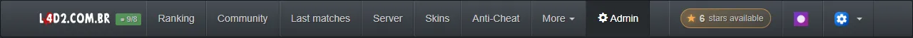

# What the application is

🌐 **English** | [Português](overview.pt.md) | [Español](overview.es.md)

L4D2 PlayStats Hub is a website for a competitive Left 4 Dead 2 community. Your game servers send the statistics of every map played, and the site turns them into a ranking, a history of matches, a page for each player, a view of the match in progress, and a few extras: a weapon skin shop and a ranking voted by the players.

You install it once, on a machine you control. It is one program and one database file. Several game servers can feed the same site.

[Back to the manual](README.md)

## Contents

- [What a visitor sees](#what-a-visitor-sees)
- [How the parts fit together](#how-the-parts-fit-together)
- [Words used in this manual](#words-used-in-this-manual)
- [Who can do what](#who-can-do-what)
- [What the site does not do](#what-the-site-does-not-do)

## What a visitor sees

The menu at the top of every page leads to the features. A feature the administrator turned off is not in the menu.



| Menu item | What it opens | Manual page |
|---|---|---|
| Ranking | The top 100 players of the current season. | [Ranking](ranking.md) |
| Community | The ranking voted by the players. | [Community ranking](community-ranking.md) |
| Last matches | Every match, newest first. | [Matches](matches.md) |
| Server | The match in progress on your game servers. | [Live server](live-server.md) |
| Skins | The weapon skin shop. | [Weapon skin shop](skin-shop.md) |
| Anti-Cheat | The page that offers the Anti-Cheat program and tells a signed-in player whether they must use it. | [Anti-Cheat](anti-cheat.md) |
| More > Players | Every player of the period, with an overview or the totals of any statistic, for any season, year or all time. | [Players](players.md) |
| More > Patents | The patent levels. | [Patents](patents.md) |
| More > Commands | Every command of the game servers, with examples. | [Game server commands](commands.md) |
| Admin | The administration area, for administrators only. | [Administration](administration.md) |
| Stars | How many stars the signed-in player can spend in the shop. | [Weapon skin shop](skin-shop.md) |
| Avatar | The page of the signed-in player. | [Players](players.md) |
| Settings (gear) | Theme, language, sign in and sign out. | [Languages, themes and phones](languages-and-themes.md) |

Signing in is done with Steam. Visitors do not need to sign in to see the ranking, the matches or the live server. Signing in is needed to buy skins, to vote in the community ranking, to use the site chat, and to administer the site.

## How the parts fit together

```text
 game server 1 ─┐
 game server 2 ─┼─ plugins ──>  L4D2 PlayStats Hub  ──>  visitors, in a browser
 game server N ─┘               (site + API + jobs)  ──>  players, inside the game
                                        │
                                   one database
```

1. A player finishes a map on one of your game servers. The `l4d2_playstats` plugin writes a statistics file for that map.
2. The PlayStats plugins send the file to the site, together with a token that says which game server it came from. While a match is in progress they also send the scoreboard, the players and the events, every few seconds.
3. The site stores the file as it arrived and builds the matches from the files: maps of the same campaign played one after the other become one match.
4. The rankings, the player pages and the stars of the skin shop are calculated from the matches.
5. When a rule changes (for example which game modes count), the administrator can rebuild every match from the stored files.

The game server always calls the site. The site never connects to the game server, so the game server can be behind a router, and no RCON password is needed. Installing the plugins is described in [Connecting a game server](../game-server.md).

## Words used in this manual

| Word | Meaning |
|---|---|
| Statistics file | The file the game server writes at the end of each map. The site keeps every file it receives. |
| Map | One map of a campaign, such as `c2m3_coaster`. Each map is one statistics file. |
| Match | Maps of the same campaign played one after the other by the same teams. See [Matches](matches.md#how-files-become-matches). |
| Ranked match | A match that counts for the ranking. It is shown as **Competitive**. A match that does not count is shown as **Casual**. Which matches count is decided by the [game modes](game-modes-and-campaigns.md). |
| Season | A period of a fixed number of months. The ranking starts again at each season. See [Seasons and history](seasons-and-history.md). |
| Experience (XP) | The points of the ranking: wins, losses, rage quits, MVPs and tank wipes. See [Ranking](ranking.md#how-experience-is-calculated). |
| Patent | A level from 1 to 15 given by the experience. See [Patents](patents.md). |
| SI MVP | The player who did the most damage to special infected in a round half. |
| CI MVP | The player who killed the most common infected in a round half. |
| FF LVP | The player who did the most friendly fire in a round half. It gives no points. |
| Tank wipe | A round half in which the player, as Tank, took down all the survivors and was still alive at the end. It adds experience but no stars. See [Ranking](ranking.md#tank-wipes). |
| Rage quit | A player who was in the first map of a match and is not in the last one. |
| Star | The currency of the skin shop. One star for each SI MVP and each CI MVP in ranked matches. |
| Game server | A Left 4 Dead 2 server registered on the site. Each one has an identifier and a key. |
| Token | The identifier and the key of a game server, written as `identifier:key`. The plugins send it with every request. |
| Module | A feature the administrator can turn on or off. See [Administration](administration.md#modules). |

## Who can do what

| Who | Can |
|---|---|
| Any visitor | See the ranking, the matches, the players, the patents, the live server, the community ranking, the shop catalog, the commands page and the Anti-Cheat page. |
| A signed-in player | Everything above, plus: buy and equip skins, vote in the community ranking (after enough matches), and write in the site chat. |
| An administrator | Everything above, plus: the administration area, punishments, editing the score of a map, replacing a player in a match, giving skins as gifts, refunds, chat bans and remote commands. |

The first administrator is the Steam account that finishes the [first-run setup](first-run.md). More administrators are added in [Administration > Administrators](administration.md#administrators).

## What the site does not do

- It does not run or configure your game server. The plugins and their settings are on the game server side.
- It does not keep the live match after the program restarts. The match in progress is kept in memory only.
- It does not run more than one copy of itself. One site serves every game server.
- It does not include the Anti-Cheat program. The Anti-Cheat page only offers a program published separately.
