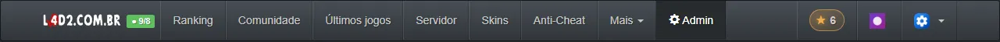

# O que é a aplicação

🌐 [English](overview.md) | **Português** | [Español](overview.es.md)

O L4D2 PlayStats Hub é um site para uma comunidade competitiva de Left 4 Dead 2. Os seus servidores de jogo enviam as estatísticas de cada mapa jogado, e o site transforma isso em um ranking, um histórico de partidas, uma página para cada jogador, uma visão da partida em andamento e mais: campeonatos, os banimentos dos servidores de jogo, uma loja de skins de armas e um ranking votado pelos jogadores. O [guia dos módulos](../modules.pt.md) lista todos os recursos.

Você instala uma vez, em uma máquina que você controla. É um programa e um arquivo de banco de dados. Vários servidores de jogo podem alimentar o mesmo site.

[Voltar ao manual](README.pt.md)

## Conteúdo

- [O que um visitante vê](#o-que-um-visitante-vê)
- [Como as partes se encaixam](#como-as-partes-se-encaixam)
- [Termos usados neste manual](#termos-usados-neste-manual)
- [Quem pode fazer o quê](#quem-pode-fazer-o-quê)
- [O que o site não faz](#o-que-o-site-não-faz)

## O que um visitante vê

O menu no topo de cada página leva aos recursos. Um recurso que o administrador desligou não aparece no menu, e os itens que não cabem na largura da janela vão para **Mais**.



| Item do menu | O que abre | Página do manual |
|---|---|---|
| Ranking | Os 100 melhores jogadores da temporada atual. | [Ranking](ranking.pt.md) |
| Comunidade | O ranking votado pelos jogadores. | [Ranking da comunidade](community-ranking.pt.md) |
| Últimos jogos | Todas as partidas, das mais recentes para as mais antigas. | [Partidas](matches.pt.md) |
| Campeonatos | Os campeonatos em andamento e os encerrados. | [Campeonatos](championships.pt.md) |
| Servidor | A partida em andamento nos seus servidores de jogo. | [Servidor ao vivo](live-server.pt.md) |
| Skins | A loja de skins de armas. | [Loja de skins de armas](skin-shop.pt.md) |
| Anti-Cheat | A página que oferece o programa Anti-Cheat e diz a um jogador logado se ele precisa usá-lo. | [Anti-Cheat](anti-cheat.pt.md) |
| Mais > Jogadores | Todos os jogadores do período, com uma visão geral ou os totais de qualquer estatística, para qualquer temporada, ano ou todo o período. | [Jogadores](players.pt.md) |
| Mais > Patentes | Os níveis de patente. | [Patentes](patents.pt.md) |
| Mais > Banimentos | Os jogadores banidos dos servidores de jogo agora. | [Banimentos](bans.pt.md) |
| Mais > Comandos | Todos os comandos dos servidores de jogo, com exemplos. | [Comandos do servidor de jogo](commands.pt.md) |
| Admin | A área de administração, só para administradores. | [Administração](administration.pt.md) |
| Estrelas | Quantas estrelas o jogador logado pode gastar na loja. | [Loja de skins de armas](skin-shop.pt.md) |
| Sino | O que aconteceu que diz respeito ao jogador logado, com as não lidas contadas. | [Notificações](notifications.pt.md) |
| Torre | A área do capitão, para o capitão ou vice-capitão de um campeonato. | [Campeonatos > A área do capitão](championships.pt.md#a-área-do-capitão) |
| Avatar | A página do jogador logado. | [Jogadores](players.pt.md) |
| Configurações (engrenagem) | Tema, idioma, login e logout. | [Idiomas, temas e celulares](languages-and-themes.pt.md) |

O login é feito com a Steam. Os visitantes não precisam fazer login para ver o ranking, as partidas ou o servidor ao vivo. O login é necessário para comprar skins, votar no ranking da comunidade, usar o chat do site, pedir para participar de um campeonato e liderar uma equipe, receber notificações e administrar o site.

## Como as partes se encaixam

```text
 game server 1 ─┐
 game server 2 ─┼─ plugins ──>  L4D2 PlayStats Hub  ──>  visitors, in a browser
 game server N ─┘               (site + API + jobs)  ──>  players, inside the game
                                        │
                                   one database
```

1. Um jogador termina um mapa em um dos seus servidores de jogo. O plugin `l4d2_playstats` grava um arquivo de estatísticas desse mapa.
2. Os plugins do PlayStats enviam o arquivo para o site, junto com um token que diz de qual servidor de jogo ele veio. Enquanto uma partida está em andamento, eles também enviam o placar, os jogadores e os eventos, a cada poucos segundos.
3. O site guarda o arquivo como ele chegou e monta as partidas a partir dos arquivos: mapas da mesma campanha jogados um depois do outro viram uma partida.
4. Os rankings, as páginas dos jogadores e as estrelas da loja de skins são calculados a partir das partidas.
5. Quando uma regra muda (por exemplo, quais modos de jogo contam), o administrador pode reconstruir todas as partidas a partir dos arquivos guardados.

É sempre o servidor de jogo que chama o site. O site nunca se conecta ao servidor de jogo, então o servidor de jogo pode ficar atrás de um roteador, e nenhuma senha de RCON é necessária. A instalação dos plugins está descrita em [Conectando um servidor de jogo](../game-server.pt.md).

## Termos usados neste manual

| Termo | Significado |
|---|---|
| Arquivo de estatísticas | O arquivo que o servidor de jogo grava no fim de cada mapa. O site guarda todos os arquivos que recebe. |
| Mapa | Um mapa de uma campanha, como `c2m3_coaster`. Cada mapa é um arquivo de estatísticas. |
| Partida | Mapas da mesma campanha jogados um depois do outro pelas mesmas equipes. Veja [Partidas](matches.pt.md#como-os-arquivos-viram-partidas). |
| Partida ranqueada | Uma partida que conta para o ranking. Ela aparece como **Competitiva**. Uma partida que não conta aparece como **Casual**. Quais partidas contam é decidido pelos [modos de jogo](game-modes-and-campaigns.pt.md). |
| Temporada | Um período com um número fixo de meses. O ranking recomeça a cada temporada. Veja [Temporadas e histórico](seasons-and-history.pt.md). |
| Experiência (XP) | Os pontos do ranking: vitórias, derrotas, rage quits, MVPs e tank wipes. Veja [Ranking](ranking.pt.md#como-a-experiência-é-calculada). |
| Patente | Um nível de 1 a 15 dado pela experiência. Veja [Patentes](patents.pt.md). |
| MVP de SI | O jogador que causou mais dano em infectados especiais em uma metade de rodada. |
| MVP de CI | O jogador que matou mais infectados comuns em uma metade de rodada. |
| LVP de FF | O jogador que causou mais fogo amigo em uma metade de rodada. Não dá pontos. |
| Tank wipe | Uma metade de rodada em que o jogador, como Tank, derrubou todos os sobreviventes e ainda estava vivo no fim. Soma experiência, mas não dá estrelas. Veja [Ranking](ranking.pt.md#tank-wipes). |
| Rage quit | Um jogador que estava no primeiro mapa de uma partida e não está no último. |
| Estrela | A moeda da loja de skins. Uma estrela para cada MVP de SI e cada MVP de CI em partidas ranqueadas. |
| Servidor de jogo | Um servidor de Left 4 Dead 2 cadastrado no site. Cada um tem um identificador e uma chave. |
| Token | O identificador e a chave de um servidor de jogo, escritos como `identifier:key`. Os plugins enviam o token em cada requisição. |
| Módulo | Um recurso que o administrador pode ligar ou desligar. Veja [Administração](administration.pt.md#módulos). |

## Quem pode fazer o quê

| Quem | Pode |
|---|---|
| Qualquer visitante | Ver o ranking, as partidas, os jogadores, as patentes, o servidor ao vivo, o ranking da comunidade, o catálogo da loja, os campeonatos, os banimentos, a página de comandos e a página do Anti-Cheat. |
| Um jogador logado | Tudo o que está acima, e também: comprar e equipar skins, votar no ranking da comunidade (depois de partidas suficientes), escrever no chat do site, pedir para participar de um campeonato e ler as notificações. |
| Um capitão ou vice-capitão | Tudo o que está acima, e também a área do capitão: o draft, o nome, a tag e a bandeira da equipe, as datas, os vetos e as campanhas. |
| Um administrador | Tudo o que está acima, e também: a área de administração, punições, edição do placar de um mapa, troca de jogador em uma partida, skins de presente, reembolsos, campeonatos, banimentos, banimentos do chat, nomes forçados e comandos remotos. |

O primeiro administrador é a conta Steam que conclui a [configuração inicial](first-run.pt.md). Outros administradores são adicionados em [Administração > Administradores](administration.pt.md#administradores).

## O que o site não faz

- Ele não executa nem configura o seu servidor de jogo. Os plugins e suas configurações ficam do lado do servidor de jogo.
- Ele não guarda a partida ao vivo depois que o programa reinicia. A partida em andamento fica só na memória.
- Ele não roda mais de uma cópia de si mesmo. Um site atende todos os servidores de jogo.
- Ele não inclui o programa Anti-Cheat. A página do Anti-Cheat só oferece um programa publicado separadamente.
