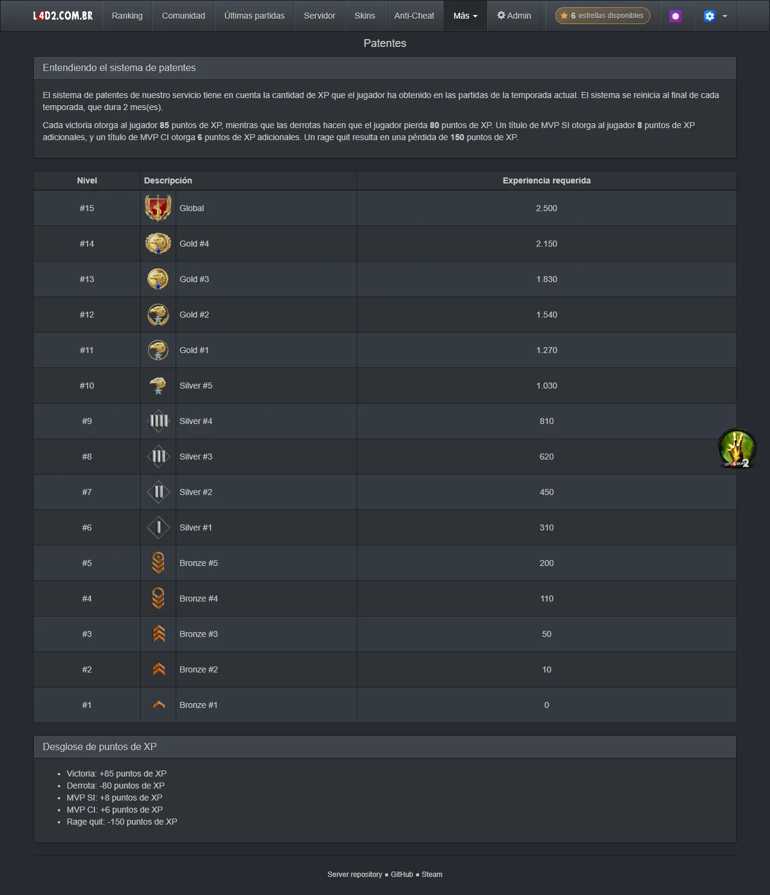

# Patentes

🌐 [English](patents.md) | [Português](patents.pt.md) | **Español**

Una patente es un nivel del 1 al 15 que da la experiencia que un jugador tiene en la temporada actual. Se muestra junto al nombre en el ranking, en la página del jugador y dentro del juego.

[Volver al manual](README.es.md)

## Contenido

- [La página de patentes](#la-página-de-patentes)
- [Los niveles](#los-niveles)
- [Subir y bajar de nivel](#subir-y-bajar-de-nivel)
- [Patentes dentro del juego](#patentes-dentro-del-juego)

## La página de patentes

**Más > Patentes** lista cada nivel con su ícono y la experiencia que necesita, seguido de cómo se gana experiencia.

## Los niveles

| Nivel | Patente | Experiencia necesaria |
|---|---|---|
| 1 | Bronze #1 | 0 |
| 2 | Bronze #2 | 10 |
| 3 | Bronze #3 | 50 |
| 4 | Bronze #4 | 110 |
| 5 | Bronze #5 | 200 |
| 6 | Silver #1 | 310 |
| 7 | Silver #2 | 450 |
| 8 | Silver #3 | 620 |
| 9 | Silver #4 | 810 |
| 10 | Silver #5 | 1.030 |
| 11 | Gold #1 | 1.270 |
| 12 | Gold #2 | 1.540 |
| 13 | Gold #3 | 1.830 |
| 14 | Gold #4 | 2.150 |
| 15 | Global | 2.500 |

Los escalones crecen a medida que sube el nivel: la experiencia necesaria es 2.500 × ((nivel − 1) ÷ 14)², redondeada hacia abajo a un múltiplo de 10. Los 15 niveles y sus nombres son fijos, pero la experiencia del nivel más alto, 2.500 de forma predeterminada, se puede cambiar en **Administración > Patentes**, junto con la curva entre los niveles, el exponente de la fórmula (2 de forma predeterminada, de 1 a 3: con 1 todos los escalones cuestan lo mismo, con valores mayores los primeros niveles son más fáciles y los últimos más difíciles). Toda la escala los acompaña, la página muestra una vista previa de cada nivel mientras escribes, y todas las páginas del sitio usan los nuevos valores al instante. También se puede cambiar es cuánta experiencia da cada resultado; consulta [Ranking](ranking.es.md#cómo-se-calcula-la-experiencia).

Las patentes pertenecen a una temporada. Vuelven a empezar desde el nivel 1 con la temporada y no se muestran en los rankings de un año ni de todo el tiempo.

## Subir y bajar de nivel

Cuando la partida de ranking más reciente lleva a un jugador a otra patente, el ranking muestra **¡Subir de nivel!** o **¡Bajar de nivel!** junto al nombre, y la barra de XP muestra el cambio en verde o en rojo. La etiqueta se mantiene hasta que se juegue la siguiente partida de ranking.

## Patentes dentro del juego

Con el plugin `l4d2_show_patent_icon`, el servidor de juego le pide al sitio las patentes de los jugadores y muestra el ícono de cada jugador sobre su cabeza antes de que empiece una partida. Los sprites de las patentes vienen en el paquete de los plugins, en `materials/sprites`; deben estar en la carpeta `left4dead2` del servidor de juego y en el FastDL. Los íconos se activan y desactivan solo en el servidor de juego: están desactivados hasta que `patent_icon_enabled` sea `1` en sus archivos de configuración. [La guía de los plugins](../../plugins/README.es.md) lista sus ajustes.
