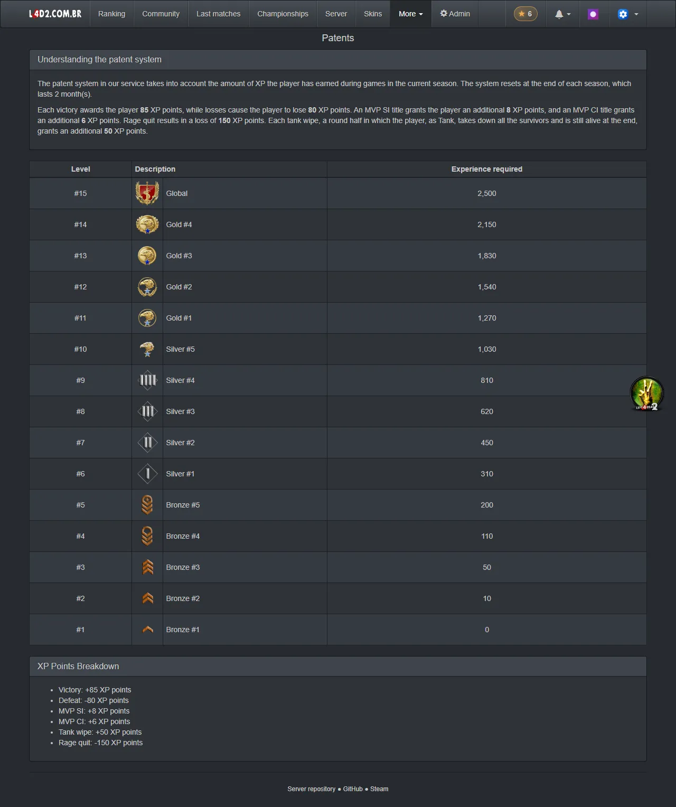

# Patents

🌐 **English** | [Português](patents.pt.md) | [Español](patents.es.md)

A patent is a level from 1 to 15 given by the experience a player has in the current season. It is shown next to the name in the ranking, on the player page and inside the game.

[Back to the manual](README.md)

## Contents

- [The patents page](#the-patents-page)
- [The levels](#the-levels)
- [Level up and level drop](#level-up-and-level-drop)
- [Patents inside the game](#patents-inside-the-game)

## The patents page

**More > Patents** lists every level with its icon and the experience it needs, followed by how experience is earned.

## The levels

| Level | Patent | Experience needed |
|---|---|---|
| 1 | Bronze #1 | 0 |
| 2 | Bronze #2 | 10 |
| 3 | Bronze #3 | 50 |
| 4 | Bronze #4 | 110 |
| 5 | Bronze #5 | 200 |
| 6 | Silver #1 | 310 |
| 7 | Silver #2 | 450 |
| 8 | Silver #3 | 620 |
| 9 | Silver #4 | 810 |
| 10 | Silver #5 | 1,030 |
| 11 | Gold #1 | 1,270 |
| 12 | Gold #2 | 1,540 |
| 13 | Gold #3 | 1,830 |
| 14 | Gold #4 | 2,150 |
| 15 | Global | 2,500 |

The steps grow as the level rises: the experience needed is 2,500 × ((level − 1) ÷ 14)², rounded down to a multiple of 10. The 15 levels and their names are fixed, but the experience of the highest level, 2,500 by default, can be changed in **Administration > Patents**, together with the curve between the levels, the exponent of the formula (2 by default, from 1 to 3: with 1 every step costs the same, with higher values the first levels are easier and the last ones harder). The whole scale follows them, the page shows a preview of every level as you type, and every page of the site uses the new values right away. Also what can be changed is how much experience each result gives; see [Ranking](ranking.md#how-experience-is-calculated).

Patents belong to a season. They start again from level 1 with the season, and they are not shown in the rankings of a year or of all time.

## Level up and level drop

When the most recent ranked match moves a player to another patent, the ranking shows **Level Up!** or **Level Drop!** next to the name, and the XP bar shows the change in green or red. The label stays until the next ranked match is played.

## Patents inside the game

With the `l4d2_show_patent_icon` plugin, the game server asks the site for the patents of the players and shows each player's icon above the head before a match starts. The patent sprites come with the plugins package, in `materials/sprites`; they must be in the `left4dead2` folder of the game server and on the FastDL. The icons are turned on and off only on the game server: they are off until `patent_icon_enabled` is `1` in its configuration files. [The plugins guide](../../plugins/README.md) lists its settings.
