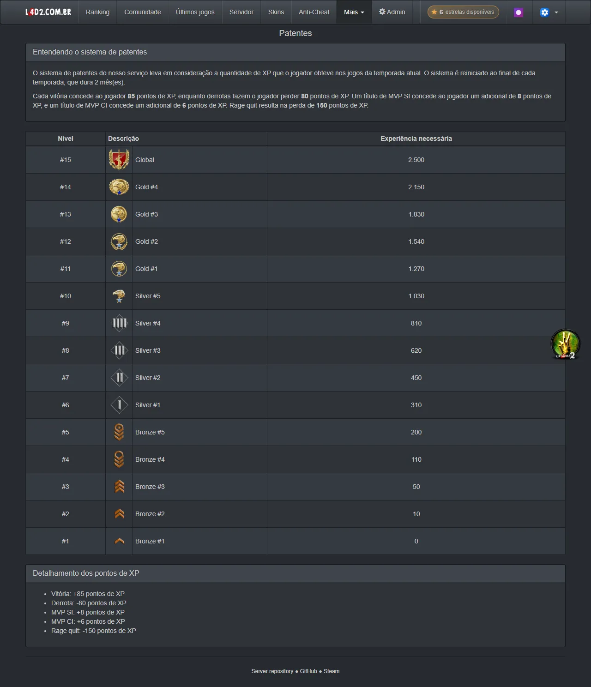

# Patentes

🌐 [English](patents.md) | **Português** | [Español](patents.es.md)

Uma patente é um nível de 1 a 15 dado pela experiência que um jogador tem na temporada atual. Ela aparece ao lado do nome no ranking, na página do jogador e dentro do jogo.

[Voltar ao manual](README.pt.md)

## Conteúdo

- [A página de patentes](#a-página-de-patentes)
- [Os níveis](#os-níveis)
- [Subida e queda de nível](#subida-e-queda-de-nível)
- [Patentes dentro do jogo](#patentes-dentro-do-jogo)

## A página de patentes

**Mais > Patentes** lista cada nível com o seu ícone e a experiência que ele exige, seguido de como a experiência é ganha.

## Os níveis

| Nível | Patente | Experiência necessária |
|---|---|---|
| 1 | Bronze #1 | 0 |
| 2 | Bronze #2 | 10 |
| 3 | Bronze #3 | 50 |
| 4 | Bronze #4 | 110 |
| 5 | Bronze #5 | 200 |
| 6 | Silver #1 | 310 |
| 7 | Silver #2 | 450 |
| 8 | Silver #3 | 620 |
| 9 | Silver #4 | 810 |
| 10 | Silver #5 | 1.030 |
| 11 | Gold #1 | 1.270 |
| 12 | Gold #2 | 1.540 |
| 13 | Gold #3 | 1.830 |
| 14 | Gold #4 | 2.150 |
| 15 | Global | 2.500 |

Os degraus crescem conforme o nível sobe: a experiência necessária é 2.500 × ((nível − 1) ÷ 14)², arredondada para baixo até um múltiplo de 10. Os níveis são fixos e não podem ser alterados nas configurações. O que pode ser alterado é quanta experiência cada resultado dá; veja [Ranking](ranking.pt.md#como-a-experiência-é-calculada).

As patentes pertencem a uma temporada. Elas recomeçam do nível 1 com a temporada e não aparecem nos rankings de um ano ou de todo o período.

## Subida e queda de nível

Quando a partida ranqueada mais recente leva um jogador para outra patente, o ranking mostra **Subiu de Nível!** ou **Caiu de Nível!** ao lado do nome, e a barra de XP mostra a mudança em verde ou vermelho. O aviso fica até a próxima partida ranqueada ser jogada.

## Patentes dentro do jogo

Com o plugin `l4d2_show_patent_icon`, o servidor de jogo pede ao site as patentes dos jogadores e mostra o ícone de cada jogador acima da cabeça antes de uma partida começar. O plugin precisa dos sprites das patentes no servidor de jogo. [O guia dos plugins](../../plugins/README.pt.md) lista as configurações dele.
