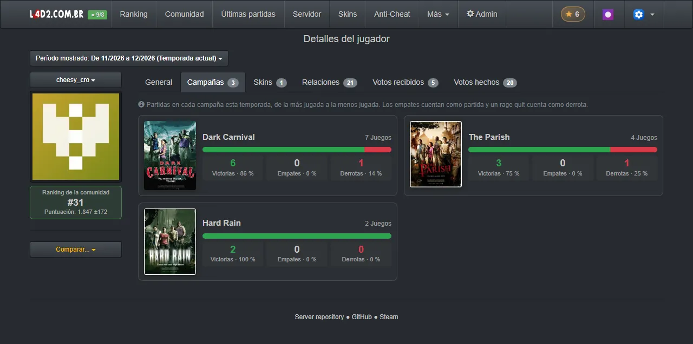
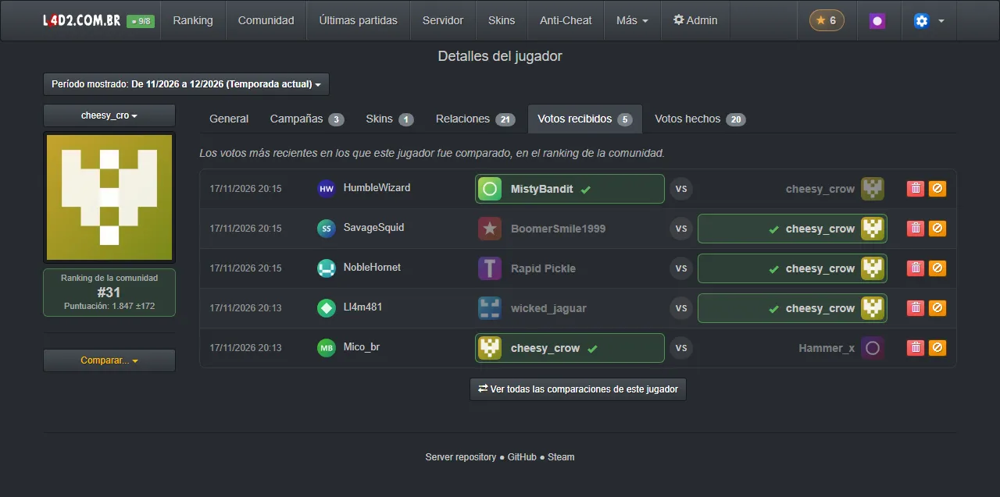

# Jugadores

🌐 [English](players.md) | [Português](players.pt.md) | **Español**

Cada jugador que jugó en tus servidores de juego tiene una página con sus resultados, sus estadísticas como superviviente y como infectado, sus partidas, las campañas que juega, sus skins, y con quién juega y contra quién.

[Volver al manual](README.es.md)

## Contenido

- [La lista de jugadores](#la-lista-de-jugadores)
- [La página del jugador](#la-página-del-jugador)
- [El nombre del jugador](#el-nombre-del-jugador)
- [Un jugador sin estadísticas](#un-jugador-sin-estadísticas)
- [Pestaña General](#pestaña-general)
- [Datos de Steam](#datos-de-steam)
- [Pestaña Campañas](#pestaña-campañas)
- [Pestaña Skins](#pestaña-skins)
- [Pestaña Relaciones](#pestaña-relaciones)
- [Pestañas de votos de la comunidad](#pestañas-de-votos-de-la-comunidad)
- [Comparar dos jugadores](#comparar-dos-jugadores)
- [Cuentas relacionadas](#cuentas-relacionadas)
- [Castigos](#castigos)

## La lista de jugadores

**Más > Jugadores** lista todos los jugadores del período elegido. Reemplaza la antigua página Historial: las temporadas pasadas, los años y todo el tiempo están todos aquí.

- **Estadística** elige lo que muestra la tabla. **Vista general**, la predeterminada, muestra para cada jugador las victorias, derrotas, juegos, premios de MVP de SI y de CI, porcentaje de victorias y rage quits, en el orden del ranking del período, con una medalla para los tres primeros. Haz clic en el encabezado de una columna para ordenar por ella; haz clic de nuevo para invertir el orden, y haz clic en **#** para volver al orden del ranking.
- Cualquier otra elección muestra una estadística: experiencia, juegos, victorias, derrotas, porcentaje de victorias, rage quits, premios de MVP, muertes, daño, skeets, levels, crowns, fuego amigo y los números como infectado. Su columna muestra el total de cada jugador, y **Por juego** muestra el promedio por juego. Pasa el mouse sobre el ícono ⓘ para ver la cantidad de juegos. Haz clic en el encabezado de la columna para invertir el orden.
- El [selector de período](seasons-and-history.es.md#el-selector-de-período) elige una temporada, un año o todo el tiempo. En esta página lista todas las temporadas de todos los años, así que el ranking final de cualquier temporada pasada queda a un clic.

La lista tiene los mismos jugadores que el ranking del período, todos y no solo el top 100. Muestra 100 jugadores por página, y los enlaces de las páginas debajo de la tabla mantienen la estadística, el orden y el período elegidos.

## La página del jugador

Haz clic en un jugador en cualquier parte del sitio para abrir su página: el ranking, las partidas, el servidor en vivo, el ranking de la comunidad y las páginas de administración llevan todos a ella, nunca directo a Steam. Tiene un selector de período, un botón **Comparar...** y hasta seis pestañas.

Cuando el módulo del ranking de la comunidad está activado, un cuadro debajo del avatar muestra la posición del jugador en el [ranking de la comunidad](community-ranking.es.md) y la puntuación, o **Todavía fuera del ranking de la comunidad** con el número de comparaciones. No cambia con el período, porque el ranking de la comunidad no se reinicia con la temporada. Cuando se comparan dos jugadores, cada uno tiene su cuadro.

## El nombre del jugador

El sitio muestra un nombre para cada jugador, el mismo en todas las páginas: los rankings, la página del jugador, las partidas y sus estadísticas, el servidor en vivo y su chat, el ranking de la comunidad, las páginas del juego, las búsquedas, las APIs y la administración. Se elige en este orden:

1. El [nombre forzado](moderation.es.md#nombres-forzados), cuando un administrador definió uno.
2. El nombre que el jugador más usó en todas las partidas del sitio, de todas las temporadas.
3. El nombre del perfil de Steam, cuando el sitio tiene una [clave de la Steam Web API](administration.es.md#sitio).
4. El último nombre visto en un servidor de juego.
5. El SteamID64, cuando no se conoce nada más.

El nombre se actualiza cuando se sube una partida, cuando cambia un nombre forzado y cuando cambian los datos de Steam. Los otros nombres que el jugador usó en las partidas siguen en **Nombres anteriores**, y la búsqueda de jugadores también encuentra al jugador por ellos.

## Un jugador sin estadísticas

Un jugador que no tiene estadísticas en el período elegido, o que nunca jugó una partida rankeada, también tiene una página. Muestra:

- **Jugador fuera del ranking**, con el selector de período, para elegir otra temporada o todo el período. Con el módulo de ranking desactivado dice **Aún sin estadísticas**.
- El avatar y un botón **Abrir perfil de Steam**.
- El [nombre del jugador](#el-nombre-del-jugador).
- Los [datos de Steam](#datos-de-steam).
- El SteamID64 (Community ID), el Steam ID en las formas `STEAM_0` y `STEAM_1` y el Steam3 ID (`[U:1:n]`), cada uno con botón de copiar, y la dirección del perfil.
- El último inicio de sesión y la cantidad de conexiones, y las [cuentas relacionadas](#cuentas-relacionadas), cuando el módulo del servidor en vivo está activado.
- El cuadro del ranking de la comunidad y las [pestañas de votos de la comunidad](#pestañas-de-votos-de-la-comunidad), cuando el jugador ya participó en la votación.

Una dirección que no es un SteamID64 válido, como `/player/0` o `/player/abc`, responde como no encontrada.

## Pestaña General

**Estadísticas generales**:

| Elemento | Significado |
|---|---|
| Ranking | Posición en el ranking del período. |
| Steam ID, URL del perfil | La cuenta, con botones para copiar y un enlace al perfil de Steam. |
| Nombre, Nombres anteriores | El [nombre del jugador](#el-nombre-del-jugador) y los otros nombres usados en las partidas. |
| Horas en Left 4 Dead 2, Nivel de Steam, Cuenta de Steam creada el, Baneos VAC, Baneos de juego | Los [datos de Steam](#datos-de-steam) de la cuenta. |
| Patente, XP | La patente y la experiencia en la temporada. Consulta [Patentes](patents.es.md). |
| Juegos, Victorias, Derrotas, Porcentaje de victorias, Rage quit | Como en el [ranking](ranking.es.md#la-página-del-ranking). |
| Castigo | Experiencia quitada por un administrador en esta temporada. |
| Racha de victorias más larga, Racha de derrotas más larga | La mayor cantidad de partidas ganadas o perdidas seguidas. |
| Historial de partidas | Una franja con el resultado de cada partida, de la más antigua a la más reciente. |

**Estadísticas como superviviente** y **Estadísticas como infectado** suman los números de todas las partidas de ranking del período: premios de MVP, eliminaciones, daño, muertes, skeets, levels, crowns, etc. Los íconos ⓘ explican los menos obvios.

**Últimas partidas** lista las partidas del jugador en el período con las mismas tarjetas que la [lista de partidas](matches.es.md#la-lista-de-partidas). Cuando has iniciado sesión, tu propia fila aparece resaltada.

## Datos de Steam

Cuando el sitio tiene una [clave de la Steam Web API](administration.es.md#sitio), lee en segundo plano datos públicos de la cuenta de Steam de cada jugador y los muestra en la pestaña **General**, a todos los visitantes:

| Elemento | Significado |
|---|---|
| Horas en Left 4 Dead 2 | El total de horas jugadas en Left 4 Dead 2 y, entre paréntesis, las horas de las últimas 2 semanas. |
| Nivel de Steam | El nivel de la cuenta de Steam. |
| Cuenta de Steam creada el | El día en que se creó la cuenta, en la zona horaria del sitio, y su antigüedad. |
| Baneos VAC, Baneos de juego | Cuántos baneos VAC y de juego tiene la cuenta, y hace cuántos días fue el último. |

Un valor que el jugador mantiene privado en Steam, como los detalles de juegos o la fecha de creación de la cuenta, muestra **No disponible**. Los baneos son públicos en Steam incluso para perfiles privados. Sin una clave no se lee nada y todos los elementos muestran **No disponible**.

Cada 10 minutos el sitio lee hasta 100 jugadores: primero los que nunca se leyeron, después los vistos más recientemente. Un jugador que jugó en los últimos 30 días se lee de nuevo después de 24 horas, los demás después de 7 días, lo que queda muy por debajo del límite diario de la Steam Web API. Una llamada a Steam que falla se intenta de nuevo más tarde.

## Pestaña Campañas

Los juegos jugados en cada campaña en el período, de la más jugada a la menos, con victorias, empates, derrotas y rage quits. Aquí los empates cuentan como juegos, y un rage quit cuenta como derrota.

## Pestaña Skins

Las skins de armas que tiene el jugador, las equipadas y un enlace a la [tienda de skins](skin-shop.es.md). Se muestra solo cuando el módulo de la tienda de skins está activado.

## Pestaña Relaciones

Dos tablas armadas a partir de las partidas de ranking del período:

- **Jugando juntos**: para cada compañero de equipo, las partidas ganadas y perdidas en el mismo equipo, y los porcentajes.
- **Jugando en contra**: para cada rival, las partidas ganadas y perdidas contra él, y los porcentajes.

**No entiendo, explícamelo** abre una breve explicación de una fila. Se muestran los primeros 12 jugadores; **Ver más jugadores** muestra el resto.

## Pestañas de votos de la comunidad

Aparecen cuando el módulo del ranking de la comunidad está activado, y solo para un jugador, no en una comparación:

- **Votos recibidos**: los 20 votos más recientes en los que el jugador fue comparado, con las mismas filas de [Últimos votos](community-ranking.es.md), con el jugador elegido en verde.
- **Votos hechos**: los 20 votos más recientes que hizo el jugador. Se oculta cuando un administrador oculta quién votó; entonces **Votos recibidos** muestra "Un jugador votó" en lugar de los nombres.

**Ver todas las comparaciones de este jugador** y **Ver todos los votos hechos por este jugador** abren **Últimos votos** filtrado por el jugador.

## Comparar dos jugadores

**Comparar...** elige un segundo jugador. La página muestra entonces los dos jugadores lado a lado: las estadísticas generales con los datos de Steam, las de superviviente y de infectado, y las partidas que jugaron, con los números del segundo jugador junto a los del primero.

**Quitar comparación** vuelve a un solo jugador.

## Cuentas relacionadas

Cuando el módulo de servidor en vivo está activado, los servidores de juego informan la dirección desde la que se conecta cada jugador. Si otras cuentas se conectaron desde la misma dirección, la página del jugador muestra un panel **Cuentas relacionadas** con esas cuentas, su último inicio de sesión y cuántas conexiones tienen. La dirección en sí nunca se muestra.

De forma predeterminada todos los visitantes ven el panel, como en el sitio antiguo. Un administrador puede limitarlo a los administradores en [Configuración > Privacidad](administration.es.md#privacidad). Ese ajuste no cambia el juego: el plugin `l4d2_gameinfo_sync` anuncia las cuentas relacionadas en el chat del juego cuando un jugador se conecta, salvo que `gameinfo_related_accounts_chat` esté en `0`.

Los administradores tienen una búsqueda sobre los mismos datos en [Moderación > Conexiones de jugadores](moderation.es.md#conexiones-de-jugadores). Las conexiones de más de tres meses se borran.

## Castigos

Un administrador ve un enlace **Editar** junto a **Castigo** cuando hay una temporada seleccionada. Pide cuántos puntos de experiencia debe perder el jugador, con 150 como sugerencia.

- Un número mayor que cero agrega a la temporada un castigo de esa cantidad de puntos.
- `0` quita todos los castigos del jugador en esa temporada.

Consulta [Ranking > Castigos](ranking.es.md#castigos) para ver cómo cuentan.
