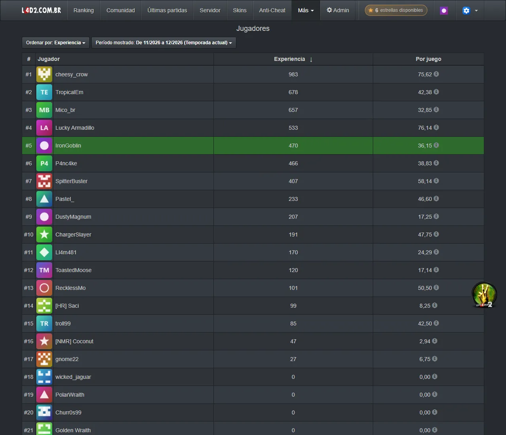
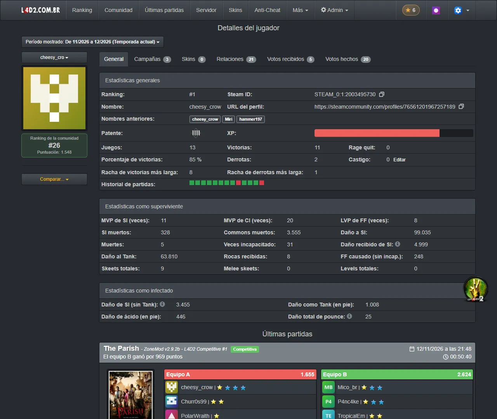
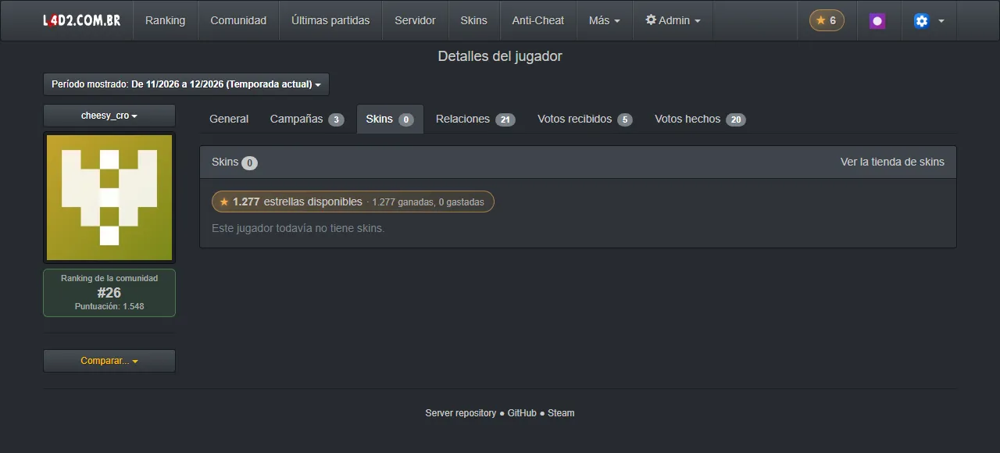
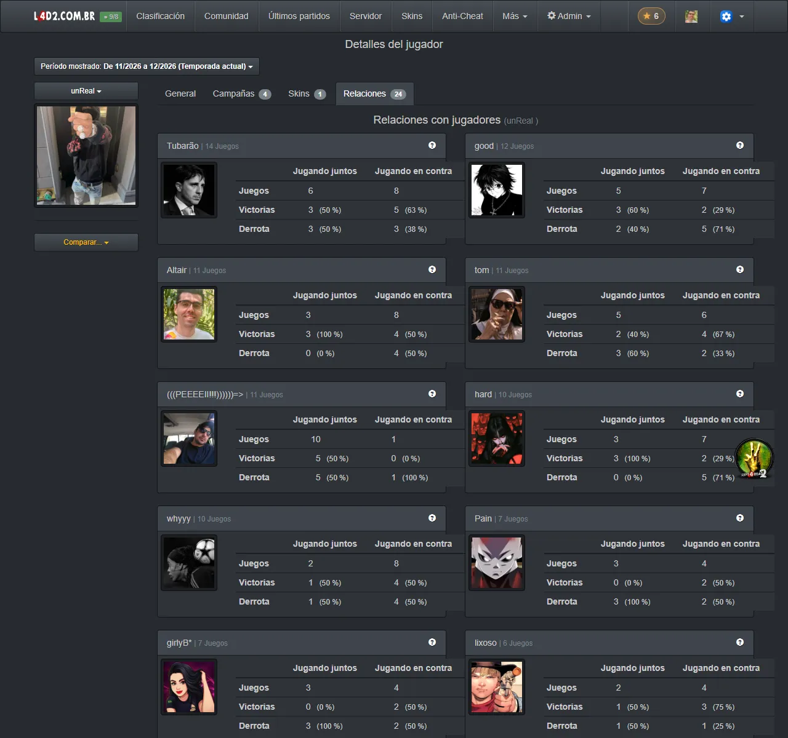
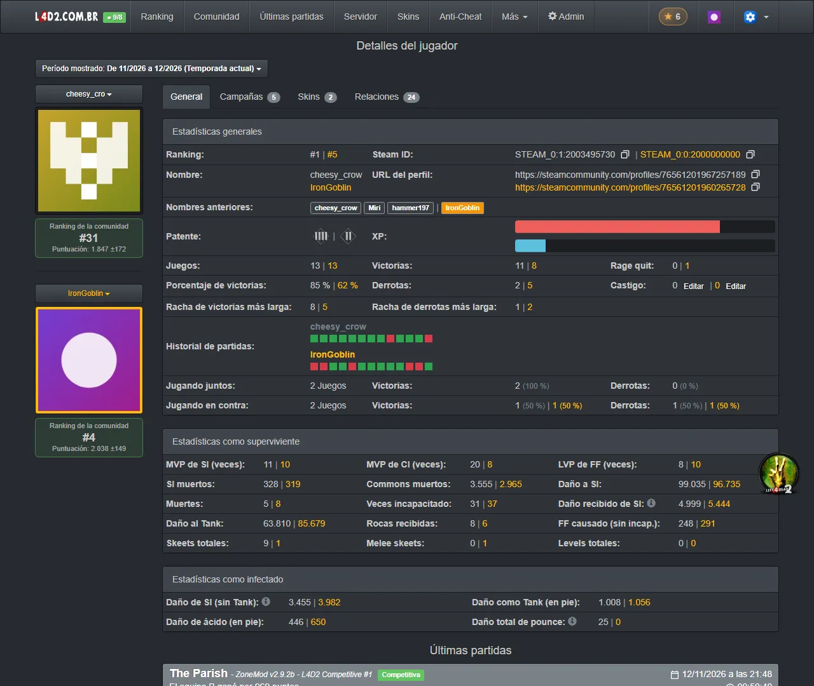

# Jugadores

🌐 [English](players.md) | [Português](players.pt.md) | **Español**

Cada jugador que jugó en tus servidores de juego tiene una página con sus resultados, sus estadísticas como superviviente y como infectado, sus partidas, las campañas que juega, sus skins, y con quién juega y contra quién.

[Volver al manual](README.es.md)

## Contenido

- [La lista de jugadores](#la-lista-de-jugadores)
- [La página del jugador](#la-página-del-jugador)
- [Un jugador sin estadísticas](#un-jugador-sin-estadísticas)
- [Pestaña General](#pestaña-general)
- [Pestaña Campañas](#pestaña-campañas)
- [Pestaña Skins](#pestaña-skins)
- [Pestaña Relaciones](#pestaña-relaciones)
- [Comparar dos jugadores](#comparar-dos-jugadores)
- [Cuentas relacionadas](#cuentas-relacionadas)
- [Castigos](#castigos)

## La lista de jugadores

**Más > Jugadores** lista todos los jugadores del período elegido, ordenados por una estadística.

- **Ordenar por** elige la estadística: experiencia, juegos, victorias, derrotas, rage quits, premios de MVP, muertes, daño, skeets, levels, crowns, fuego amigo y los números como infectado.
- La columna de la estadística elegida muestra el total de cada jugador, y **Por juego** muestra el promedio por juego. Pasa el mouse sobre el ícono ⓘ para ver la cantidad de juegos. Haz clic en el encabezado de la columna para invertir el orden.
- El [selector de período](seasons-and-history.es.md#el-selector-de-período) elige una temporada, un año o todo el tiempo.

La lista tiene los mismos jugadores que el ranking del período, todos y no solo el top 100.

## La página del jugador

Haz clic en un jugador en cualquier parte del sitio para abrir su página: el ranking, las partidas, el servidor en vivo, el ranking de la comunidad y las páginas de administración llevan todos a ella, nunca directo a Steam. Tiene un selector de período, un botón **Comparar...** y hasta cuatro pestañas.

## Un jugador sin estadísticas

Un jugador que no tiene estadísticas en el período elegido, o que nunca jugó una partida rankeada, también tiene una página. Muestra:

- **Jugador fuera del ranking**, con el selector de período, para elegir otra temporada o todo el período. Con el módulo de ranking desactivado dice **Aún sin estadísticas**.
- El avatar y un botón **Abrir perfil de Steam**.
- El mejor nombre que el sitio conoce: el último nombre visto en un servidor de juego, o el nombre del perfil de Steam.
- El SteamID64 (Community ID), el Steam ID en las formas `STEAM_0` y `STEAM_1` y el Steam3 ID (`[U:1:n]`), cada uno con botón de copiar, y la dirección del perfil.
- El último inicio de sesión y la cantidad de conexiones, y las [cuentas relacionadas](#cuentas-relacionadas), cuando el módulo del servidor en vivo está activado.

Una dirección que no es un SteamID64 válido, como `/player/0` o `/player/abc`, responde como no encontrada.

## Pestaña General

**Estadísticas generales**:

| Elemento | Significado |
|---|---|
| Ranking | Posición en el ranking del período. |
| Steam ID, URL del perfil | La cuenta, con botones para copiar y un enlace al perfil de Steam. |
| Nombre, Nombres anteriores | El nombre usado con más frecuencia y los otros nombres usados. |
| Patente, XP | La patente y la experiencia en la temporada. Consulta [Patentes](patents.es.md). |
| Juegos, Victorias, Derrotas, Porcentaje de victorias, Rage quit | Como en el [ranking](ranking.es.md#la-página-del-ranking). |
| Castigo | Experiencia quitada por un administrador en esta temporada. |
| Racha de victorias más larga, Racha de derrotas más larga | La mayor cantidad de partidas ganadas o perdidas seguidas. |
| Historial de partidas | Una franja con el resultado de cada partida, de la más antigua a la más reciente. |

**Estadísticas como superviviente** y **Estadísticas como infectado** suman los números de todas las partidas de ranking del período: premios de MVP, eliminaciones, daño, muertes, skeets, levels, crowns, etc. Los íconos ⓘ explican los menos obvios.

**Últimas partidas** lista las partidas del jugador en el período con las mismas tarjetas que la [lista de partidas](matches.es.md#la-lista-de-partidas). Cuando has iniciado sesión, tu propia fila aparece resaltada.

## Pestaña Campañas

Los juegos jugados en cada campaña en el período, de la más jugada a la menos, con victorias, empates, derrotas y rage quits. Aquí los empates cuentan como juegos, y un rage quit cuenta como derrota.

## Pestaña Skins

Las skins de armas que tiene el jugador, las equipadas y un enlace a la [tienda de skins](skin-shop.es.md). Se muestra solo cuando el módulo de la tienda de skins está activado.

## Pestaña Relaciones

Dos tablas armadas a partir de las partidas de ranking del período:

- **Jugando juntos**: para cada compañero de equipo, las partidas ganadas y perdidas en el mismo equipo, y los porcentajes.
- **Jugando en contra**: para cada rival, las partidas ganadas y perdidas contra él, y los porcentajes.

**No entiendo, explícamelo** abre una breve explicación de una fila. Se muestran los primeros 12 jugadores; **Ver más jugadores** muestra el resto.

## Comparar dos jugadores

**Comparar...** elige un segundo jugador. La página muestra entonces los dos jugadores lado a lado: las estadísticas generales, las de superviviente y de infectado, y las partidas que jugaron, con los números del segundo jugador junto a los del primero.

**Quitar comparación** vuelve a un solo jugador.

## Cuentas relacionadas

Cuando el módulo de servidor en vivo está activado, los servidores de juego informan la dirección desde la que se conecta cada jugador. Si otras cuentas se conectaron desde la misma dirección, la página del jugador muestra un panel **Cuentas relacionadas** con esas cuentas, su último inicio de sesión y cuántas conexiones tienen. La dirección en sí nunca se muestra.

De forma predeterminada todos los visitantes ven el panel, como en el sitio antiguo. Un administrador puede limitarlo a los administradores en [Configuración > Privacidad](administration.es.md#privacidad). Ese ajuste no cambia el juego: el plugin `l4d2_gameinfo_sync` anuncia las cuentas relacionadas en el chat del juego cuando un jugador se conecta, salvo que `gameinfo_related_accounts_chat` esté en `0`.

Los administradores tienen una búsqueda sobre los mismos datos en [Moderación > Conexiones de jugadores](moderation.es.md#conexiones-de-jugadores). Las conexiones de más de tres meses se borran.

## Castigos

Un administrador ve un enlace **Editar** junto a **Castigo** cuando hay una temporada seleccionada. Pide cuántos puntos de experiencia debe perder el jugador, con 150 como sugerencia.

- Un número mayor que cero agrega a la temporada un castigo de esa cantidad de puntos.
- `0` quita todos los castigos del jugador en esa temporada.

Consulta [Ranking > Castigos](ranking.es.md#castigos) para ver cómo cuentan.
