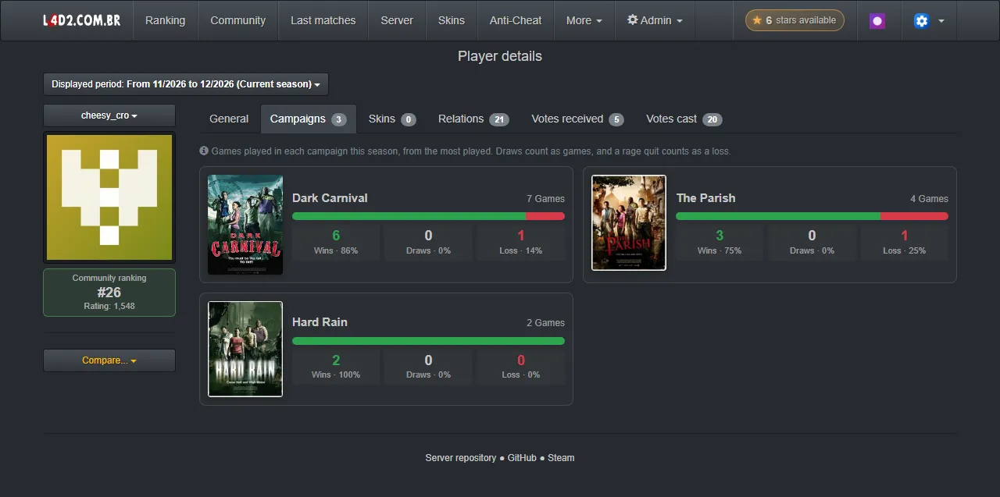
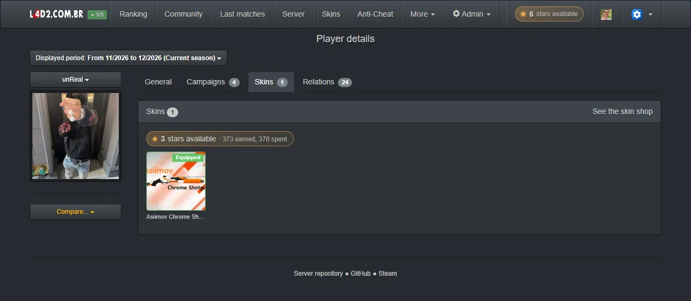
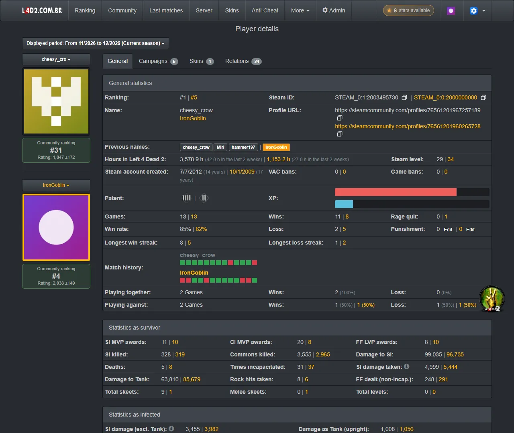

# Players

🌐 **English** | [Português](players.pt.md) | [Español](players.es.md)

Every player who played on your game servers has a page with their results, their statistics as survivor and as infected, their matches, the campaigns they play, their skins, and who they play with and against.

[Back to the manual](README.md)

## Contents

- [The players list](#the-players-list)
- [The player page](#the-player-page)
- [A player without statistics](#a-player-without-statistics)
- [General tab](#general-tab)
- [Campaigns tab](#campaigns-tab)
- [Skins tab](#skins-tab)
- [Relations tab](#relations-tab)
- [Comparing two players](#comparing-two-players)
- [Related accounts](#related-accounts)
- [Punishments](#punishments)

## The players list

**More > Players** lists every player of the chosen period, ordered by one statistic.

- **Order by** chooses the statistic: experience, games, wins, losses, rage quits, MVP awards, deaths, damage, skeets, levels, crowns, friendly fire and the infected numbers.
- The column of the chosen statistic shows each player's total, and **Per game** shows the average per game. Hover the ⓘ icon to see the number of games. Click the column header to reverse the order.
- The [period selector](seasons-and-history.md#the-period-selector) chooses a season, a year or all time.

The list has the same players as the ranking of the period, all of them and not only the top 100. It shows 100 players per page, and the page links under the table keep the order and the period you chose.

## The player page

Click a player anywhere on the site to open their page: the ranking, the matches, the live server, the community ranking and the administration pages all link to it, never straight to Steam. It has a period selector, a **Compare** button, and up to four tabs.

## A player without statistics

A player who has no statistics in the chosen period, or who never played a ranked match, still has a page. It shows:

- **Player not ranked**, with the period selector, so another season or all time can be chosen. With the ranking module off it says **No statistics yet** instead.
- The avatar and an **Open Steam profile** button.
- The best name the site knows: the last name seen on a game server, or the name of the Steam profile.
- The SteamID64 (Community ID), the Steam ID in the `STEAM_0` and `STEAM_1` forms and the Steam3 ID (`[U:1:n]`), each with a copy button, and the profile URL.
- The last login and the number of connections, and the [related accounts](#related-accounts), when the live server module is on.

An address that is not a valid SteamID64, such as `/player/0` or `/player/abc`, answers as not found.

## General tab

**General statistics**:

| Item | Meaning |
|---|---|
| Ranking | Position in the ranking of the period. |
| Steam ID, Profile URL | The account, with copy buttons and a link to the Steam profile. |
| Name, Previous names | The name used most often, and the other names used. |
| Patent, XP | The patent and experience in the season. See [Patents](patents.md). |
| Games, Wins, Loss, Win rate, Rage quit | As in the [ranking](ranking.md#the-ranking-page). |
| Punishment | Experience taken away by an administrator in this season. |
| Longest win streak, Longest loss streak | The most matches won or lost in a row. |
| Match history | A strip with the result of each match, oldest to newest. |

**Statistics as survivor** and **Statistics as infected** add up the numbers of every ranked match of the period: MVP awards, kills, damage, deaths, skeets, levels, crowns and so on. The ⓘ icons explain the less obvious ones.

**Last matches** lists the player's matches of the period with the same cards as the [match list](matches.md#the-match-list). When you are signed in, your own row is highlighted.

## Campaigns tab

The games played in each campaign in the period, from the most played, with wins, draws, losses and rage quits. Draws count as games here, and a rage quit counts as a loss.

## Skins tab

The weapon skins the player owns, the ones equipped, and a link to the [skin shop](skin-shop.md). Shown only when the skin shop module is on.

## Relations tab

Two tables built from the ranked matches of the period:

- **Playing together**: for each teammate, the matches won and lost on the same team, and the rates.
- **Playing against**: for each opponent, the matches won and lost against them, and the rates.

**I don't get it, explain it to me** opens a short explanation of one row. The first 12 players are shown; **Show more players** shows the rest.

## Comparing two players

**Compare** chooses a second player. The page then shows both players side by side: the general statistics, the survivor and infected statistics, and the matches they played, with the second player's numbers next to the first one's.

**Remove comparison** goes back to one player.

## Related accounts

When the live server module is on, the game servers report the address each player connects from. If other accounts connected from the same address, the player page shows a **Related accounts** panel with those accounts, their last login and how many connections they have. The address itself is never shown.

By default every visitor sees the panel, as on the old site. An administrator can limit it to administrators in [Settings > Privacy](administration.md#privacy). That setting does not change the game: the `l4d2_gameinfo_sync` plugin announces related accounts in the game chat when a player connects, unless `gameinfo_related_accounts_chat` is `0`.

Administrators have a search over the same data in [Moderation > Player connections](moderation.md#player-connections). Connections older than three months are deleted.

## Punishments

An administrator sees an **Edit** link next to **Punishment**, when a season is selected. It asks how many experience points the player should lose, with 150 suggested.

- A number above zero adds a punishment of that many points to the season.
- `0` removes every punishment of the player in that season.

See [Ranking > Punishments](ranking.md#punishments) for how they count.
