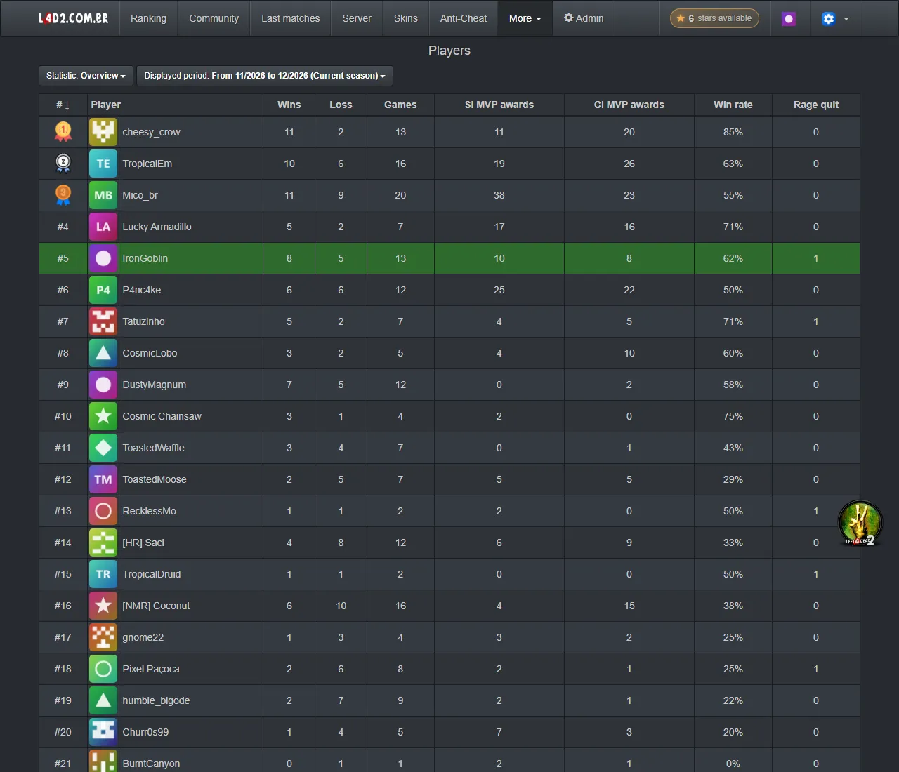
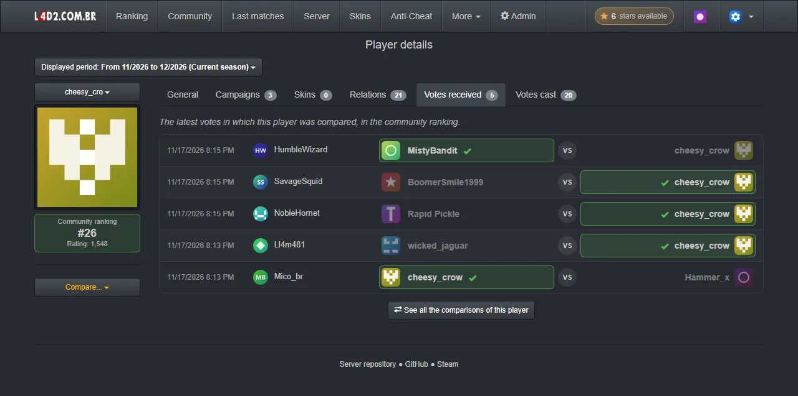

# Players

🌐 **English** | [Português](players.pt.md) | [Español](players.es.md)

Every player who played on your game servers has a page with their results, their statistics as survivor and as infected, their matches, the campaigns they play, their skins, and who they play with and against.

[Back to the manual](README.md)

## Contents

- [The players list](#the-players-list)
- [The player page](#the-player-page)
- [The player name](#the-player-name)
- [A player without statistics](#a-player-without-statistics)
- [General tab](#general-tab)
- [Steam data](#steam-data)
- [Campaigns tab](#campaigns-tab)
- [Skins tab](#skins-tab)
- [Relations tab](#relations-tab)
- [Community votes tabs](#community-votes-tabs)
- [Comparing two players](#comparing-two-players)
- [Related accounts](#related-accounts)
- [Punishments](#punishments)

## The players list

**More > Players** lists every player of the chosen period. It replaces the old History page: past seasons, years and all time are all here.

- **Statistic** chooses what the table shows. **Overview**, the default, shows for each player the wins, losses, games, SI MVP and CI MVP awards, tank wipes, win rate and rage quits, in the order of the ranking of the period, with a medal for the top three. Click a column header to order by it; click it again to reverse the order, and click **#** to go back to the ranking order.
- Any other choice shows one statistic: experience, games, wins, losses, win rate, rage quits, MVP awards, tank wipes, deaths, damage, skeets, levels, crowns, friendly fire and the infected numbers. Its column shows each player's total, and **Per game** shows the average per game. Hover the ⓘ icon to see the number of games. Click the column header to reverse the order.
- The [period selector](seasons-and-history.md#the-period-selector) chooses a season, a year or all time. Like on the ranking, it lists the seasons of the current year, each year and all time.

The list has the same players as the ranking of the period, all of them and not only the top 100. It shows 100 players per page, and the page links under the table keep the statistic, the order and the period you chose.

## The player page

Click a player anywhere on the site to open their page: the ranking, the matches, the live server, the community ranking and the administration pages all link to it, never straight to Steam. It has a period selector, a **Compare...** button, and up to six tabs.

When the community ranking module is on, a box under the avatar shows the position of the player in the [community ranking](community-ranking.md) and the rating, or **Not in the community ranking yet** with the number of comparisons. It does not change with the period, since the community ranking does not reset with the season. When two players are compared, each one has a box.

## The player name

The site shows one name for each player, the same on every page: the rankings, the player page, the matches and their statistics, the live server and its chat, the community ranking, the in-game pages, the searches, the APIs and the administration. It is chosen in this order:

1. The [forced name](moderation.md#forced-names), when an administrator set one.
2. The name the player used most often in all the matches on the site, of every season.
3. The name of the Steam profile, when the site has a [Steam Web API key](administration.md#site).
4. The last name seen on a game server.
5. The SteamID64, when nothing else is known.

The name is updated when a match is uploaded, when a forced name changes and when the Steam data changes. The other names the player used in the matches stay in **Previous names**, and the player search also finds the player by them.

## A player without statistics

A player who has no statistics in the chosen period, or who never played a ranked match, still has a page. It shows:

- **Player not ranked**, with the period selector, so another season or all time can be chosen. With the ranking module off it says **No statistics yet** instead.
- The avatar and an **Open Steam profile** button.
- The [name of the player](#the-player-name).
- The SteamID64 (Community ID), the Steam ID in the `STEAM_0` and `STEAM_1` forms and the Steam3 ID (`[U:1:n]`), each with a copy button, and the profile URL.
- The [Steam data](#steam-data).
- The last login and the number of connections, and the [related accounts](#related-accounts), when the live server module is on.
- The community ranking box and the [community votes tabs](#community-votes-tabs), when the player already took part in the voting.

An address that is not a valid SteamID64, such as `/player/0` or `/player/abc`, answers as not found.

## General tab

**General statistics**:

| Item | Meaning |
|---|---|
| Ranking | Position in the ranking of the period. |
| Steam ID, Profile URL | The account, with copy buttons and a link to the Steam profile. |
| Name, Previous names | The [name of the player](#the-player-name), and the other names used in the matches. |
| Hours in Left 4 Dead 2, Steam level, Steam account created, VAC bans, Game bans | The [Steam data](#steam-data) of the account. |
| Patent, XP | The patent and experience in the season. See [Patents](patents.md). |
| Games, Wins, Loss, Win rate, Rage quit | As in the [ranking](ranking.md#the-ranking-page). |
| Punishment | Experience taken away by an administrator in this season. |
| Longest win streak, Longest loss streak | The most matches won or lost in a row. |
| Match history | A strip with the result of each match, oldest to newest. |

**Statistics as survivor** and **Statistics as infected** add up the numbers of every ranked match of the period: MVP awards, tank wipes, kills, damage, deaths, skeets, levels, crowns and so on. The ⓘ icons explain the less obvious ones.

**Last matches** lists the player's matches of the period with the same cards as the [match list](matches.md#the-match-list). When you are signed in, your own row is highlighted.

## Steam data

When the site has a [Steam Web API key](administration.md#site), it reads public data of each player's Steam account in the background and shows it in the **General** tab, to every visitor:

| Item | Meaning |
|---|---|
| Hours in Left 4 Dead 2 | The total hours played in Left 4 Dead 2 and, in brackets, the hours of the last 2 weeks. |
| Steam level | The level of the Steam account. |
| Steam account created | The day the account was created, in the time zone of the site, and its age. |
| VAC bans, Game bans | How many VAC and game bans the account has, and how many days ago the last one happened. |

A value the player keeps private on Steam, such as the game details or the creation date of the account, shows **Not available**. The bans are public on Steam even for private profiles. Without a key nothing is read and every item shows **Not available**.

Every 10 minutes the site reads up to 100 players: first the ones never read, then the ones seen most recently. A player who played in the last 30 days is read again after 24 hours, the others after 7 days, which stays far below the daily limit of the Steam Web API. A Steam call that fails is tried again later.

## Campaigns tab

The games played in each campaign in the period, from the most played, with wins, draws, losses and rage quits. Draws count as games here, and a rage quit counts as a loss.

## Skins tab

The weapon skins the player owns, the ones equipped, and a link to the [skin shop](skin-shop.md). Shown only when the skin shop module is on.

## Relations tab

Two tables built from the ranked matches of the period:

- **Playing together**: for each teammate, the matches won and lost on the same team, and the rates.
- **Playing against**: for each opponent, the matches won and lost against them, and the rates.

**I don't get it, explain it to me** opens a short explanation of one row. The first 12 players are shown; **Show more players** shows the rest.

## Community votes tabs

Shown when the community ranking module is on, and only for one player, not in a comparison:

- **Votes received**: the latest 20 votes in which the player was compared, the same rows as [Latest votes](community-ranking.md), with the chosen player in green.
- **Votes cast**: the latest 20 votes the player made. Hidden when an administrator hides who voted; then **Votes received** shows "A player voted" instead of the names.

**See all the comparisons of this player** and **See all the votes made by this player** open **Latest votes** filtered by the player.

## Comparing two players

**Compare...** chooses a second player. The page then shows both players side by side: the general statistics with the Steam data, the survivor and infected statistics, and the matches they played, with the second player's numbers next to the first one's.

**Remove comparison** goes back to one player.

## Related accounts

When the live server module is on, the game servers report the address each player connects from. If other accounts connected from the same address, the player page shows a **Related accounts** panel with those accounts, their last login and how many connections they have. The address itself is never shown.

By default every visitor sees the panel, as on the old site. An administrator can limit it to administrators in [Settings > Privacy](administration.md#privacy). That setting does not change the game: the `l4d2_gameinfo_sync` plugin announces related accounts in the game chat when a player connects, unless `gameinfo_related_accounts_chat` is `0`.

Administrators have a search over the same data in [Moderation > Player connections](moderation.md#player-connections). Connections older than three months are deleted.

## Punishments

An administrator sees an **Edit** link next to **Punishment**, when a season is selected. It asks how many experience points the player should lose, with 150 suggested.

- A number above zero adds a punishment of that many points to the season.
- `0` removes every punishment of the player in that season.

See [Ranking > Punishments](ranking.md#punishments) for how they count.
