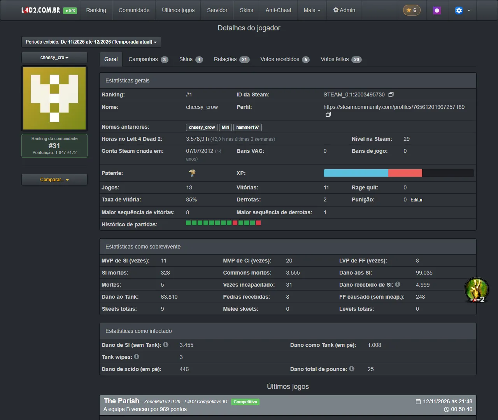
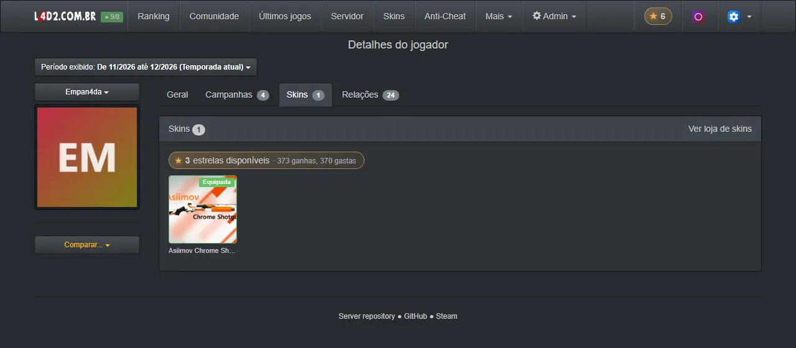
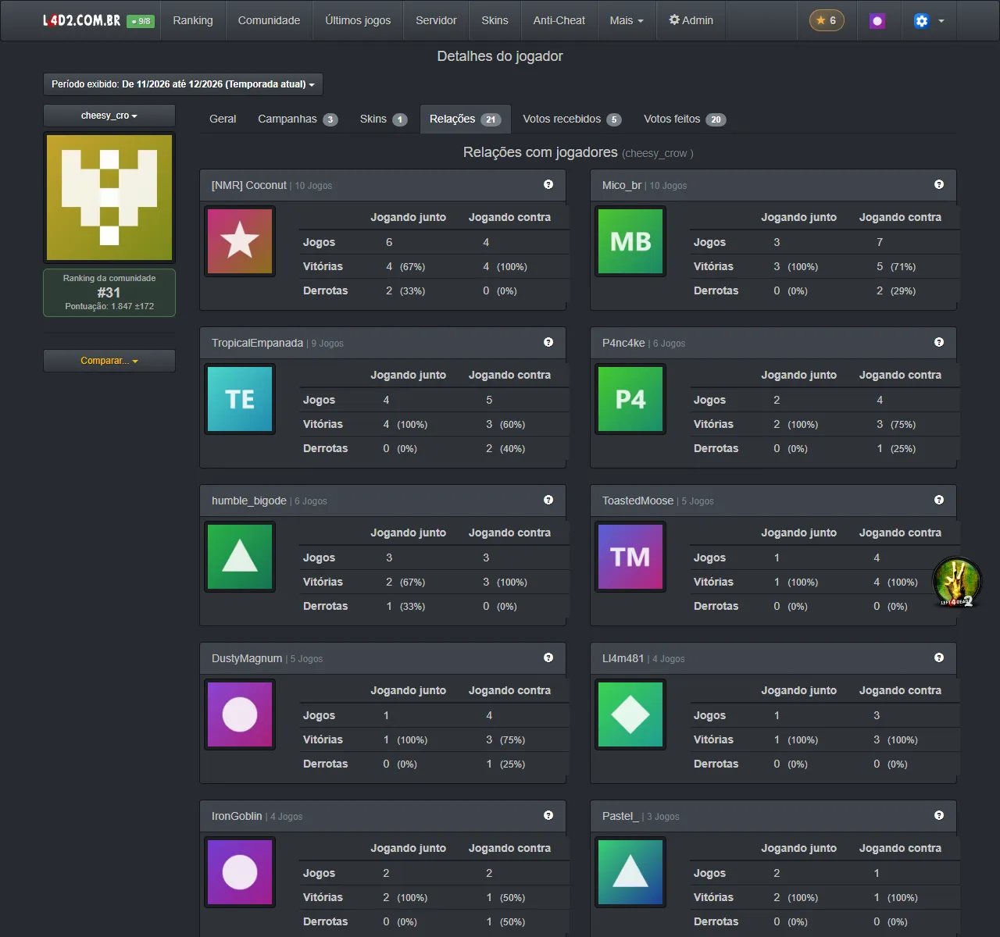
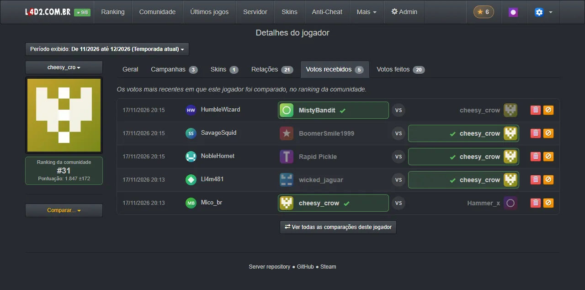

# Jogadores

🌐 [English](players.md) | **Português** | [Español](players.es.md)

Todo jogador que jogou nos seus servidores de jogo tem uma página com os resultados dele, as estatísticas como sobrevivente e como infectado, as partidas, as campanhas que ele joga, as skins e com quem e contra quem ele joga.

[Voltar ao manual](README.pt.md)

## Conteúdo

- [A lista de jogadores](#a-lista-de-jogadores)
- [A página do jogador](#a-página-do-jogador)
- [O nome do jogador](#o-nome-do-jogador)
- [Um jogador sem estatísticas](#um-jogador-sem-estatísticas)
- [Aba Geral](#aba-geral)
- [Dados da Steam](#dados-da-steam)
- [Aba Campanhas](#aba-campanhas)
- [Aba Skins](#aba-skins)
- [Aba Relações](#aba-relações)
- [Abas de votos da comunidade](#abas-de-votos-da-comunidade)
- [Comparando dois jogadores](#comparando-dois-jogadores)
- [Contas relacionadas](#contas-relacionadas)
- [Punições](#punições)

## A lista de jogadores

**Mais > Jogadores** lista todos os jogadores do período escolhido. Ela substitui a antiga página Histórico: temporadas passadas, anos e todo o período estão todos aqui.

- **Estatística** escolhe o que a tabela mostra. **Visão geral**, o padrão, mostra para cada jogador as vitórias, derrotas, jogos, MVPs de SI e de CI, taxa de vitória e rage quits, na ordem do ranking do período, com uma medalha para os três primeiros. Clique no cabeçalho de uma coluna para ordenar por ela; clique de novo para inverter a ordem, e clique em **#** para voltar à ordem do ranking.
- Qualquer outra escolha mostra uma estatística: experiência, jogos, vitórias, derrotas, taxa de vitória, rage quits, prêmios de MVP, mortes, dano, skeets, levels, crowns, fogo amigo e os números de infectado. A coluna mostra o total de cada jogador, e **Por jogo** mostra a média por jogo. Passe o mouse sobre o ícone ⓘ para ver o número de jogos. Clique no cabeçalho da coluna para inverter a ordem.
- O [seletor de período](seasons-and-history.pt.md#o-seletor-de-período) escolhe uma temporada, um ano ou todo o período. Como no ranking, ele lista as temporadas do ano atual, cada ano e todo o período.

A lista tem os mesmos jogadores do ranking do período, todos eles e não só os 100 melhores. Ela mostra 100 jogadores por página, e os links das páginas embaixo da tabela mantêm a estatística, a ordem e o período escolhidos.

## A página do jogador

Clique em um jogador em qualquer lugar do site para abrir a página dele: o ranking, as partidas, o servidor ao vivo, o ranking da comunidade e as páginas da administração levam todos a ela, nunca direto para a Steam. Ela tem um seletor de período, um botão **Comparar...** e até seis abas.

Quando o módulo do ranking da comunidade está ligado, um quadro embaixo do avatar mostra a posição do jogador no [ranking da comunidade](community-ranking.pt.md) e a pontuação, ou **Ainda fora do ranking da comunidade** com o número de comparações. Ele não muda com o período, porque o ranking da comunidade não reinicia com a temporada. Quando dois jogadores são comparados, cada um tem o seu quadro.

## O nome do jogador

O site mostra um nome para cada jogador, o mesmo em todas as páginas: os rankings, a página do jogador, as partidas e suas estatísticas, o servidor ao vivo e seu chat, o ranking da comunidade, as páginas do jogo, as buscas, as APIs e a administração. Ele é escolhido nesta ordem:

1. O [nome forçado](moderation.pt.md#nomes-forçados), quando um administrador definiu um.
2. O nome que o jogador mais usou em todas as partidas do site, de todas as temporadas.
3. O nome do perfil Steam, quando o site tem uma [chave da Steam Web API](administration.pt.md#site).
4. O último nome visto em um servidor de jogo.
5. O SteamID64, quando nada mais é conhecido.

O nome é atualizado quando uma partida é enviada, quando um nome forçado muda e quando os dados da Steam mudam. Os outros nomes que o jogador usou nas partidas continuam em **Nomes anteriores**, e a busca de jogadores também encontra o jogador por eles.

## Um jogador sem estatísticas

Um jogador que não tem estatísticas no período escolhido, ou que nunca jogou uma partida ranqueada, também tem uma página. Ela mostra:

- **Jogador fora do ranking**, com o seletor de período, para escolher outra temporada ou todo o período. Com o módulo de ranking desligado, ela diz **Ainda sem estatísticas**.
- O avatar e um botão **Abrir perfil na Steam**.
- O [nome do jogador](#o-nome-do-jogador).
- Os [dados da Steam](#dados-da-steam).
- O SteamID64 (Community ID), o Steam ID nas formas `STEAM_0` e `STEAM_1` e o Steam3 ID (`[U:1:n]`), cada um com botão de copiar, e o endereço do perfil.
- O último login e o número de conexões, e as [contas relacionadas](#contas-relacionadas), quando o módulo do servidor ao vivo está ligado.
- O quadro do ranking da comunidade e as [abas de votos da comunidade](#abas-de-votos-da-comunidade), quando o jogador já participou da votação.

Um endereço que não é um SteamID64 válido, como `/player/0` ou `/player/abc`, responde como não encontrado.

## Aba Geral

**Estatísticas gerais**:

| Item | Significado |
|---|---|
| Ranking | Posição no ranking do período. |
| ID da Steam, Perfil | A conta, com botões de copiar e um link para o perfil na Steam. |
| Nome, Nomes anteriores | O [nome do jogador](#o-nome-do-jogador), e os outros nomes usados nas partidas. |
| Horas no Left 4 Dead 2, Nível na Steam, Conta Steam criada em, Bans VAC, Bans de jogo | Os [dados da Steam](#dados-da-steam) da conta. |
| Patente, XP | A patente e a experiência na temporada. Veja [Patentes](patents.pt.md). |
| Jogos, Vitórias, Derrotas, Taxa de vitória, Rage quit | Como no [ranking](ranking.pt.md#a-página-do-ranking). |
| Punição | Experiência tirada por um administrador nesta temporada. |
| Maior sequência de vitórias, Maior sequência de derrotas | O maior número de partidas ganhas ou perdidas seguidas. |
| Histórico de partidas | Uma faixa com o resultado de cada partida, da mais antiga para a mais recente. |

**Estatísticas como sobrevivente** e **Estatísticas como infectado** somam os números de todas as partidas ranqueadas do período: prêmios de MVP, mortes causadas, dano, mortes, skeets, levels, crowns e assim por diante. Os ícones ⓘ explicam os menos óbvios.

**Últimos jogos** lista as partidas do jogador no período com os mesmos cartões da [lista de partidas](matches.pt.md#a-lista-de-partidas). Quando você está logado, a sua própria linha fica destacada.

## Dados da Steam

Quando o site tem uma [chave da Steam Web API](administration.pt.md#site), ele lê em segundo plano dados públicos da conta Steam de cada jogador e os mostra na aba **Geral**, para todos os visitantes:

| Item | Significado |
|---|---|
| Horas no Left 4 Dead 2 | O total de horas jogadas no Left 4 Dead 2 e, entre parênteses, as horas das últimas 2 semanas. |
| Nível na Steam | O nível da conta Steam. |
| Conta Steam criada em | O dia em que a conta foi criada, no fuso horário do site, e a idade dela. |
| Bans VAC, Bans de jogo | Quantos bans VAC e de jogo a conta tem, e há quantos dias foi o último. |

Um valor que o jogador mantém privado na Steam, como os detalhes de jogos ou a data de criação da conta, mostra **Não disponível**. Os bans são públicos na Steam mesmo para perfis privados. Sem uma chave nada é lido e todos os itens mostram **Não disponível**.

A cada 10 minutos o site lê até 100 jogadores: primeiro os que nunca foram lidos, depois os vistos mais recentemente. Um jogador que jogou nos últimos 30 dias é lido de novo depois de 24 horas, os outros depois de 7 dias, o que fica bem abaixo do limite diário da Steam Web API. Uma chamada à Steam que falha é tentada de novo mais tarde.

## Aba Campanhas

Os jogos disputados em cada campanha no período, da mais jogada para a menos jogada, com vitórias, empates, derrotas e rage quits. Aqui os empates contam como jogos, e um rage quit conta como derrota.

## Aba Skins

As skins de armas que o jogador tem, as que estão equipadas e um link para a [loja de skins](skin-shop.pt.md). Só aparece quando o módulo da loja de skins está ligado.

## Aba Relações

Duas tabelas montadas a partir das partidas ranqueadas do período:

- **Jogando junto**: para cada companheiro de equipe, as partidas ganhas e perdidas na mesma equipe, e as taxas.
- **Jogando contra**: para cada adversário, as partidas ganhas e perdidas contra ele, e as taxas.

**Não entendi, me explique melhor** abre uma explicação curta de uma linha. Os primeiros 12 jogadores aparecem; **Ver mais jogadores** mostra o resto.

## Abas de votos da comunidade

Aparecem quando o módulo do ranking da comunidade está ligado, e só para um jogador, não numa comparação:

- **Votos recebidos**: os 20 votos mais recentes em que o jogador foi comparado, nas mesmas linhas de [Últimos votos](community-ranking.pt.md), com o jogador escolhido em verde.
- **Votos feitos**: os 20 votos mais recentes que o jogador fez. Fica escondida quando um administrador esconde quem votou; aí **Votos recebidos** mostra "Um jogador votou" no lugar dos nomes.

**Ver todas as comparações deste jogador** e **Ver todos os votos feitos por este jogador** abrem **Últimos votos** filtrado pelo jogador.

## Comparando dois jogadores

**Comparar...** escolhe um segundo jogador. A página passa a mostrar os dois jogadores lado a lado: as estatísticas gerais com os dados da Steam, as estatísticas como sobrevivente e como infectado e as partidas que eles jogaram, com os números do segundo jogador ao lado dos do primeiro.

**Remover comparação** volta para um jogador só.

## Contas relacionadas

Quando o módulo do servidor ao vivo está ligado, os servidores de jogo informam o endereço de onde cada jogador se conecta. Se outras contas se conectaram do mesmo endereço, a página do jogador mostra um painel **Contas relacionadas** com essas contas, o último login delas e quantas conexões elas têm. O endereço em si nunca é mostrado.

Por padrão todo visitante vê o painel, como no site antigo. Um administrador pode restringir o painel aos administradores em [Configurações > Privacidade](administration.pt.md#privacidade). Essa configuração não muda o jogo: o plugin `l4d2_gameinfo_sync` anuncia as contas relacionadas no chat do jogo quando um jogador se conecta, a não ser que `gameinfo_related_accounts_chat` esteja em `0`.

Os administradores têm uma busca sobre os mesmos dados em [Moderação > Conexões de jogadores](moderation.pt.md#conexões-de-jogadores). As conexões com mais de três meses são apagadas.

## Punições

Um administrador vê um link **Editar** ao lado de **Punição** quando uma temporada está selecionada. Ele pergunta quantos pontos de experiência o jogador deve perder, com 150 como sugestão.

- Um número acima de zero adiciona uma punição com essa quantidade de pontos na temporada.
- `0` remove todas as punições do jogador naquela temporada.

Veja [Ranking > Punições](ranking.pt.md#punições) para saber como elas contam.
