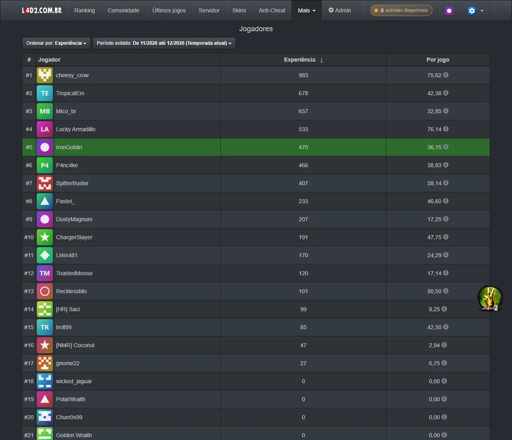
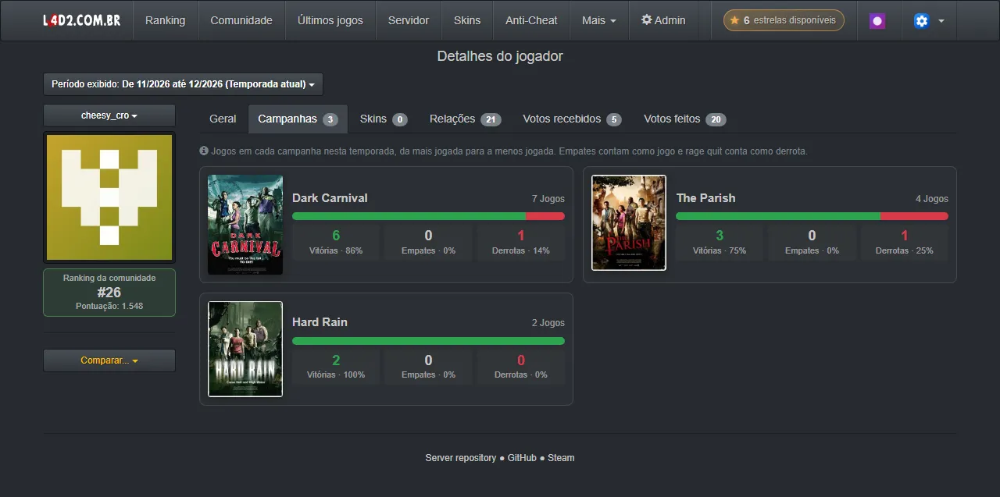
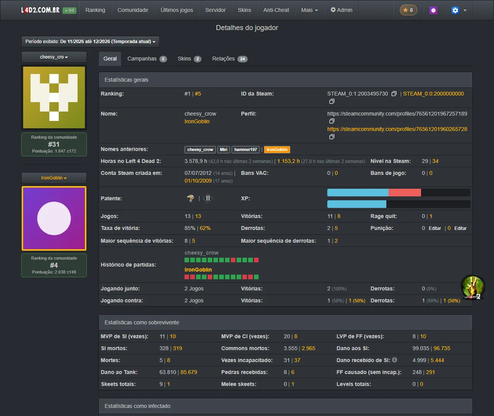

# Jogadores

🌐 [English](players.md) | **Português** | [Español](players.es.md)

Todo jogador que jogou nos seus servidores de jogo tem uma página com os resultados dele, as estatísticas como sobrevivente e como infectado, as partidas, as campanhas que ele joga, as skins e com quem e contra quem ele joga.

[Voltar ao manual](README.pt.md)

## Conteúdo

- [A lista de jogadores](#a-lista-de-jogadores)
- [A página do jogador](#a-página-do-jogador)
- [Aba Geral](#aba-geral)
- [Aba Campanhas](#aba-campanhas)
- [Aba Skins](#aba-skins)
- [Aba Relações](#aba-relações)
- [Comparando dois jogadores](#comparando-dois-jogadores)
- [Contas relacionadas](#contas-relacionadas)
- [Punições](#punições)

## A lista de jogadores

**Mais > Jogadores** lista todos os jogadores do período escolhido, ordenados por uma estatística.

- **Ordenar por** escolhe a estatística: experiência, jogos, vitórias, derrotas, rage quits, prêmios de MVP, mortes, dano, skeets, levels, crowns, fogo amigo e os números de infectado.
- A coluna da estatística escolhida mostra o total de cada jogador, e **Por jogo** mostra a média por jogo. Passe o mouse sobre o ícone ⓘ para ver o número de jogos. Clique no cabeçalho da coluna para inverter a ordem.
- O [seletor de período](seasons-and-history.pt.md#o-seletor-de-período) escolhe uma temporada, um ano ou todo o período.

A lista tem os mesmos jogadores do ranking do período, todos eles e não só os 100 melhores. Ela mostra 100 jogadores por página, e os links das páginas embaixo da tabela mantêm a ordem e o período escolhidos.

## A página do jogador

Clique em um jogador em qualquer lugar do site para abrir a página dele. Ela tem um seletor de período, um botão **Comparar...** e até quatro abas.

## Aba Geral

**Estatísticas gerais**:

| Item | Significado |
|---|---|
| Ranking | Posição no ranking do período. |
| ID da Steam, Perfil | A conta, com botões de copiar e um link para o perfil na Steam. |
| Nome, Nomes anteriores | O nome usado com mais frequência, e os outros nomes usados. |
| Patente, XP | A patente e a experiência na temporada. Veja [Patentes](patents.pt.md). |
| Jogos, Vitórias, Derrotas, Taxa de vitória, Rage quit | Como no [ranking](ranking.pt.md#a-página-do-ranking). |
| Punição | Experiência tirada por um administrador nesta temporada. |
| Maior sequência de vitórias, Maior sequência de derrotas | O maior número de partidas ganhas ou perdidas seguidas. |
| Histórico de partidas | Uma faixa com o resultado de cada partida, da mais antiga para a mais recente. |

**Estatísticas como sobrevivente** e **Estatísticas como infectado** somam os números de todas as partidas ranqueadas do período: prêmios de MVP, mortes causadas, dano, mortes, skeets, levels, crowns e assim por diante. Os ícones ⓘ explicam os menos óbvios.

**Últimos jogos** lista as partidas do jogador no período com os mesmos cartões da [lista de partidas](matches.pt.md#a-lista-de-partidas). Quando você está logado, a sua própria linha fica destacada.

## Aba Campanhas

Os jogos disputados em cada campanha no período, da mais jogada para a menos jogada, com vitórias, empates, derrotas e rage quits. Aqui os empates contam como jogos, e um rage quit conta como derrota.

## Aba Skins

As skins de armas que o jogador tem, as que estão equipadas e um link para a [loja de skins](skin-shop.pt.md). Só aparece quando o módulo da loja de skins está ligado.

## Aba Relações

Duas tabelas montadas a partir das partidas ranqueadas do período:

- **Jogando junto**: para cada companheiro de equipe, as partidas ganhas e perdidas na mesma equipe, e as taxas.
- **Jogando contra**: para cada adversário, as partidas ganhas e perdidas contra ele, e as taxas.

**Não entendi, me explique melhor** abre uma explicação curta de uma linha. Os primeiros 12 jogadores aparecem; **Ver mais jogadores** mostra o resto.

## Comparando dois jogadores

**Comparar...** escolhe um segundo jogador. A página passa a mostrar os dois jogadores lado a lado: as estatísticas gerais, as estatísticas como sobrevivente e como infectado e as partidas que eles jogaram, com os números do segundo jogador ao lado dos do primeiro.

**Remover comparação** volta para um jogador só.

## Contas relacionadas

Quando o módulo do servidor ao vivo está ligado, os servidores de jogo informam o endereço de onde cada jogador se conecta. Se outras contas se conectaram do mesmo endereço, a página do jogador mostra um painel **Contas relacionadas** com essas contas, o último login delas e quantas conexões elas têm. O endereço em si nunca é mostrado.

Por padrão todo visitante vê o painel, como no site antigo. Um administrador pode restringir o painel aos administradores em [Configurações > Privacidade](administration.pt.md#privacidade). Essa configuração não muda o jogo: o plugin `l4d2_gameinfo_sync` anuncia as contas relacionadas no chat do jogo quando um jogador se conecta, a não ser que `gameinfo_related_accounts_chat` esteja em `0`.

Os administradores têm uma busca sobre os mesmos dados em [Moderação > Conexões de jogadores](moderation.pt.md#conexões-de-jogadores). As conexões com mais de três meses são apagadas.

## Punições

Um administrador vê um link **Editar** ao lado de **Punição** quando uma temporada está selecionada. Ele pergunta quantos pontos de experiência o jogador deve perder, com 150 como sugestão.

- Um número acima de zero adiciona uma punição com essa quantidade de pontos na temporada.
- `0` remove todas as punições do jogador naquela temporada.

Veja [Ranking > Punições](ranking.pt.md#punições) para saber como elas contam.
