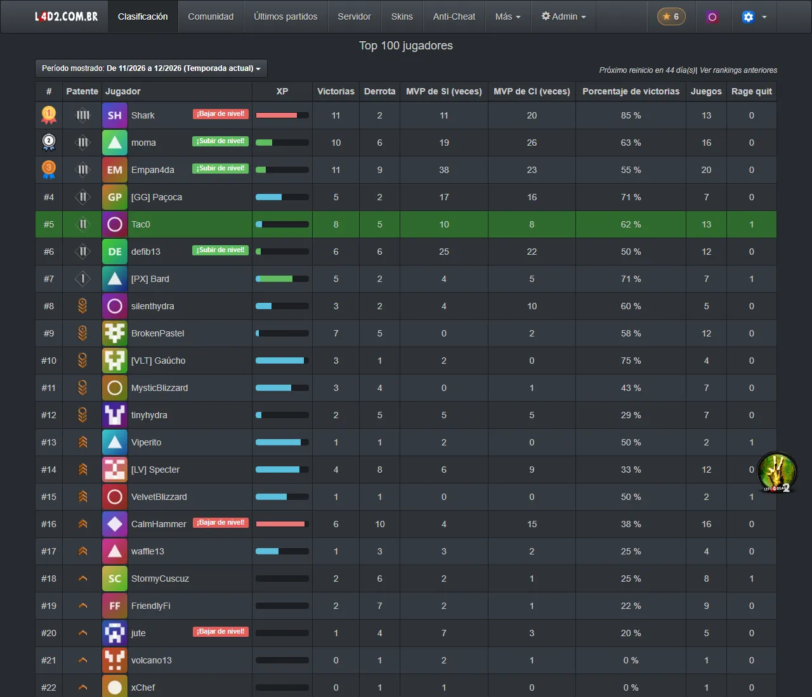
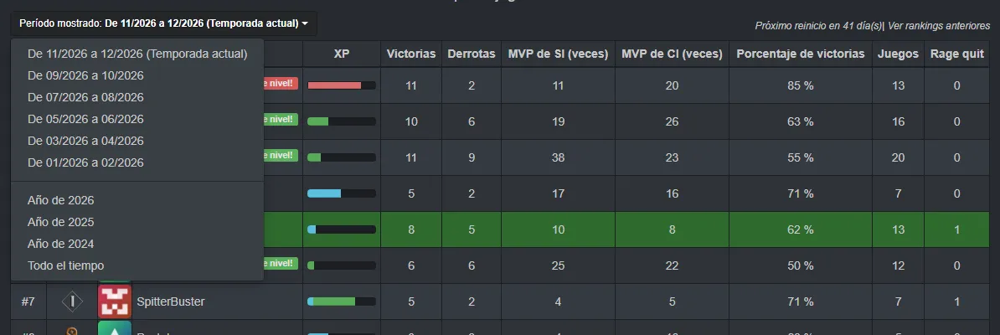

# Ranking

🌐 [English](ranking.md) | [Português](ranking.pt.md) | **Español**

El ranking es la primera página del sitio. Lista los 100 mejores jugadores de la temporada actual por experiencia (XP), calculada a partir de las partidas de ranking jugadas en todos tus servidores de juego.

[Volver al manual](README.es.md)

## Contenido

- [La página del ranking](#la-página-del-ranking)
- [Elegir el período](#elegir-el-período)
- [Cómo se calcula la experiencia](#cómo-se-calcula-la-experiencia)
- [Victorias, derrotas, empates y rage quits](#victorias-derrotas-empates-y-rage-quits)
- [MVP](#mvp)
- [Tank wipes](#tank-wipes)
- [Castigos](#castigos)
- [Mínimo de partidas](#mínimo-de-partidas)
- [El orden del ranking](#el-orden-del-ranking)
- [Configuración](#configuración)

## La página del ranking

| Columna | Significado |
|---|---|
| # | Posición. Los tres primeros tienen una medalla. |
| Patente | La patente que corresponde a la experiencia del jugador. Consulta [Patentes](patents.es.md). |
| Jugador | Avatar y nombre. Haz clic para abrir la [página del jugador](players.es.md). |
| ¡Subir de nivel! / ¡Bajar de nivel! | La última partida de la temporada llevó a este jugador a una patente más alta o más baja. |
| XP | Una barra con el progreso hacia la próxima patente. Pasa el mouse por encima para ver la experiencia, el próximo nivel y cuánto cambió la última partida. Verde significa que la última partida sumó experiencia; rojo, que la restó. |
| Victorias, Derrotas | Partidas de ranking ganadas y perdidas. Un rage quit cuenta como derrota. |
| MVP de SI (veces), MVP de CI (veces) | Cuántas veces el jugador fue MVP. Consulta [MVP](#mvp). |
| Tank wipes | Mitades de ronda que el jugador terminó como Tank. Consulta [Tank wipes](#tank-wipes). |
| Porcentaje de victorias | Victorias divididas por victorias más derrotas. |
| Juegos | Victorias más derrotas. Los empates no se incluyen. |
| Rage quit | Partidas que el jugador abandonó antes del final. |

Cuando tienes la sesión iniciada, tu propia fila aparece resaltada en verde.

Encima de la tabla:

- **Período mostrado** abre el [selector de período](#elegir-el-período).
- **Próximo reinicio en N día(s)** indica cuándo termina la temporada actual y el ranking vuelve a empezar.
- **Ver rankings anteriores** abre la [lista de jugadores](players.es.md#la-lista-de-jugadores) del mismo período, donde se puede elegir cualquier temporada pasada, año o todo el tiempo.

Se muestran los primeros 50 jugadores; **Mostrar más...** muestra el resto del top 100. La lista completa de jugadores del período está en la página [Jugadores](players.es.md).

Al inicio de una temporada, antes de la primera partida de ranking, la página muestra en su lugar el top 6 de la última temporada terminada.

## Elegir el período

El ranking puede mostrar cualquier temporada, un año calendario completo o todo el tiempo. La temporada actual es la predeterminada. [Temporadas e historia](seasons-and-history.es.md) explica cómo se calculan los períodos. Las patentes y los cambios de nivel se muestran solo cuando hay una temporada seleccionada, porque las patentes pertenecen a una temporada.

## Cómo se calcula la experiencia

Cada partida de ranking cambia la experiencia de los jugadores que estuvieron en ella. Con la configuración predeterminada:

| Resultado | Experiencia |
|---|---|
| Victoria | +85 |
| Derrotas | −80 |
| Rage quit | −150, y nada más de esa partida |
| Cada MVP de SI en la partida | +8 |
| Cada MVP de CI en la partida | +6 |
| Cada tank wipe en la partida | +50 |

Por ejemplo, un jugador que gana una partida y fue MVP de SI en dos mitades de ronda y MVP de CI en una obtiene 85 + 2 × 8 + 6 = 107 XP. Un jugador que pierde con un MVP de SI obtiene −80 + 8 = −72 XP, y un jugador que pierde pero derribó a los supervivientes dos veces como Tank obtiene −80 + 2 × 50 = 20 XP.

- Las partidas se aplican en el orden en que se jugaron.
- La experiencia nunca baja de cero. Un jugador con 30 XP que pierde una partida termina con 0, no con −50.
- Solo cuentan las partidas de ranking. Una partida es de ranking cuando su modo de juego cuenta para el ranking y tiene suficientes mapas. Consulta [Modos de juego y campañas](game-modes-and-campaigns.es.md).
- El ranking de una temporada usa solo las partidas de esa temporada. Empieza desde cero en cada temporada nueva.
- Los valores de arriba son los predeterminados. El administrador puede cambiarlos en [Configuración > Puntos del ranking](administration.es.md#puntos-del-ranking). Un cambio se aplica de inmediato a todas las temporadas, incluidas las pasadas.

## Victorias, derrotas, empates y rage quits

El resultado de una partida lo decide el marcador después de su último mapa.

| Situación | Resultado para el jugador |
|---|---|
| Estuvo en el primer mapa y en el último, en el equipo con más puntos | Victoria |
| Estuvo en el primer mapa y en el último, en el equipo con menos puntos | Derrota |
| Los dos equipos terminaron con los mismos puntos, y el jugador estuvo en el primer y en el último mapa | Empate: ni victoria ni derrota, solo los puntos de MVP y de tank wipe |
| Estuvo en el primer mapa y no está en el último | Rage quit: una derrota y −150 XP por la partida |
| Entró después del primer mapa y estuvo en el último | Ni victoria ni derrota; los puntos de MVP y de tank wipe sí cuentan |

Un rage quit reemplaza todo lo demás que el jugador obtendría de esa partida, incluidos los puntos de MVP y de tank wipe.

## MVP

El archivo de estadísticas de cada mapa tiene, para cada mitad de ronda, un MVP en daño a los infectados especiales (**MVP de SI**), un MVP en infectados comunes eliminados (**MVP de CI**) y un jugador con más fuego amigo (**LVP de FF**). Un mapa tiene dos mitades de ronda, así que un equipo de cuatro puede ganar varios premios a lo largo de una partida.

- MVP de SI y MVP de CI suman experiencia (8 y 6 por defecto) y dan una estrella cada uno para la [tienda de skins](skin-shop.es.md#estrellas).
- LVP de FF se muestra en las estadísticas y no da puntos.

## Tank wipes

Un tank wipe es una mitad de ronda en la que el jugador, como Tank, derribó a todos los supervivientes y seguía vivo cuando terminó la ronda: los infectados ganaron la ronda en ese mismo momento, antes de que los supervivientes llegaran al refugio o mataran al Tank.

El archivo de estadísticas no tiene un campo para esto, así que el sitio lo deduce de cada mitad de ronda: ningún superviviente seguía en pie al final, y el tiempo del Tank se detuvo en el mismo segundo que el de la ronda, lo que solo ocurre cuando todavía hay un Tank vivo. El tank wipe va para el jugador infectado que hizo más daño como Tank en esa mitad. Un Tank controlado por un bot, o uno que nunca golpeó a un superviviente, no da tank wipe.

Los tank wipes se muestran en el ranking, la lista de jugadores, la página del jugador, las partidas y las páginas dentro del juego. Cada uno suma experiencia (50 por defecto, consulta [Configuración](#configuración)); no dan estrellas para la tienda de skins.

## Castigos

Un administrador puede quitarle experiencia a un jugador en una temporada, por ejemplo después de un mal comportamiento. El castigo se resta del total del jugador en esa temporada y se muestra en la página del jugador.

- Se aplica en la [página del jugador](players.es.md#castigos), con la temporada seleccionada.
- Pertenece a una temporada. La temporada siguiente empieza sin él.
- No se aplica a los rankings de un año ni de todo el tiempo.

[Moderación](moderation.es.md#castigos) explica cómo agregar y quitar uno.

## Mínimo de partidas

El administrador puede exigir un mínimo de juegos (victorias más derrotas) para aparecer en el ranking. Es 0 por defecto, así que aparece todo jugador con una partida de ranking. Un jugador por debajo del mínimo queda fuera del ranking, pero sus partidas siguen contando para todos los demás.

## El orden del ranking

Los jugadores se ordenan por experiencia. Cuando dos jugadores tienen la misma experiencia, el orden lo deciden, en este orden: más victorias, menos derrotas, más MVP de SI, más MVP de CI.

## Configuración

| Ajuste | Dónde | Predeterminado |
|---|---|---|
| Puntos por victoria, derrota y rage quit | [Configuración > Puntos del ranking](administration.es.md#puntos-del-ranking) | 85, −80, −150 |
| Puntos por cada MVP de SI y cada MVP de CI | [Configuración > Puntos del ranking](administration.es.md#puntos-del-ranking) | 8, 6 |
| Puntos por cada tank wipe | [Configuración > Puntos del ranking](administration.es.md#puntos-del-ranking) | 50 |
| Mínimo de partidas para aparecer en el ranking | [Configuración > Puntos del ranking](administration.es.md#puntos-del-ranking) | 0 |
| Qué modos de juego cuentan y cuántos mapas necesita una partida | [Modos de juego](game-modes-and-campaigns.es.md#modos-de-juego) | 4v4 con al menos 2 mapas |
| Duración de la temporada | [Configuración > Temporadas](administration.es.md#temporadas) | 2 meses |

El módulo de ranking completo se puede desactivar en [Módulos](administration.es.md#módulos). La primera página muestra entonces un breve texto de bienvenida.
