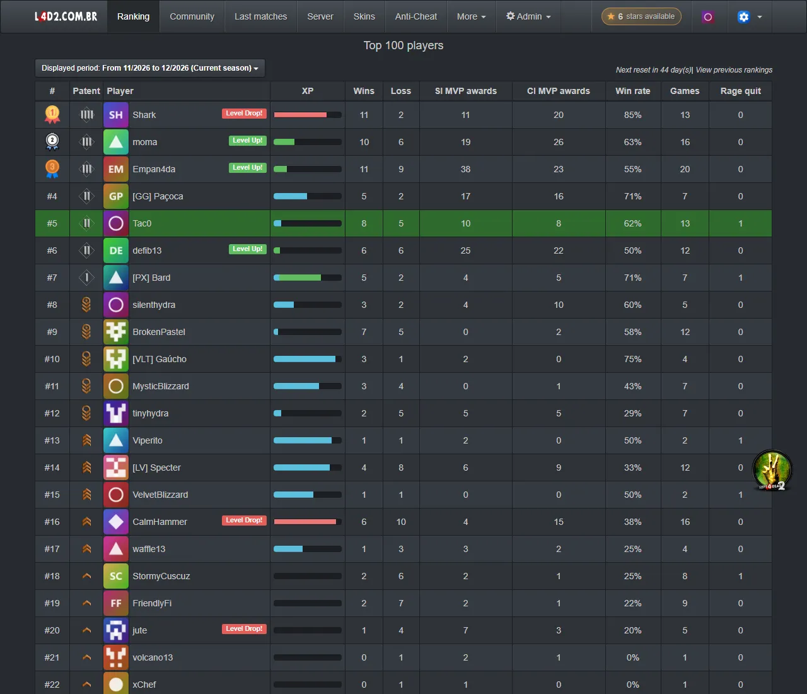
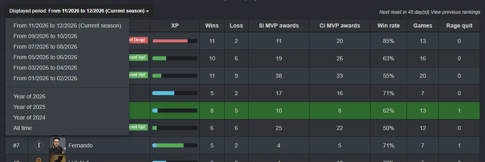

# Ranking

🌐 **English** | [Português](ranking.pt.md) | [Español](ranking.es.md)

The ranking is the first page of the site. It lists the top 100 players of the current season by experience (XP), calculated from the ranked matches played on all your game servers.

[Back to the manual](README.md)

## Contents

- [The ranking page](#the-ranking-page)
- [Choosing the period](#choosing-the-period)
- [How experience is calculated](#how-experience-is-calculated)
- [Wins, losses, draws and rage quits](#wins-losses-draws-and-rage-quits)
- [MVPs](#mvps)
- [Punishments](#punishments)
- [Minimum number of matches](#minimum-number-of-matches)
- [The order of the ranking](#the-order-of-the-ranking)
- [Settings](#settings)

## The ranking page

| Column | Meaning |
|---|---|
| # | Position. The first three have a medal. |
| Patent | The patent of the player's experience. See [Patents](patents.md). |
| Player | Avatar and name. Click it to open the [player page](players.md). |
| Level Up! / Level Drop! | The last match of the season moved this player to a higher or lower patent. |
| XP | A bar with the progress towards the next patent. Hover it to see the experience, the next level and how much the last match changed. Green means the last match added experience, red means it took experience away. |
| Wins, Loss | Ranked matches won and lost. A rage quit counts as a loss. |
| SI MVP awards, CI MVP awards | How many times the player was MVP. See [MVPs](#mvps). |
| Win rate | Wins divided by wins plus losses. |
| Games | Wins plus losses. Draws are not included. |
| Rage quit | Matches the player left before the end. |

When you are signed in, your own row is highlighted in green.

Above the table:

- **Displayed period** opens the [period selector](#choosing-the-period).
- **Next reset in N day(s)** says when the current season ends and the ranking starts again.
- **View previous rankings** opens the [players list](players.md#the-players-list) of the same period, where any past season, year or all time can be chosen.

The first 50 players are shown; **Show more...** shows the rest of the top 100. The full list of players of the period is on the [Players](players.md) page.

At the start of a season, before the first ranked match, the page shows the top 6 of the last finished season instead.

## Choosing the period

The ranking can show any season, a whole calendar year, or all time. The current season is the default. [Seasons and history](seasons-and-history.md) explains how the periods are calculated. Patents and level changes are shown only when a season is selected, since patents belong to a season.

## How experience is calculated

Each ranked match changes the experience of the players who were in it. With the default settings:

| Result | Experience |
|---|---|
| Win | +85 |
| Loss | −80 |
| Rage quit | −150, and nothing else from that match |
| Each SI MVP award in the match | +8 |
| Each CI MVP award in the match | +6 |

For example, a player who wins a match and was SI MVP in two round halves and CI MVP in one gets 85 + 2 × 8 + 6 = 107 XP. A player who loses with one SI MVP gets −80 + 8 = −72 XP.

- The matches are applied in the order they were played.
- Experience never goes below zero. A player with 30 XP who loses a match ends with 0, not −50.
- Only ranked matches count. A match is ranked when its game mode counts for the ranking and it has enough maps. See [Game modes and campaigns](game-modes-and-campaigns.md).
- The ranking of a season uses only the matches of that season. It starts from zero at each new season.
- The values above are the defaults. The administrator can change them in [Settings > Ranking points](administration.md#ranking-points). A change applies to every season right away, past ones included.

## Wins, losses, draws and rage quits

The result of a match is decided by the score after its last map.

| Situation | Result for the player |
|---|---|
| Was in the first map and in the last map, on the team with the higher score | Win |
| Was in the first map and in the last map, on the team with the lower score | Loss |
| Both teams ended with the same score, and the player was in the first and the last map | Draw: no win or loss, only the MVP points |
| Was in the first map and is not in the last map | Rage quit: one loss, and −150 XP for the match |
| Joined after the first map and was in the last map | No win and no loss; MVP points still count |

A rage quit replaces everything else the player would get from that match, including MVP points.

## MVPs

The statistics file of each map has, for each round half, an MVP in special infected damage (**SI MVP**), an MVP in common infected killed (**CI MVP**), and a player with the most friendly fire (**FF LVP**). A map has two round halves, so a team of four can win several awards over a match.

- SI MVP and CI MVP add experience (8 and 6 by default) and give one star each for the [skin shop](skin-shop.md#stars).
- FF LVP is shown in the statistics and gives no points.

## Punishments

An administrator can take experience away from a player in a season, for example after bad behaviour. The punishment is subtracted from the player's total of that season and is shown on the player page.

- It is set on the [player page](players.md#punishments), with the season selected.
- It belongs to one season. The next season starts without it.
- It does not apply to the rankings of a year or of all time.

[Moderation](moderation.md#punishments) explains how to add and remove one.

## Minimum number of matches

The administrator can require a minimum number of games (wins plus losses) to appear in the ranking. It is 0 by default, so every player with a ranked match appears. A player below the minimum is left out of the ranking, but their matches still count for everybody else.

## The order of the ranking

Players are ordered by experience. When two players have the same experience, the order is decided by, in this order: more wins, fewer losses, more SI MVP awards, more CI MVP awards.

## Settings

| Setting | Where | Default |
|---|---|---|
| Points for a win, a loss and a rage quit | [Settings > Ranking points](administration.md#ranking-points) | 85, −80, −150 |
| Points for each SI MVP and each CI MVP | [Settings > Ranking points](administration.md#ranking-points) | 8, 6 |
| Minimum matches to appear in the ranking | [Settings > Ranking points](administration.md#ranking-points) | 0 |
| Which game modes count, and how many maps a match needs | [Game modes](game-modes-and-campaigns.md#game-modes) | 4v4 with at least 2 maps |
| Season length | [Settings > Seasons](administration.md#seasons) | 2 months |

The whole ranking module can be turned off in [Modules](administration.md#modules). The first page then shows a short welcome text instead.
