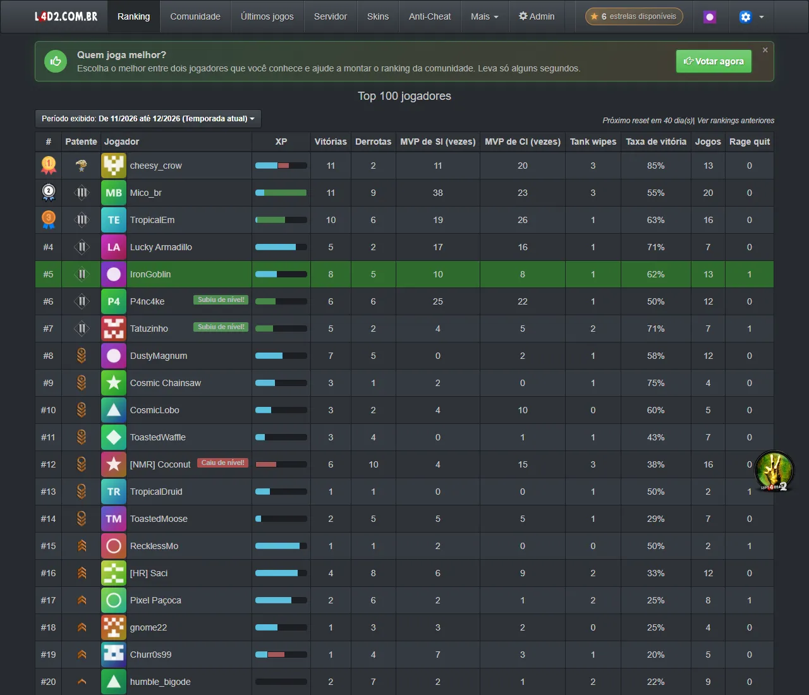
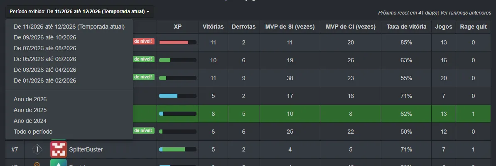

# Ranking

🌐 [English](ranking.md) | **Português** | [Español](ranking.es.md)

O ranking é a primeira página do site. Ele lista os 100 melhores jogadores da temporada atual por experiência (XP), calculada a partir das partidas ranqueadas jogadas em todos os seus servidores de jogo.

[Voltar ao manual](README.pt.md)

## Conteúdo

- [A página do ranking](#a-página-do-ranking)
- [Escolhendo o período](#escolhendo-o-período)
- [Como a experiência é calculada](#como-a-experiência-é-calculada)
- [Vitórias, derrotas, empates e rage quits](#vitórias-derrotas-empates-e-rage-quits)
- [MVPs](#mvps)
- [Tank wipes](#tank-wipes)
- [Punições](#punições)
- [Número mínimo de partidas](#número-mínimo-de-partidas)
- [A ordem do ranking](#a-ordem-do-ranking)
- [Configurações](#configurações)

## A página do ranking

| Coluna | Significado |
|---|---|
| # | Posição. Os três primeiros têm uma medalha. |
| Patente | A patente correspondente à experiência do jogador. Veja [Patentes](patents.pt.md). |
| Jogador | Avatar e nome. Clique para abrir a [página do jogador](players.pt.md). |
| Subiu de nível! / Caiu de nível! | A última partida da temporada levou este jogador para uma patente mais alta ou mais baixa. |
| XP | Uma barra com o progresso até a próxima patente. Passe o mouse sobre ela para ver a experiência, o próximo nível e quanto a última partida mudou. Verde quer dizer que a última partida somou experiência; vermelho, que ela tirou experiência. |
| Vitórias, Derrotas | Partidas ranqueadas ganhas e perdidas. Um rage quit conta como derrota. |
| MVP de SI (vezes), MVP de CI (vezes) | Quantas vezes o jogador foi MVP. Veja [MVPs](#mvps). |
| Tank wipes | Metades de rodada em que o jogador, como Tank, derrubou todos os sobreviventes e ainda estava vivo no fim. Veja [Tank wipes](#tank-wipes). |
| Taxa de vitória | Vitórias divididas por vitórias mais derrotas. |
| Jogos | Vitórias mais derrotas. Os empates não entram. |
| Rage quit | Partidas que o jogador abandonou antes do fim. |

Quando você está logado, a sua própria linha fica destacada em verde.

Acima da tabela:

- **Período exibido** abre o [seletor de período](#escolhendo-o-período).
- **Próximo reset em N dia(s)** diz quando a temporada atual termina e o ranking recomeça.
- **Ver rankings anteriores** abre a [lista de jogadores](players.pt.md#a-lista-de-jogadores): do ano atual quando a temporada atual está sendo mostrada; se não, do período mostrado. Lá dá para escolher uma temporada do ano atual, qualquer ano ou todo o período.

Os primeiros 50 jogadores aparecem; **Mostrar mais...** mostra o resto dos 100 melhores. A lista completa de jogadores do período está na página [Jogadores](players.pt.md).

No início de uma temporada, antes da primeira partida ranqueada, a página mostra, em vez disso, os 6 melhores da última temporada encerrada.

## Escolhendo o período

O ranking pode mostrar qualquer temporada, um ano inteiro ou todo o período. A temporada atual é o padrão. [Temporadas e histórico](seasons-and-history.pt.md) explica como os períodos são calculados. As patentes e as mudanças de nível só aparecem quando uma temporada está selecionada, já que as patentes pertencem a uma temporada.

## Como a experiência é calculada

Cada partida ranqueada muda a experiência dos jogadores que estavam nela. Com as configurações padrão:

| Resultado | Experiência |
|---|---|
| Vitória | +85 |
| Derrota | −80 |
| Rage quit | −150, e nada mais dessa partida |
| Cada MVP de SI na partida | +8 |
| Cada MVP de CI na partida | +6 |
| Cada tank wipe na partida | +50 |

Por exemplo, um jogador que ganha uma partida e foi MVP de SI em duas metades de rodada e MVP de CI em uma recebe 85 + 2 × 8 + 6 = 107 XP. Um jogador que perde com um MVP de SI recebe −80 + 8 = −72 XP, e um jogador que perde, mas derrubou os sobreviventes duas vezes como Tank recebe −80 + 2 × 50 = 20 XP.

- As partidas são aplicadas na ordem em que foram jogadas.
- A experiência nunca fica abaixo de zero. Um jogador com 30 XP que perde uma partida termina com 0, não com −50.
- Só as partidas ranqueadas contam. Uma partida é ranqueada quando o modo de jogo dela conta para o ranking e ela tem mapas suficientes. Veja [Modos de jogo e campanhas](game-modes-and-campaigns.pt.md).
- O ranking de uma temporada usa só as partidas daquela temporada. Ele começa do zero a cada nova temporada.
- Os valores acima são os padrões. O administrador pode alterá-los em [Configurações > Pontos do ranking](administration.pt.md#pontos-do-ranking). Uma alteração vale na hora para todas as temporadas, inclusive as passadas.

## Vitórias, derrotas, empates e rage quits

O resultado de uma partida é decidido pelo placar depois do último mapa dela.

| Situação | Resultado para o jogador |
|---|---|
| Estava no primeiro e no último mapa, na equipe com o placar maior | Vitória |
| Estava no primeiro e no último mapa, na equipe com o placar menor | Derrota |
| As duas equipes terminaram com o mesmo placar, e o jogador estava no primeiro e no último mapa | Empate: nem vitória nem derrota, só os pontos de MVP e de tank wipe |
| Estava no primeiro mapa e não está no último | Rage quit: uma derrota e −150 XP pela partida |
| Entrou depois do primeiro mapa e estava no último | Nem vitória nem derrota; os pontos de MVP e de tank wipe continuam valendo |

Um rage quit substitui tudo o que o jogador receberia daquela partida, inclusive os pontos de MVP e de tank wipe.

## MVPs

O arquivo de estatísticas de cada mapa tem, para cada metade de rodada, um MVP em dano em infectados especiais (**MVP de SI**), um MVP em infectados comuns mortos (**MVP de CI**) e um jogador com mais fogo amigo (**LVP de FF**). Um mapa tem duas metades de rodada, então uma equipe de quatro pode ganhar vários prêmios ao longo de uma partida.

- O MVP de SI e o MVP de CI somam experiência (8 e 6 por padrão) e dão uma estrela cada para a [loja de skins](skin-shop.pt.md#estrelas).
- O LVP de FF aparece nas estatísticas e não dá pontos.

## Tank wipes

Um tank wipe é uma metade de rodada em que o jogador, como Tank, derrubou todos os sobreviventes e ainda estava vivo quando a rodada terminou: os infectados ganharam a rodada ali mesmo, antes de os sobreviventes chegarem à sala segura ou matarem o Tank.

O arquivo de estatísticas não tem um campo para isso, então o site descobre a partir de cada metade de rodada: nenhum sobrevivente estava de pé no fim, e o tempo do Tank parou no mesmo segundo que o da rodada, o que só acontece quando ainda há um Tank vivo. O tank wipe vai para o jogador infectado que causou mais dano como Tank naquela metade. Um Tank controlado por um bot, ou um que nunca acertou um sobrevivente, não dá tank wipe.

Os tank wipes aparecem no ranking, na lista de jogadores, na página do jogador, nas partidas e nas páginas dentro do jogo. Cada um soma experiência (50 por padrão, veja [Configurações](#configurações)); eles não dão estrelas para a loja de skins.

## Punições

Um administrador pode tirar experiência de um jogador em uma temporada, por exemplo depois de um mau comportamento. A punição é subtraída do total do jogador naquela temporada e aparece na página do jogador.

- Ela é definida na [página do jogador](players.pt.md#punições), com a temporada selecionada.
- Ela pertence a uma temporada. A temporada seguinte começa sem ela.
- Ela não vale nos rankings de um ano ou de todo o período.

[Moderação](moderation.pt.md#punições) explica como adicionar e remover uma punição.

## Número mínimo de partidas

O administrador pode exigir um número mínimo de jogos (vitórias mais derrotas) para aparecer no ranking. O padrão é 0, então todo jogador com uma partida ranqueada aparece. Um jogador abaixo do mínimo fica fora do ranking, mas as partidas dele continuam contando para todos os outros.

## A ordem do ranking

Os jogadores são ordenados por experiência. Quando dois jogadores têm a mesma experiência, o desempate segue esta ordem: mais vitórias, menos derrotas, mais MVPs de SI, mais MVPs de CI.

## Configurações

| Configuração | Onde | Padrão |
|---|---|---|
| Pontos por vitória, derrota e rage quit | [Configurações > Pontos do ranking](administration.pt.md#pontos-do-ranking) | 85, −80, −150 |
| Pontos para cada MVP de SI e cada MVP de CI | [Configurações > Pontos do ranking](administration.pt.md#pontos-do-ranking) | 8, 6 |
| Pontos para cada tank wipe | [Configurações > Pontos do ranking](administration.pt.md#pontos-do-ranking) | 50 |
| Mínimo de partidas para aparecer no ranking | [Configurações > Pontos do ranking](administration.pt.md#pontos-do-ranking) | 0 |
| Quais modos de jogo contam, e de quantos mapas uma partida precisa | [Modos de jogo](game-modes-and-campaigns.pt.md#modos-de-jogo) | 4v4 com pelo menos 2 mapas |
| Duração da temporada | [Configurações > Temporadas](administration.pt.md#temporadas) | 2 meses |

O módulo inteiro do ranking pode ser desligado em [Módulos](administration.pt.md#módulos). A primeira página passa a mostrar um texto curto de boas-vindas no lugar.
