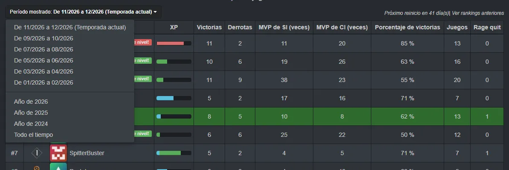

# Temporadas e historia

🌐 [English](seasons-and-history.md) | [Português](seasons-and-history.pt.md) | **Español**

El ranking se juega por temporadas. Al inicio de cada temporada todos vuelven a empezar desde cero experiencia. Las temporadas pasadas no se pierden: todavía se pueden consultar su ranking, sus partidas y sus jugadores, y también los de años completos y de todo el tiempo.

[Volver al manual](README.es.md)

## Contenido

- [Cómo funcionan las temporadas](#cómo-funcionan-las-temporadas)
- [El selector de período](#el-selector-de-período)
- [Historial](#historial)
- [Años y todo el tiempo](#años-y-todo-el-tiempo)
- [Cambiar la duración de la temporada](#cambiar-la-duración-de-la-temporada)
- [Qué pasa al final de una temporada](#qué-pasa-al-final-de-una-temporada)

## Cómo funcionan las temporadas

El administrador elige la duración de una temporada, en meses, de 1 a 24. El valor predeterminado es 2 meses.

- La primera temporada empieza al inicio de un año y los bloques siguen a partir de ahí. Con 2 meses, las temporadas empiezan en enero, marzo, mayo, julio, septiembre y noviembre. Con 3 meses, en enero, abril, julio y octubre.
- Cada temporada siguiente empieza exactamente donde terminó la anterior.
- Las fechas usan la zona horaria del sitio, definida en [Configuración](administration.es.md#sitio). Una temporada que termina el 31 de diciembre termina a la medianoche en esa zona horaria.
- En todo el sitio una temporada se nombra por su primer y su último mes, como **De 01/2026 a 02/2026**, y los selectores de período añaden **(Temporada actual)** a la actual.
- Cada archivo de estadísticas pertenece a la temporada de la fecha que el servidor de juego escribió en él. Un archivo anterior a la primera temporada crea las temporadas anteriores que necesita, así que los datos antiguos importados encuentran su lugar.
- Una partida nunca abarca dos temporadas. Los mapas jugados a uno y otro lado de la medianoche del cambio de temporada forman dos partidas.

La página del ranking indica cuántos días quedan: **Próximo reinicio en N día(s)**.

## El selector de período

El ranking, la lista de jugadores y la página del jugador tienen este selector. Lista:

- todas las temporadas, agrupadas por año, de la más reciente a la más antigua, con la actual marcada;
- cada año calendario;
- todo el tiempo.

Elegir un período cambia todos los números de la página: posiciones, victorias, MVP y las partidas listadas. La elección va en la dirección de la página, así que se puede compartir un enlace a una temporada pasada. La lista de partidas tiene sus propios filtros de temporada, año y servidor de juego; consulta [Partidas](matches.es.md#la-lista-de-partidas).

## Historial

El ranking final de una temporada pasada, de un año o de todo el tiempo está en la [lista de jugadores](players.es.md#la-lista-de-jugadores): elige el período y deja la **Vista general**, que muestra las victorias, derrotas, juegos, premios de MVP, porcentaje de victorias y rage quits de cada jugador en el orden del ranking. La lista de jugadores reemplazó la antigua página Historial; sus direcciones, como `/history/all-time` o `/history/2025`, abren la lista de jugadores del mismo período.

## Años y todo el tiempo

El ranking de un año usa todas las partidas de ranking cuyo último mapa se jugó en ese año calendario. Todo el tiempo usa todas las partidas de ranking registradas.

La experiencia en estos rankings se calcula igual que en una temporada, sobre el período más largo, con dos diferencias:

- los castigos no se aplican, porque pertenecen a una temporada;
- las patentes y los cambios de nivel no se muestran.

## Cambiar la duración de la temporada

La duración se cambia en [Configuración > Temporadas](administration.es.md#temporadas). El cambio se aplica a partir de la próxima temporada. Las temporadas que ya existen conservan sus fechas.

## Qué pasa al final de una temporada

No hay que hacer nada a mano. Cuando el reloj del sitio pasa el final de la temporada:

- el ranking de la nueva temporada empieza vacío, y la primera página muestra el top 6 de la temporada que acaba de terminar hasta que se juegue la primera partida de ranking;
- los castigos de la temporada anterior dejan de contar;
- si la [tienda de skins](skin-shop.es.md#reembolsos-al-final-de-una-temporada) reembolsa las skins al final de una temporada, cada skin comprada antes de la nueva temporada se reembolsa y las estrellas vuelven a sus dueños.

Las estrellas, las calificaciones de la comunidad y los regalos no se reinician.
