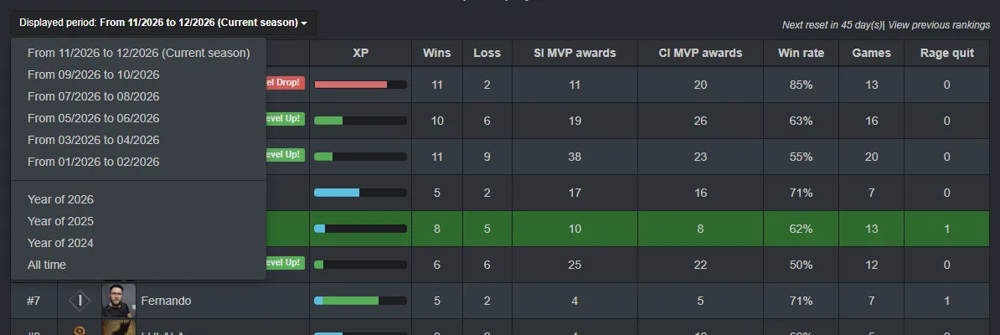
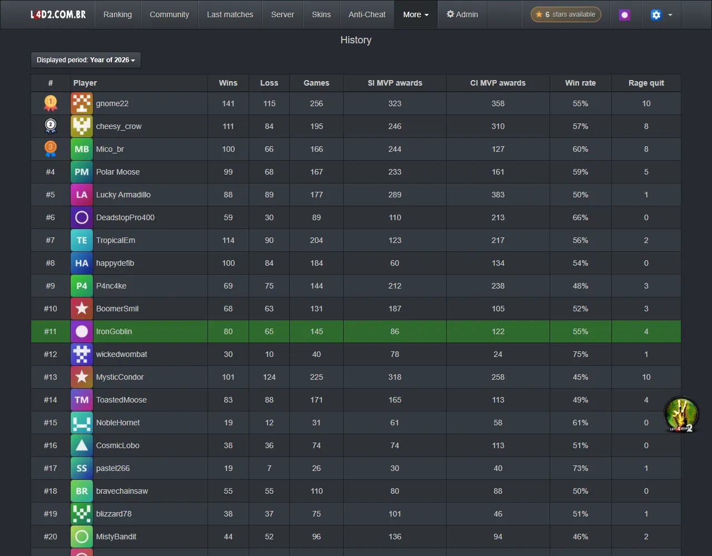

# Seasons and history

🌐 **English** | [Português](seasons-and-history.pt.md) | [Español](seasons-and-history.es.md)

The ranking is played in seasons. At the start of each season everybody starts again from zero experience. Past seasons are not lost: their ranking, matches and players can still be browsed, as can whole years and all time.

[Back to the manual](README.md)

## Contents

- [How seasons work](#how-seasons-work)
- [The period selector](#the-period-selector)
- [History](#history)
- [Years and all time](#years-and-all-time)
- [Changing the season length](#changing-the-season-length)
- [What happens at the end of a season](#what-happens-at-the-end-of-a-season)

## How seasons work

The administrator chooses the length of a season, in months, from 1 to 24. The default is 2 months.

- The first season starts at the beginning of a year and its blocks follow from there. With 2 months, seasons start in January, March, May, July, September and November. With 3 months, in January, April, July and October.
- Each next season starts exactly where the previous one ended.
- The dates use the time zone of the site, set in [Settings](administration.md#site). A season that ends on 31 December ends at midnight in that time zone.
- Each statistics file belongs to the season of the date the game server wrote in it. A file from before the first season creates the earlier seasons it needs, so imported old data finds its place.
- A match never crosses two seasons. Maps played across midnight at the turn of a season make two matches.

The ranking page says how many days are left: **Next reset in N day(s)**.

## The period selector

The ranking, the players list and the player page have this selector. It lists:

- every season, grouped by year, newest first, with the current one marked;
- each calendar year;
- all time.

Choosing a period changes every number on the page: positions, wins, MVPs and the matches listed. The choice is carried in the address, so a link to a past season can be shared. The match list has its own filters for the season, the year and the game server; see [Matches](matches.md#the-match-list).

## History

**More > History** shows the final ranking of a finished period.

The selector of this page lists all time, every year, and the seasons of the current year that are already finished. It opens on the current year. The ranking of a past season of an earlier year is reached from the period selector of the ranking page.

The table shows, for each player: wins, losses, games, SI MVP and CI MVP awards, win rate and rage quits. The top three have a medal.

## Years and all time

The ranking of a year uses every ranked match whose last map was played in that calendar year. All time uses every ranked match ever recorded.

The experience in these rankings is calculated the same way as in a season, over the longer period, with two differences:

- punishments are not applied, since they belong to one season;
- patents and level changes are not shown.

## Changing the season length

The length is changed in [Settings > Seasons](administration.md#seasons). The change applies from the next season. Seasons that already exist keep their dates.

## What happens at the end of a season

Nothing has to be done by hand. When the clock of the site passes the end of the season:

- the ranking of the new season starts empty, and the first page shows the top 6 of the season that just ended until the first ranked match is played;
- punishments of the old season stop counting;
- if the [skin shop](skin-shop.md#refunds-at-the-end-of-a-season) refunds skins at the end of a season, every skin bought before the new season is refunded and the stars return to their owners.

Stars, community ratings and gifts are not reset.
