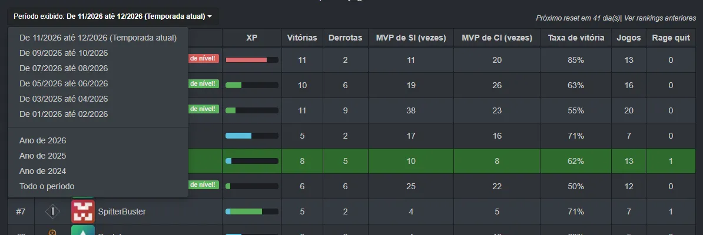

# Temporadas e histórico

🌐 [English](seasons-and-history.md) | **Português** | [Español](seasons-and-history.es.md)

O ranking é disputado em temporadas. No início de cada temporada, todo mundo recomeça com zero de experiência. As temporadas passadas não se perdem: o ranking, as partidas e os jogadores delas continuam disponíveis para consulta, assim como os de anos inteiros e de todo o período.

[Voltar ao manual](README.pt.md)

## Conteúdo

- [Como as temporadas funcionam](#como-as-temporadas-funcionam)
- [O seletor de período](#o-seletor-de-período)
- [Histórico](#histórico)
- [Anos e todo o período](#anos-e-todo-o-período)
- [Mudando a duração da temporada](#mudando-a-duração-da-temporada)
- [O que acontece no fim de uma temporada](#o-que-acontece-no-fim-de-uma-temporada)

## Como as temporadas funcionam

O administrador escolhe a duração de uma temporada, em meses, de 1 a 24. O padrão é 2 meses.

- A primeira temporada começa no início de um ano, e os blocos seguem a partir daí. Com 2 meses, as temporadas começam em janeiro, março, maio, julho, setembro e novembro. Com 3 meses, em janeiro, abril, julho e outubro.
- Cada temporada seguinte começa exatamente onde a anterior terminou.
- As datas usam o fuso horário do site, definido em [Configurações](administration.pt.md#site). Uma temporada que termina em 31 de dezembro termina à meia-noite nesse fuso horário.
- Em todo o site, uma temporada é identificada pelo primeiro e pelo último mês, como **De 01/2026 até 02/2026**, e os seletores de período acrescentam **(Temporada atual)** à atual.
- Cada arquivo de estatísticas pertence à temporada da data que o servidor de jogo gravou nele. Um arquivo de antes da primeira temporada cria as temporadas anteriores de que precisa, então dados antigos importados encontram o seu lugar.
- Uma partida nunca atravessa duas temporadas. Mapas jogados antes e depois da meia-noite da virada de uma temporada formam duas partidas.

A página do ranking diz quantos dias faltam: **Próximo reset em N dia(s)**.

## O seletor de período

O ranking, a lista de jogadores e a página do jogador têm este seletor. Ele lista:

- as temporadas do ano atual, das mais recentes para as mais antigas, com a atual marcada (uma temporada mais antiga ainda abre pelo endereço dela, como um link compartilhado);
- cada ano;
- todo o período.

Escolher um período muda todos os números da página: posições, vitórias, MVPs e as partidas listadas. A escolha vai no endereço, então dá para compartilhar um link de uma temporada passada. A lista de partidas tem filtros próprios para a temporada, o ano e o servidor de jogo; veja [Partidas](matches.pt.md#a-lista-de-partidas).

## Histórico

O ranking final de uma temporada passada, de um ano ou de todo o período fica na [lista de jogadores](players.pt.md#a-lista-de-jogadores): escolha o período (uma temporada do ano atual, qualquer ano ou todo o período; uma temporada mais antiga abre pelo endereço dela) e mantenha a **Visão geral**, que mostra as vitórias, derrotas, jogos, MVPs, tank wipes, taxa de vitória e rage quits de cada jogador na ordem do ranking. A lista de jogadores substituiu a antiga página Histórico; os endereços dela, como `/history/all-time` ou `/history/2025`, abrem a lista de jogadores do mesmo período.

## Anos e todo o período

O ranking de um ano usa todas as partidas ranqueadas cujo último mapa foi jogado naquele ano. Todo o período usa todas as partidas ranqueadas já registradas.

A experiência nesses rankings é calculada do mesmo jeito que em uma temporada, sobre o período mais longo, com duas diferenças:

- as punições não são aplicadas, já que pertencem a uma temporada;
- as patentes e as mudanças de nível não aparecem.

## Mudando a duração da temporada

A duração é alterada em [Configurações > Temporadas](administration.pt.md#temporadas). A alteração vale a partir da próxima temporada. As temporadas que já existem mantêm as suas datas.

## O que acontece no fim de uma temporada

Nada precisa ser feito à mão. Quando o relógio do site passa do fim da temporada:

- o ranking da nova temporada começa vazio, e a primeira página mostra os 6 melhores da temporada que acabou de terminar até a primeira partida ranqueada ser jogada;
- as punições da temporada antiga deixam de contar;
- se a [loja de skins](skin-shop.pt.md#reembolsos-no-fim-de-uma-temporada) reembolsa as skins no fim de uma temporada, todas as skins compradas antes da nova temporada são reembolsadas e as estrelas voltam para os donos.

As estrelas, as pontuações do ranking da comunidade e os presentes não são zerados.
