# Tienda de skins de armas

🌐 [English](skin-shop.md) | [Português](skin-shop.pt.md) | **Español**

Los jugadores ganan estrellas al ser MVP en partidas de ranking y las gastan en skins para sus armas. Una skin comprada se equipa en el servidor de juego a partir del siguiente cambio de mapa. Las skins las hace la comunidad en el Steam Workshop; la tienda da el crédito a cada autor.

La tienda necesita el módulo de ranking, el plugin `l4d2_weapon_skins` en el servidor de juego y un catálogo importado por un administrador.

[Volver al manual](README.es.md)

## Contenido

- [Estrellas](#estrellas)
- [La página de la tienda](#la-página-de-la-tienda)
- [Comprar una skin](#comprar-una-skin)
- [Mis skins y equipar](#mis-skins-y-equipar)
- [Usar las skins en el juego](#usar-las-skins-en-el-juego)
- [Reembolsos al final de una temporada](#reembolsos-al-final-de-una-temporada)
- [Regalos](#regalos)
- [Autores de las skins](#autores-de-las-skins)
- [Para administradores](#para-administradores)

## Estrellas

- Cada premio de **MVP de SI** y cada premio de **MVP de CI** en una partida de ranking vale una estrella. Consulta [Ranking > MVP](ranking.es.md#mvp).
- Cuentan todas las partidas de ranking desde el principio. Las estrellas no se reinician con la temporada y nunca vencen.
- El saldo es las estrellas ganadas menos el precio de las skins que el jugador tiene ahora. Cuando una compra se reembolsa, su precio vuelve al saldo.
- Los regalos no cuestan nada.

Un jugador conectado ve el saldo en la barra del menú (**N estrellas disponibles**) y arriba en la tienda, con cuántas estrellas vinieron de cada tipo de MVP.

## La página de la tienda

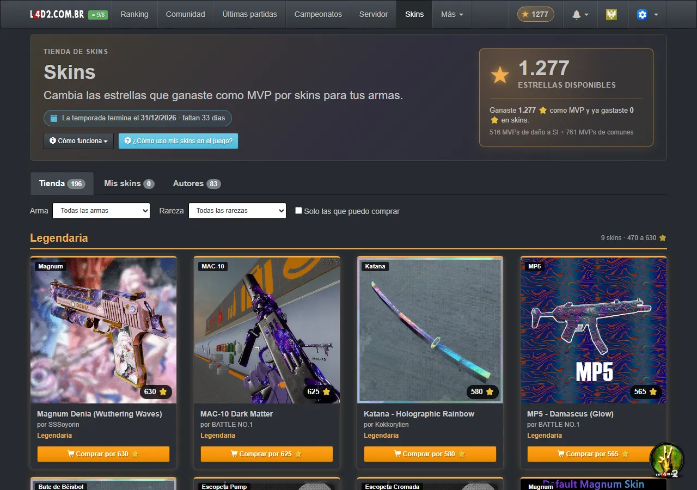

Arriba:

- **La temporada termina el**: el último día de la temporada actual y cuántos días quedan. Las skins compradas duran hasta entonces (consulta los [reembolsos](#reembolsos-al-final-de-una-temporada)).
- **Cómo funciona**: los tres pasos y las reglas de la temporada.
- **¿Cómo uso mis skins en el juego?**: los comandos del chat.
- El saldo de estrellas.

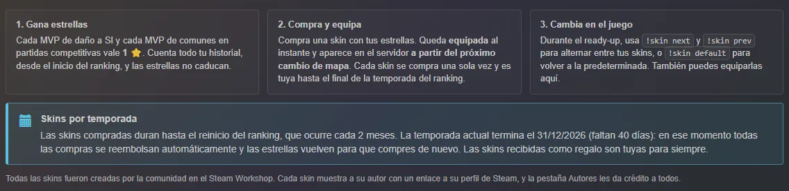

Las pestañas:

| Pestaña | Muestra |
|---|---|
| Tienda | Todas las skins a la venta, agrupadas por rareza: Legendaria, Épica, Rara, Poco común y Común. |
| Mis skins | Las skins que tienes. Se muestra cuando iniciaste sesión. |
| Autores | Todos los autores del Workshop cuyas skins están en la tienda, con un enlace a su perfil de Steam. |

Los filtros eligen un arma (o todas las armas de fuego, o todas las armas cuerpo a cuerpo), una rareza y **Solo las que puedo comprar**.

Cada tarjeta muestra el arma, la imagen, el precio, el nombre, el autor y la rareza. El botón dice **Comprar por N** cuando tienes suficientes estrellas, y cuántas estrellas te faltan cuando no. Un visitante que no inició sesión ve el catálogo y un botón para iniciar sesión con Steam:

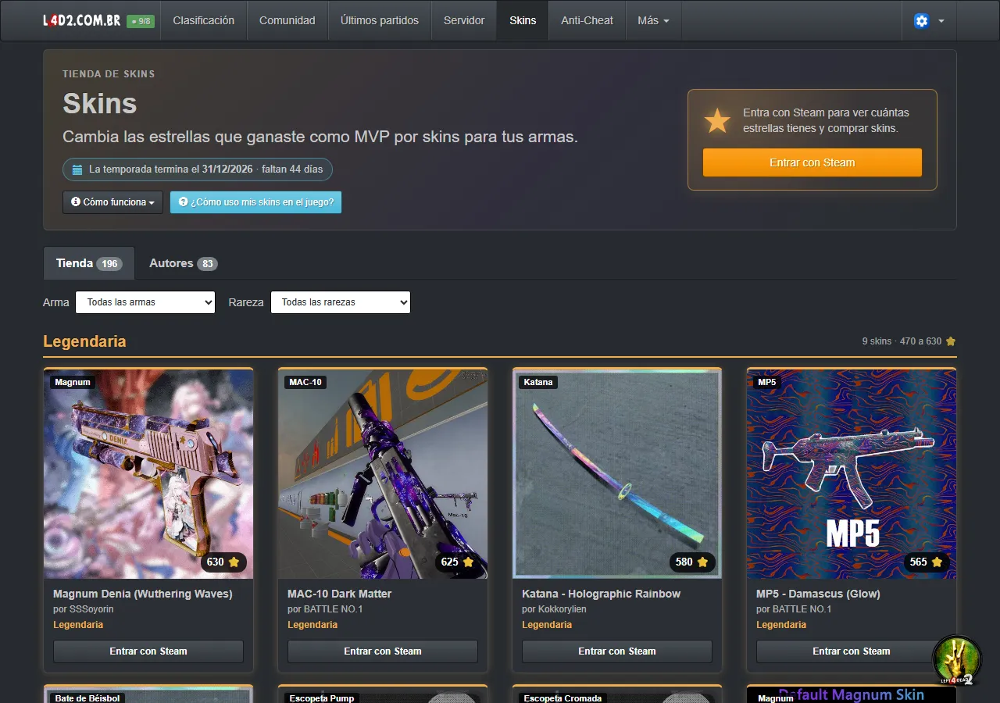

Haz clic en una tarjeta para ver los detalles de la skin: hasta seis fotos, la rareza, el arma, el precio, el autor, la descripción, el título original en el Workshop, el comando de chat para usarla y un enlace a la página del Workshop.

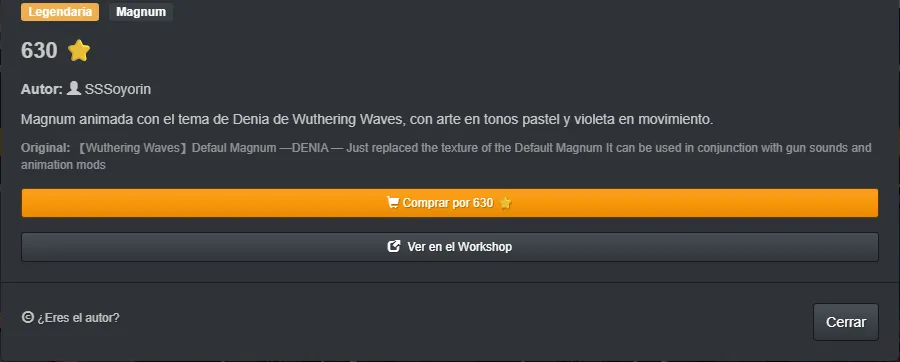

## Comprar una skin

Haz clic en **Comprar por N**. La tienda te pide que confirmes:

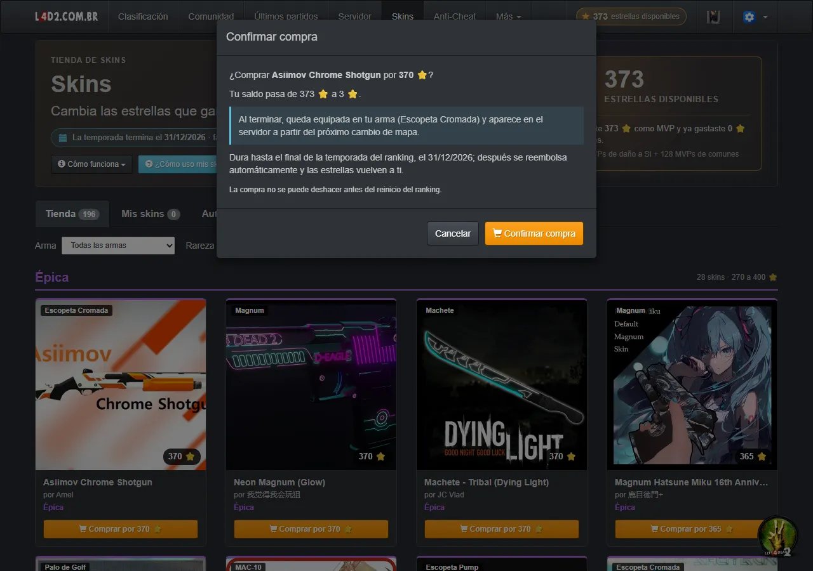

Después de la compra, la skin se equipa en esa arma de inmediato:

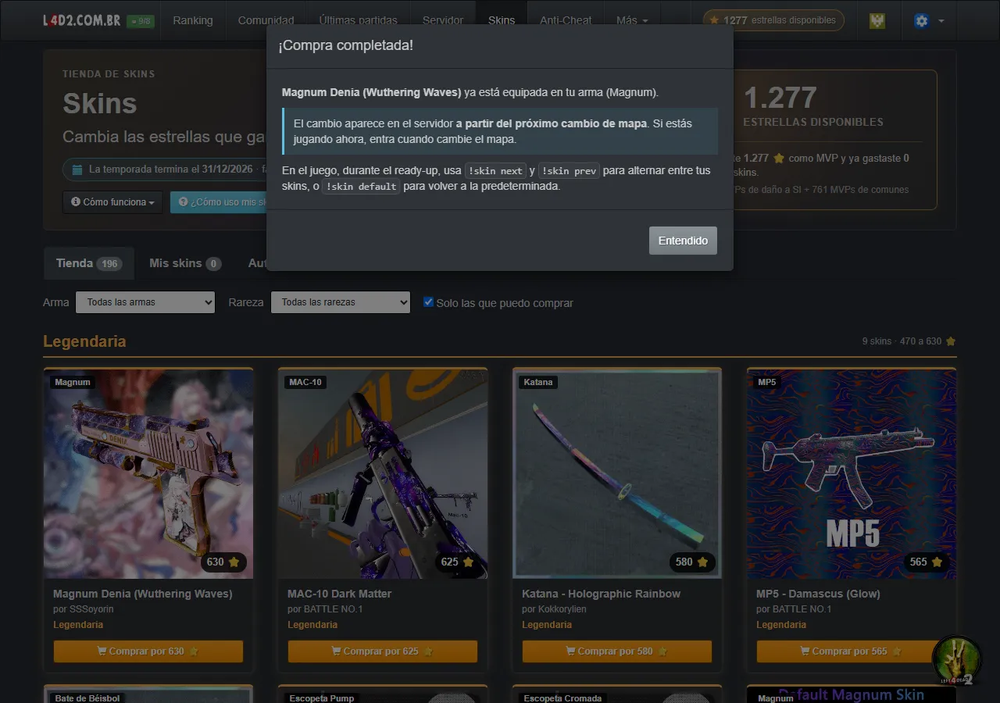

- Cada skin se puede comprar una vez.
- El cambio aparece en el servidor de juego a partir del siguiente cambio de mapa. Si estás jugando, aparece cuando cambia el mapa.
- El precio es el que se muestra en el momento de la compra. Un cambio de precio posterior no afecta a las skins ya compradas.

## Mis skins y equipar

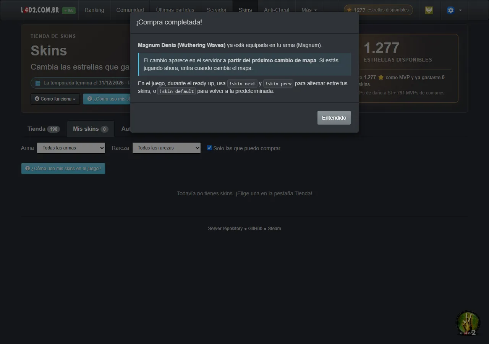

Puedes tener varias skins para la misma arma, y una de ellas está equipada. En el sitio:

- **Equipar** pone esa skin en el arma.
- **Volver a la predeterminada** devuelve el arma a su aspecto normal.

Lo que equipas en el sitio se usa en el juego, y lo que eliges en el juego aparece en el sitio.

Las skins que tiene un jugador también están en la [pestaña Skins de la página del jugador](players.es.md#pestaña-skins).

## Usar las skins en el juego

Escribe estos comandos en el chat del juego:

| Comando | Qué hace |
|---|---|
| `!skin next`, `!skin prev` | Cambia entre las skins que compraste para el arma que tienes en la mano. Después de la última, vuelve a la skin predeterminada. |
| `!skin surtr` | Usa una de tus skins por su id. El id está en los detalles de cada skin. |
| `!skin default` | Devuelve el arma que tienes en la mano a la skin predeterminada. |
| `!skin next pump` | Elige el arma por nombre, sin tenerla en la mano. |
| `!skin status` | Muestra cuántas estrellas y skins tienes. |
| `!skin` | Muestra la ayuda de las skins en el chat. |

El cambio se hace durante el ready-up. La skin se queda con el arma: si la sueltas, quien la recoja la usa con tu skin.

## Reembolsos al final de una temporada

Por defecto, las skins compradas duran una temporada:

- Cuando empieza una temporada nueva, cada skin comprada antes de ella se retira y sus estrellas vuelven al dueño. El dueño puede volver a comprar de inmediato, las mismas skins u otras.
- Los regalos no se retiran. Se conservan para siempre.
- El administrador puede desactivar esto en los [ajustes de la tienda](#ajustes-de-la-tienda). Las skins compradas también se conservan para siempre entonces.

El reembolso se hace solo: el sitio revisa cada 10 minutos si empezó una temporada nueva. La tienda muestra cuántos días quedan.

## Regalos

Un administrador puede regalar cualquier skin a cualquier jugador. La skin se equipa para ese jugador, no se cobran estrellas y se conserva al final de la temporada. En la tienda, los detalles de una skin tienen un botón **Regalar (admin)**; la [página de compras](#compras) tiene **Regalar skin**.

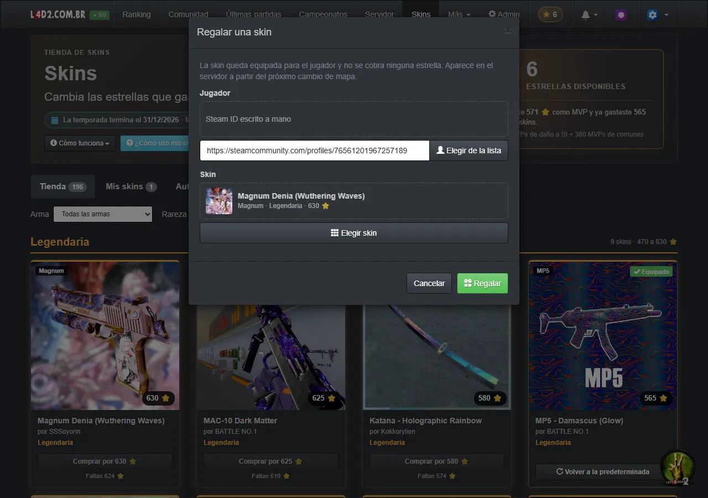

Elige al jugador por Steam ID (en cualquier formato), por enlace al perfil o de la lista, y haz clic en **Regalar**.

## Autores de las skins

Cada skin muestra su autor con un enlace a su perfil de Steam y a la página original del Workshop. El aviso **¿Eres el autor?** explica que el proyecto no tiene fines de lucro, que las estrellas no se pueden comprar con dinero, y cómo un autor puede pedir que se retire una skin: un mensaje en Steam o una solicitud en GitHub, si el administrador definió esas direcciones.

El nombre del autor viene de su perfil de Steam, y no solo del catálogo. Una vez al día el sitio le pide a Steam el nombre actual de cada autor y actualiza sus skins cuando alguien lo cambió, así la tienda siempre acredita el nombre que el autor usa hoy. Volver a importar el catálogo mantiene el nombre leído de Steam. Funciona sin la clave de la Steam Web API; con la clave, definida en los ajustes del sitio, es más rápido.

## Para administradores

La tienda tiene cuatro páginas en **Administración > Skins**.

### Compras

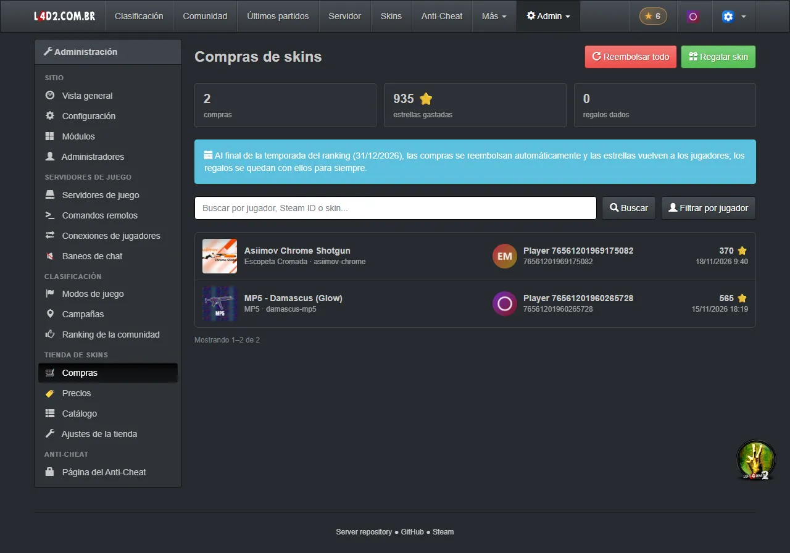

La lista de todas las compras y regalos, de la más reciente a la más antigua, con los totales: compras, estrellas gastadas y regalos dados. Busca por jugador, Steam ID o skin, o filtra por un jugador.

Haz clic en una compra para ver los detalles: el precio, el saldo antes y después, quién la regaló (en un regalo) y la fecha. Desde ahí:

- **Reembolsar compra** le quita la skin a ese jugador y devuelve su precio.
- **Mostrar solo las compras de este jugador** y **Abrir el perfil del jugador**.

**Reembolsar todo** retira todas las compras y todos los regalos de todos los jugadores. No se puede deshacer. Úsalo, por ejemplo, después de recalcular los precios. Las estrellas no cambian: solo se devuelve lo gastado.

**Regalar skin** abre la ventana de [regalo](#regalos).

### Catálogo

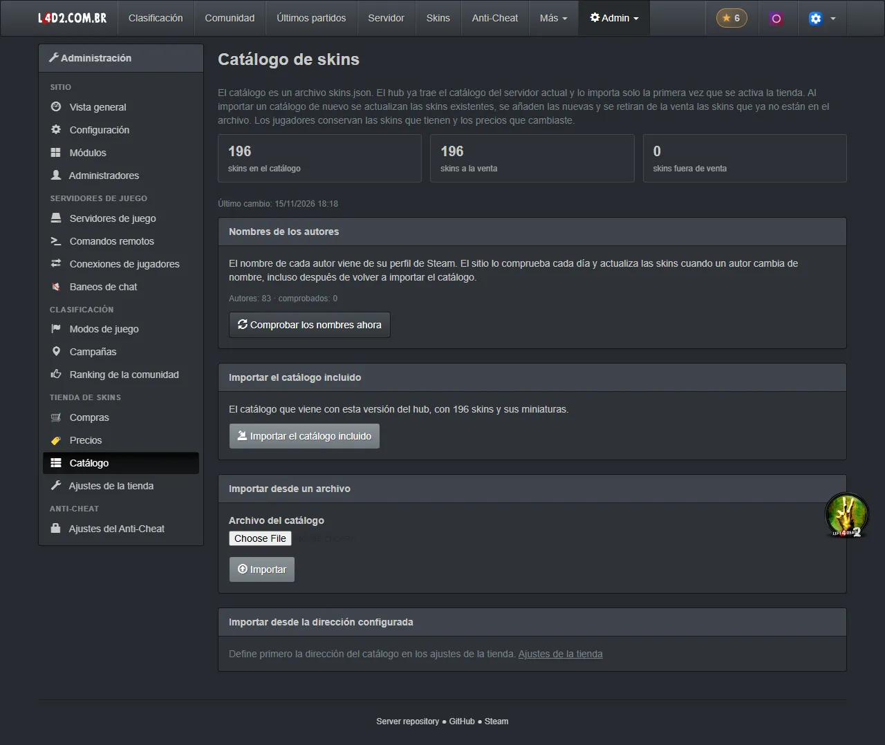

El catálogo es el archivo `skins.json` del [repositorio de recursos](https://github.com/altair-sossai/l4d2-zone-server-assets). Impórtalo desde un archivo, o descárgalo de la dirección definida en los ajustes de la tienda. Al importar de nuevo:

- se actualizan las skins que existen y se agregan las nuevas;
- se retiran de la venta las skins que ya no están en el archivo; los jugadores conservan las que tienen.

La página muestra cuántas skins hay en el catálogo, a la venta y fuera de venta, y cuándo cambió por última vez. El panel **Nombres de los autores** muestra cuántos autores hay, cuántos se comprobaron en Steam, cuándo fue la última comprobación y cuándo un autor cambió su nombre por última vez. **Comprobar los nombres ahora** hace la comprobación al momento, sin esperar a la diaria.

### Precios

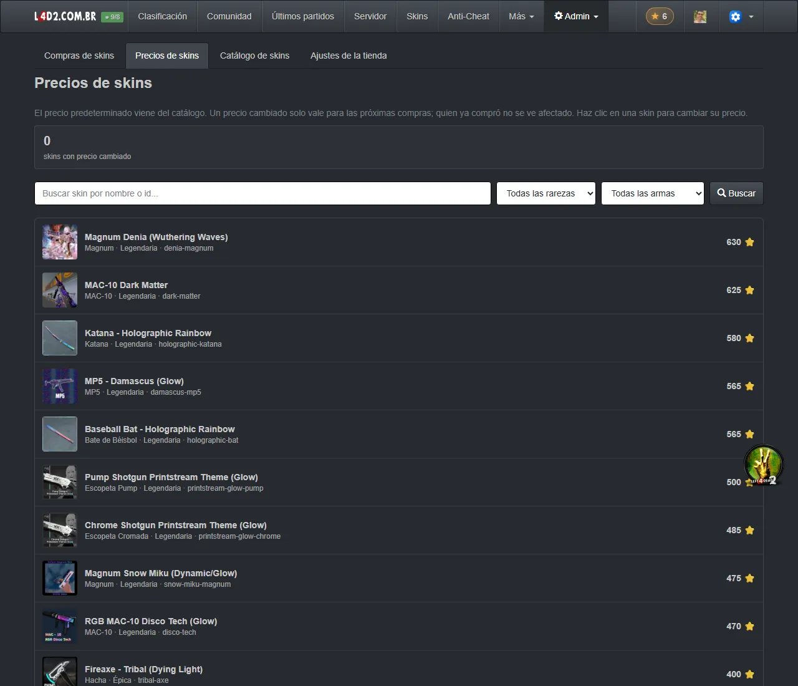

El precio predeterminado de cada skin viene del catálogo. Haz clic en una skin para darle otro precio o para volver al predeterminado. Un precio nuevo se aplica solo a las compras nuevas. La lista se puede buscar y filtrar por rareza y arma, y muestra cuántas skins tienen un precio cambiado. Desde aquí también se puede regalar una skin.

### Ajustes de la tienda

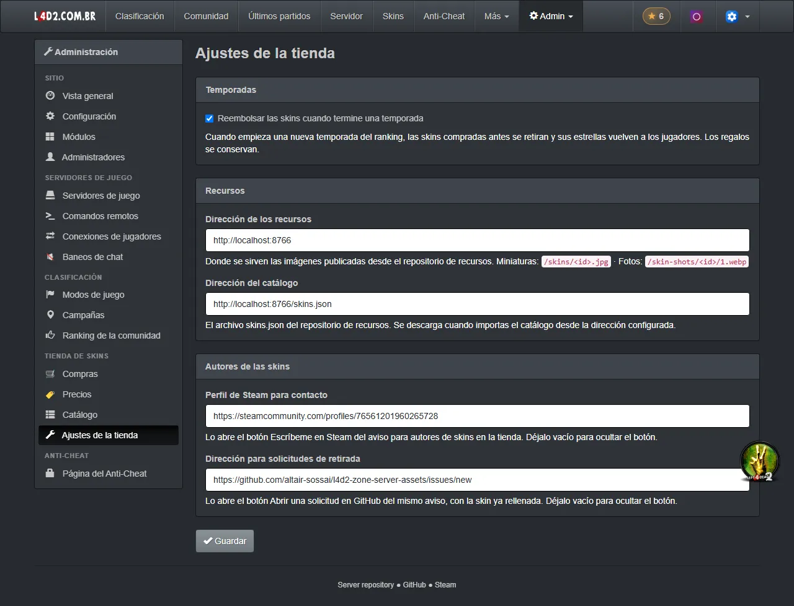

| Ajuste | Qué hace |
|---|---|
| Reembolsar las skins cuando termine una temporada | Activado por defecto. Consulta los [reembolsos](#reembolsos-al-final-de-una-temporada). |
| Dirección de los recursos | Dónde se sirven las imágenes del repositorio de recursos. Las miniaturas se leen de `skins/<id>.jpg` y las fotos de `skin-shots/<id>/` bajo esta dirección. |
| Dirección del catálogo | De dónde se descarga el archivo `skins.json` cuando importas desde la dirección configurada. |
| Perfil de Steam para contacto | Lo abre **Escríbeme en Steam** en el aviso para los autores de skins. Vacío oculta el botón. |
| Dirección para solicitudes de retirada | La abre **Abrir una solicitud en GitHub** en el mismo aviso, con la skin ya completada. Vacío oculta el botón. |

Desactivar el módulo de la tienda de skins en [Módulos](administration.es.md#módulos) quita **Skins** del menú, las estrellas de la barra del menú y la pestaña Skins de la página del jugador. Las compras se conservan y vuelven si el módulo se activa de nuevo.
