# Weapon skin shop

🌐 **English** | [Português](skin-shop.pt.md) | [Español](skin-shop.es.md)

Players earn stars by being MVP in ranked matches and spend them on skins for their weapons. A bought skin is equipped on the game server from the next map change. The skins are made by the community on the Steam Workshop; the shop credits every author.

The shop needs the ranking module, the `l4d2_weapon_skins` plugin on the game server, and a catalog imported by an administrator.

[Back to the manual](README.md)

## Contents

- [Stars](#stars)
- [The shop page](#the-shop-page)
- [Buying a skin](#buying-a-skin)
- [My skins and equipping](#my-skins-and-equipping)
- [Using skins in the game](#using-skins-in-the-game)
- [Refunds at the end of a season](#refunds-at-the-end-of-a-season)
- [Gifts](#gifts)
- [Skin authors](#skin-authors)
- [For administrators](#for-administrators)

## Stars

- Each **SI MVP** and each **CI MVP** award in a ranked match is worth one star. See [Ranking > MVPs](ranking.md#mvps).
- Every ranked match since the beginning counts. Stars do not reset with the season and never expire.
- The balance is the stars earned minus the price of the skins the player has now. When a purchase is refunded, its price comes back to the balance.
- Gifts cost nothing.

A signed-in player sees the balance in the menu bar (**N stars available**) and at the top of the shop, with how many stars came from each kind of MVP.

## The shop page

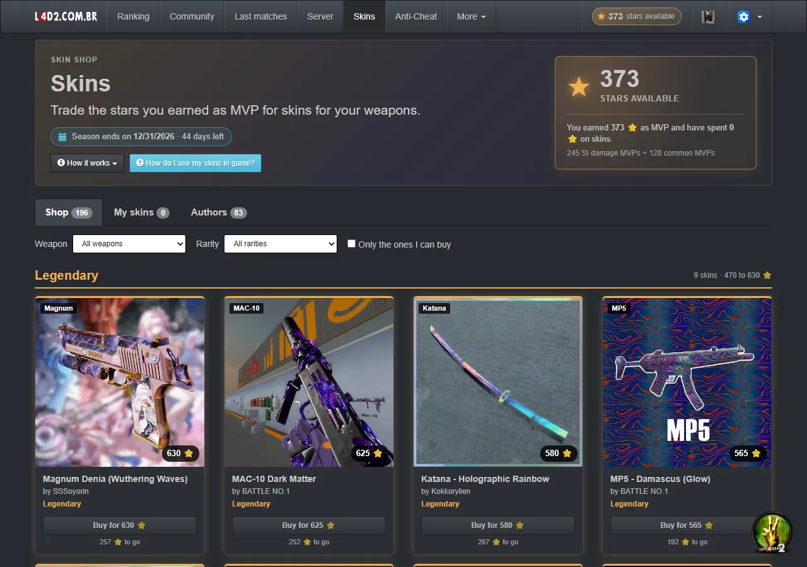

At the top:

- **Season ends on**: the last day of the current season and how many days are left. Bought skins last until then (see [refunds](#refunds-at-the-end-of-a-season)).
- **How it works**: the three steps and the rules of the season.
- **How do I use my skins in game?**: the chat commands.
- The balance of stars.

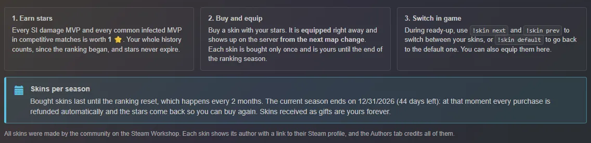

The tabs:

| Tab | Shows |
|---|---|
| Shop | Every skin for sale, grouped by rarity: Legendary, Epic, Rare, Uncommon and Common. |
| My skins | The skins you own. Shown when you are signed in. |
| Authors | Every Workshop author whose skins are in the shop, with a link to their Steam profile. |

The filters choose a weapon (or all firearms, or all melee weapons), a rarity, and **Only the ones I can buy**.

Each card shows the weapon, the picture, the price, the name, the author and the rarity. The button says **Buy for N** when you have enough stars, and how many stars are still missing when you do not. A visitor who is not signed in sees the catalog and a button to sign in with Steam:

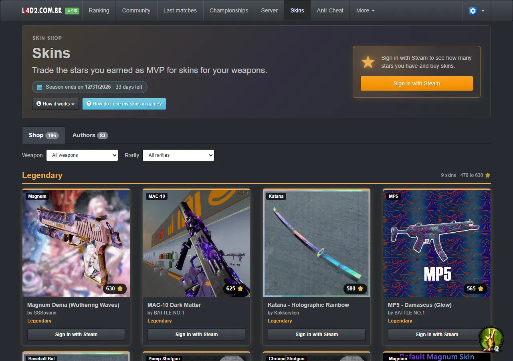

Click a card to see the details of the skin: up to six photos, the rarity, the weapon, the price, the author, the description, the original title on the Workshop, the chat command to use it, and a link to the Workshop page.

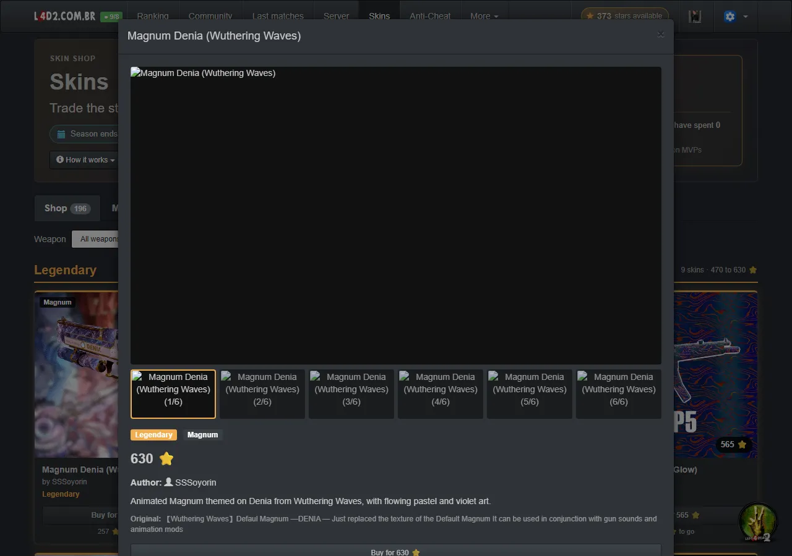

## Buying a skin

Click **Buy for N**. The shop asks you to confirm:

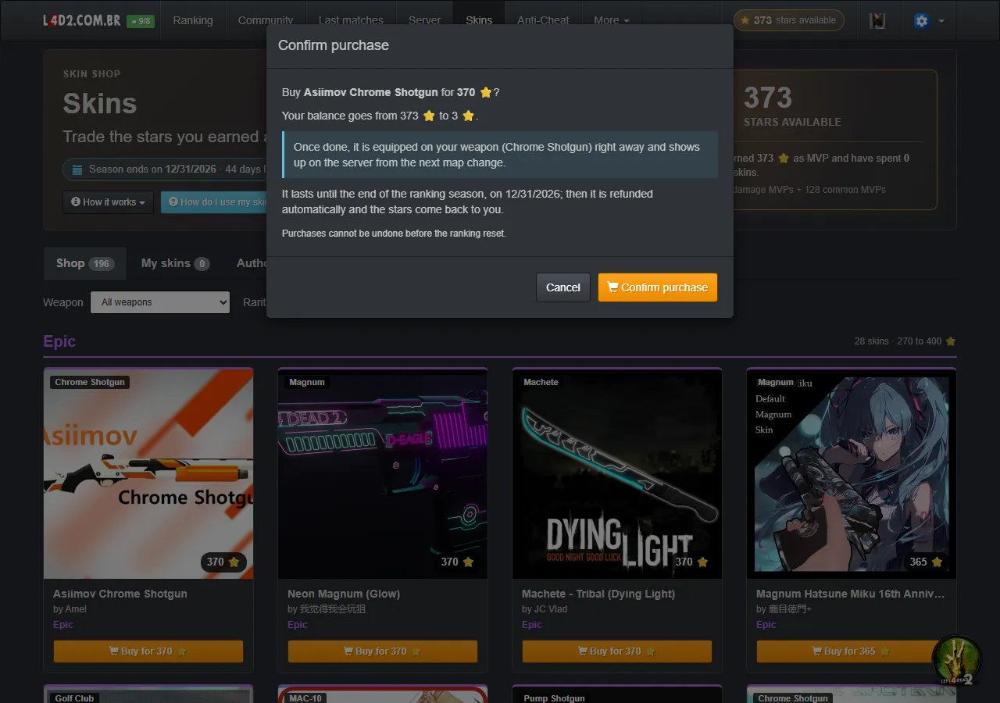

After the purchase the skin is equipped on that weapon at once:

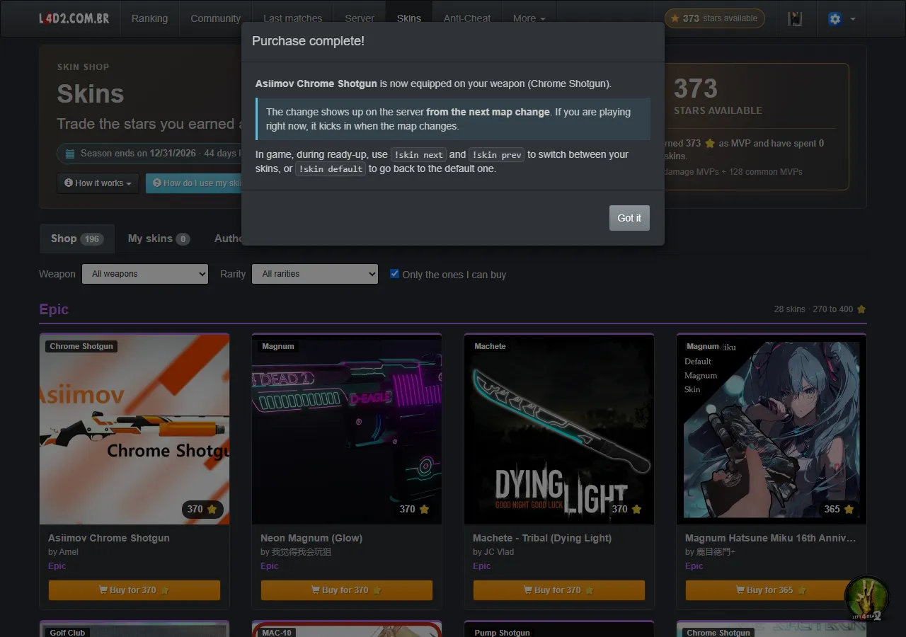

- Each skin can be bought once.
- The change shows up on the game server from the next map change. If you are playing, it appears when the map changes.
- The price is the one shown at the moment of the purchase. A later price change does not affect skins already bought.

## My skins and equipping

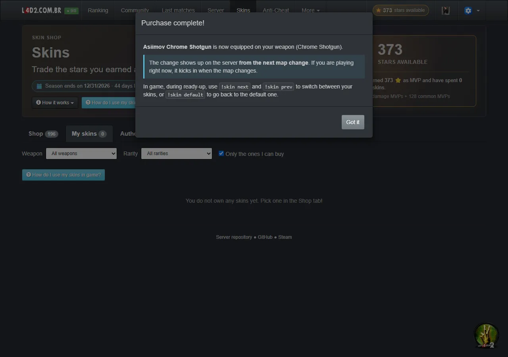

You can own several skins for the same weapon, and one of them is equipped. On the site:

- **Equip** puts that skin on the weapon.
- **Back to default** puts the weapon back on its normal look.

What you equip on the site is used in the game, and what you choose in the game shows up on the site.

The skins a player owns are also on the [Skins tab of the player page](players.md#skins-tab).

## Using skins in the game

Type these commands in the game chat:

| Command | What it does |
|---|---|
| `!skin next`, `!skin prev` | Switch between the skins you bought for the weapon in your hand. After the last one, it goes back to the default skin. |
| `!skin surtr` | Uses one of your skins by its id. The id is in the details of each skin. |
| `!skin default` | Puts the weapon in your hand back on the default skin. |
| `!skin next pump` | Picks the weapon by name, without holding it. |
| `!skin status` | Shows how many stars and skins you have. |
| `!skin` | Shows the skins help in the chat. |

Switching is done during the ready-up. The skin stays with the weapon: if you drop it, whoever picks it up uses it with your skin.

## Refunds at the end of a season

By default, bought skins last for one season:

- When a new season starts, every skin bought before it is taken back and its stars return to the owner. The owner can buy again right away, the same skins or others.
- Gifts are not taken back. They are kept forever.
- The administrator can turn this off in the [shop settings](#shop-settings). Bought skins are then kept forever too.

The refund runs by itself: the site checks every 10 minutes whether a new season has started. The shop shows how many days are left.

## Gifts

An administrator can give any skin to any player. The skin is equipped for that player, no stars are charged, and it is kept at the end of the season. In the shop, the details of a skin have a **Give as a gift (admin)** button; the [purchases page](#purchases) has **Give a skin**.

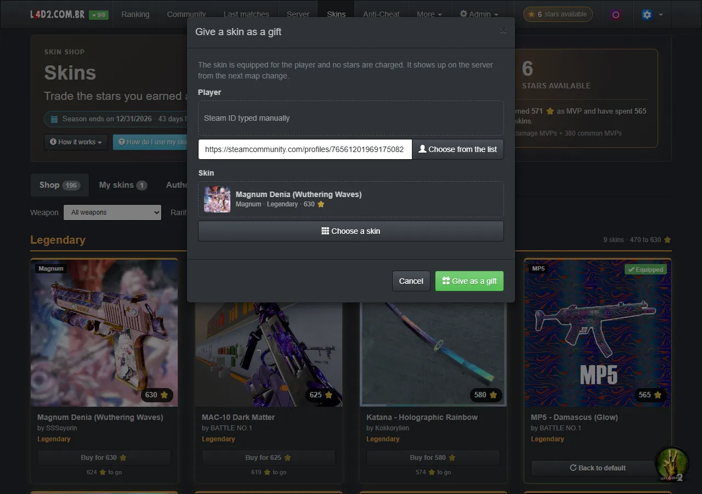

Choose the player by Steam ID (any format), by profile link, or from the list, then click **Give as a gift**.

## Skin authors

Every skin shows its author with a link to their Steam profile and to the original Workshop page. The **Are you the author?** notice explains that the project is non-profit, that stars cannot be bought with money, and how an author can ask for a skin to be removed: a message on Steam or a request on GitHub, if the administrator set those addresses.

The author's name comes from their Steam profile, not only from the catalog. Once a day the site asks Steam for the current name of every author and updates their skins when someone changed it, so the shop always credits the name the author uses today. Importing the catalog again keeps the name read from Steam. It works without a Steam Web API key; with a key, set in the site settings, it is faster.

## For administrators

The shop has four pages, in the **Skin shop** group of the [administration menu](administration.md#the-administration-menu).

### Purchases

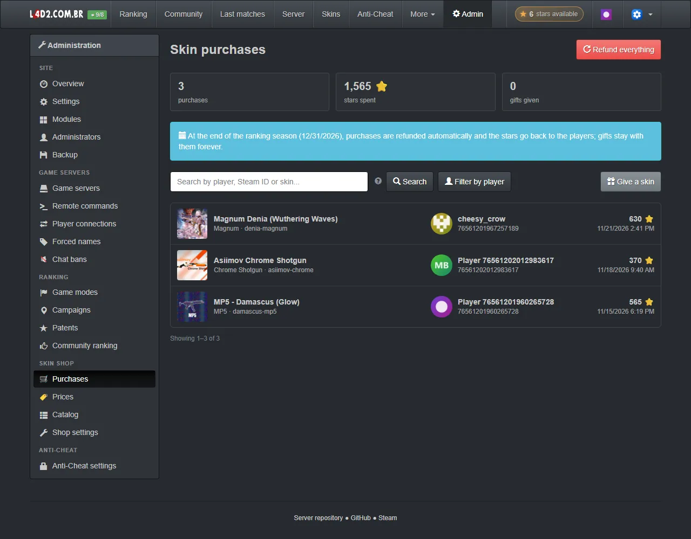

The list of every purchase and gift, newest first, with the totals: purchases, stars spent and gifts given. Search by player, Steam ID or skin, or filter by one player.

Click a purchase to see the details: the price, the balance before and after, who gave it (for a gift) and the date. From there:

- **Refund purchase** takes the skin back from that player and returns its price.
- **Show only this player's purchases** and **Open the player's profile**.

**Refund everything** takes back every purchase and every gift of every player. It cannot be undone. Use it, for example, after recalculating prices. Stars are not changed: only what was spent is returned.

**Give a skin** opens the [gift](#gifts) window.

### Catalog

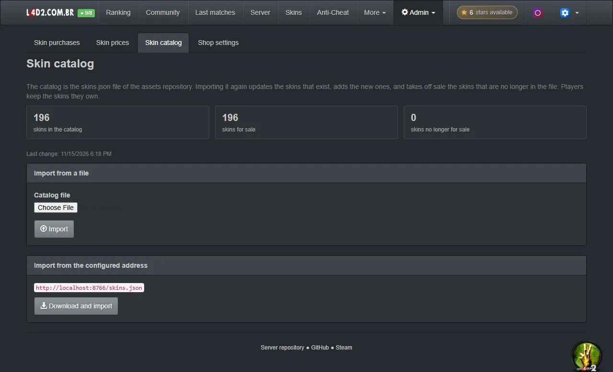

The catalog is the `skins.json` file of the [assets repository](https://github.com/altair-sossai/l4d2-zone-server-assets). Import it from a file, or download it from the address set in the shop settings. Importing again:

- updates the skins that exist and adds the new ones;
- takes off sale the skins that are no longer in the file; players keep the ones they own.

The page shows how many skins are in the catalog, for sale and off sale, and when it last changed. The **Author names** panel shows how many authors there are, how many were checked on Steam, when the last check ran and when an author last changed their name. **Check the names now** runs the check at once instead of waiting for the daily one.

### Prices

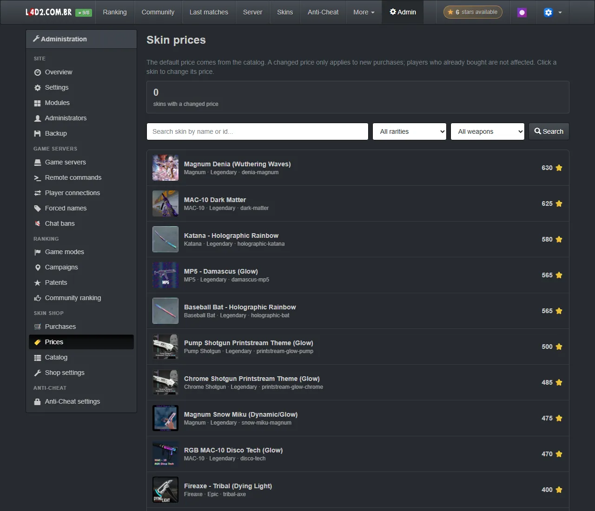

The default price of each skin comes from the catalog. Click a skin to give it another price, or to put it back on the default. A new price applies only to new purchases. The list can be searched and filtered by rarity and weapon, and shows how many skins have a changed price. A skin can also be given as a gift from here.

### Shop settings

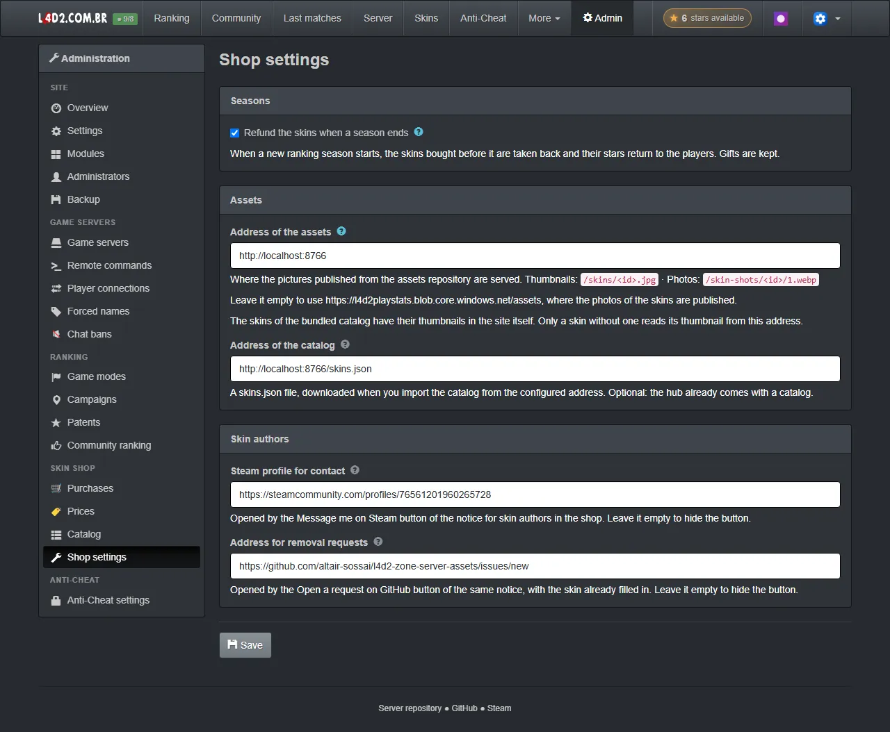

| Setting | What it does |
|---|---|
| Refund the skins when a season ends | On by default. See [refunds](#refunds-at-the-end-of-a-season). |
| Address of the assets | Where the pictures of the assets repository are served. Thumbnails are read from `skins/<id>.jpg` and photos from `skin-shots/<id>/` under this address. |
| Address of the catalog | Where the `skins.json` file is downloaded from when you import from the configured address. |
| Steam profile for contact | Opened by **Message me on Steam** in the notice for skin authors. Empty hides the button. |
| Address for removal requests | Opened by **Open a request on GitHub** in the same notice, with the skin filled in. Empty hides the button. |

Turning off the skin shop module in [Modules](administration.md#modules) removes **Skins** from the menu, the stars from the menu bar, and the Skins tab of the player page. Purchases are kept and come back if the module is turned on again.
