# Loja de skins de armas

🌐 [English](skin-shop.md) | **Português** | [Español](skin-shop.es.md)

Os jogadores ganham estrelas sendo MVP em partidas ranqueadas e as gastam em skins para as suas armas. Uma skin comprada é equipada no servidor de jogo a partir da próxima troca de mapa. As skins são feitas pela comunidade no Steam Workshop; a loja dá o crédito a cada autor.

A loja precisa do módulo do ranking, do plugin `l4d2_weapon_skins` no servidor de jogo e de um catálogo importado por um administrador.

[Voltar ao manual](README.pt.md)

## Conteúdo

- [Estrelas](#estrelas)
- [A página da loja](#a-página-da-loja)
- [Comprando uma skin](#comprando-uma-skin)
- [Minhas skins e como equipar](#minhas-skins-e-como-equipar)
- [Usando skins no jogo](#usando-skins-no-jogo)
- [Reembolsos no fim de uma temporada](#reembolsos-no-fim-de-uma-temporada)
- [Presentes](#presentes)
- [Autores das skins](#autores-das-skins)
- [Para administradores](#para-administradores)

## Estrelas

- Cada prêmio de **MVP de SI** e de **MVP de CI** em uma partida ranqueada vale uma estrela. Veja [Ranking > MVPs](ranking.pt.md#mvps).
- Todas as partidas ranqueadas desde o começo contam. As estrelas não são zeradas com a temporada e nunca expiram.
- O saldo é o total de estrelas ganhas menos o preço das skins que o jogador tem agora. Quando uma compra é reembolsada, o preço dela volta para o saldo.
- Os presentes não custam nada.

Um jogador logado vê o saldo na barra do menu (**N estrelas disponíveis**) e no topo da loja, com quantas estrelas vieram de cada tipo de MVP.

## A página da loja

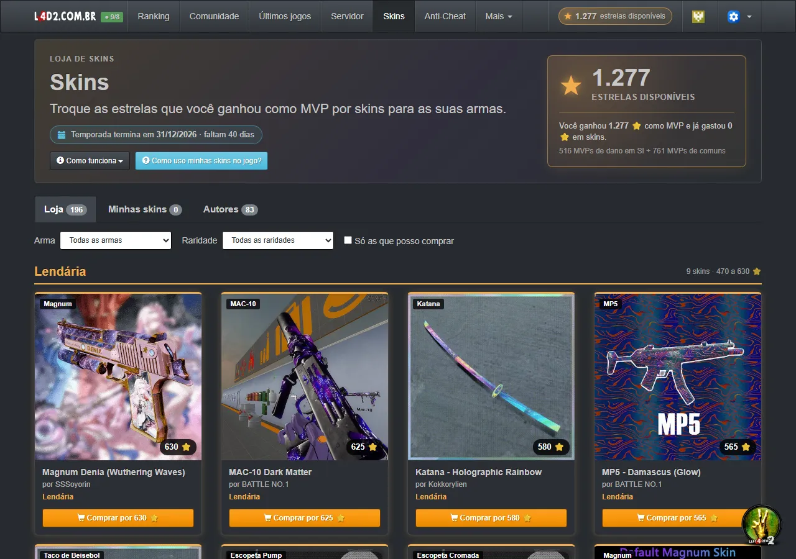

No topo:

- **Temporada termina em**: o último dia da temporada atual e quantos dias faltam. As skins compradas valem até lá (veja [reembolsos](#reembolsos-no-fim-de-uma-temporada)).
- **Como funciona**: os três passos e as regras da temporada.
- **Como uso minhas skins no jogo?**: os comandos do chat.
- O saldo de estrelas.

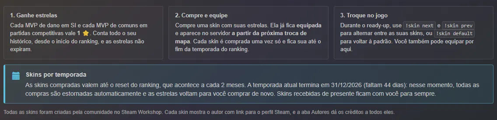

As abas:

| Aba | Mostra |
|---|---|
| Loja | Todas as skins à venda, agrupadas por raridade: Lendária, Épica, Rara, Incomum e Comum. |
| Minhas skins | As skins que você tem. Aparece quando você está logado. |
| Autores | Todos os autores do Workshop que têm skins na loja, com um link para o perfil deles na Steam. |

Os filtros escolhem uma arma (ou todas as armas de fogo, ou todas as armas brancas), uma raridade e **Só as que posso comprar**.

Cada cartão mostra a arma, a imagem, o preço, o nome, o autor e a raridade. O botão diz **Comprar por N** quando você tem estrelas suficientes, e quantas estrelas ainda faltam quando não tem. Um visitante que não fez login vê o catálogo e um botão para entrar com a Steam:

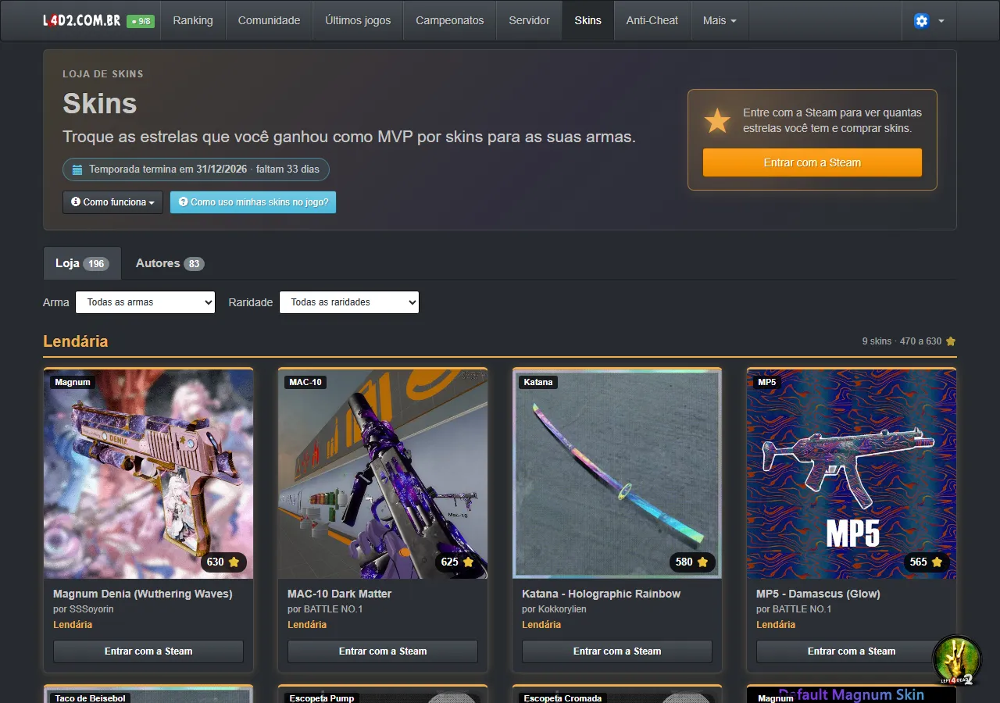

Clique em um cartão para ver os detalhes da skin: até seis fotos, a raridade, a arma, o preço, o autor, a descrição, o título original no Workshop, o comando do chat para usá-la e um link para a página do Workshop.

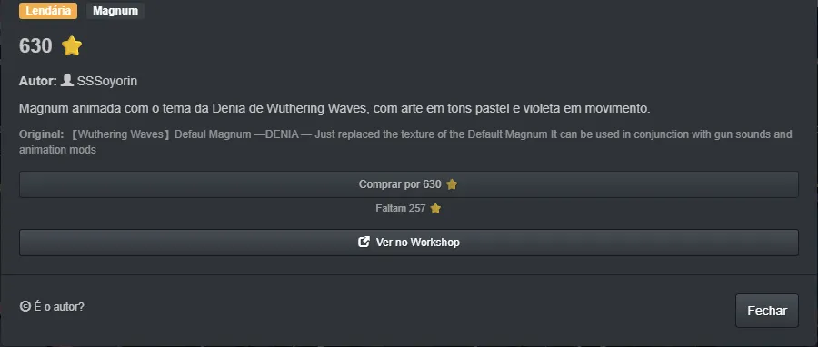

## Comprando uma skin

Clique em **Comprar por N**. A loja pede que você confirme:

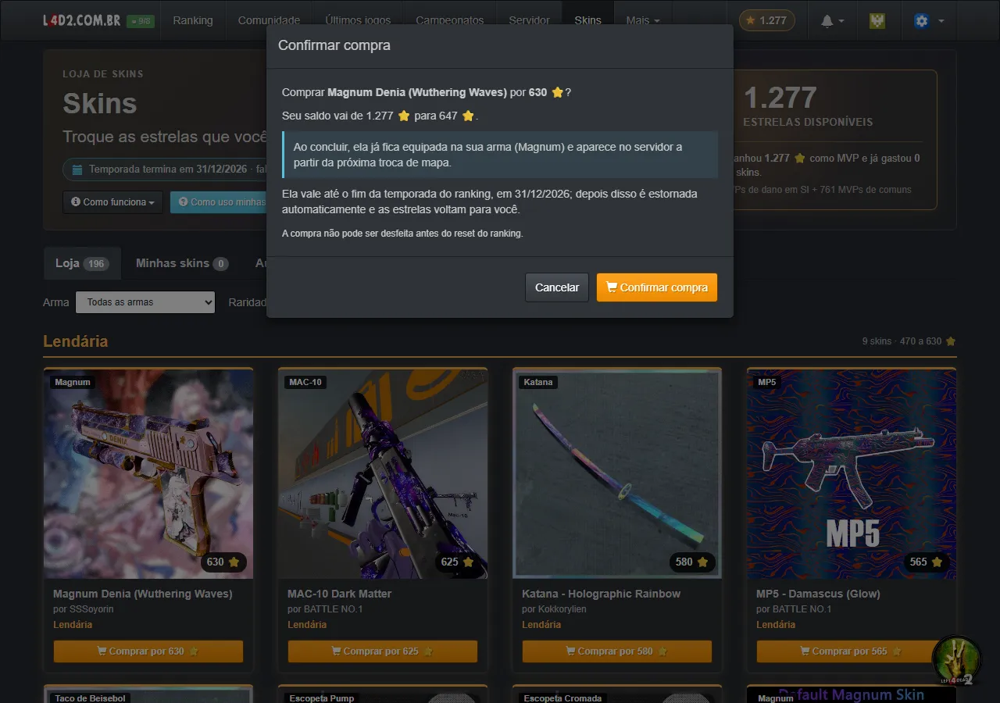

Depois da compra, a skin já fica equipada naquela arma:

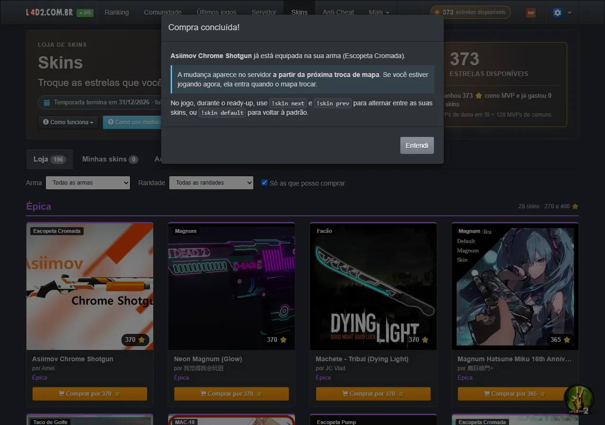

- Cada skin pode ser comprada uma vez.
- A mudança aparece no servidor de jogo a partir da próxima troca de mapa. Se você estiver jogando, ela aparece quando o mapa mudar.
- O preço é o que aparece no momento da compra. Uma mudança de preço depois não afeta as skins já compradas.

## Minhas skins e como equipar

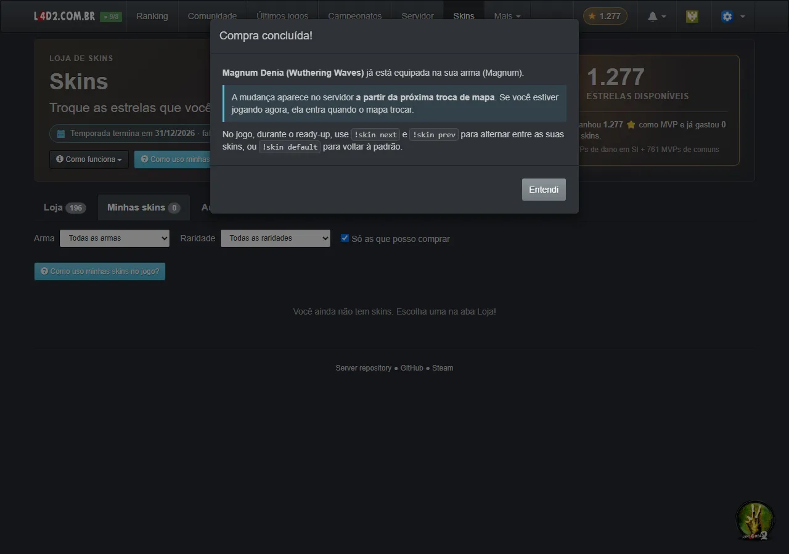

Você pode ter várias skins para a mesma arma, e uma delas fica equipada. No site:

- **Equipar** coloca aquela skin na arma.
- **Voltar para a padrão** devolve a arma à aparência normal.

O que você equipa no site é usado no jogo, e o que você escolhe no jogo aparece no site.

As skins que um jogador tem também estão na [aba Skins da página do jogador](players.pt.md#aba-skins).

## Usando skins no jogo

Digite estes comandos no chat do jogo:

| Comando | O que faz |
|---|---|
| `!skin next`, `!skin prev` | Alterna entre as skins que você comprou para a arma na sua mão. Depois da última, volta para a skin padrão. |
| `!skin surtr` | Usa uma das suas skins pelo id. O id está nos detalhes de cada skin. |
| `!skin default` | Devolve a arma na sua mão à skin padrão. |
| `!skin next pump` | Escolhe a arma pelo nome, sem precisar estar com ela na mão. |
| `!skin status` | Mostra quantas estrelas e quantas skins você tem. |
| `!skin` | Mostra a ajuda das skins no chat. |

A troca é feita durante o ready-up. A skin fica com a arma: se você largar a arma, quem pegar usa ela com a sua skin.

## Reembolsos no fim de uma temporada

Por padrão, as skins compradas valem por uma temporada:

- Quando uma nova temporada começa, todas as skins compradas antes dela são retiradas e as estrelas voltam para o dono. O dono pode comprar de novo na hora, as mesmas skins ou outras.
- Os presentes não são retirados. Eles ficam para sempre.
- O administrador pode desligar isso nas [configurações da loja](#configurações-da-loja). As skins compradas passam então a ficar para sempre também.

O reembolso acontece sozinho: o site confere a cada 10 minutos se uma nova temporada começou. A loja mostra quantos dias faltam.

## Presentes

Um administrador pode dar qualquer skin para qualquer jogador. A skin fica equipada para esse jogador, nenhuma estrela é cobrada e ela é mantida no fim da temporada. Na loja, os detalhes de uma skin têm um botão **Dar de presente (admin)**; a [página de compras](#compras) tem **Dar skin de presente**.

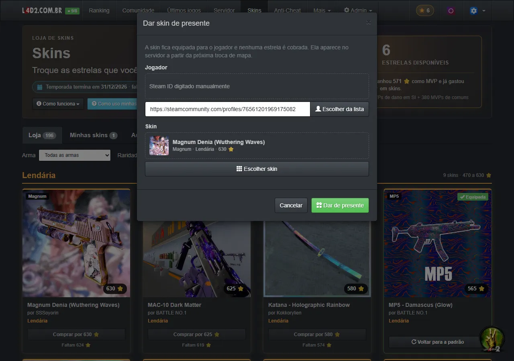

Escolha o jogador pelo Steam ID (em qualquer formato), pelo link do perfil ou pela lista, e clique em **Dar de presente**.

## Autores das skins

Cada skin mostra o autor dela com um link para o perfil dele na Steam e para a página original do Workshop. O aviso **É o autor?** explica que o projeto não tem fins lucrativos, que as estrelas não podem ser compradas com dinheiro e como um autor pode pedir a remoção de uma skin: uma mensagem na Steam ou um pedido no GitHub, se o administrador definiu esses endereços.

O nome do autor vem do perfil dele na Steam, e não só do catálogo. Uma vez por dia o site pergunta à Steam o nome atual de cada autor e atualiza as skins dele quando alguém mudou de nome, então a loja sempre credita o nome que o autor usa hoje. Importar o catálogo de novo mantém o nome lido da Steam. Funciona sem a chave da Steam Web API; com a chave, definida nas configurações do site, fica mais rápido.

## Para administradores

A loja tem quatro páginas em **Administração > Skins**.

### Compras

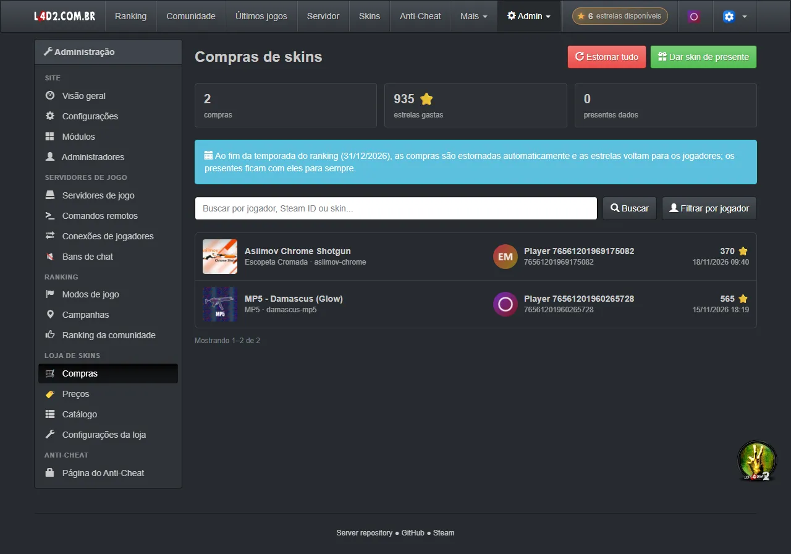

A lista de todas as compras e presentes, dos mais recentes para os mais antigos, com os totais: compras, estrelas gastas e presentes dados. Busque por jogador, Steam ID ou skin, ou filtre por um jogador.

Clique em uma compra para ver os detalhes: o preço, o saldo antes e depois, quem deu (no caso de um presente) e a data. A partir dali:

- **Estornar compra** retira a skin daquele jogador e devolve o preço dela.
- **Mostrar só as compras deste jogador** e **Abrir o perfil do jogador**.

**Estornar tudo** retira todas as compras e todos os presentes de todos os jogadores. Não pode ser desfeito. Use, por exemplo, depois de recalcular os preços. As estrelas não são alteradas: só o que foi gasto é devolvido.

**Dar skin de presente** abre a janela de [presente](#presentes).

### Catálogo

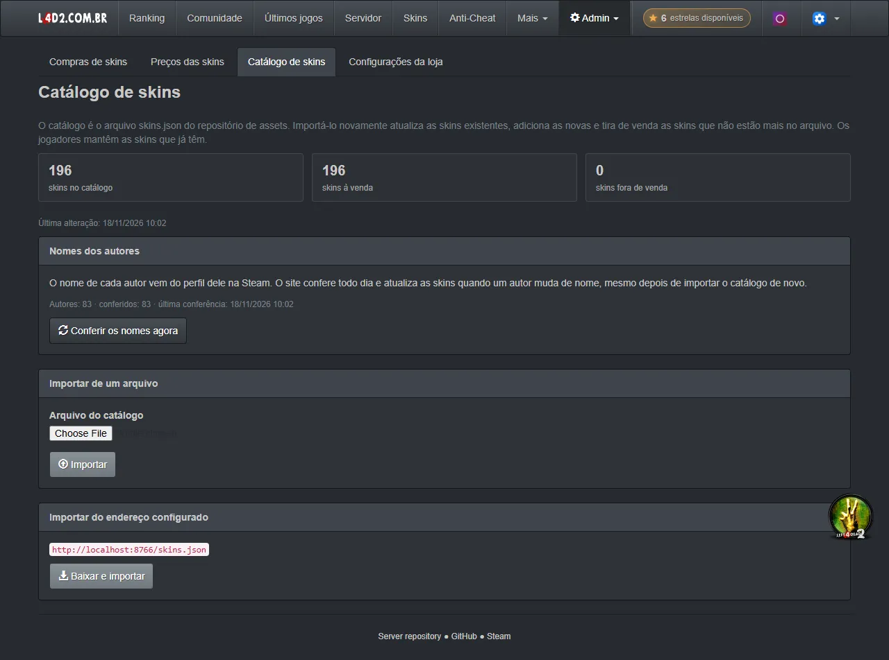

O catálogo é o arquivo `skins.json` do [repositório de assets](https://github.com/altair-sossai/l4d2-zone-server-assets). Importe-o de um arquivo ou baixe-o do endereço definido nas configurações da loja. Importar de novo:

- atualiza as skins que já existem e adiciona as novas;
- tira de venda as skins que não estão mais no arquivo; os jogadores ficam com as que já têm.

A página mostra quantas skins estão no catálogo, à venda e fora de venda, e quando ele mudou pela última vez. O painel **Nomes dos autores** mostra quantos autores existem, quantos foram conferidos na Steam, quando foi a última conferência e quando um autor mudou de nome pela última vez. **Conferir os nomes agora** roda a conferência na hora, sem esperar a diária.

### Preços

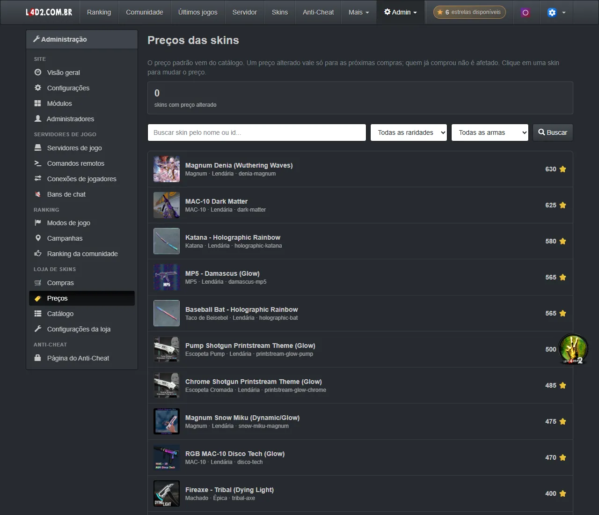

O preço padrão de cada skin vem do catálogo. Clique em uma skin para dar outro preço a ela, ou para voltar ao padrão. Um novo preço vale só para as novas compras. A lista pode ser pesquisada e filtrada por raridade e arma, e mostra quantas skins têm o preço alterado. Uma skin também pode ser dada de presente por aqui.

### Configurações da loja

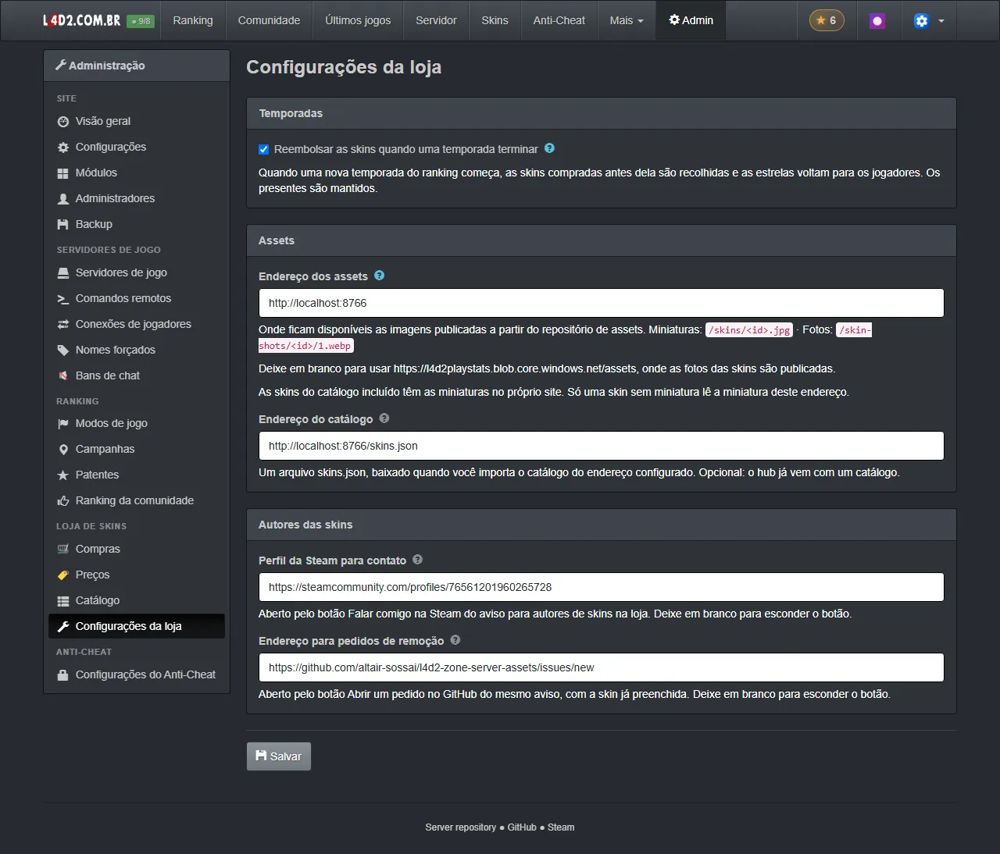

| Configuração | O que faz |
|---|---|
| Reembolsar as skins quando uma temporada terminar | Ligada por padrão. Veja [reembolsos](#reembolsos-no-fim-de-uma-temporada). |
| Endereço dos assets | Onde as imagens do repositório de assets são servidas. As miniaturas são lidas de `skins/<id>.jpg` e as fotos de `skin-shots/<id>/` sob esse endereço. |
| Endereço do catálogo | De onde o arquivo `skins.json` é baixado quando você importa do endereço configurado. |
| Perfil da Steam para contato | Aberto por **Falar comigo na Steam** no aviso para autores de skins. Em branco, o botão fica escondido. |
| Endereço para pedidos de remoção | Aberto por **Abrir um pedido no GitHub** no mesmo aviso, com a skin preenchida. Em branco, o botão fica escondido. |

Desligar o módulo da loja de skins em [Módulos](administration.pt.md#módulos) remove **Skins** do menu, as estrelas da barra do menu e a aba Skins da página do jogador. As compras são mantidas e voltam se o módulo for ligado de novo.
