# Módulos

🌐 [English](modules.md) | [Português](modules.pt.md) | **Español**

Para qué sirve cada módulo de L4D2 PlayStats Hub, qué hace, quién lo usa y qué necesita. Un módulo es una función que el administrador activa o desactiva; algunas partes están siempre activas. Esta página es el resumen: cada sección lleva a la página del [manual de usuario](manual/README.es.md) con todos los detalles y todos los ajustes.

## Contenido

- [Los módulos en resumen](#los-módulos-en-resumen)
- [Activar o desactivar un módulo](#activar-o-desactivar-un-módulo)
- [Ranking y estadísticas](#ranking-y-estadísticas)
- [Servidor en vivo](#servidor-en-vivo)
- [Chat del sitio](#chat-del-sitio)
- [Comandos remotos](#comandos-remotos)
- [Tienda de skins de armas](#tienda-de-skins-de-armas)
- [Ranking de la comunidad](#ranking-de-la-comunidad)
- [Campeonatos](#campeonatos)
- [Baneos](#baneos)
- [Anti-Cheat](#anti-cheat)
- [Siempre activo](#siempre-activo)
  - [Servidores de juego y envío de estadísticas](#servidores-de-juego-y-envío-de-estadísticas)
  - [Notificaciones](#notificaciones)
  - [Página de comandos](#página-de-comandos)
  - [Nombres forzados](#nombres-forzados)
  - [Administración](#administración)
  - [Copias de seguridad](#copias-de-seguridad)
  - [Idiomas, temas y teléfonos](#idiomas-temas-y-teléfonos)

## Los módulos en resumen

| Módulo | Para qué sirve | Por defecto | Necesita | Plugin del servidor de juego |
|---|---|---|---|---|
| [Ranking y estadísticas](#ranking-y-estadísticas) | El ranking, las partidas, los jugadores y las temporadas. | Activado | | `l4d2_ranking` y `l4d2_show_patent_icon` (opcionales) |
| [Servidor en vivo](#servidor-en-vivo) | La partida en curso en cada servidor de juego. | Activado | | `l4d2_gameinfo_sync` |
| [Chat del sitio](#chat-del-sitio) | Escribir en el chat del juego desde el sitio. | Desactivado | Servidor en vivo | `l4d2_gameinfo_sync` |
| [Comandos remotos](#comandos-remotos) | Enviar comandos del sitio a un servidor de juego. | Desactivado | Servidor en vivo | `l4d2_gameinfo_sync` |
| [Tienda de skins de armas](#tienda-de-skins-de-armas) | Gastar las estrellas de los MVP en skins de armas. | Desactivado | Ranking y estadísticas | `l4d2_weapon_skins` |
| [Ranking de la comunidad](#ranking-de-la-comunidad) | Un segundo ranking, votado por los jugadores. | Desactivado | | Ninguno |
| [Campeonatos](#campeonatos) | Campeonatos con equipos, draft, fases y resultados. | Desactivado | | Ninguno además de las estadísticas |
| [Baneos](#baneos) | Los jugadores baneados de los servidores de juego. | Desactivado | | `l4d2_bans` |
| [Anti-Cheat](#anti-cheat) | La página del Anti-Cheat y quién debe usarlo. | Desactivado | | El plugin del Anti-Cheat, un proyecto aparte |

Todo servidor de juego necesita también `l4d2_playstats_sync`, que envía los archivos de estadísticas. Los seis plugins de este repositorio están descritos en la [guía de los plugins](../plugins/README.es.md).

## Activar o desactivar un módulo

El administrador elige los módulos en el tercer paso de la [configuración inicial](manual/first-run.es.md#paso-3-los-módulos) y, más tarde, en **Administración > Módulos** (`/admin/modules`): marca el módulo y haz clic en **Guardar**. El **?** junto a cada nombre explica qué cambia.

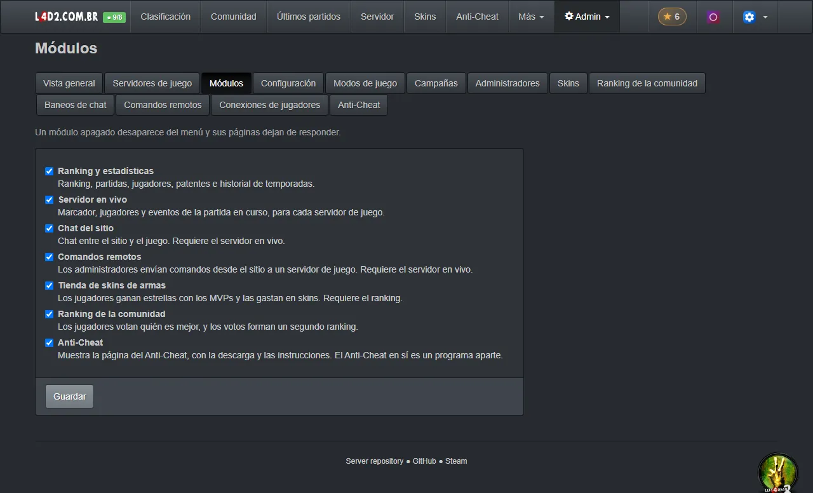

- Un módulo desactivado desaparece de los menús, y sus páginas y su API responden como no encontradas.
- Desactivar un módulo no borra nada. Sus datos vuelven cuando se activa de nuevo.
- Un módulo cuyo requisito está desactivado se comporta como desactivado, aunque su propia casilla esté marcada.

Consulta [Administración > Módulos](manual/administration.es.md#módulos).

## Ranking y estadísticas

| | |
|---|---|
| Para qué sirve | Convierte cada partida jugada en tus servidores en un ranking, un historial y una página para cada jugador. |
| Por defecto | Activado |
| Necesita | `l4d2_playstats_sync` en los servidores de juego. Opcionales: `l4d2_ranking` para `!ranking` dentro del juego y `l4d2_show_patent_icon` para los íconos de patente. |
| Manual | [Ranking](manual/ranking.es.md), [Temporadas e historia](manual/seasons-and-history.es.md), [Patentes](manual/patents.es.md), [Partidas](manual/matches.es.md), [Jugadores](manual/players.es.md), [Modos de juego y campañas](manual/game-modes-and-campaigns.es.md), [Páginas dentro del juego](manual/in-game-pages.es.md), [Moderación > Castigos](manual/moderation.es.md#castigos) |

El ranking de la temporada actual abre el sitio: posición, patente, experiencia, victorias y derrotas, MVP, tank wipes, porcentaje de victorias y rage quits. Un selector abre las otras temporadas, un año entero o todo el tiempo.

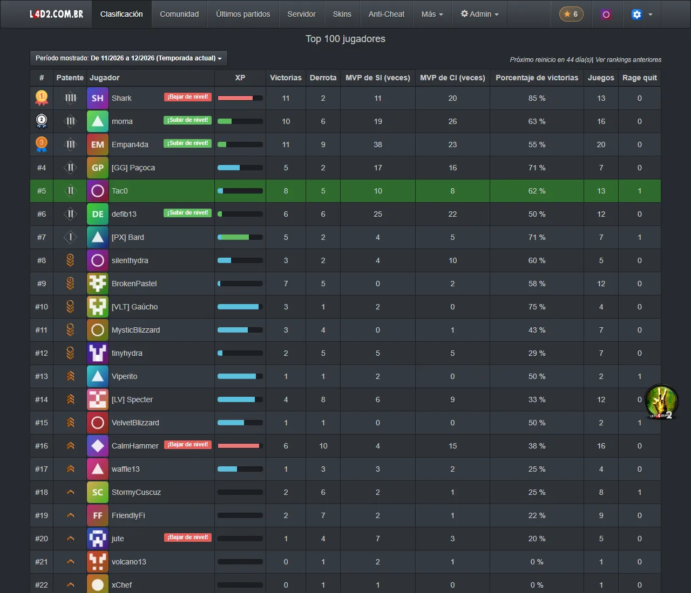

- **Visitantes y jugadores**
  - **Partidas**: todas las partidas, con el marcador de cada mapa, los jugadores y las estadísticas de cada equipo y de cada mapa.
  - **Jugadores**: la lista de jugadores, la página de cada uno (resultados, campañas, skins, con quién y contra quién juega) y la comparación de dos jugadores.
  - **Patentes**: 15 niveles, según la experiencia de la temporada.
  - **Dentro del juego**: `!ranking` abre el ranking en el navegador del propio juego.
- **Administradores**
  - Deciden qué modos de juego cuentan, qué mapas forman una campaña, cuántos puntos da cada resultado y cuánto dura una temporada.
  - Castigan a un jugador en una temporada, editan el marcador de un mapa, cambian un jugador en una partida y reconstruyen todas las partidas a partir de los archivos guardados.

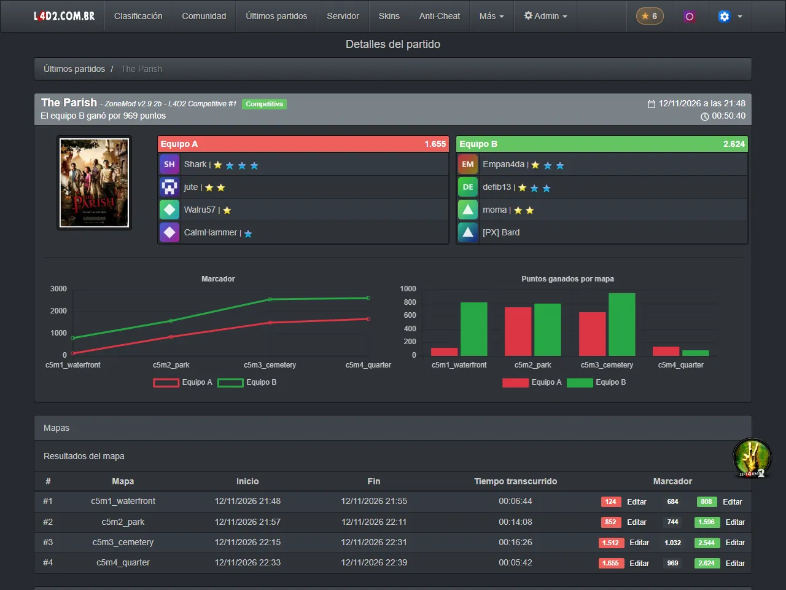

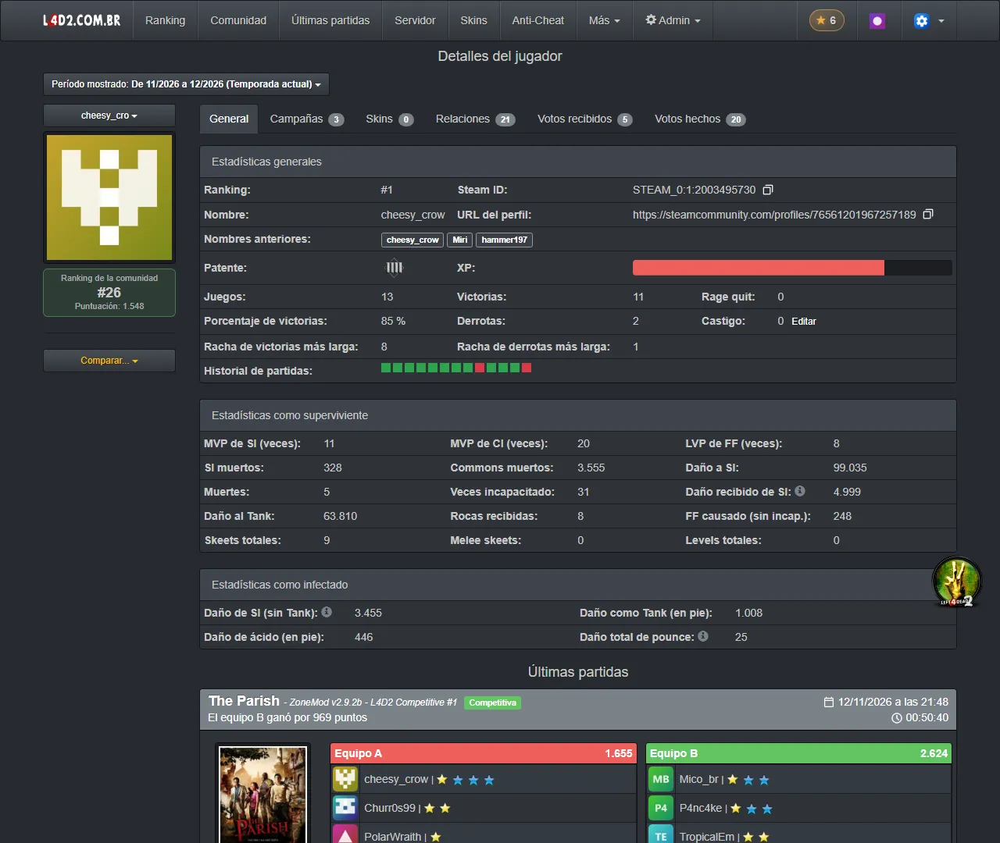

Con el módulo desactivado, la primera página muestra un breve texto de bienvenida y las partidas se siguen construyendo, sin mostrarse.

## Servidor en vivo

| | |
|---|---|
| Para qué sirve | Sigue la partida en curso en cada servidor de juego, desde el navegador. |
| Por defecto | Activado |
| Necesita | `l4d2_gameinfo_sync` en los servidores de juego. |
| Manual | [Servidor en vivo](manual/live-server.es.md), [Moderación > Conexiones de jugadores](manual/moderation.es.md#conexiones-de-jugadores) |

**Servidor**, en el menú, abre la lista de servidores de juego, o la página en vivo cuando solo hay uno.

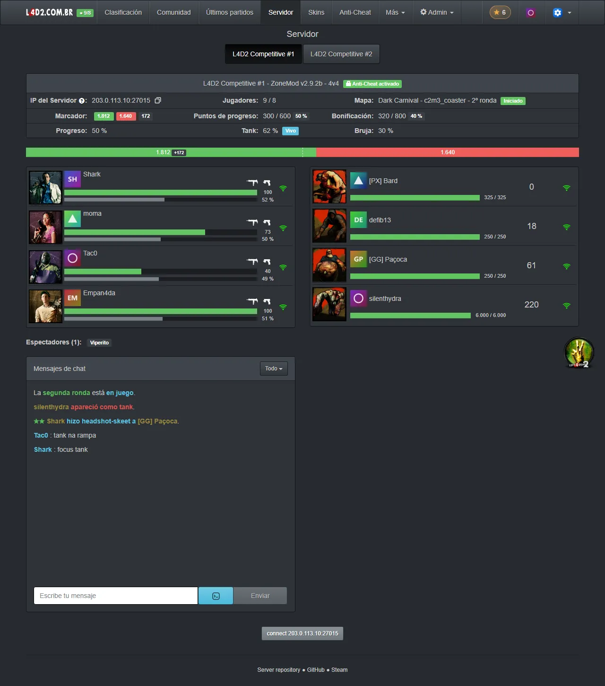

- **Visitantes y jugadores**
  - El marcador, el bono, dónde aparecen el Tank y la Witch, los supervivientes con su salud y sus armas, los infectados con su clase y su daño, los espectadores.
  - Los eventos de la partida (skeets, crowns, Tank, pausas) y el chat del juego.
  - La dirección del servidor con un botón para copiarla, y el número de jugadores conectados junto al nombre del sitio en todas las páginas.
- **Administradores**
  - Definen el retraso de la página en vivo (15 segundos por defecto) y cada cuánto se actualiza.
  - **Conexiones de jugadores**: las cuentas que se conectaron desde la misma dirección que un jugador. La dirección en sí nunca se muestra.

## Chat del sitio

| | |
|---|---|
| Para qué sirve | Permite que los jugadores que iniciaron sesión escriban en el chat de un servidor de juego desde la página en vivo. |
| Por defecto | Desactivado |
| Necesita | El módulo [Servidor en vivo](#servidor-en-vivo) y `l4d2_gameinfo_sync`. |
| Manual | [Servidor en vivo > Escribir en el chat desde el sitio](manual/live-server.es.md#escribir-en-el-chat-desde-el-sitio), [Moderación > Baneos del chat](manual/moderation.es.md#baneos-del-chat) |

- **Jugadores** que iniciaron sesión con Steam escriben en el cuadro bajo el chat de la página en vivo. El mensaje aparece en el juego.
- **Administradores** banean a un jugador del chat del sitio y definen las pausas entre mensajes y su tamaño. Un baneo del chat no silencia al jugador dentro del juego y no es un baneo del servidor: eso es el módulo [Baneos](#baneos).

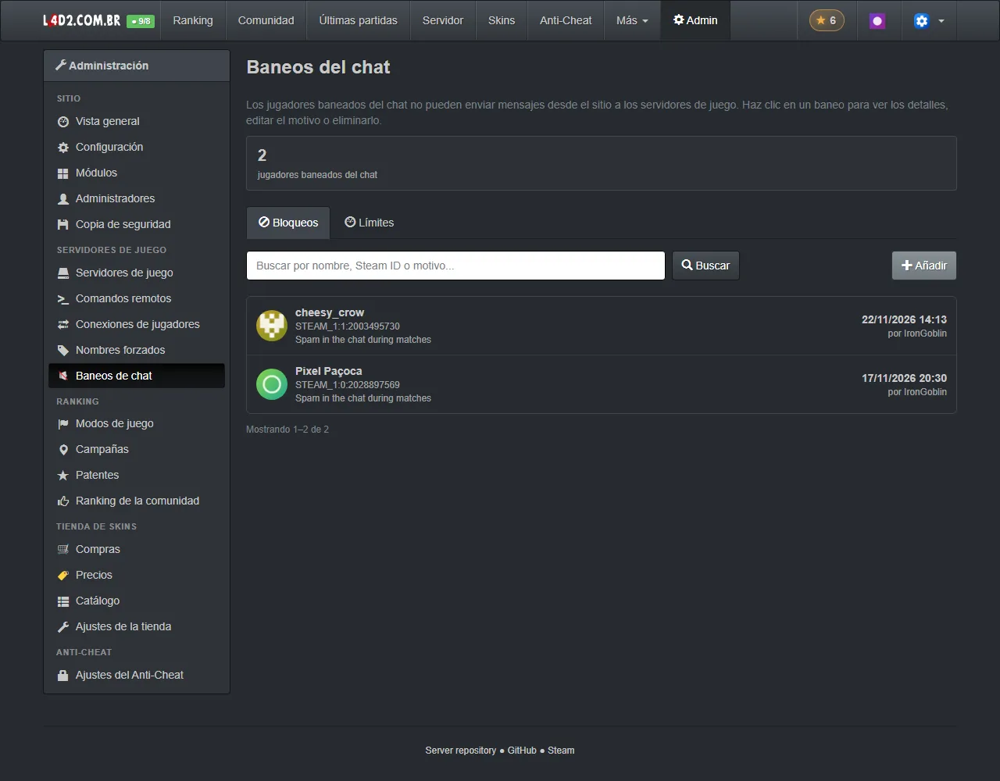

## Comandos remotos

| | |
|---|---|
| Para qué sirve | Envía comandos de SourceMod del sitio a un servidor de juego, sin RCON. |
| Por defecto | Desactivado |
| Necesita | El módulo [Servidor en vivo](#servidor-en-vivo) y `l4d2_gameinfo_sync`. |
| Manual | [Moderación > Comandos remotos](manual/moderation.es.md#comandos-remotos) |

Solo lo usan los **administradores**:

- Escriben un comando, como `sm_forcestart`, o lo arman paso a paso con el botón del terminal. El servidor de juego lo recoge en su siguiente consulta.
- Envían un comando desde el cuadro de chat de la página en vivo.
- Leen el registro de auditoría: cada comando, quién lo envió, cuándo, y si fue entregado.

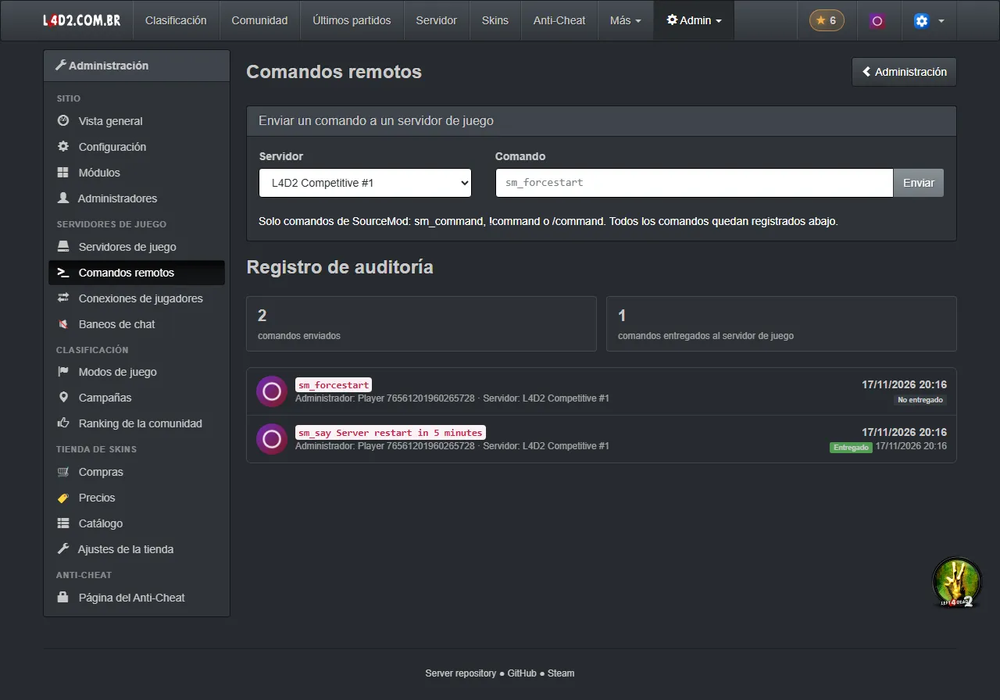

## Tienda de skins de armas

| | |
|---|---|
| Para qué sirve | Recompensa a los jugadores: cada MVP de una partida clasificatoria da una estrella, y las estrellas compran skins de armas. |
| Por defecto | Desactivado |
| Necesita | El módulo [Ranking y estadísticas](#ranking-y-estadísticas), `l4d2_weapon_skins` y los modelos y materiales de las skins en un FastDL (consulta [Conectar un servidor de juego](game-server.es.md#opcional-skins-de-armas-e-íconos-de-patente)). |
| Manual | [Tienda de skins de armas](manual/skin-shop.es.md) |

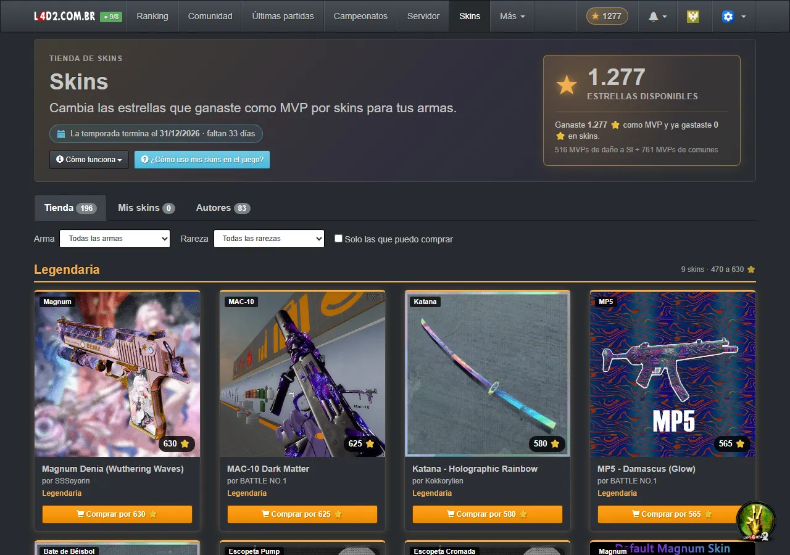

- **Visitantes** ven el catálogo, por arma y rareza, con fotos de cada skin.
- **Jugadores** compran skins con sus estrellas, las equipan en el sitio o con `!skin` en el juego y ven su saldo en la barra del menú. Las skins compradas en una temporada se reembolsan cuando termina.
- **Administradores** regalan skins, reembolsan compras, cambian precios, importan el catálogo y desactivan el reembolso de la temporada. El catálogo viene con el sitio y se importa la primera vez que se activa el módulo.

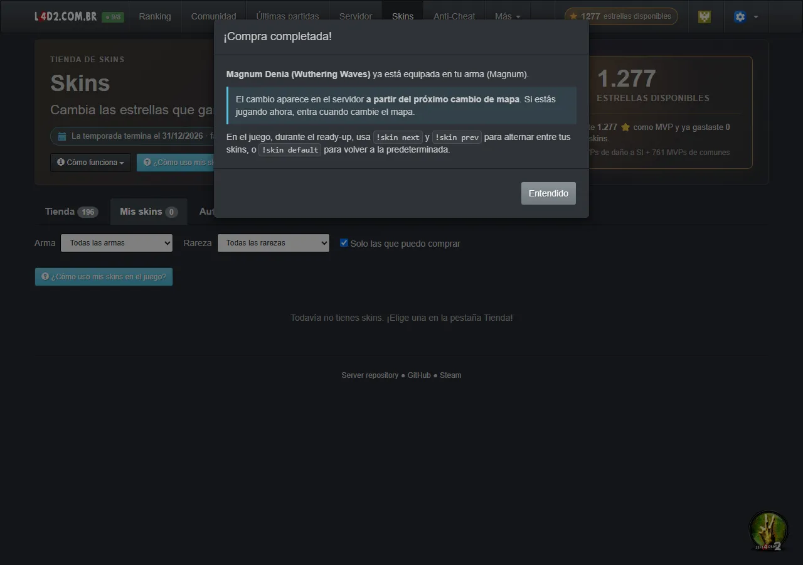

## Ranking de la comunidad

| | |
|---|---|
| Para qué sirve | Un segundo ranking, hecho con lo que los jugadores piensan unos de otros. |
| Por defecto | Desactivado |
| Necesita | Nada más. Los votos usan a los jugadores que jugaron en tus servidores. |
| Manual | [Ranking de la comunidad](manual/community-ranking.es.md) |

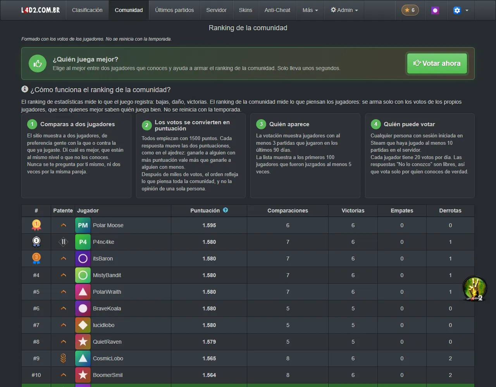

- **Visitantes** ven el ranking y los últimos votos.
- **Jugadores** con partidas suficientes eligen al mejor de dos jugadores: izquierda, derecha, mismo nivel o "no lo sé". Hay un límite de votos por día, y cada pareja se pregunta una sola vez.
- **Administradores** definen los límites y los mínimos, bloquean a un votante y borran votos.
- **Servidores de juego** pueden pedir dos equipos equilibrados según este ranking, para un mix (consulta [Conectar un servidor de juego](game-server.es.md#el-mix-por-el-ranking-de-la-comunidad)).

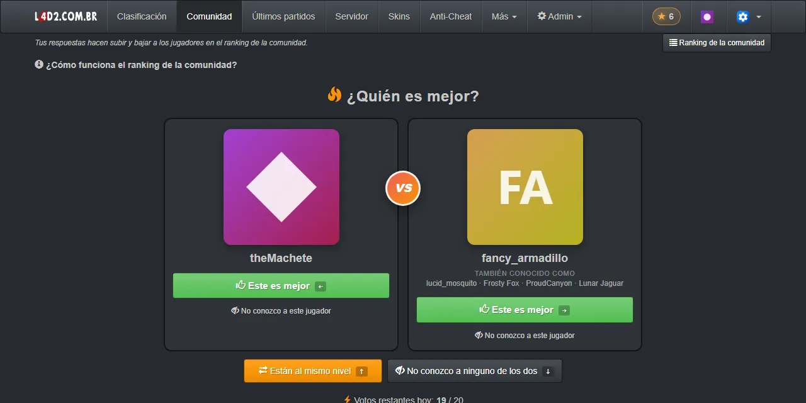

## Campeonatos

| | |
|---|---|
| Para qué sirve | Organiza campeonatos en tus servidores de juego, desde la inscripción hasta la final. |
| Por defecto | Desactivado |
| Necesita | Nada más. Los resultados salen de los archivos de estadísticas, así que los servidores de juego solo necesitan `l4d2_playstats_sync`. El [Anti-Cheat](#anti-cheat) y el [Ranking](#ranking-y-estadísticas) son opcionales. |
| Manual | [Campeonatos](manual/championships.es.md) |

**Campeonatos**, en el menú, lista todos los campeonatos: los que están en curso arriba y los terminados con su campeón.

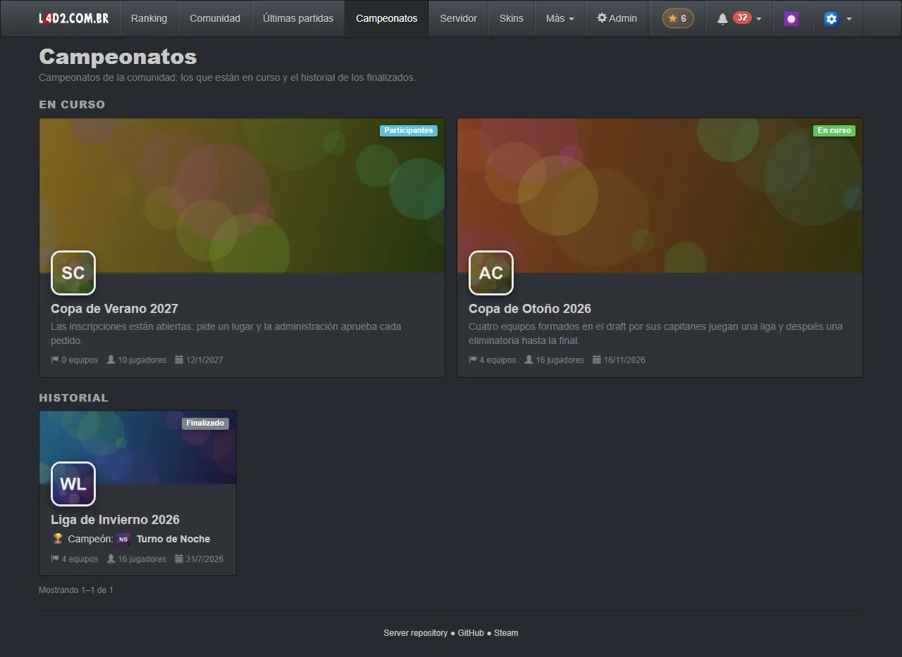

Cada campeonato tiene sus propias páginas, con su banner y su logo: una vista general con el próximo juego, los equipos y el formato, y las pestañas Reglas, Equipos, Draft, Clasificación, Cuadro, Juegos y Estadísticas.

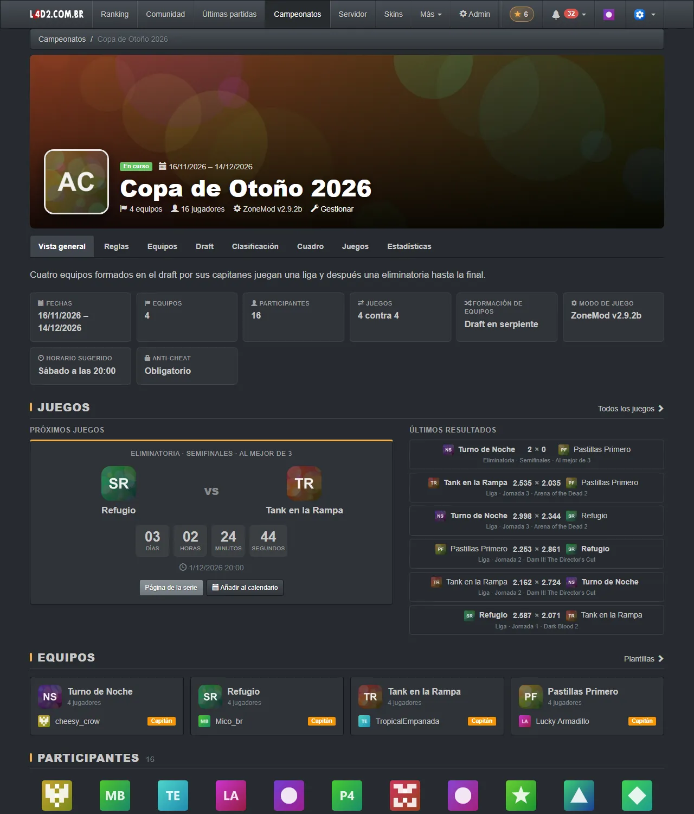

- **Visitantes** siguen todo: la clasificación, el cuadro, las fechas (con enlace al calendario) y los resultados.
- **Jugadores** piden participar, cuando la administración lo permite, con un mensaje. La administración aprueba o rechaza cada pedido.
- **Capitanes y vicecapitanes** tienen el **área del capitán**: eligen jugadores en el draft, proponen nombre, tag y bandera del equipo, proponen y aceptan fechas, vetan campañas y eligen las campañas de sus juegos.
- **Administradores** crean el campeonato a partir de un formato, eligen a los participantes y cómo se forman los equipos, arman las fases y pueden decidir todo lo que deciden los capitanes. También eligen qué campañas se pueden jugar, si el Anti-Cheat es obligatorio, y un día y una hora sugeridos para los juegos.

| Parte | Opciones |
|---|---|
| Formatos | Liga, eliminatoria, liga seguida de eliminatoria, grupos seguidos de eliminatoria. Cada fase se puede cambiar hasta que se arma. |
| Formación de los equipos | Manual, ruleta, bombos, draft en serpiente o draft en línea. |
| Campañas | Sorteadas para cada ronda, elegidas por los equipos o elegidas por la administración, con vetos y una lista de campañas permitidas. |
| Resultados | Enlazados solos a la partida del servidor, enlazados a mano, escritos o por walkover, con penalizaciones. |

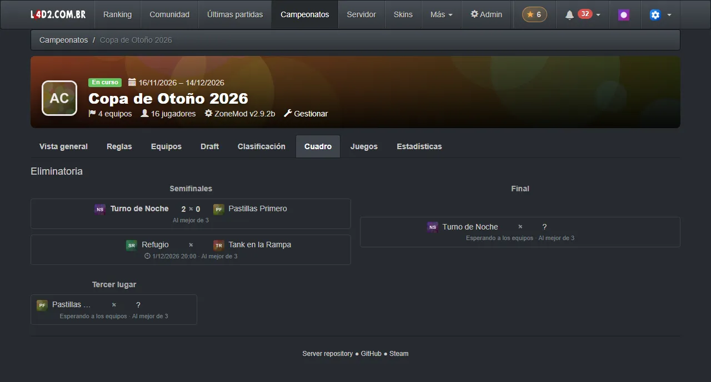

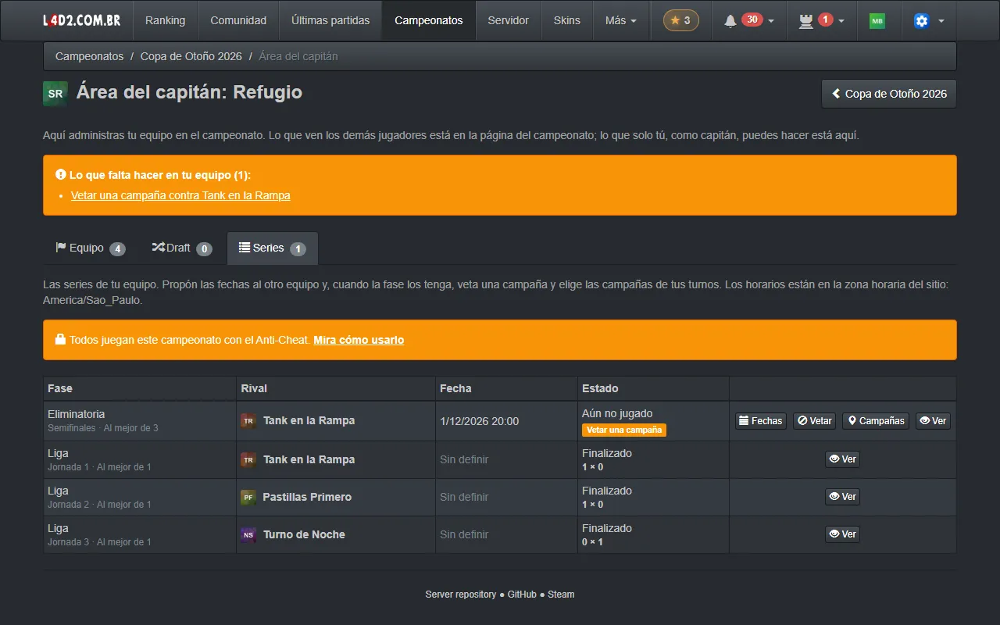

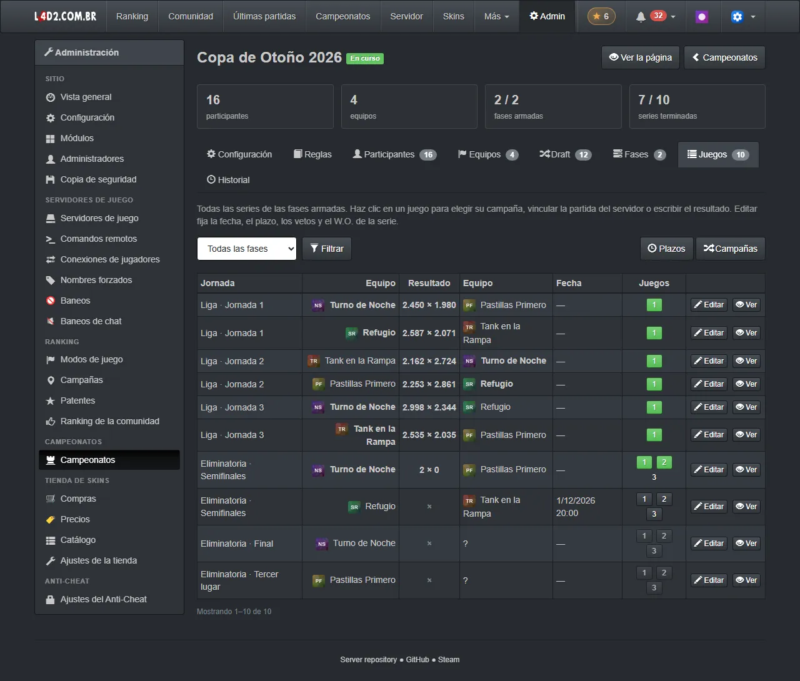

Los juegos son partidas normales del servidor: cuentan para el ranking como cualquier otra.

## Baneos

| | |
|---|---|
| Para qué sirve | Guarda los baneos de todos los servidores de juego en una sola lista, pública, con el motivo y el fin de cada uno. |
| Por defecto | Desactivado |
| Necesita | `l4d2_bans` en los servidores de juego. Con el módulo [Servidor en vivo](#servidor-en-vivo), un baneo hecho en el sitio llega a los servidores al instante; sin él, la próxima vez que el jugador se conecte. |
| Manual | [Baneos](manual/bans.es.md) |

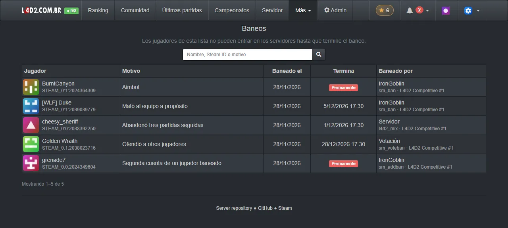

- **Visitantes** ven en **Más > Baneos** quién está baneado ahora, por qué, hasta cuándo y por quién. La página de un jugador baneado empieza con un aviso. Las direcciones IP y las cuentas relacionadas nunca son públicas.
- **Jugadores** baneados no entran en ninguno de los servidores de juego y reciben un aviso en la campana.
- **Administradores** banean con una duración y un motivo, editan, levantan el baneo, importan un archivo `banned_user.cfg` y leen el historial de los baneos terminados. Los baneos dados en el juego con `sm_ban`, `sm_addban`, una votación u otro plugin llegan solos, y `sm_unban` los levanta.
- **Alertas** avisan a los administradores cuando una cuenta se conecta desde la misma dirección IP que una cuenta baneada.

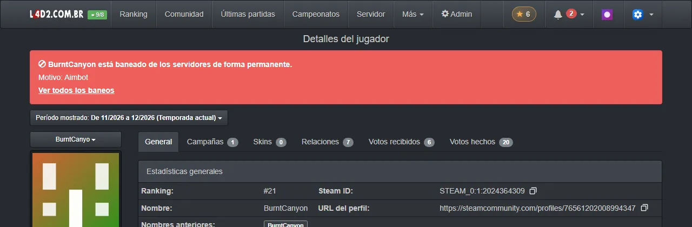

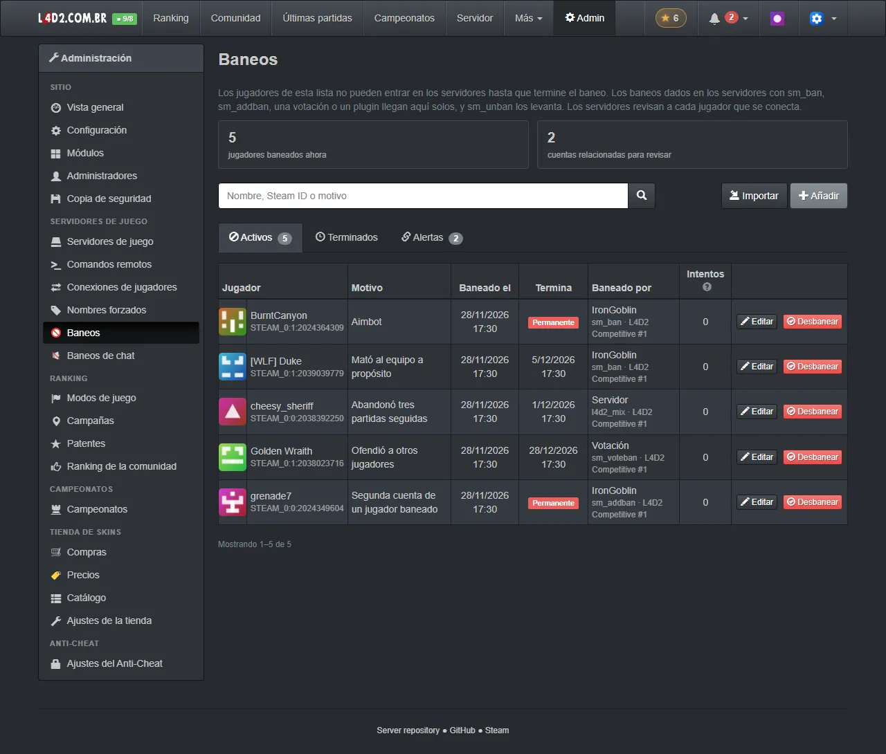

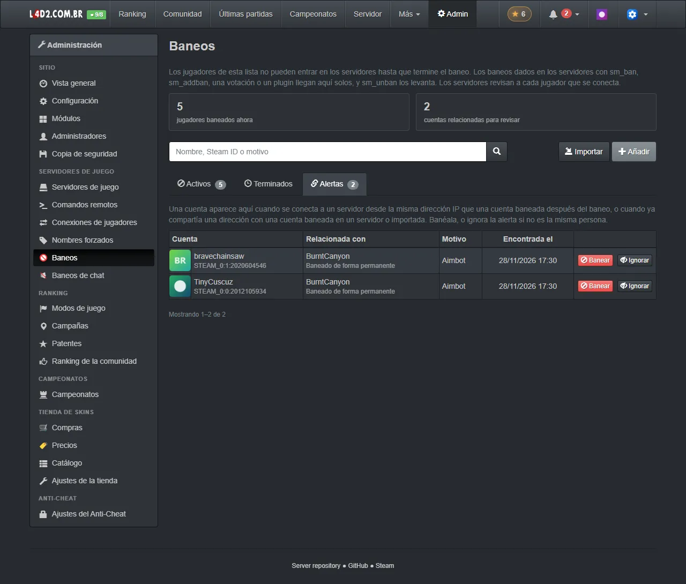

## Anti-Cheat

| | |
|---|---|
| Para qué sirve | Ofrece el programa Anti-Cheat a los jugadores y decide quién debe usarlo en los servidores de juego. |
| Por defecto | Desactivado |
| Necesita | El programa Anti-Cheat y el plugin del Anti-Cheat del servidor de juego, que son proyectos aparte y no forman parte de este repositorio (consulta [Conectar un servidor de juego](game-server.es.md#opcional-el-plugin-del-anti-cheat)). |
| Manual | [Anti-Cheat](manual/anti-cheat.es.md) |

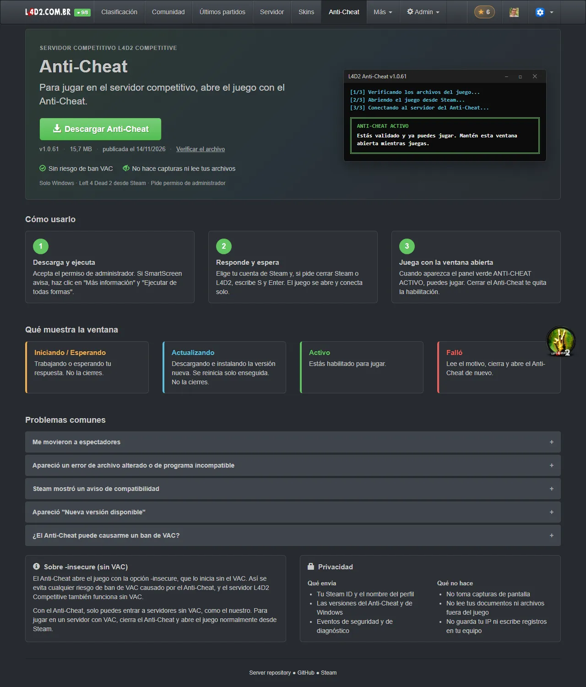

- **Visitantes** encuentran la descarga, cómo verificar el archivo, cómo usarlo y las respuestas a los problemas comunes.
- **Jugadores** que iniciaron sesión leen si su cuenta debe tener el Anti-Cheat abierto.
- **Administradores** eligen el modo (todos menos una lista de excepciones, o solo una lista de jugadores) y mantienen las dos listas.

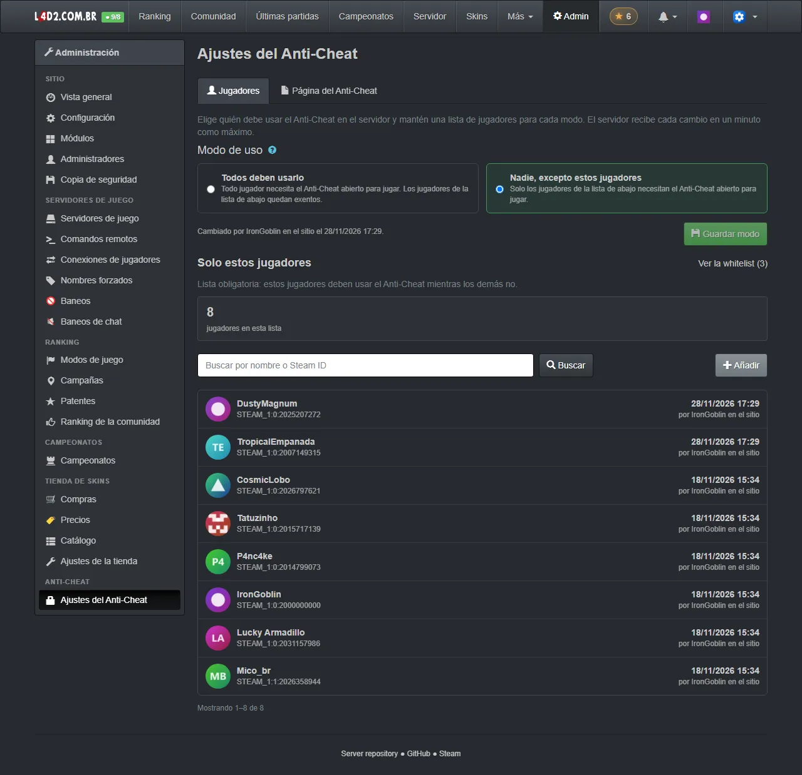

## Siempre activo

Estas partes no tienen interruptor: funcionan con cualquier módulo activado.

### Servidores de juego y envío de estadísticas

Cada servidor de juego se registra en **Administración > Servidores de juego** y recibe un token. Los plugins envían con él los archivos de estadísticas, y el sitio muestra si cada servidor está conectado y qué falta. Varios servidores alimentan el mismo sitio, y los resultados de un jugador se suman entre todos.

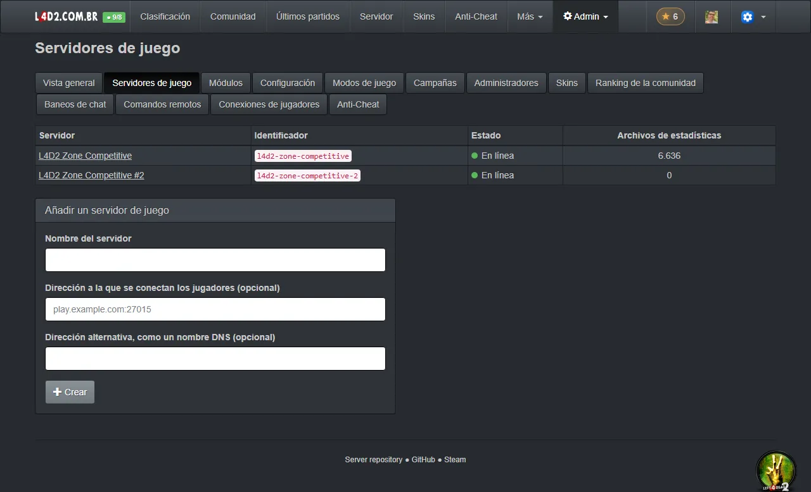

Manual: [Administración > Servidores de juego](manual/administration.es.md#servidores-de-juego), [Conectar un servidor de juego](game-server.es.md).

### Notificaciones

Una campana en la barra superior le cuenta a cada jugador que inició sesión lo que le concierne: un campeonato en el que puede participar, un pedido respondido, su turno en el draft, una serie programada, un castigo, un baneo, un regalo. Los administradores reciben aviso de lo que los espera, como un pedido para participar, una nueva bandera de equipo o una alerta de baneo. Las no leídas se cuentan en la campana, y `/notifications` las lista todas. Se guardan 90 días. Cuáles llegan depende de los módulos activados.

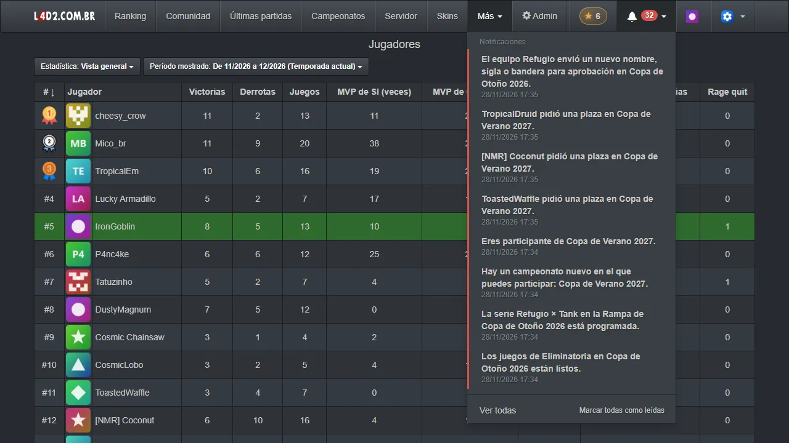

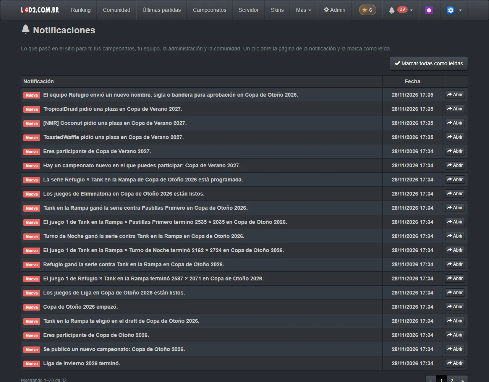

Manual: [Notificaciones](manual/notifications.es.md).

### Página de comandos

**Más > Comandos** enseña todos los comandos de los servidores de juego, con búsqueda y ejemplos. Un comando que necesita un módulo desactivado queda oculto.

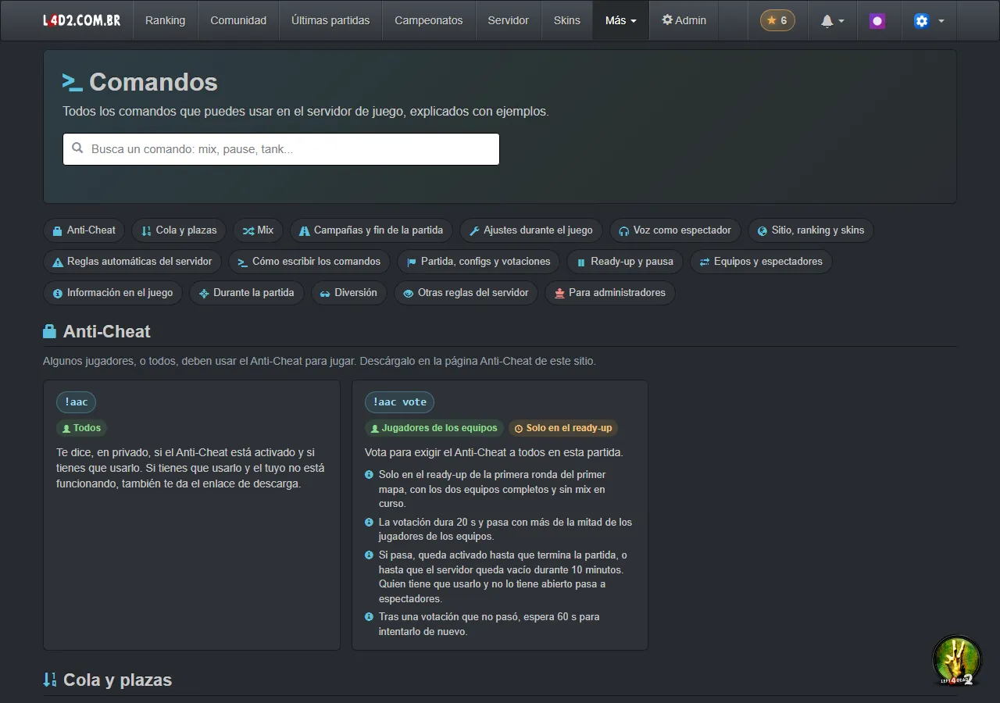

Manual: [Comandos del servidor de juego](manual/commands.es.md).

### Nombres forzados

Los administradores le dan a un jugador un nombre fijo, usado en todas las páginas del sitio y, con el plugin `l4d2_forced_names`, en el juego.

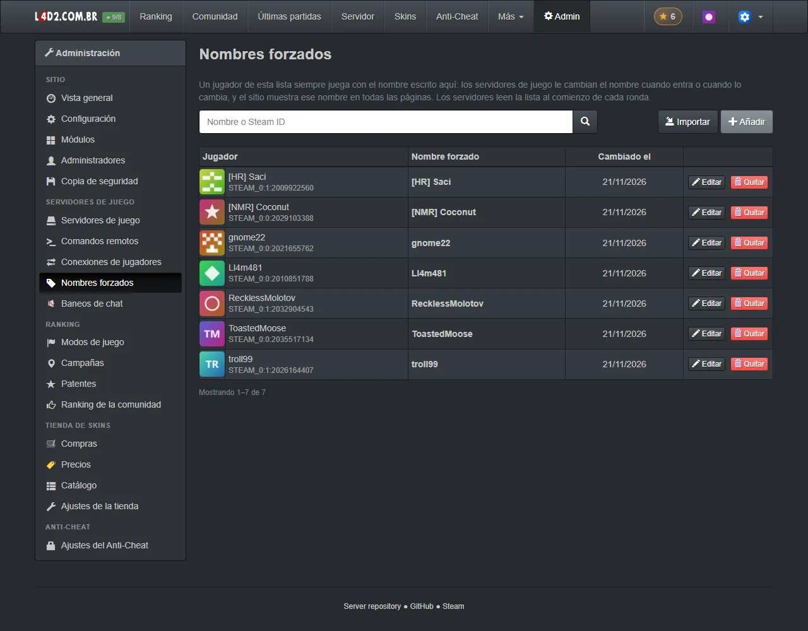

Manual: [Moderación > Nombres forzados](manual/moderation.es.md#nombres-forzados).

### Administración

**Admin**, en el menú, abre el área de administración: la vista general, la configuración, los módulos, los administradores y una página para cada función. Se entra con Steam, y todo cambio pide confirmación.

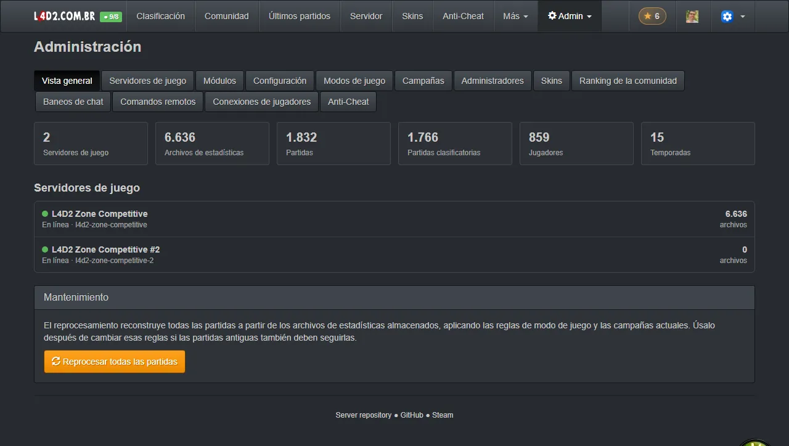

Manual: [Administración](manual/administration.es.md), [Configuración inicial](manual/first-run.es.md).

### Copias de seguridad

El sitio sube un zip de sus datos a un contenedor de Azure Storage cada algunas horas, comprueba que se puede restaurar y avisa a los administradores cuando una copia falla. Está desactivado hasta que se define un destino.

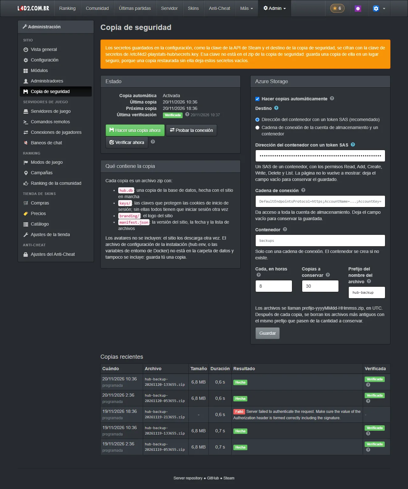

Manual: [Copias de seguridad y actualizaciones](manual/backups-and-updates.es.md).

### Idiomas, temas y teléfonos

Todas las páginas existen en inglés, portugués y español, en un tema oscuro y uno claro, y caben en un teléfono.

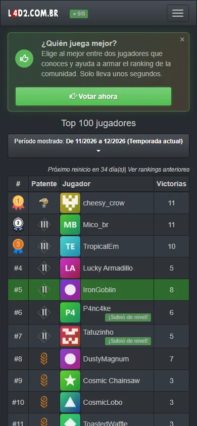

Manual: [Idiomas, temas y teléfonos](manual/languages-and-themes.es.md).
