# Módulos

🌐 [English](modules.md) | **Português** | [Español](modules.es.md)

Para que serve cada módulo do L4D2 PlayStats Hub, o que ele faz, quem usa e do que precisa. Um módulo é um recurso que o administrador liga ou desliga; algumas partes ficam sempre ligadas. Esta página é o resumo: cada seção leva à página do [manual do usuário](manual/README.pt.md) com todos os detalhes e todas as configurações.

## Conteúdo

- [Os módulos em resumo](#os-módulos-em-resumo)
- [Ligando e desligando um módulo](#ligando-e-desligando-um-módulo)
- [Ranking e estatísticas](#ranking-e-estatísticas)
- [Servidor ao vivo](#servidor-ao-vivo)
- [Chat do site](#chat-do-site)
- [Comandos remotos](#comandos-remotos)
- [Loja de skins de armas](#loja-de-skins-de-armas)
- [Ranking da comunidade](#ranking-da-comunidade)
- [Campeonatos](#campeonatos)
- [Banimentos](#banimentos)
- [Anti-Cheat](#anti-cheat)
- [Sempre ligado](#sempre-ligado)
  - [Servidores de jogo e envio das estatísticas](#servidores-de-jogo-e-envio-das-estatísticas)
  - [Notificações](#notificações)
  - [Página de comandos](#página-de-comandos)
  - [Nomes forçados](#nomes-forçados)
  - [Administração](#administração)
  - [Backups](#backups)
  - [Idiomas, temas e celulares](#idiomas-temas-e-celulares)

## Os módulos em resumo

| Módulo | Para que serve | Padrão | Precisa de | Plugin do servidor de jogo |
|---|---|---|---|---|
| [Ranking e estatísticas](#ranking-e-estatísticas) | O ranking, as partidas, os jogadores e as temporadas. | Ligado | | `l4d2_ranking` e `l4d2_show_patent_icon` (opcionais) |
| [Servidor ao vivo](#servidor-ao-vivo) | A partida em andamento em cada servidor de jogo. | Ligado | | `l4d2_gameinfo_sync` |
| [Chat do site](#chat-do-site) | Escrever no chat do jogo pelo site. | Desligado | Servidor ao vivo | `l4d2_gameinfo_sync` |
| [Comandos remotos](#comandos-remotos) | Enviar comandos do site para um servidor de jogo. | Desligado | Servidor ao vivo | `l4d2_gameinfo_sync` |
| [Loja de skins de armas](#loja-de-skins-de-armas) | Gastar as estrelas dos MVPs em skins de armas. | Desligado | Ranking e estatísticas | `l4d2_weapon_skins` |
| [Ranking da comunidade](#ranking-da-comunidade) | Um segundo ranking, votado pelos jogadores. | Desligado | | Nenhum |
| [Campeonatos](#campeonatos) | Campeonatos com equipes, draft, fases e resultados. | Desligado | | Nenhum além das estatísticas |
| [Banimentos](#banimentos) | Os jogadores banidos dos servidores de jogo. | Desligado | | `l4d2_bans` |
| [Anti-Cheat](#anti-cheat) | A página do Anti-Cheat e quem precisa usá-lo. | Desligado | | O plugin do Anti-Cheat, um projeto separado |

Todo servidor de jogo também precisa do `l4d2_playstats_sync`, que envia os arquivos de estatísticas. Os seis plugins deste repositório estão descritos no [guia dos plugins](../plugins/README.pt.md).

## Ligando e desligando um módulo

O administrador escolhe os módulos no terceiro passo da [configuração inicial](manual/first-run.pt.md#passo-3-os-módulos) e, depois, em **Administração > Módulos** (`/admin/modules`): marque o módulo e clique em **Salvar**. O **?** ao lado de cada nome explica o que muda.

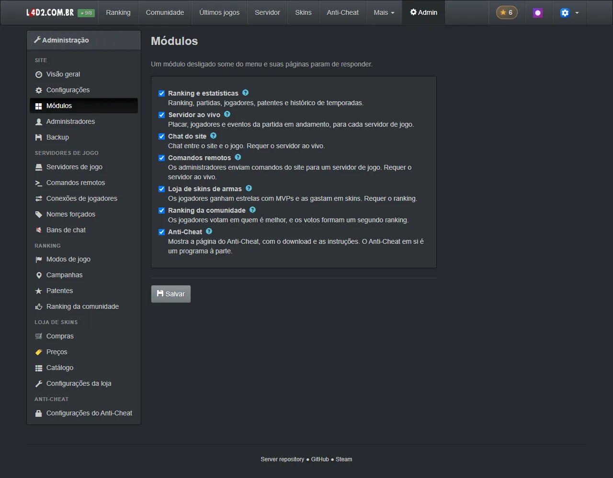

- Um módulo desligado some dos menus, e suas páginas e sua API respondem como não encontradas.
- Desligar um módulo não apaga nada. Os dados voltam quando ele é ligado de novo.
- Um módulo cujo requisito está desligado se comporta como desligado, mesmo com a própria caixa marcada.

Veja [Administração > Módulos](manual/administration.pt.md#módulos).

## Ranking e estatísticas

| | |
|---|---|
| Para que serve | Transforma cada partida jogada nos seus servidores em ranking, histórico e uma página para cada jogador. |
| Padrão | Ligado |
| Precisa de | `l4d2_playstats_sync` nos servidores de jogo. Opcionais: `l4d2_ranking` para o `!ranking` dentro do jogo e `l4d2_show_patent_icon` para os ícones de patente. |
| Manual | [Ranking](manual/ranking.pt.md), [Temporadas e histórico](manual/seasons-and-history.pt.md), [Patentes](manual/patents.pt.md), [Partidas](manual/matches.pt.md), [Jogadores](manual/players.pt.md), [Modos de jogo e campanhas](manual/game-modes-and-campaigns.pt.md), [Páginas dentro do jogo](manual/in-game-pages.pt.md), [Moderação > Punições](manual/moderation.pt.md#punições) |

O ranking da temporada atual abre o site: posição, patente, experiência, vitórias e derrotas, MVPs, tank wipes, aproveitamento e rage quits. Um seletor abre as outras temporadas, um ano inteiro ou todo o período.

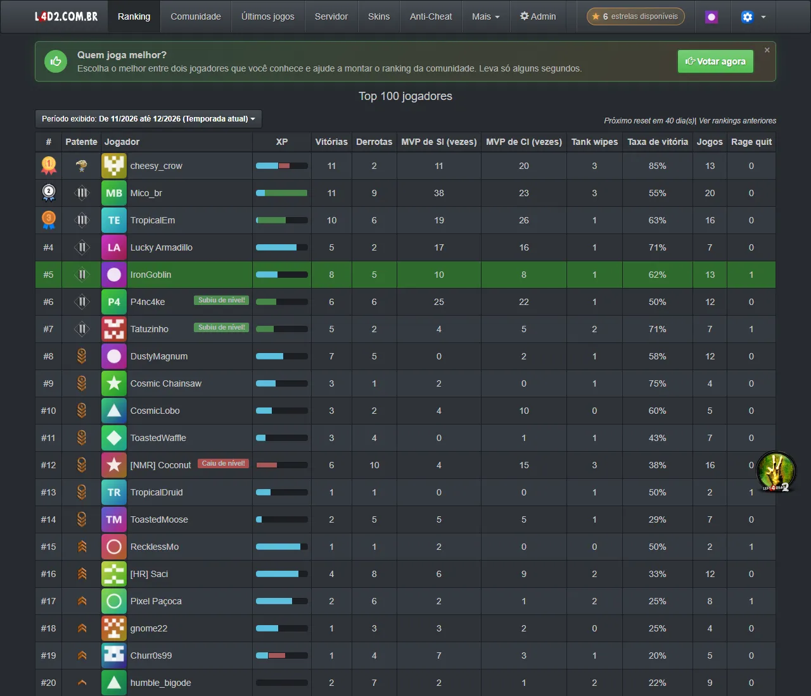

- **Visitantes e jogadores**
  - **Partidas**: todas as partidas, com o placar de cada mapa, os jogadores e as estatísticas de cada equipe e de cada mapa.
  - **Jogadores**: a lista de jogadores, a página de cada um (resultados, campanhas, skins, com quem e contra quem joga) e a comparação entre dois jogadores.
  - **Patentes**: 15 níveis, pela experiência da temporada.
  - **Dentro do jogo**: o `!ranking` abre o ranking no navegador do próprio jogo.
- **Administradores**
  - Decidem quais modos de jogo contam, quais mapas formam uma campanha, quantos pontos cada resultado dá e quanto dura uma temporada.
  - Punem um jogador em uma temporada, editam o placar de um mapa, trocam um jogador em uma partida e reconstroem todas as partidas a partir dos arquivos guardados.

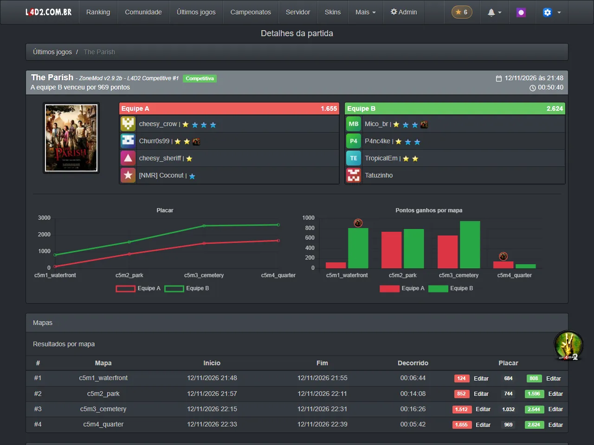

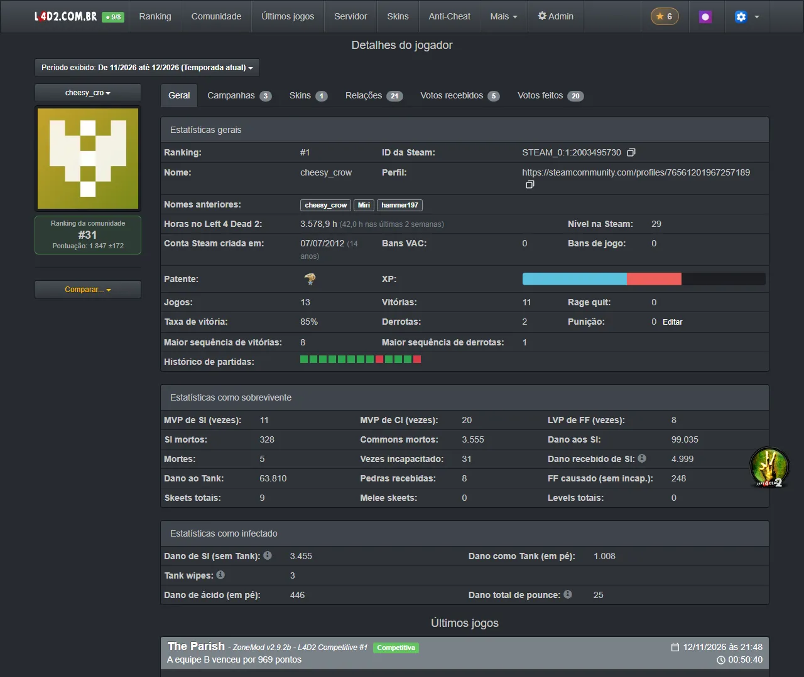

Com o módulo desligado, a primeira página mostra um pequeno texto de boas-vindas e as partidas continuam sendo montadas, sem aparecer.

## Servidor ao vivo

| | |
|---|---|
| Para que serve | Acompanha a partida em andamento em cada servidor de jogo, pelo navegador. |
| Padrão | Ligado |
| Precisa de | `l4d2_gameinfo_sync` nos servidores de jogo. |
| Manual | [Servidor ao vivo](manual/live-server.pt.md), [Moderação > Conexões de jogadores](manual/moderation.pt.md#conexões-de-jogadores) |

**Servidor**, no menu, abre a lista de servidores de jogo, ou a página ao vivo quando só há um.

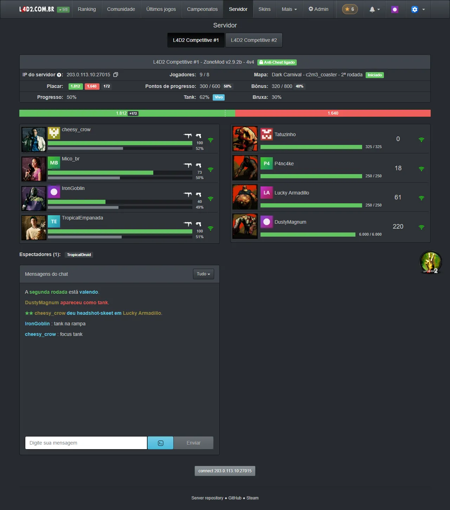

- **Visitantes e jogadores**
  - O placar, o bônus, onde o Tank e a Witch nascem, os sobreviventes com a vida e as armas, os infectados com a classe e o dano, os espectadores.
  - Os eventos da partida (skeets, crowns, Tank, pausas) e o chat do jogo.
  - O endereço do servidor com um botão de copiar, e o número de jogadores online ao lado do nome do site em todas as páginas.
- **Administradores**
  - Definem o atraso da página ao vivo (15 segundos por padrão) e de quanto em quanto tempo ela se atualiza.
  - **Conexões de jogadores**: as contas que conectaram do mesmo endereço de um jogador. O endereço em si nunca é mostrado.

## Chat do site

| | |
|---|---|
| Para que serve | Permite que jogadores conectados com a Steam escrevam no chat de um servidor de jogo pela página ao vivo. |
| Padrão | Desligado |
| Precisa de | O módulo [Servidor ao vivo](#servidor-ao-vivo) e o `l4d2_gameinfo_sync`. |
| Manual | [Servidor ao vivo > Escrevendo no chat pelo site](manual/live-server.pt.md#escrevendo-no-chat-pelo-site), [Moderação > Banimentos do chat](manual/moderation.pt.md#banimentos-do-chat) |

- **Jogadores** conectados com a Steam escrevem na caixa abaixo do chat da página ao vivo. A mensagem aparece no jogo.
- **Administradores** banem um jogador do chat do site e definem as pausas entre as mensagens e o tamanho delas. Um banimento do chat não silencia o jogador dentro do jogo e não é um banimento do servidor: isso é o módulo [Banimentos](#banimentos).

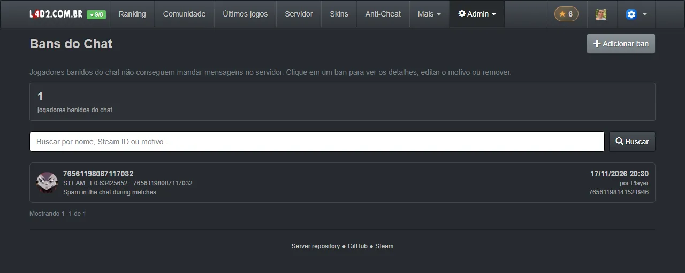

## Comandos remotos

| | |
|---|---|
| Para que serve | Envia comandos do SourceMod do site para um servidor de jogo, sem RCON. |
| Padrão | Desligado |
| Precisa de | O módulo [Servidor ao vivo](#servidor-ao-vivo) e o `l4d2_gameinfo_sync`. |
| Manual | [Moderação > Comandos remotos](manual/moderation.pt.md#comandos-remotos) |

Só os **administradores** usam:

- Digitam um comando, como `sm_forcestart`, ou montam passo a passo com o botão do terminal. O servidor de jogo o busca na próxima verificação.
- Enviam um comando pela caixa de chat da página ao vivo.
- Leem o registro de auditoria: cada comando, quem enviou, quando, e se foi entregue.

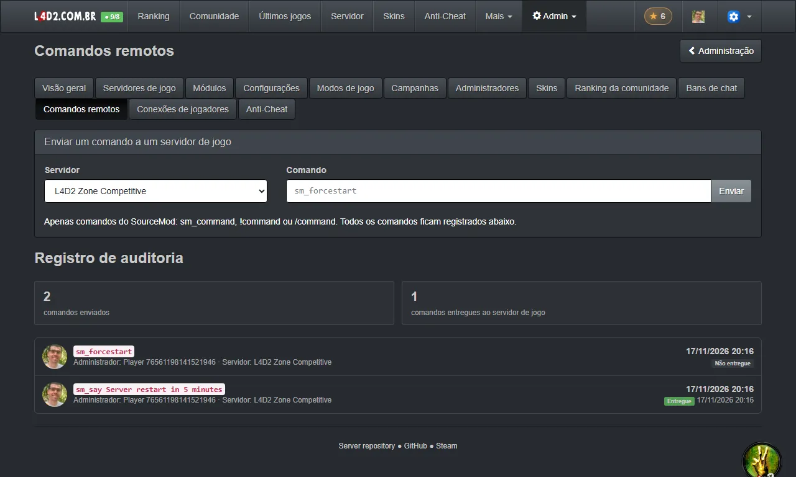

## Loja de skins de armas

| | |
|---|---|
| Para que serve | Recompensa os jogadores: cada MVP de uma partida ranqueada dá uma estrela, e as estrelas compram skins de armas. |
| Padrão | Desligado |
| Precisa de | O módulo [Ranking e estatísticas](#ranking-e-estatísticas), o `l4d2_weapon_skins` e os modelos e materiais das skins em um FastDL (veja [Conectando um servidor de jogo](game-server.pt.md#opcional-skins-de-armas-e-ícones-de-patente)). |
| Manual | [Loja de skins de armas](manual/skin-shop.pt.md) |

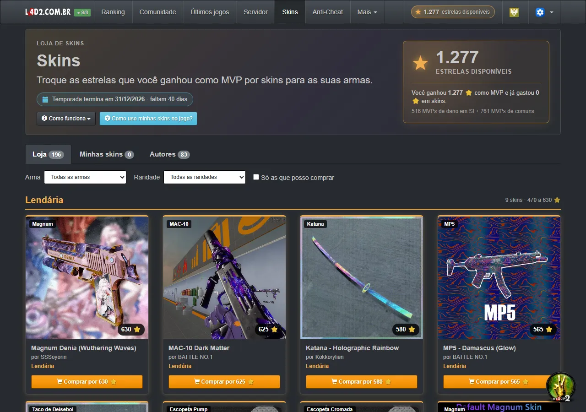

- **Visitantes** veem o catálogo, por arma e raridade, com fotos de cada skin.
- **Jogadores** compram skins com as estrelas, equipam no site ou com `!skin` no jogo e veem o saldo na barra do menu. As skins compradas em uma temporada são reembolsadas quando ela termina.
- **Administradores** dão skins de presente, reembolsam compras, mudam preços, importam o catálogo e desligam o reembolso da temporada. O catálogo vem com o site e é importado na primeira vez que o módulo é ligado.

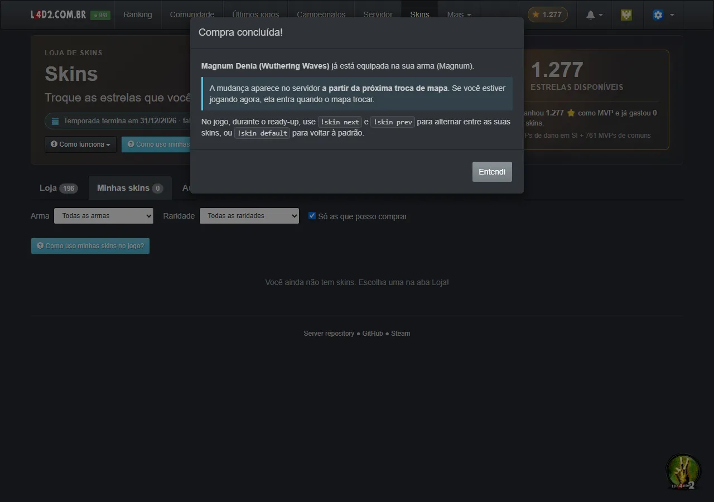

## Ranking da comunidade

| | |
|---|---|
| Para que serve | Um segundo ranking, feito com o que os jogadores pensam uns dos outros. |
| Padrão | Desligado |
| Precisa de | Mais nada. Os votos usam os jogadores que jogaram nos seus servidores. |
| Manual | [Ranking da comunidade](manual/community-ranking.pt.md) |

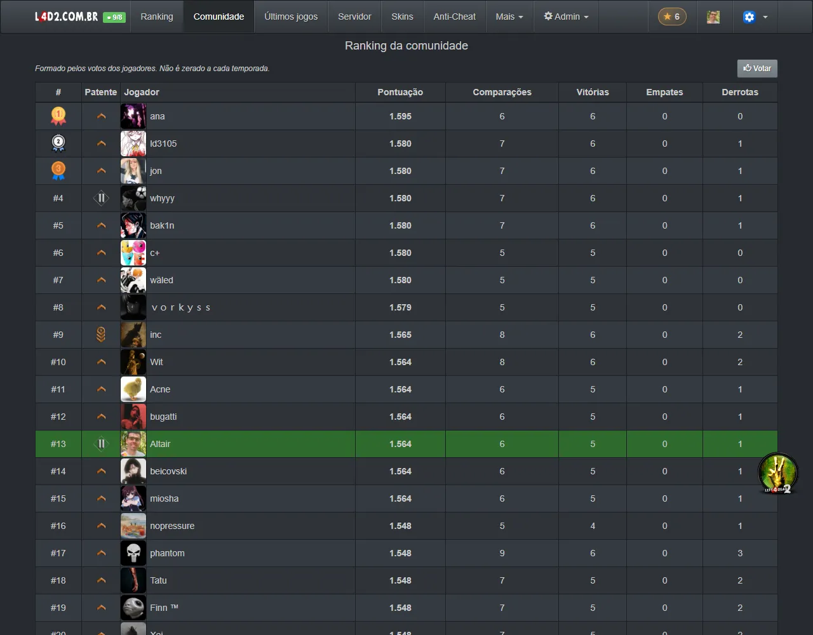

- **Visitantes** veem o ranking e os últimos votos.
- **Jogadores** com partidas suficientes escolhem o melhor entre dois jogadores: esquerda, direita, mesmo nível ou "não sei". Há um limite de votos por dia, e cada dupla é perguntada uma só vez.
- **Administradores** definem os limites e os mínimos, bloqueiam um votante e apagam votos.
- **Servidores de jogo** podem pedir duas equipes equilibradas por este ranking, para um mix (veja [Conectando um servidor de jogo](game-server.pt.md#o-mix-pelo-ranking-da-comunidade)).

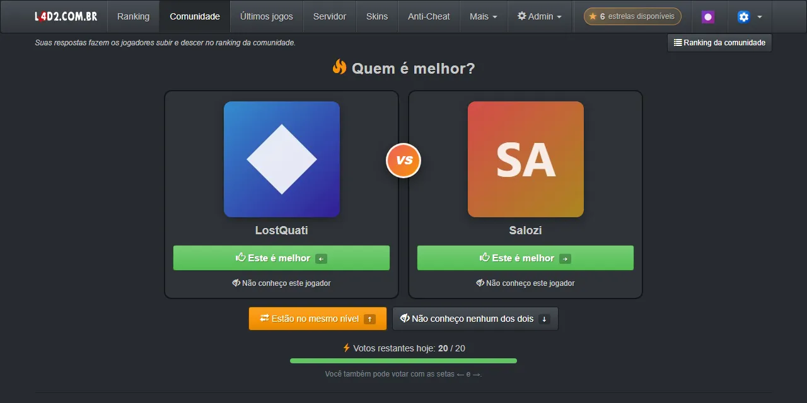

## Campeonatos

| | |
|---|---|
| Para que serve | Organiza campeonatos nos seus servidores de jogo, da inscrição à final. |
| Padrão | Desligado |
| Precisa de | Mais nada. Os resultados vêm dos arquivos de estatísticas, então os servidores de jogo só precisam do `l4d2_playstats_sync`. O [Anti-Cheat](#anti-cheat) e o [Ranking](#ranking-e-estatísticas) são opcionais. |
| Manual | [Campeonatos](manual/championships.pt.md) |

**Campeonatos**, no menu, lista todos os campeonatos: os em andamento no topo e os encerrados com o campeão.

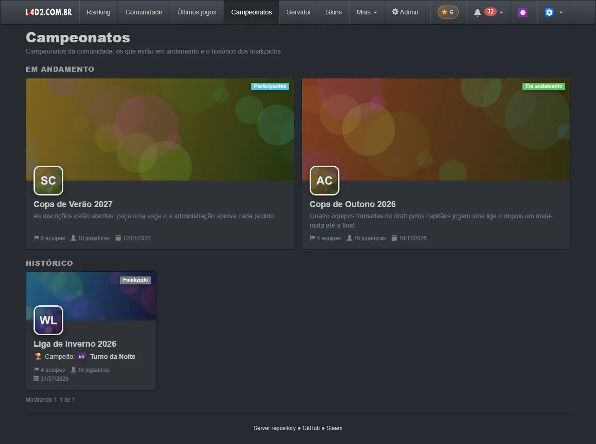

Cada campeonato tem as próprias páginas, com banner e logo: uma visão geral com o próximo jogo, as equipes e o formato, e as abas Regras, Equipes, Draft, Classificação, Chave, Jogos e Estatísticas.

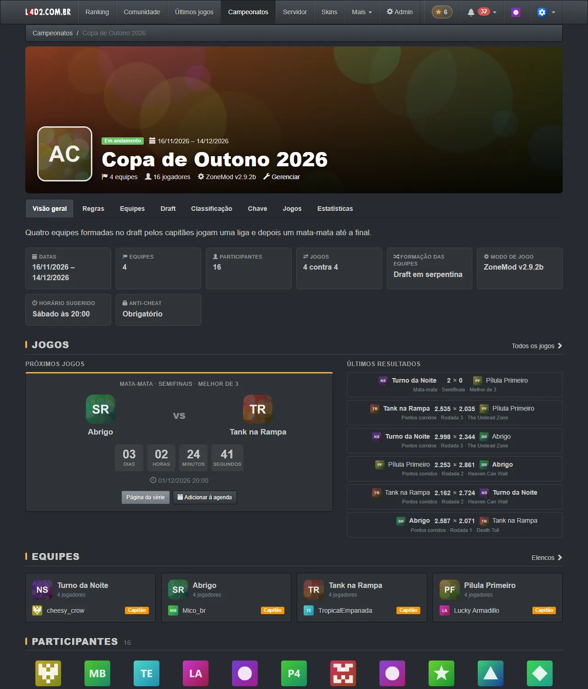

- **Visitantes** acompanham tudo: a classificação, a chave, as datas (com link para o calendário) e os resultados.
- **Jogadores** pedem para participar, quando a administração permite, com uma mensagem. A administração aprova ou recusa cada pedido.
- **Capitães e vice-capitães** têm a **área do capitão**: escolhem jogadores no draft, propõem nome, tag e bandeira da equipe, propõem e aceitam datas, vetam campanhas e escolhem as campanhas dos seus jogos.
- **Administradores** criam o campeonato a partir de um formato, escolhem os participantes e como as equipes são formadas, montam as fases e podem decidir tudo o que os capitães decidem. Também escolhem quais campanhas podem ser jogadas, se o Anti-Cheat é obrigatório, e um dia e horário sugeridos para os jogos.

| Parte | Opções |
|---|---|
| Formatos | Pontos corridos, mata-mata, pontos corridos seguidos de mata-mata, grupos seguidos de mata-mata. Cada fase pode ser mudada até ser montada. |
| Formação das equipes | Manual, roleta, potes, draft em serpentina ou draft em linha. |
| Campanhas | Sorteadas para cada rodada, escolhidas pelas equipes ou escolhidas pela administração, com vetos e uma lista de campanhas permitidas. |
| Resultados | Ligados sozinhos à partida do servidor, ligados à mão, digitados ou por W.O., com penalidades. |

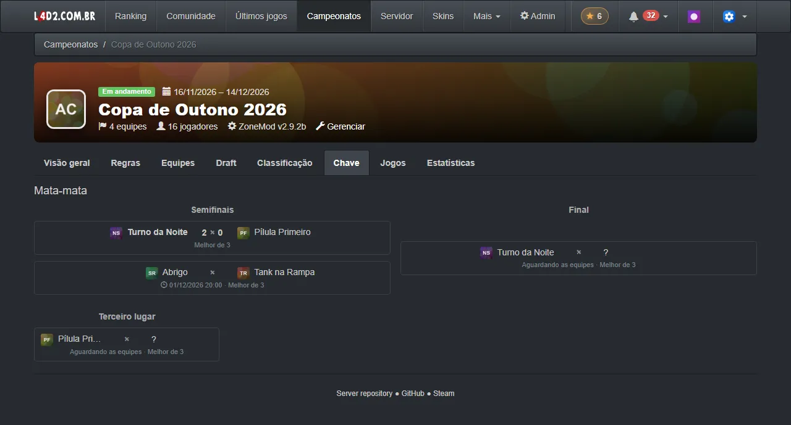

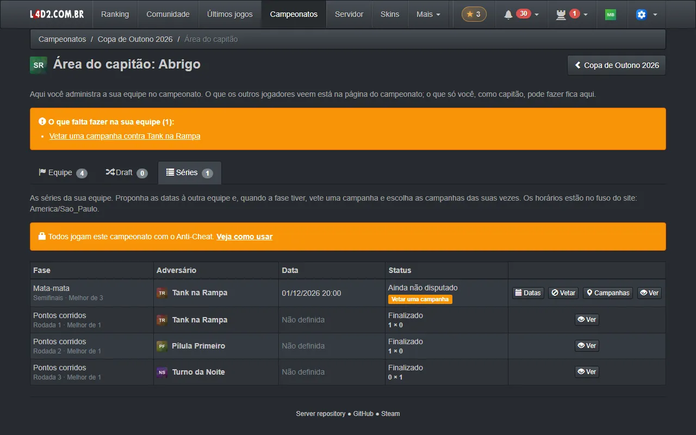

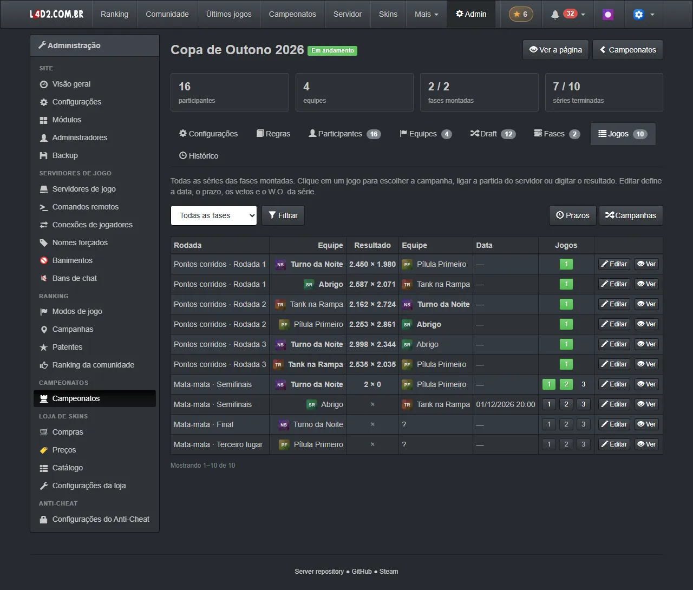

Os jogos são partidas normais do servidor: contam para o ranking como qualquer outra.

## Banimentos

| | |
|---|---|
| Para que serve | Guarda os banimentos de todos os servidores de jogo em uma lista só, pública, com o motivo e o fim de cada um. |
| Padrão | Desligado |
| Precisa de | `l4d2_bans` nos servidores de jogo. Com o módulo [Servidor ao vivo](#servidor-ao-vivo), um banimento feito no site chega aos servidores na hora; sem ele, na próxima vez que o jogador conectar. |
| Manual | [Banimentos](manual/bans.pt.md) |

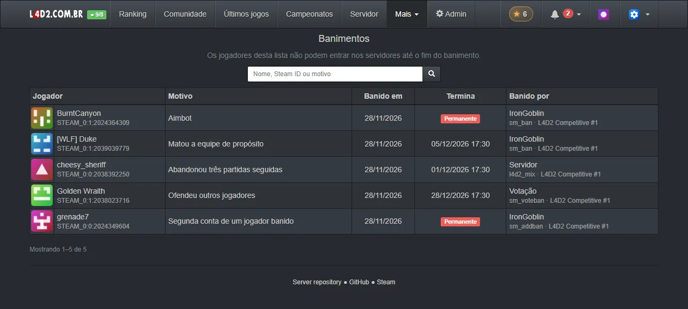

- **Visitantes** veem em **Mais > Banimentos** quem está banido agora, por quê, até quando e por quem. A página de um jogador banido começa com um aviso. Endereços IP e contas relacionadas nunca são públicos.
- **Jogadores** banidos não entram em nenhum dos servidores de jogo e são avisados no sino.
- **Administradores** banem com duração e motivo, editam, removem o banimento, importam um arquivo `banned_user.cfg` e leem o histórico dos banimentos encerrados. Os banimentos dados no jogo com `sm_ban`, `sm_addban`, uma votação ou outro plugin chegam sozinhos, e o `sm_unban` os remove.
- **Alertas** avisam os administradores quando uma conta conecta do mesmo endereço IP de uma conta banida.

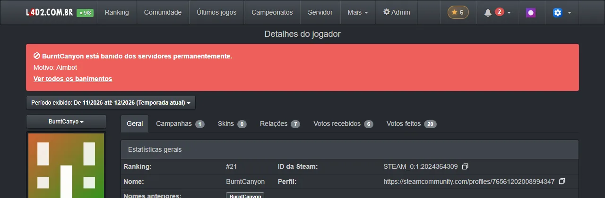

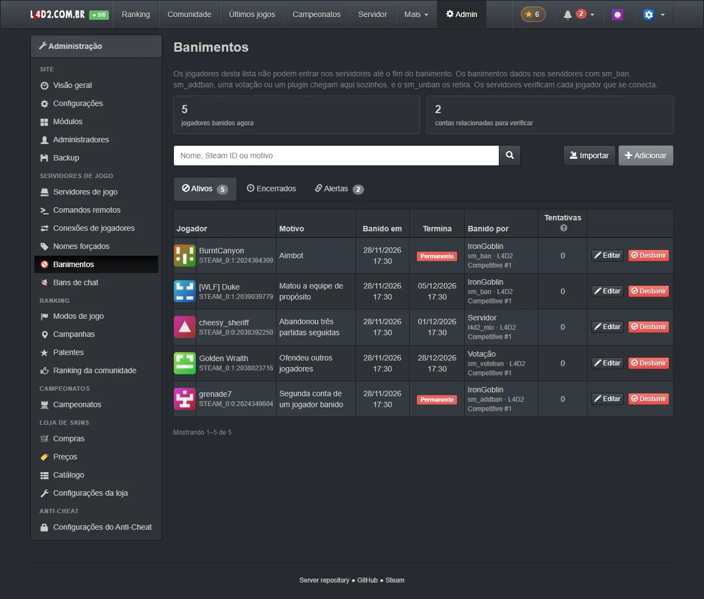

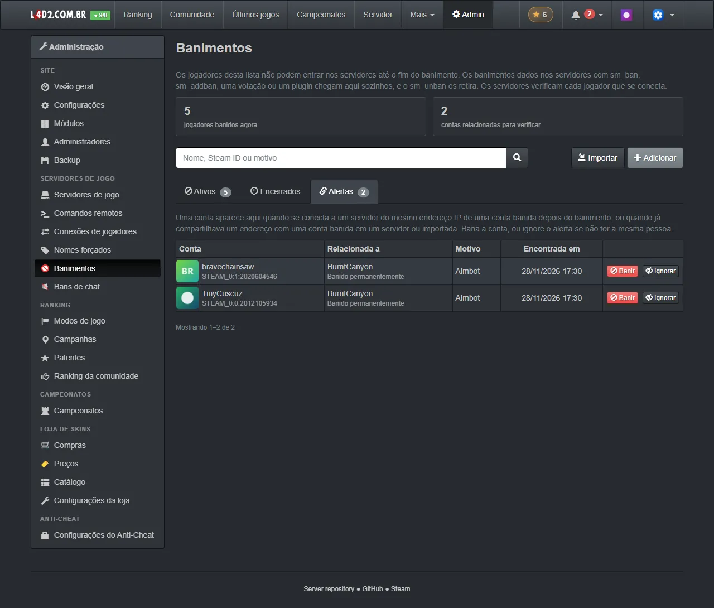

## Anti-Cheat

| | |
|---|---|
| Para que serve | Oferece o programa Anti-Cheat aos jogadores e decide quem precisa usá-lo nos servidores de jogo. |
| Padrão | Desligado |
| Precisa de | O programa Anti-Cheat e o plugin do Anti-Cheat do servidor de jogo, que são projetos separados e não fazem parte deste repositório (veja [Conectando um servidor de jogo](game-server.pt.md#opcional-o-plugin-do-anti-cheat)). |
| Manual | [Anti-Cheat](manual/anti-cheat.pt.md) |

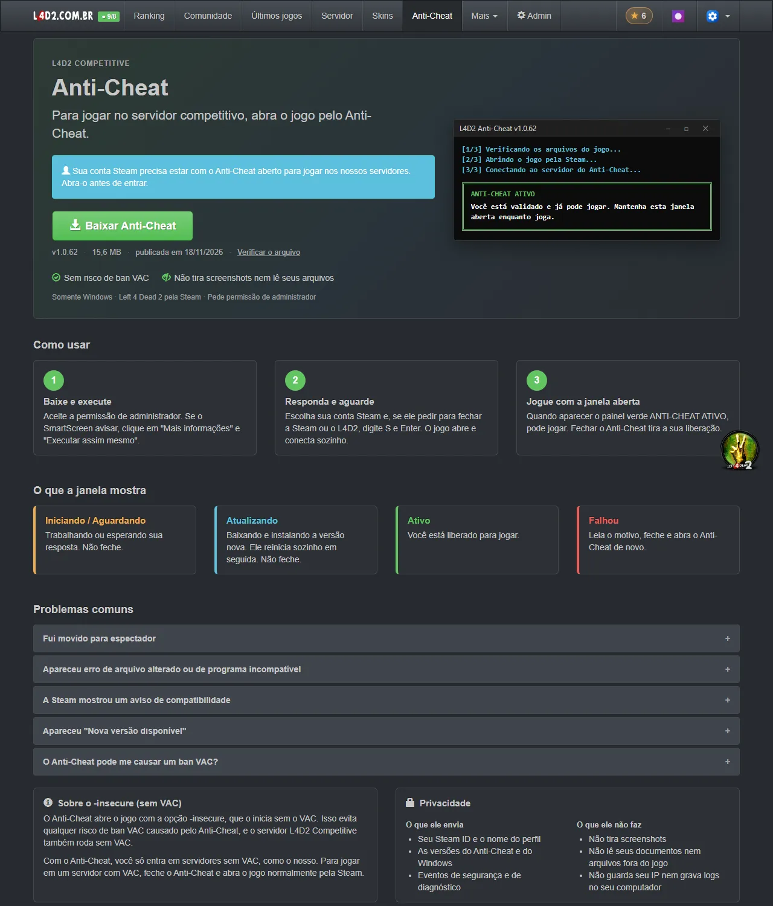

- **Visitantes** encontram o download, como conferir o arquivo, como usar e as respostas para os problemas comuns.
- **Jogadores** conectados com a Steam leem se a conta deles precisa ter o Anti-Cheat aberto.
- **Administradores** escolhem o modo (todos menos uma lista de exceções, ou só uma lista de jogadores) e mantêm as duas listas.

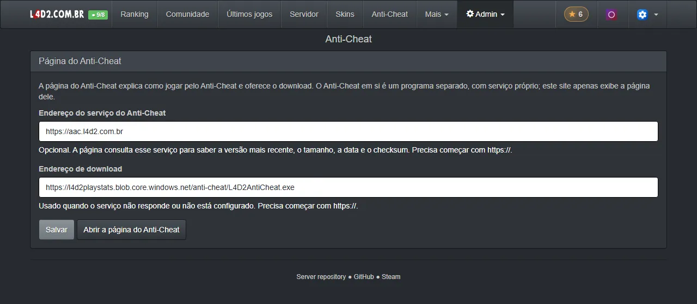

## Sempre ligado

Estas partes não têm chave: funcionam com quaisquer módulos ligados.

### Servidores de jogo e envio das estatísticas

Cada servidor de jogo é cadastrado em **Administração > Servidores de jogo** e recebe um token. Os plugins enviam os arquivos de estatísticas com ele, e o site mostra se cada servidor está conectado e o que falta. Vários servidores alimentam o mesmo site, e os resultados de um jogador se somam entre todos.

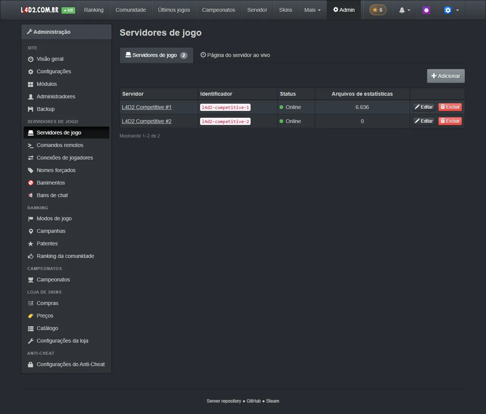

Manual: [Administração > Servidores de jogo](manual/administration.pt.md#servidores-de-jogo), [Conectando um servidor de jogo](game-server.pt.md).

### Notificações

Um sino na barra do topo conta a cada jogador conectado com a Steam o que diz respeito a ele: um campeonato de que pode participar, um pedido respondido, a vez no draft, uma série marcada, uma punição, um banimento, um presente. Os administradores são avisados do que espera por eles, como um pedido para participar, uma nova bandeira de equipe ou um alerta de banimento. As não lidas são contadas no sino, e `/notifications` lista todas. Elas ficam guardadas por 90 dias. Quais chegam depende dos módulos ligados.

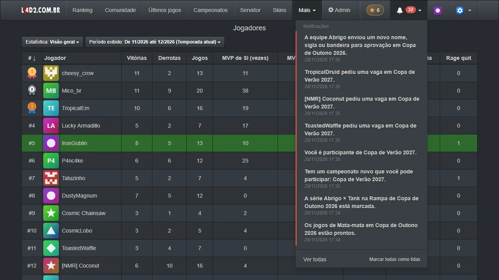

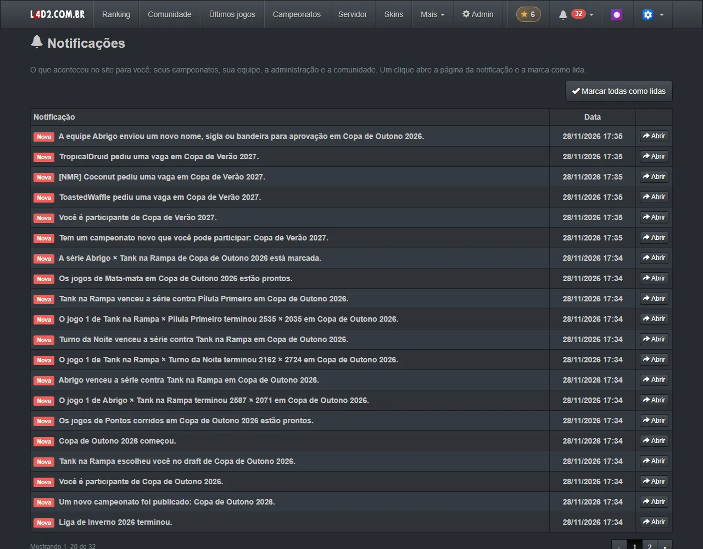

Manual: [Notificações](manual/notifications.pt.md).

### Página de comandos

**Mais > Comandos** ensina todos os comandos dos servidores de jogo, com busca e exemplos. Um comando que precisa de um módulo desligado fica escondido.

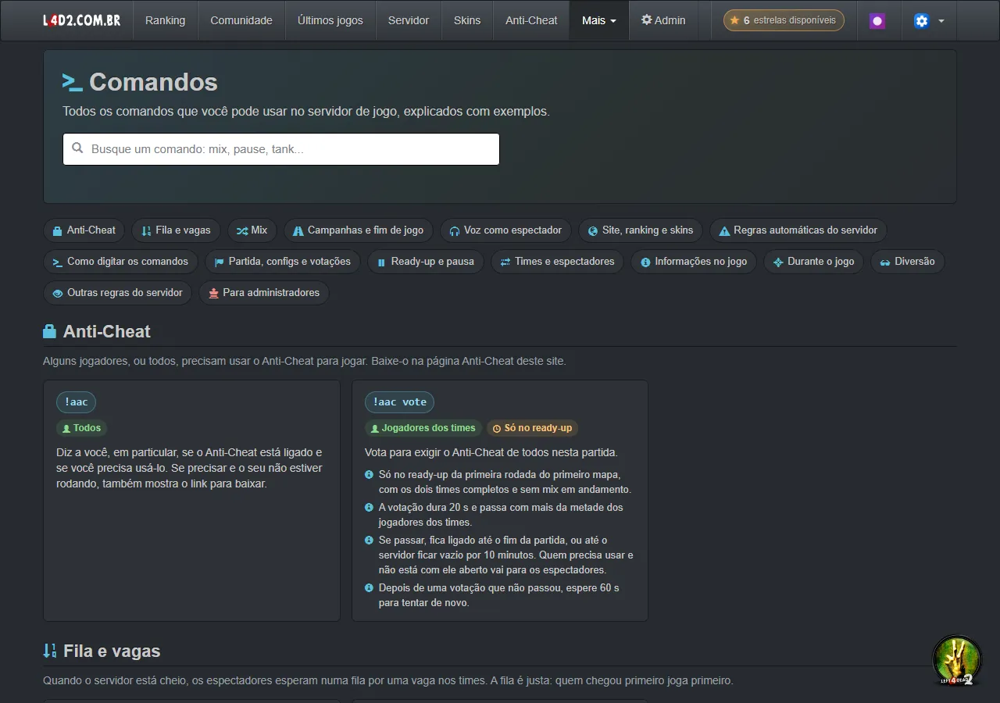

Manual: [Comandos do servidor de jogo](manual/commands.pt.md).

### Nomes forçados

Os administradores dão a um jogador um nome fixo, usado em todas as páginas do site e, com o plugin `l4d2_forced_names`, no jogo.

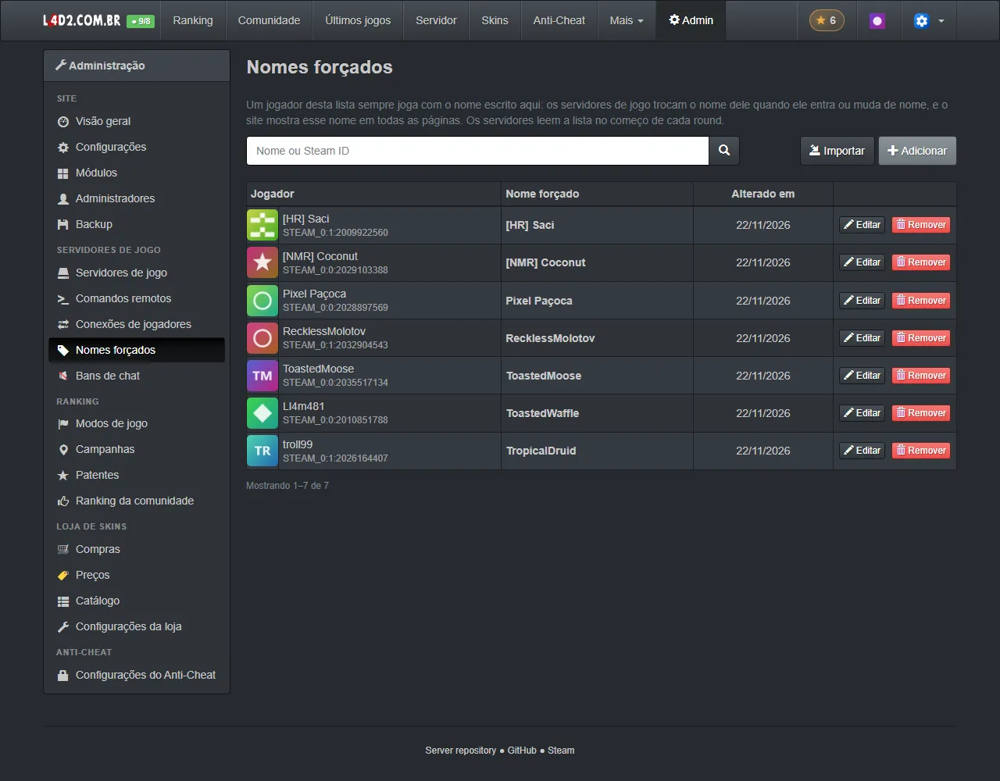

Manual: [Moderação > Nomes forçados](manual/moderation.pt.md#nomes-forçados).

### Administração

**Admin**, no menu, abre a área de administração: a visão geral, as configurações, os módulos, os administradores e uma página para cada recurso. A entrada é pela Steam, e toda mudança pede confirmação.

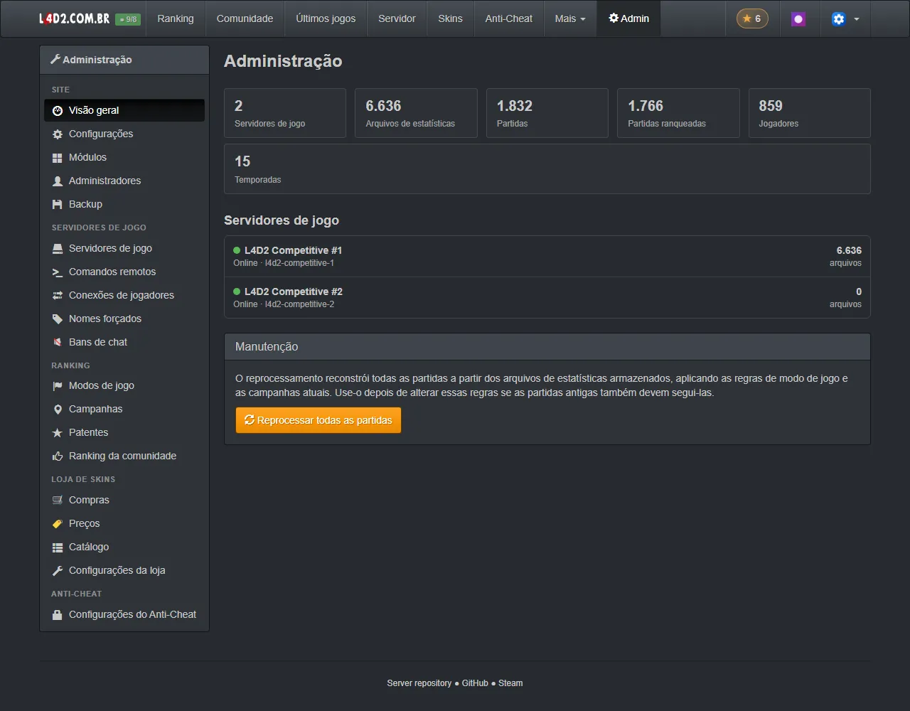

Manual: [Administração](manual/administration.pt.md), [Configuração inicial](manual/first-run.pt.md).

### Backups

O site envia um zip dos seus dados para um contêiner do Azure Storage a cada algumas horas, confere se ele pode ser restaurado e avisa os administradores quando um backup falha. Fica desligado até um destino ser definido.

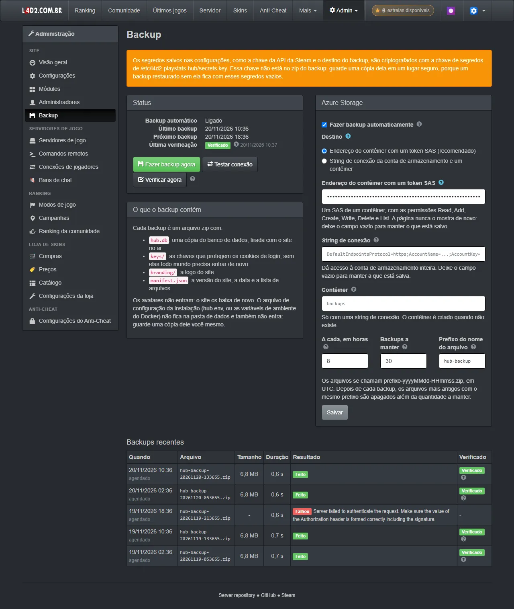

Manual: [Backups e atualizações](manual/backups-and-updates.pt.md).

### Idiomas, temas e celulares

Todas as páginas existem em inglês, português e espanhol, em um tema escuro e um claro, e cabem em um celular.

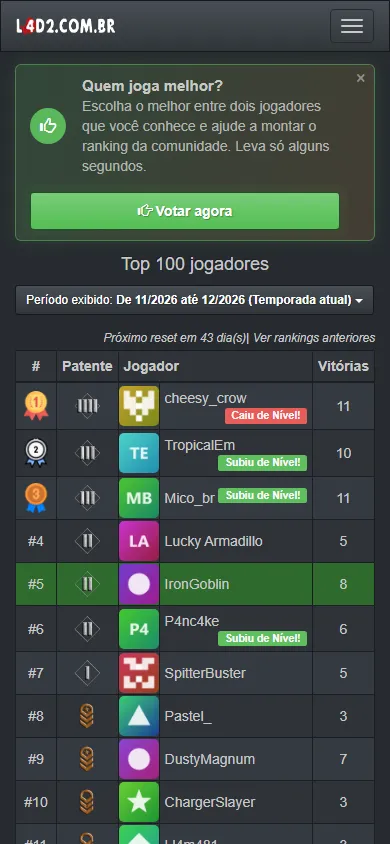

Manual: [Idiomas, temas e celulares](manual/languages-and-themes.pt.md).
