# Cambiar desde el sitio antiguo

🌐 [English](switch-from-old-site.md) | [Português](switch-from-old-site.pt.md) | **Español**

Cómo reemplazar una copia en funcionamiento del sitio anterior (`l4d2-playstats-web` con `l4d2-playstats-api`) por este, en la misma máquina, sin cambiar las direcciones que ya usan los jugadores. El ejemplo es la instalación de l4d2.com.br: un VPS Ubuntu en `124.198.128.43` donde nginx sirve `https://l4d2.com.br` y lo pasa al sitio antiguo en el puerto `5000`, el juego abre `http://124.198.128.43:5000`, y el servidor de juego se basa en [l4d2-zone-server](https://github.com/altair-sossai/l4d2-zone-server). Pon tus propios nombres y direcciones en su lugar.

## Contenido

- [El plan](#el-plan)
- [Parte 1: instala el sitio nuevo junto al antiguo](#parte-1-instala-el-sitio-nuevo-junto-al-antiguo)
- [Parte 2: prueba con un servidor de juego](#parte-2-prueba-con-un-servidor-de-juego)
- [Parte 3: el cambio](#parte-3-el-cambio)
- [Despliegue automático](#despliegue-automático)
- [Parte 4: volver atrás](#parte-4-volver-atrás)

## El plan

| Parte | Qué cambia | Qué notan los jugadores |
|---|---|---|
| 1 | El sitio nuevo funciona en el puerto `5090`, junto al antiguo. nginx y el sitio antiguo no se tocan. | Nada. |
| 2 | Un servidor de juego envía sus partidas al sitio nuevo. | Las partidas de ese servidor dejan de llegar al sitio antiguo. |
| 3 | El sitio antiguo se detiene y el nuevo toma su puerto, el `5000`. nginx sigue pasando `https://l4d2.com.br` ahí. | Las páginas nuevas, en las mismas direcciones. |
| 4 | Solo si algo sale mal: vuelve el sitio antiguo. | Las páginas antiguas otra vez. |

Deja `/home/l4d2-playstats-web`, la carpeta del sitio antiguo, tal como está hasta que estés seguro: volver atrás la necesita.

## Parte 1: instala el sitio nuevo junto al antiguo

En l4d2.com.br esta parte se hizo el 19 de noviembre de 2026. El sitio nuevo funciona en `http://124.198.128.43:5090` con el ranking del sitio antiguo, y nada de lo que usan los jugadores cambió.

### Ejecuta el instalador

1. Conéctate al VPS por SSH como `root`, o con un usuario que pueda usar `sudo`.
2. Ejecuta el instalador sin dominio. Sin `HUB_DOMAIN` no instala Caddy, así que nginx y los puertos 80 y 443 quedan como están. `HUB_PORT=5090` no es el `5080` por defecto del instalador porque, en este VPS, ese puerto ya lo usa la API del anti-cheat (`127.0.0.1:5080`):

   ```bash
   curl -fsSL https://raw.githubusercontent.com/altair-sossai/l4d2-playstats-hub/main/deploy/install.sh | sudo HUB_PORT=5090 bash
   ```

   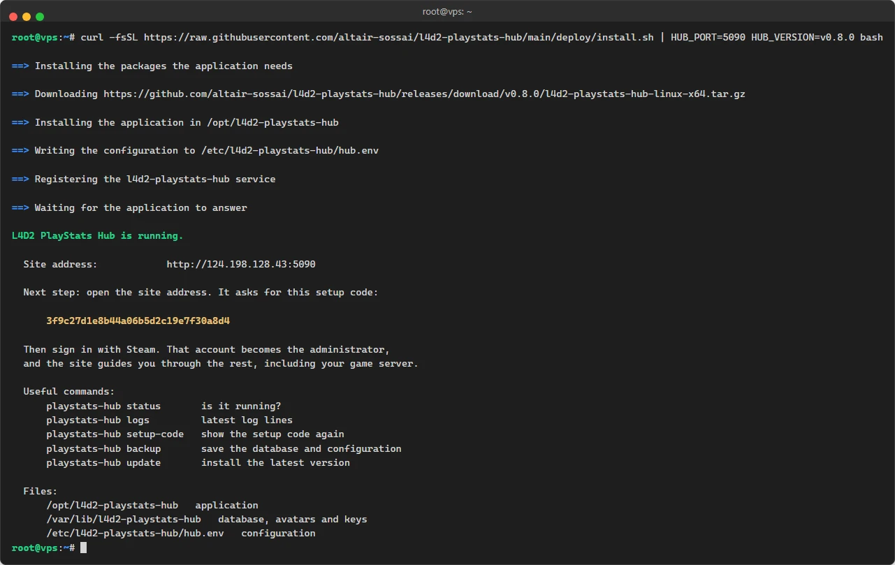

3. Abre el puerto `5090`. Con UFW activo, el instalador ya lo hizo; si no, ejecuta `sudo ufw allow 5090/tcp`. En este VPS UFW está desactivado. Si tu proveedor de hosting tiene su propio firewall, abre el puerto ahí también.

El instalador solo agrega la aplicación: `/opt/l4d2-playstats-hub`, los datos en `/var/lib/l4d2-playstats-hub`, la configuración en `/etc/l4d2-playstats-hub/hub.env`, el servicio `l4d2-playstats-hub` y el comando `playstats-hub`. El sitio antiguo, la API del anti-cheat y nginx siguen en sus puertos:

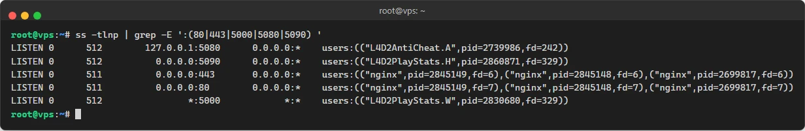

[Instalación en un VPS Linux](install-linux.es.md) explica cada paso del instalador y los comandos `playstats-hub`.

### El asistente de configuración

Abre `http://124.198.128.43:5090`. El asistente se explica en [Configuración inicial](manual/first-run.es.md); estos son los valores usados en l4d2.com.br.

1. Pega el código de configuración que mostró el instalador e inicia sesión con Steam. Esa cuenta pasa a ser el primer administrador.

   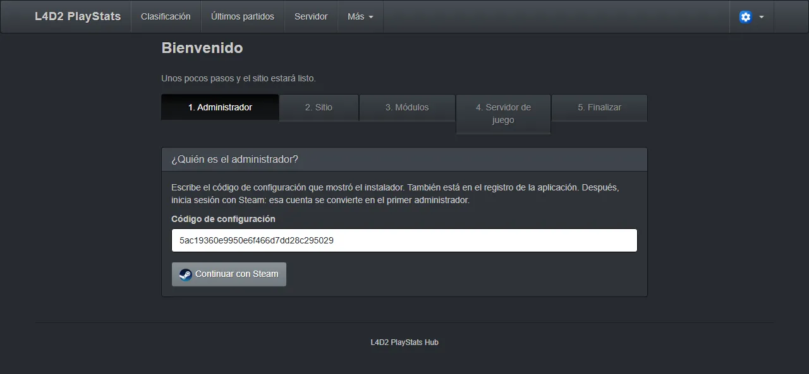

2. El sitio:

   | Campo | Valor | De dónde viene |
   |---|---|---|
   | Nombre del sitio | `L4D2 Competitive` | El nombre en el título de las páginas antiguas. |
   | Logo del sitio | `logo.png` | El logo del sitio antiguo, `wwwroot/imgs/logo.png` en `l4d2-playstats-web`. |
   | Idioma predeterminado | Português | |
   | Zona horaria | `America/Sao_Paulo` | |
   | Duración de la temporada, en meses | `2` | El sitio antiguo empezaba un ranking nuevo cada dos meses. |
   | Clave de la Steam Web API | La primera clave de `SteamApiKey` | `/home/l4d2-playstats-web/appsettings.json`. El sitio antiguo guarda dos claves separadas por `;`; el sitio nuevo usa una. |

   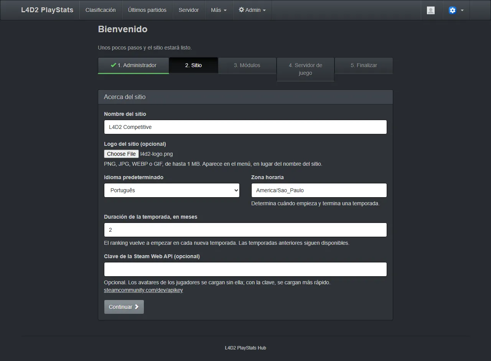

3. Los módulos: todo lo que tenía el sitio antiguo. El ranking de la comunidad queda desactivado, porque el sitio antiguo no lo tenía.

   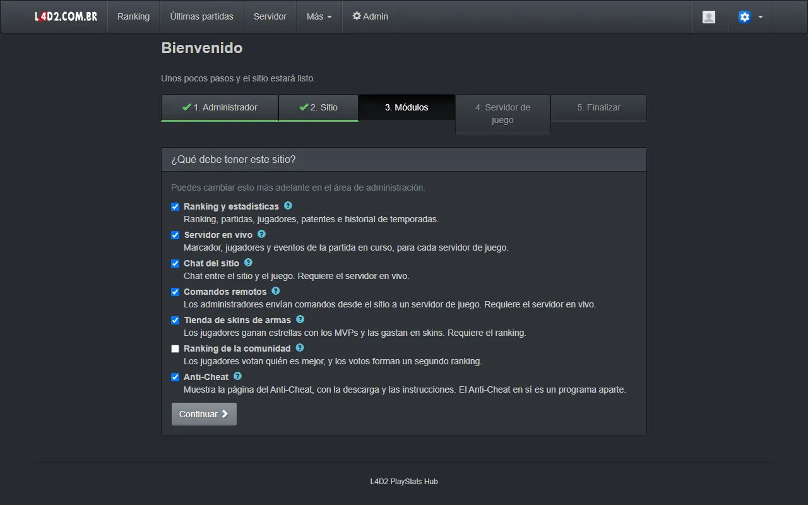

4. El servidor de juego: el nombre `l4d2.com.br | Competitive`, el mismo del sitio antiguo, y la dirección `124.198.128.93:27015`, la IP de `server.l4d2.com.br` y el puerto del servidor de juego.

   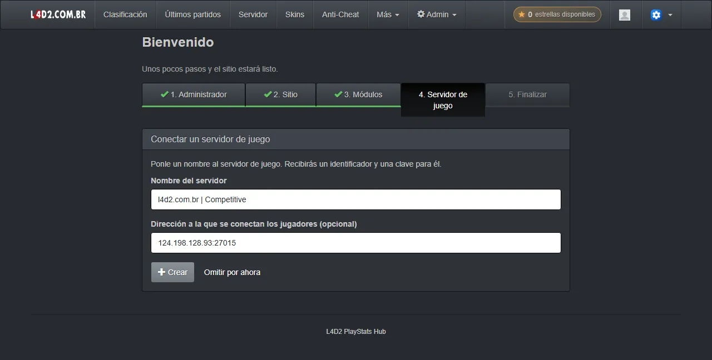

5. **Crear** muestra las dos líneas para el servidor de juego. Copia el token ahora: se muestra una sola vez. En l4d2.com.br se guardó en el VPS en `/root/l4d2-playstats-hub-server-token.txt`, que solo `root` puede leer. Se usa para traer los datos antiguos, más abajo, y en la [Parte 2](#parte-2-prueba-con-un-servidor-de-juego).

   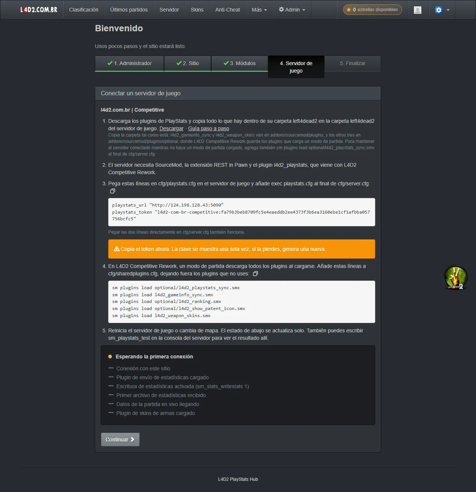

6. **Continuar** y **Finalizar**. El sitio abre el área de administración.

   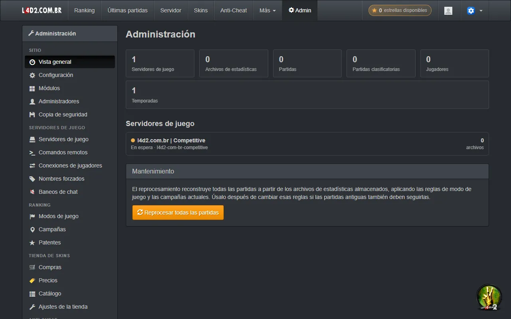

### El resto de la administración

| Página | Qué se configuró | De dónde viene |
|---|---|---|
| **Configuración → Apariencia** | Los tres enlaces del pie del sitio antiguo (Server repository, GitHub, Steam), las palabras clave para buscadores y el ID de Google Analytics `G-4QMNBJLQST`. | El `_Layout.cshtml` antiguo. Con el mismo ID de Google Analytics, las visitas siguen en el mismo informe. |
| **Configuración → Sitio** | La **Dirección pública del sitio** queda vacía hasta la [Parte 3](#parte-3-el-cambio). | |
| **Configuración → Privacidad** | Cuentas relacionadas visibles para todos, el valor por defecto. | El sitio antiguo las mostraba a todos. |
| **Administradores** | Las tres cuentas de `ServerAdmins`. | `/home/l4d2-playstats-web/appsettings.json`. |
| **Servidores de juego → l4d2.com.br \| Competitive** | Dirección alternativa `server.l4d2.com.br`. | El `ServerDns` del sitio antiguo. La página del servidor en vivo muestra las dos direcciones, como la antigua. |
| **Modos de juego** | Una regla para cada uno de `ZoneMod v*`, `NeoMod Tourney *` y `VanillaMod *`: 4 jugadores por equipo, al menos 2 mapas, cuenta para el ranking. La regla `*` de un sitio nuevo queda como **Otras configuraciones**, sin contar. | El `ConfigurationName` del servidor antiguo, `^(NeoMod Tourney\|ZoneMod\|VanillaMod) v?\d+\.\d+(?:\.\d+)?[a-z]?$`: solo esas tres configuraciones entraban en el ranking. |
| **Ajustes del Anti-Cheat** | Servicio `https://aac.l4d2.com.br` y descarga `https://l4d2playstats.blob.core.windows.net/anti-cheat/L4D2AntiCheat.exe`. | Las direcciones que usaba el sitio antiguo. |
| **Catálogo** de la tienda de skins | Nada que hacer: las 196 skins del sitio antiguo se importaron al activar la tienda. | |

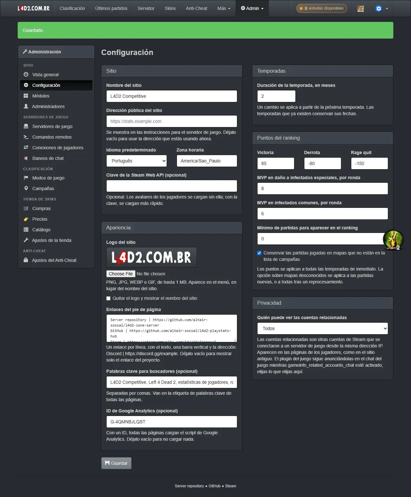

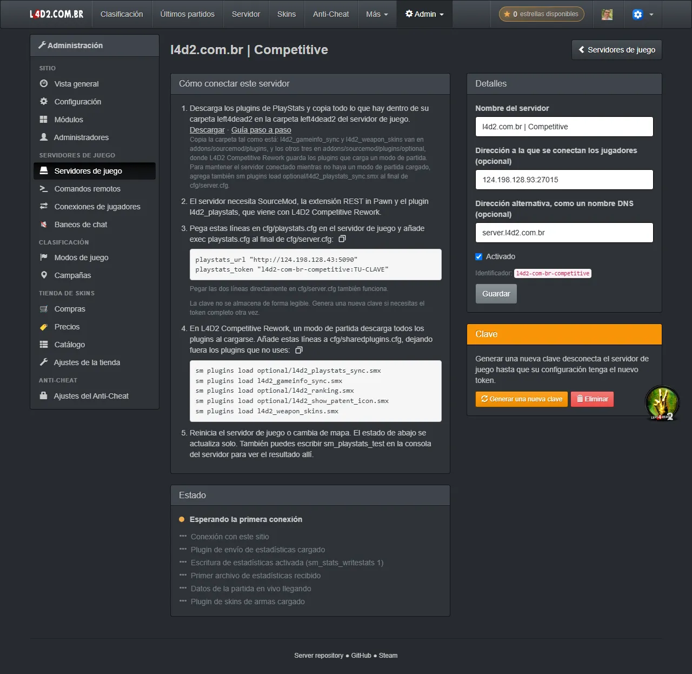

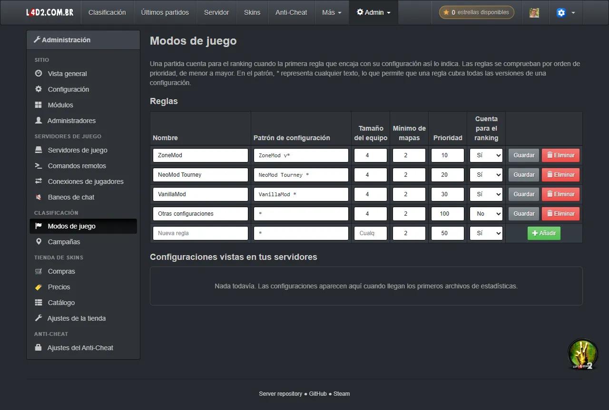

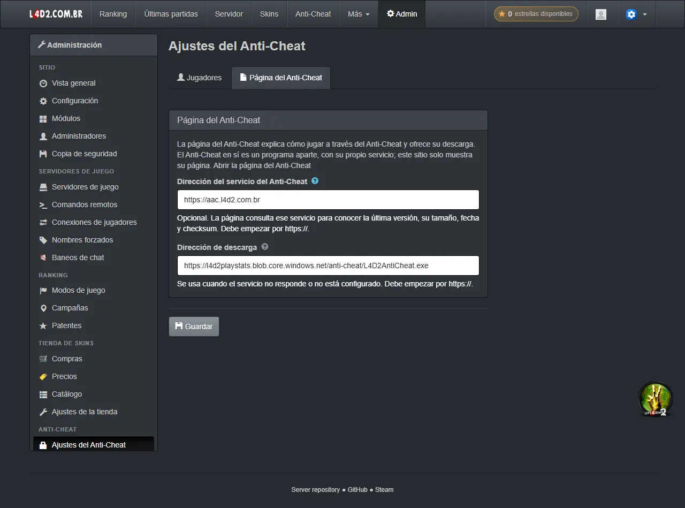

### Trae los datos del sitio antiguo

El ranking, las partidas y el historial se arman a partir de los archivos de estadísticas que la API antigua guardaba en la tabla `Statistics` de su almacenamiento de Azure. Un programa aparte, `l4d2-playstats-importer` (fuera de este repositorio), lee esa tabla sin cambiarla y envía cada archivo a `POST /api/statistics` con el token del servidor de juego, el mismo camino que usan los plugins:

```bash
dotnet run -c Release -- dump ./dump --settings local.settings.json
dotnet run -c Release -- upload ./dump http://124.198.128.43:5090 "<token del servidor de juego>"
```

`dump` toma la cadena de conexión del almacenamiento de `Values:AzureWebJobsStorage` en el `local.settings.json` de `l4d2-playstats-api`. El 19 de noviembre de 2026 escribió 6.648 archivos, hasta las partidas del 17 de noviembre, y todos se aceptaron: 1.835 partidas, 1.769 de ellas en el ranking, 859 jugadores y 15 temporadas. El ranking de la temporada actual mostró los mismos jugadores, en el mismo orden, que el sitio antiguo.

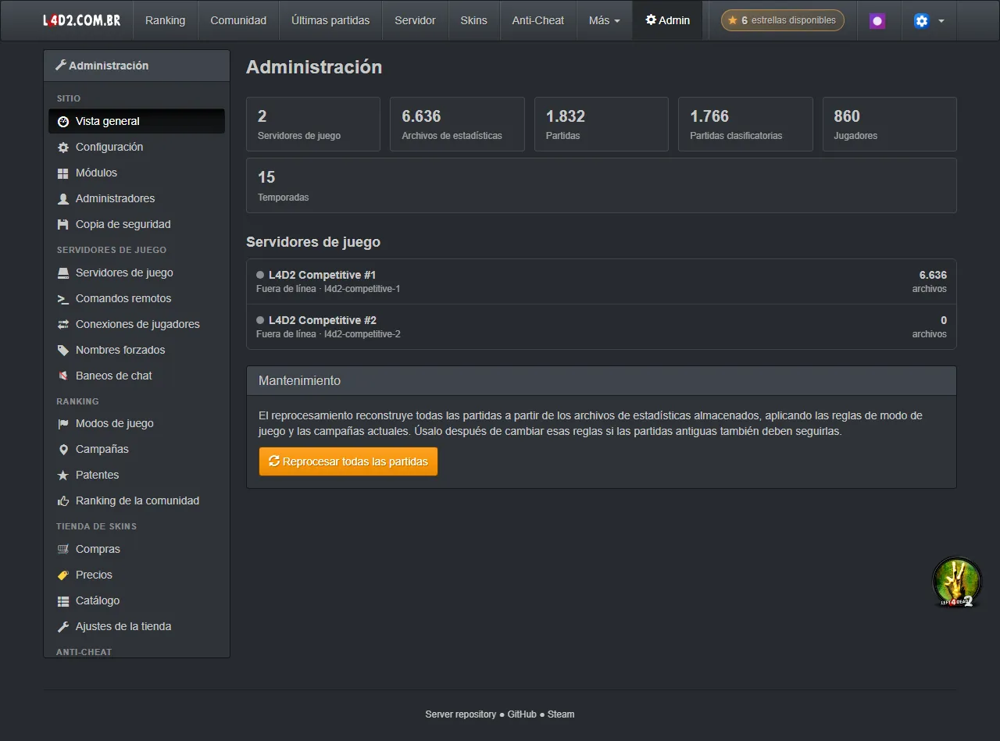

Ejecuta los dos comandos otra vez justo antes de la [Parte 3](#parte-3-el-cambio). Un archivo que el sitio ya tiene se reemplaza, no entra dos veces, así que solo son nuevas las partidas jugadas desde el último envío.

Nada más del sitio antiguo se copia: las compras de skins, los regalos y las skins equipadas, los baneos de chat y las listas del Anti-Cheat empiezan vacíos. Vuelve a cargar los baneos de chat y los jugadores del Anti-Cheat en el sitio nuevo.

### Comprueba

```bash
playstats-hub status
```

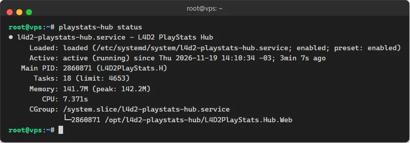

## Parte 2: prueba con un servidor de juego

Un servidor de juego envía sus partidas a un solo sitio. Mientras apunta al sitio nuevo, sus partidas ya no llegan al antiguo, y no van ahí después. Prueba con un segundo servidor de juego si tienes uno, o en un momento tranquilo con el principal.

### Haz una copia de lo que reemplazan los plugins

En el servidor de juego, guarda una copia de los archivos que reemplazan los nuevos plugins, para la [Parte 4](#parte-4-volver-atrás):

```bash
cd /path/to/the/server/left4dead2
tar -czf ~/playstats-plugins-backup.tar.gz addons/sourcemod/plugins addons/sourcemod/translations addons/sourcemod/configs/weapon_skins.cfg cfg
```

Si el servidor de juego se instala desde un repositorio, como `l4d2-zone-server`, haz los cambios de abajo también en el repositorio, o la próxima instalación traerá de vuelta los plugins y los ajustes antiguos.

### Copia los plugins

Copia todo lo que hay dentro de la carpeta `left4dead2` de los plugins (en el zip de la versión `l4d2-playstats-hub-plugins.zip`, o en [plugins/left4dead2](../plugins/left4dead2) en este repositorio) encima de la carpeta `left4dead2` del servidor:

| Archivo | Qué reemplaza |
|---|---|
| `addons/sourcemod/plugins/l4d2_gameinfo_sync.smx` y `l4d2_weapon_skins.smx` | Los antiguos en el mismo lugar. |
| `addons/sourcemod/plugins/optional/l4d2_playstats_sync.smx`, `l4d2_ranking.smx` y `l4d2_show_patent_icon.smx` | Los antiguos en el mismo lugar, que el `shared_plugins.cfg` de los modos de partida ya carga. |
| `addons/sourcemod/translations/**` | Los textos de las versiones antiguas. Cópialos junto con los archivos `.smx`: los textos del ranking cambiaron. |
| `addons/sourcemod/configs/weapon_skins.cfg` | Las mismas armas y skins. |
| `addons/sourcemod/scripting/**` | Las fuentes, que solo se usan para compilar. |
| `cfg/playstats.cfg` | Nada: es nuevo. |

Debe haber una sola copia de cada plugin. Ninguno de los cinco puede quedar en otra carpeta, como un `l4d2_playstats_sync.smx` antiguo en `addons/sourcemod/plugins/` mismo.

### Cambia los ajustes

| Archivo | Cambio |
|---|---|
| `cfg/cfgogl/zonemod/shared_cvars.cfg` y `cfg/cfgogl/neomod/shared_cvars.cfg` | Borra `confogl_addcvar playstats_url ...`, la API antigua, que haría que los cinco plugins volvieran a apuntar a ella en cada partida, y `confogl_addcvar ranking_url ...`, que ya no existe. Deja las demás líneas: `patent_icon_enabled`, `weapon_skins_*`, `gameinfo_*` y `anti_cheat_*` funcionan como antes. |
| `cfg/server_secrets.cfg` | Borra `playstats_access_token`. Agrega `playstats_url` y `playstats_token` (abajo). Pon en `l4d2_web_secret` el mismo token que en `playstats_token`. |
| `cfg/server.cfg` | Pon en `l4d2_web_url` la dirección del sitio nuevo. Si quieres, agrega `sm plugins load optional/l4d2_playstats_sync.smx` al final, para que el sitio vea el servidor mientras no haya un modo de partida cargado. |
| `cfg/sharedplugins.cfg` | Opcional: las líneas `sm plugins load` del [Paso 5](game-server.es.md#paso-5-carga-los-plugins-en-tus-modos-de-partida), para los modos de partida que todavía no cargan estos plugins (en `l4d2-zone-server`, todos los modos menos ZoneMod y NeoMod). |

Las líneas para `cfg/server_secrets.cfg`, con el token del servidor de juego (en l4d2.com.br, en `/root/l4d2-playstats-hub-server-token.txt` en el VPS) en lugar del ejemplo:

```text
playstats_url "http://124.198.128.43:5090"
playstats_token "l4d2-com-br-competitive:3f9c…"
l4d2_web_secret "l4d2-com-br-competitive:3f9c…"
```

Y la línea para `cfg/server.cfg`:

```text
sm_cvar l4d2_web_url "http://124.198.128.43:5090"
```

- `playstats_url` es una dirección HTTP simple, así que el navegador del juego también la abre y `playstats_ingame_url` puede quedar vacío.
- `l4d2_web_url` y `l4d2_web_secret` solo los lee el plugin de anti-cheat (1.5.0 o más nuevo), para las listas de [Quién debe usar el Anti-Cheat](manual/anti-cheat.es.md#quién-debe-usar-el-anti-cheat). Las listas antiguas no se copian: agrega los jugadores otra vez en el sitio nuevo antes de activar el anti-cheat.
- Deja `playstats_public_url` desactivado por ahora. Se define en la Parte 3; antes de eso, el chat mandaría a los jugadores a la tienda del sitio antiguo.
- Con estas líneas en el archivo de secretos no necesitas `exec playstats.cfg`: el resto de `cfg/playstats.cfg` solo muestra los valores por defecto, y los modos de partida de `l4d2-zone-server` ya definen `sm_stats_writestats`.
- Nunca definas `playstats_token` ni `l4d2_web_secret` con `confogl_addcvar`: Confogl muestra en el chat los valores que sigue.

### Comprueba

1. Reinicia el servidor de juego mientras está vacío y carga un modo de partida, por ejemplo con `!match`.
2. En la consola del servidor, `sm plugins list` debe mostrar los cinco plugins, ninguno con error y ninguno dos veces. Después, `sm_playstats_test` debe responder `Connected to the site`.
3. En el sitio nuevo, abre **Administración → Servidores de juego** y el servidor. Debe decir **Conectado**, con la lista de comprobación del [Paso 6](game-server.es.md#paso-6-verifica-la-conexión).
4. Juega un mapa completo. La partida aparece en **Partidas**, la ronda en **Servidor**, y el chat del sitio llega al juego.
5. En el juego, `!ranking` abre el panel del ranking. Con `weapon_skins_enabled 1`, `!skin status` responde; con `patent_icon_enabled 1`, los íconos de patente aparecen antes de la partida.

## Parte 3: el cambio

En l4d2.com.br el cambio se hizo el 19 de noviembre de 2026. Los pipelines `l4d2-playstats-web` y `l4d2-playstats-api` y la release `l4d2-playstats-api` se borraron de Azure DevOps, así que nada vuelve a publicar el sitio antiguo ni la API antigua.

Hazlo cuando no esté jugando nadie. Después de esto los dos sitios escuchan en el puerto `5000`, así que el antiguo se detiene primero.

1. Trae las partidas jugadas desde la importación: ejecuta otra vez los dos comandos de [Trae los datos del sitio antiguo](#trae-los-datos-del-sitio-antiguo).
2. Detén el sitio antiguo, conservando sus archivos: `sudo screen -S l4d2-playstats-web -X quit`. Funciona en un `screen` de `root`, así que `sudo screen -ls` lo muestra junto a `l4d2-anticheat-api`, que sigue.
3. Evita que arranque con el sistema: ejecuta `sudo crontab -e` y pon `#` delante de `@reboot /home/l4d2-playstats-web/bash/bootstrap.sh`. Conserva la línea de `l4d2-anticheat-api`.
4. Desactiva la publicación automática del sitio antiguo, el pipeline de Azure Pipelines de `l4d2-playstats-web`. Si no, un push lo vuelve a iniciar en el puerto `5000`.
5. Pasa el sitio nuevo al puerto `5000`: en `/etc/l4d2-playstats-hub/hub.env`, cambia `ASPNETCORE_URLS=http://0.0.0.0:5090` por `ASPNETCORE_URLS=http://0.0.0.0:5000`, y luego ejecuta `sudo playstats-hub restart` y `playstats-hub status`.
6. Compruébalo: `curl -s http://127.0.0.1:5000/api/ping` responde, `https://l4d2.com.br` y `http://124.198.128.43:5000` muestran el sitio nuevo, y el inicio de sesión con Steam funciona en `https://l4d2.com.br`.
7. En **Administración → Configuración → Sitio**, pon la **Dirección pública del sitio** en `https://l4d2.com.br`.
8. En el servidor de juego, apunta todo al puerto `5000` y define la dirección que los jugadores leen en el chat: las dos primeras líneas en `cfg/server_secrets.cfg`, la última en `cfg/server.cfg`. Luego cambia el mapa o reinicia el servidor, y ejecuta `sm_playstats_test` otra vez:

   ```text
   playstats_url "http://124.198.128.43:5000"
   playstats_public_url "https://l4d2.com.br"
   sm_cvar l4d2_web_url "http://124.198.128.43:5000"
   ```

9. Cierra el puerto `5090`, que ya no se usa: `sudo ufw delete allow 5090/tcp` con UFW activo, y en el firewall del proveedor si lo abriste ahí.

Los plugins también podrían usar `https://l4d2.com.br`; la dirección simple los mantiene funcionando pase lo que pase con el certificado. nginx no necesita cambios: sigue pasando `https://l4d2.com.br` al puerto `5000`, y el sitio nuevo confía en las cabeceras `X-Forwarded-*` de un proxy en la misma máquina. Si el inicio de sesión con Steam vuelve a una dirección `http://` o a la dirección IP, el `location` de nginx debe pasar estas cabeceras:

```nginx
proxy_set_header Host $host;
proxy_set_header X-Forwarded-For $proxy_add_x_forwarded_for;
proxy_set_header X-Forwarded-Proto $scheme;
```

## Despliegue automático

En l4d2.com.br una release de este repositorio actualiza el sitio y los plugins del servidor de juego:

| Qué | Cómo |
|---|---|
| El sitio | El pipeline `l4d2-playstats-hub` de Azure Pipelines, de [deploy/azure-pipelines.yml](../deploy/azure-pipelines.yml), se ejecuta con cada tag `v*`. Por la conexión SSH del VPS espera el paquete Linux de la release y ejecuta el instalador con esa versión. Los datos y `/etc/l4d2-playstats-hub/hub.env` se conservan, así que el sitio sigue en el puerto `5000`. |
| Los plugins | El pipeline de `l4d2-zone-server` se ejecuta después, y con cada push a su `master`. Descarga `l4d2-playstats-hub-plugins.zip` de la misma release (la más reciente, en un push), copia sus carpetas `plugins`, `translations` y `configs` sobre el `addons` del repositorio, escribe `cfg/playstats_token.cfg` desde la variable secreta `PLAYSTATS_TOKEN` del pipeline y publica. Los cinco plugins ya no están en `l4d2-zone-server`. |

El servidor de juego lee el token en `cfg/playstats_token.cfg`, que `cfg/server.cfg` ejecuta justo después de `server_secrets.cfg`, y las direcciones en `cfg/server.cfg`:

```text
playstats_url "http://124.198.128.43:5000"
playstats_public_url "https://l4d2.com.br"
sm_cvar l4d2_web_url "https://l4d2.com.br"
```

## Parte 4: volver atrás

Si algo no funciona y no se puede arreglar en el momento:

1. Detén el sitio nuevo y evita que arranque con el sistema: `sudo systemctl disable --now l4d2-playstats-hub`. Sus datos quedan en `/var/lib/l4d2-playstats-hub`.
2. Inicia el sitio antiguo como antes: `sudo /home/l4d2-playstats-web/bash/bootstrap.sh`. Quita el `#` de su línea `@reboot` y activa otra vez su pipeline.
3. En el servidor de juego, extrae la copia en la carpeta `left4dead2` (`tar -xzf ~/playstats-plugins-backup.tar.gz`) y reinicia el servidor. Eso trae de vuelta los plugins antiguos y todos los ajustes de `cfg`.

Las partidas jugadas mientras el servidor de juego apuntaba al sitio nuevo quedan solo ahí; el sitio antiguo no las recibe. Para intentarlo de nuevo más tarde, vuelve a poner el puerto `5090` en `ASPNETCORE_URLS` de `/etc/l4d2-playstats-hub/hub.env` y ejecuta `sudo systemctl enable --now l4d2-playstats-hub`.
