# Switching from the old site

🌐 **English** | [Português](switch-from-old-site.pt.md) | [Español](switch-from-old-site.es.md)

How to replace a running copy of the earlier site (`l4d2-playstats-web` with `l4d2-playstats-api`) with this one, on the same machine, without changing the addresses players already use. The example is the setup of l4d2.com.br: one Ubuntu VPS at `124.198.128.43` where nginx serves `https://l4d2.com.br` and passes it to the old site on port `5000`, the game opens `http://124.198.128.43:5000`, and the game server is based on [l4d2-zone-server](https://github.com/altair-sossai/l4d2-zone-server). Put your own names and addresses in their place.

## Contents

- [The plan](#the-plan)
- [Part 1: install the new site beside the old one](#part-1-install-the-new-site-beside-the-old-one)
- [Part 2: test with a game server](#part-2-test-with-a-game-server)
- [Part 3: the switch](#part-3-the-switch)
- [Automatic deploy](#automatic-deploy)
- [Part 4: going back](#part-4-going-back)

## The plan

| Part | What changes | What players notice |
|---|---|---|
| 1 | The new site runs on port `5090`, next to the old one. nginx and the old site are not touched. | Nothing. |
| 2 | One game server sends its matches to the new site. | The matches of that server stop reaching the old site. |
| 3 | The old site stops and the new one takes its port, `5000`. nginx keeps passing `https://l4d2.com.br` there. | The new pages, at the same addresses. |
| 4 | Only if something goes wrong: the old site comes back. | The old pages again. |

Keep `/home/l4d2-playstats-web`, the folder of the old site, as it is until you are sure: going back needs it.

## Part 1: install the new site beside the old one

On l4d2.com.br this part was done on 19 November 2026. The new site runs at `http://124.198.128.43:5090` with the ranking of the old site, and nothing that players use changed.

### Run the installer

1. Connect to the VPS with SSH as `root`, or as a user that can run `sudo`.
2. Run the installer without a domain. Without `HUB_DOMAIN` it does not install Caddy, so nginx and ports 80 and 443 stay as they are. `HUB_PORT=5090` is not the installer's default `5080` because on this VPS that port is already taken by the anti-cheat API (`127.0.0.1:5080`):

   ```bash
   curl -fsSL https://raw.githubusercontent.com/altair-sossai/l4d2-playstats-hub/main/deploy/install.sh | sudo HUB_PORT=5090 bash
   ```

   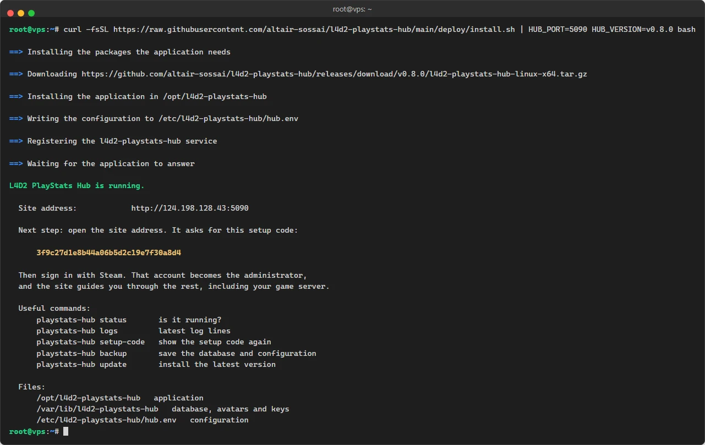

3. Open port `5090`. When UFW is active the installer already did it; otherwise run `sudo ufw allow 5090/tcp`. On this VPS UFW is off. If your hosting provider has its own firewall, open the port there too.

The installer only adds the application: `/opt/l4d2-playstats-hub`, the data in `/var/lib/l4d2-playstats-hub`, the configuration in `/etc/l4d2-playstats-hub/hub.env`, the `l4d2-playstats-hub` service and the `playstats-hub` command. The old site, the anti-cheat API and nginx keep their ports:

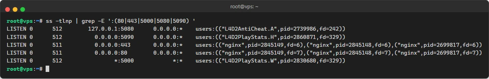

[Installing on a Linux VPS](install-linux.md) explains each step of the installer and the `playstats-hub` commands.

### The setup wizard

Open `http://124.198.128.43:5090`. The wizard is explained in [First-run setup](manual/first-run.md); these are the values used for l4d2.com.br.

1. Paste the setup code the installer printed and sign in with Steam. That account becomes the first administrator.

   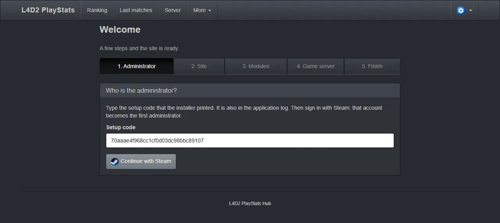

2. The site:

   | Field | Value | Where it comes from |
   |---|---|---|
   | Site name | `L4D2 Competitive` | The name in the title of the old pages. |
   | Site logo | `logo.png` | The logo of the old site, `wwwroot/imgs/logo.png` in `l4d2-playstats-web`. |
   | Default language | Português | |
   | Time zone | `America/Sao_Paulo` | |
   | Season length, in months | `2` | The old site started a new ranking every two months. |
   | Steam Web API key | The first key of `SteamApiKey` | `/home/l4d2-playstats-web/appsettings.json`. The old site keeps two keys separated by `;`; the new site takes one. |

   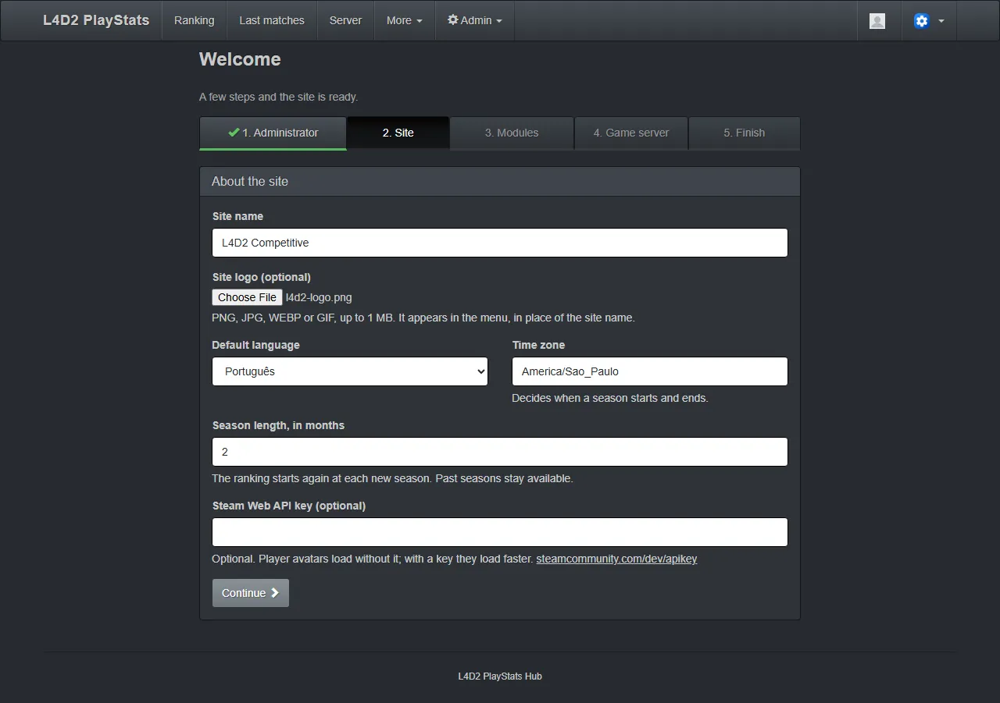

3. The modules: everything the old site had. The community ranking stays off, since the old site had none.

   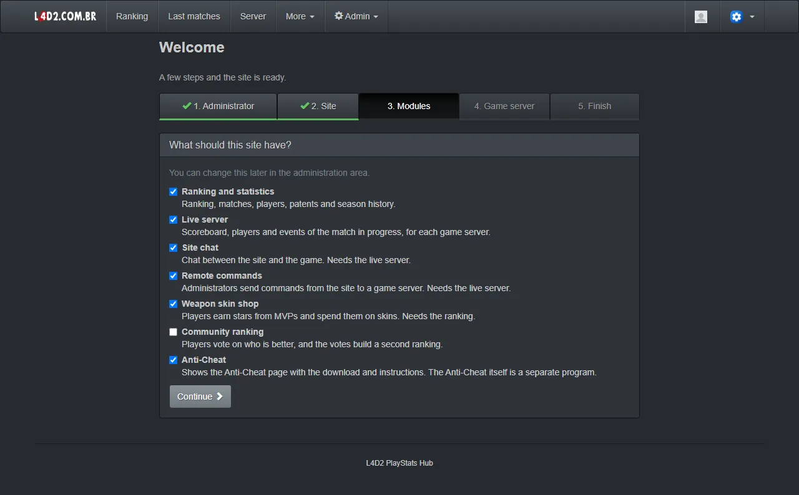

4. The game server: the name `l4d2.com.br | Competitive`, the one the old site used, and the address `124.198.128.93:27015`, the IP of `server.l4d2.com.br` and the port of the game server.

   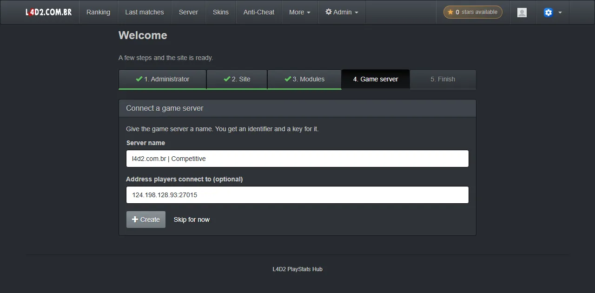

5. **Create** shows the two lines for the game server. Copy the token now: it is shown only once. On l4d2.com.br it was saved on the VPS in `/root/l4d2-playstats-hub-server-token.txt`, which only `root` can read. It is used to bring the old data below and in [Part 2](#part-2-test-with-a-game-server).

   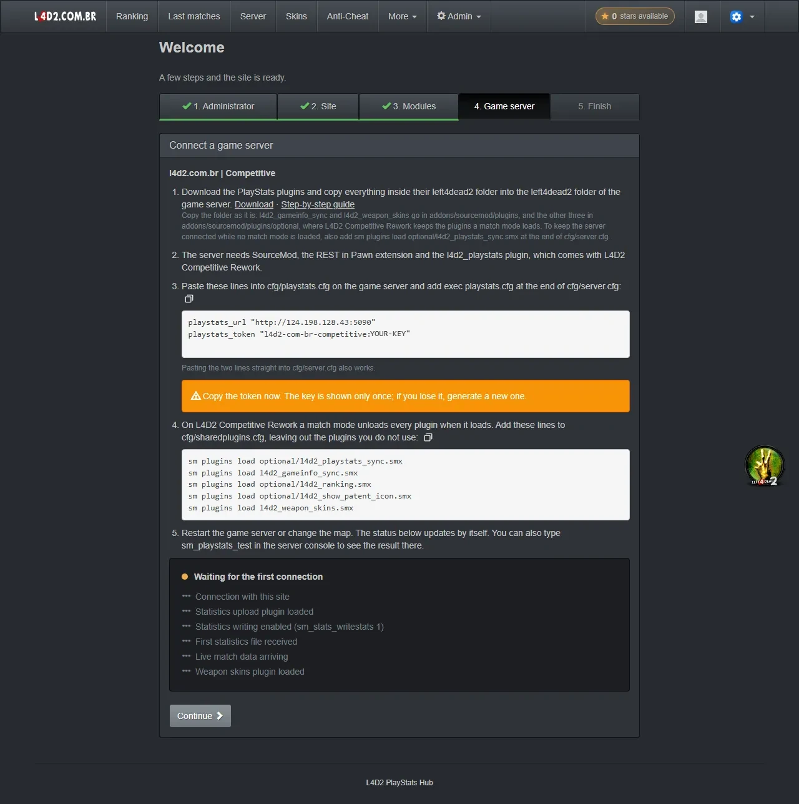

6. **Continue** and **Finish**. The site opens the administration area.

   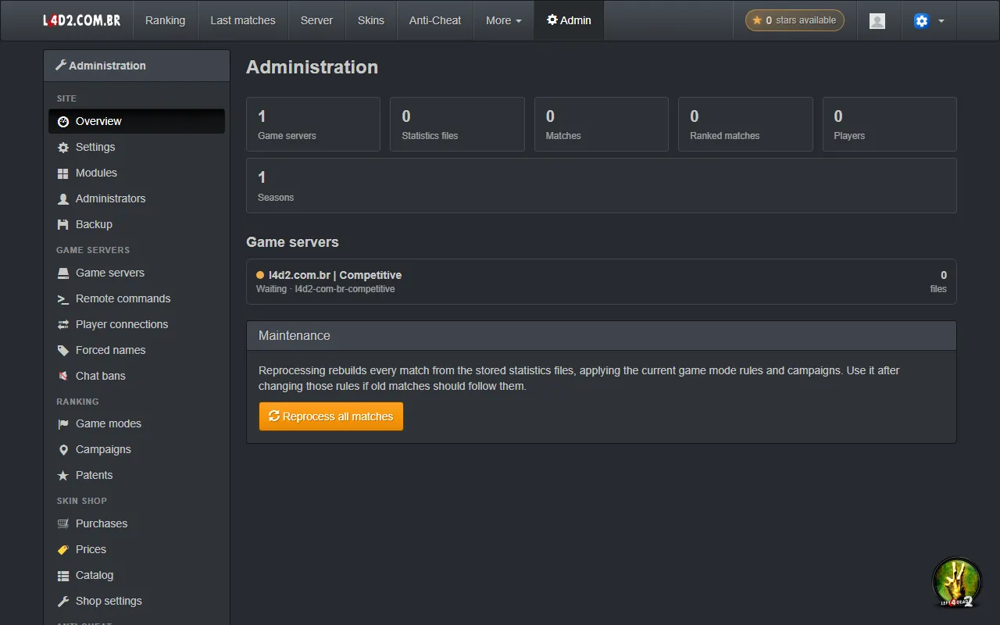

### The rest of the administration

| Page | What was set | Where it comes from |
|---|---|---|
| **Settings → Appearance** | The three footer links of the old site (Server repository, GitHub, Steam), the keywords for search engines and the Google Analytics ID `G-4QMNBJLQST`. | The old `_Layout.cshtml`. With the same Google Analytics ID the visits stay in the same report. |
| **Settings → Site** | **Public address of the site** stays empty until [Part 3](#part-3-the-switch). | |
| **Settings → Privacy** | Related accounts seen by everyone, the default. | The old site showed them to everyone. |
| **Administrators** | The three accounts of `ServerAdmins`. | `/home/l4d2-playstats-web/appsettings.json`. |
| **Game servers → l4d2.com.br \| Competitive** | Alternative address `server.l4d2.com.br`. | `ServerDns` of the old site. The live server page shows both addresses, as the old one did. |
| **Game modes** | One rule each for `ZoneMod v*`, `NeoMod Tourney *` and `VanillaMod *`: 4 players per team, at least 2 maps, counted for the ranking. The `*` rule of a new site stays as **Other configurations**, not counted. | The `ConfigurationName` of the old server, `^(NeoMod Tourney\|ZoneMod\|VanillaMod) v?\d+\.\d+(?:\.\d+)?[a-z]?$`: only these three configurations were ranked. |
| **Anti-Cheat settings** | Service `https://aac.l4d2.com.br` and download `https://l4d2playstats.blob.core.windows.net/anti-cheat/L4D2AntiCheat.exe`. | The addresses the old site used. |
| **Catalog** of the skin shop | Nothing to do: the 196 skins of the old site were imported when the shop was turned on. | |

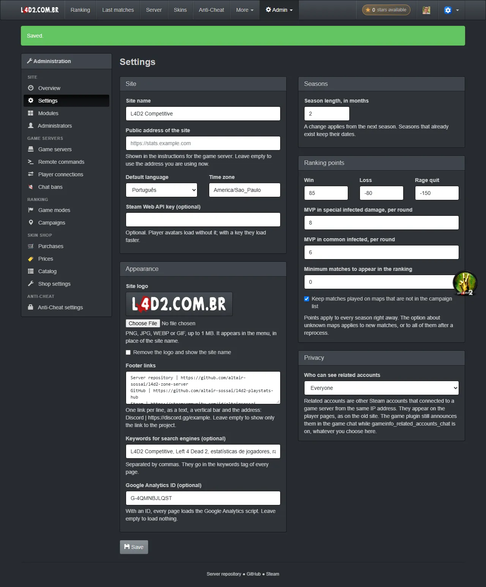

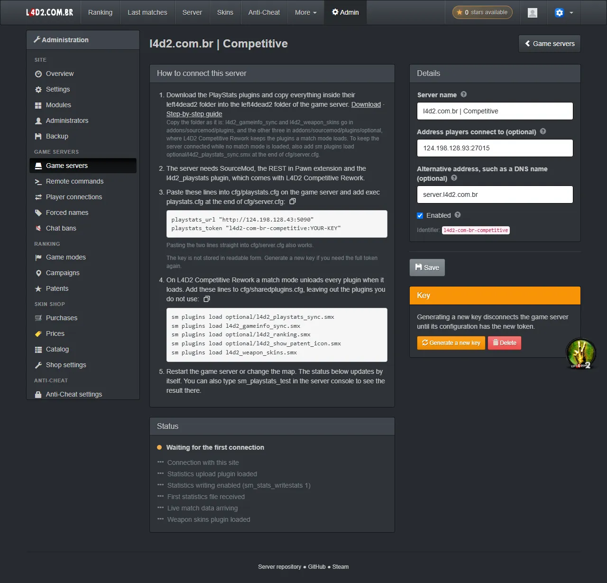

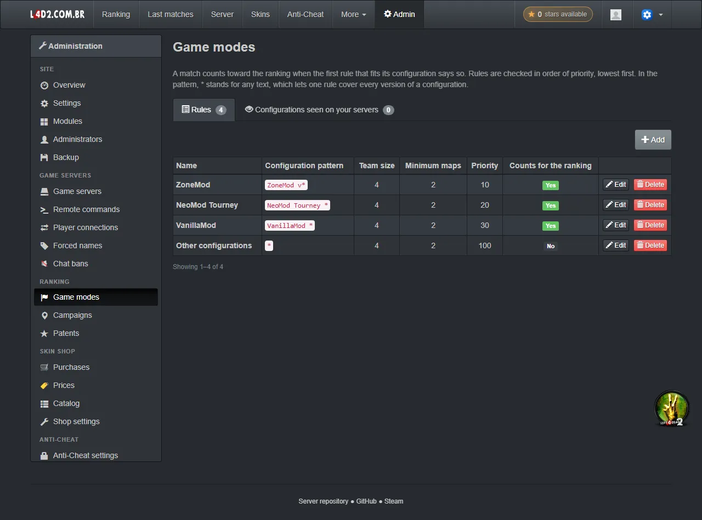

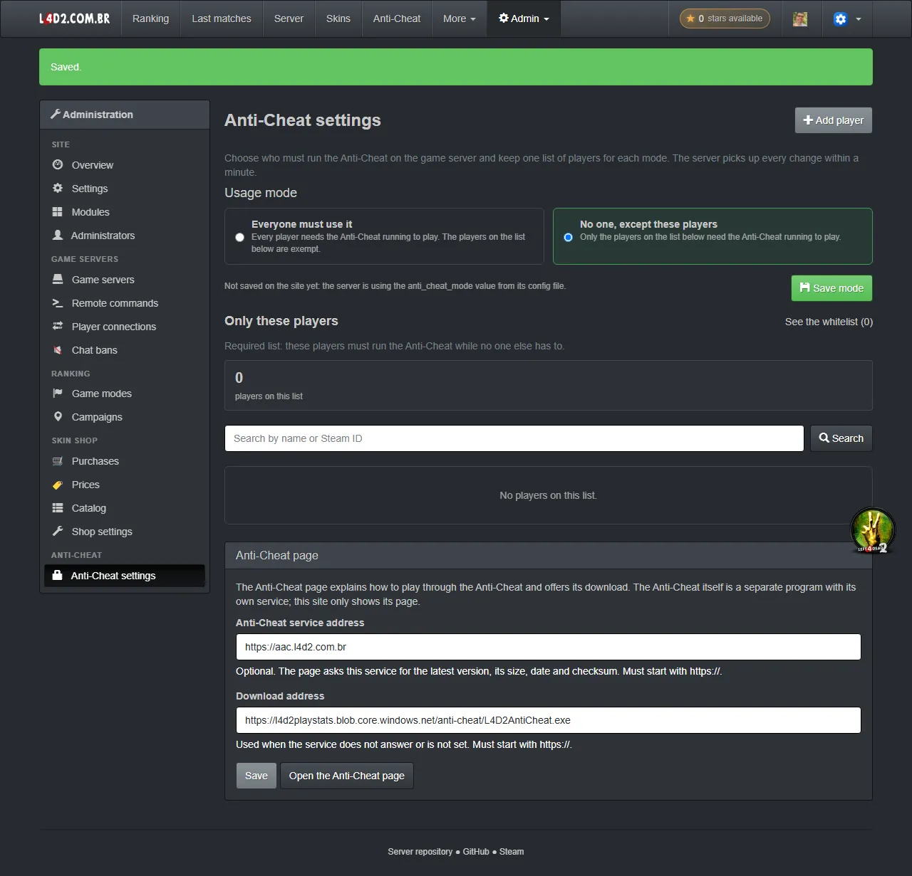

### Bring the data of the old site

The ranking, the matches and the history are built from the statistics files the old API kept in the `Statistics` table of its Azure storage. A separate program, `l4d2-playstats-importer` (not in this repository), reads that table without changing it and uploads each file to `POST /api/statistics` with the token of the game server, the same path the plugins use:

```bash
dotnet run -c Release -- dump ./dump --settings local.settings.json
dotnet run -c Release -- upload ./dump http://124.198.128.43:5090 "<token of the game server>"
```

`dump` takes the storage connection string from `Values:AzureWebJobsStorage` in the `local.settings.json` of `l4d2-playstats-api`. On 19 November 2026 it wrote 6,648 files, up to the matches of 17 November, and all of them were accepted: 1,835 matches, 1,769 of them ranked, 859 players and 15 seasons. The ranking of the current season listed the same players, in the same order, as the old site.

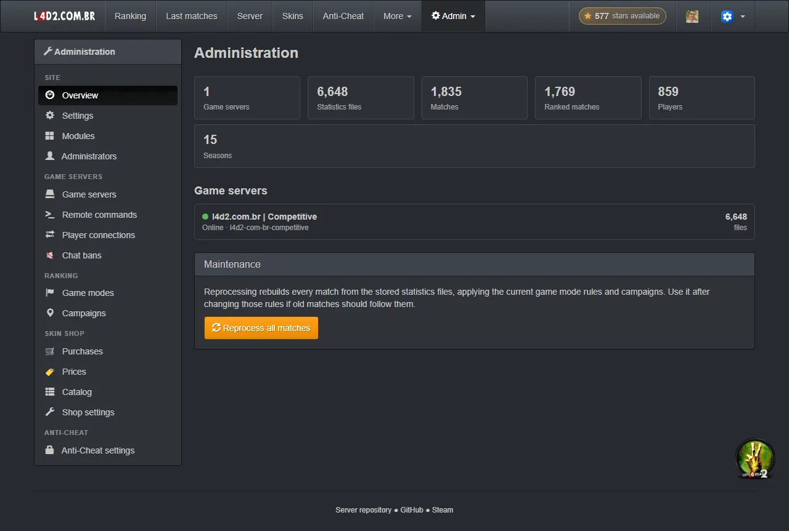

Run both commands again right before [Part 3](#part-3-the-switch). A file the site already has is replaced, not added twice, so only the matches played since the last upload are new.

Nothing else of the old site is copied: the skin purchases, gifts and equipped skins, the chat bans and the Anti-Cheat lists start empty. Add the chat bans and the Anti-Cheat players again on the new site.

### Check

```bash
playstats-hub status
```

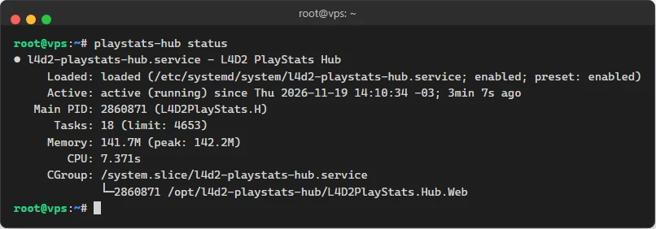

## Part 2: test with a game server

A game server sends its matches to one site only. While it points to the new site, its matches no longer reach the old one, and they do not go there later. Test with a second game server if you have one, or at a quiet time with the main one.

### Back up what the plugins replace

On the game server, save a copy of the files the new plugins replace, for [Part 4](#part-4-going-back):

```bash
cd /path/to/the/server/left4dead2
tar -czf ~/playstats-plugins-backup.tar.gz addons/sourcemod/plugins addons/sourcemod/translations addons/sourcemod/configs/weapon_skins.cfg cfg
```

If the game server is deployed from a repository, such as `l4d2-zone-server`, make the changes below in the repository too, or the next deploy brings the old plugins and settings back.

### Copy the plugins

Copy everything inside the `left4dead2` folder of the plugins (in the release zip `l4d2-playstats-hub-plugins.zip`, or [plugins/left4dead2](../plugins/left4dead2) in this repository) over the `left4dead2` folder of the server:

| File | What it replaces |
|---|---|
| `addons/sourcemod/plugins/l4d2_gameinfo_sync.smx` and `l4d2_weapon_skins.smx` | The old ones in the same place. |
| `addons/sourcemod/plugins/optional/l4d2_playstats_sync.smx`, `l4d2_ranking.smx` and `l4d2_show_patent_icon.smx` | The old ones in the same place, which the `shared_plugins.cfg` of the match modes already loads. |
| `addons/sourcemod/translations/**` | The texts of the old versions. Copy them together with the `.smx` files: the ranking texts changed. |
| `addons/sourcemod/configs/weapon_skins.cfg` | The same weapons and skins. |
| `addons/sourcemod/scripting/**` | The sources, only used to compile. |
| `cfg/playstats.cfg` | Nothing: it is new. |

There must be only one copy of each plugin. None of the five may stay in another folder, such as an old `l4d2_playstats_sync.smx` in `addons/sourcemod/plugins/` itself.

### Change the settings

| File | Change |
|---|---|
| `cfg/cfgogl/zonemod/shared_cvars.cfg` and `cfg/cfgogl/neomod/shared_cvars.cfg` | Delete `confogl_addcvar playstats_url ...`, the old API, which would point the five plugins back at it on every match, and `confogl_addcvar ranking_url ...`, which no longer exists. Keep the other lines: `patent_icon_enabled`, `weapon_skins_*`, `gameinfo_*` and `anti_cheat_*` work as before. |
| `cfg/server_secrets.cfg` | Delete `playstats_access_token`. Add `playstats_url` and `playstats_token` (below). Set `l4d2_web_secret` to the same token as `playstats_token`. |
| `cfg/server.cfg` | Set `l4d2_web_url` to the address of the new site. Optionally add `sm plugins load optional/l4d2_playstats_sync.smx` at the end, so the site sees the server while no match mode is loaded. |
| `cfg/sharedplugins.cfg` | Optional: the `sm plugins load` lines of [Step 5](game-server.md#step-5-load-the-plugins-in-your-match-modes), for the match modes that do not load these plugins yet (on `l4d2-zone-server`, every mode except ZoneMod and NeoMod). |

The lines for `cfg/server_secrets.cfg`, with the token of the game server (on l4d2.com.br, in `/root/l4d2-playstats-hub-server-token.txt` on the VPS) in place of the example:

```text
playstats_url "http://124.198.128.43:5090"
playstats_token "l4d2-com-br-competitive:3f9c…"
l4d2_web_secret "l4d2-com-br-competitive:3f9c…"
```

And the line for `cfg/server.cfg`:

```text
sm_cvar l4d2_web_url "http://124.198.128.43:5090"
```

- `playstats_url` is a plain HTTP address, so the browser inside the game opens it too and `playstats_ingame_url` can stay empty.
- `l4d2_web_url` and `l4d2_web_secret` are read only by the anti-cheat plugin (1.5.0 or newer), for the lists of [Who must use the Anti-Cheat](manual/anti-cheat.md#who-must-use-the-anti-cheat). The old lists are not copied: add the players again on the new site before you turn the anti-cheat on.
- Leave `playstats_public_url` off for now. It is set in Part 3; before that, the chat would send players to the shop of the old site.
- With these lines in the secrets file you do not need `exec playstats.cfg`: the rest of `cfg/playstats.cfg` only shows the defaults, and the match modes of `l4d2-zone-server` already set `sm_stats_writestats`.
- Never set `playstats_token` or `l4d2_web_secret` with `confogl_addcvar`: Confogl prints the values it tracks in the chat.

### Check

1. Restart the game server while it is empty, and load a match mode, for example with `!match`.
2. In the server console, `sm plugins list` must show the five plugins, none of them failed and none of them twice. Then `sm_playstats_test` must answer `Connected to the site`.
3. On the new site, open **Administration → Game servers** and the server. It must say **Connected**, with the checklist of [Step 6](game-server.md#step-6-check-the-connection).
4. Play a complete map. The match appears in **Matches**, the round in **Server**, and the site chat reaches the game.
5. In the game, `!ranking` opens the ranking panel. With `weapon_skins_enabled 1`, `!skin status` answers; with `patent_icon_enabled 1`, the patent icons show before the match.

## Part 3: the switch

On l4d2.com.br the switch was done on 19 November 2026. The pipelines `l4d2-playstats-web` and `l4d2-playstats-api` and the release `l4d2-playstats-api` were deleted from Azure DevOps, so nothing deploys the old site or the old API again.

Do it while nobody is playing. Both sites listen on port `5000` after this, so the old one stops first.

1. Bring the matches played since the import: run the two commands of [Bring the data of the old site](#bring-the-data-of-the-old-site) again.
2. Stop the old site, keeping its files: `sudo screen -S l4d2-playstats-web -X quit`. It runs in a `screen` of `root`, so `sudo screen -ls` lists it next to `l4d2-anticheat-api`, which stays.
3. Stop it from starting at boot: run `sudo crontab -e` and put `#` in front of `@reboot /home/l4d2-playstats-web/bash/bootstrap.sh`. Keep the line of `l4d2-anticheat-api`.
4. Turn off the automatic deploy of the old site, the Azure Pipelines pipeline of `l4d2-playstats-web`. Otherwise a push starts it again on port `5000`.
5. Move the new site to port `5000`: in `/etc/l4d2-playstats-hub/hub.env`, change `ASPNETCORE_URLS=http://0.0.0.0:5090` to `ASPNETCORE_URLS=http://0.0.0.0:5000`, then run `sudo playstats-hub restart` and `playstats-hub status`.
6. Check it: `curl -s http://127.0.0.1:5000/api/ping` answers, `https://l4d2.com.br` and `http://124.198.128.43:5000` show the new site, and the Steam sign-in works at `https://l4d2.com.br`.
7. In **Administration → Settings → Site**, set **Public address of the site** to `https://l4d2.com.br`.
8. On the game server, point everything at port `5000` and set the address players read in chat: the first two lines in `cfg/server_secrets.cfg`, the last one in `cfg/server.cfg`. Then change the map or restart the server, and run `sm_playstats_test` again:

   ```text
   playstats_url "http://124.198.128.43:5000"
   playstats_public_url "https://l4d2.com.br"
   sm_cvar l4d2_web_url "http://124.198.128.43:5000"
   ```

9. Close port `5090`, which is no longer used: `sudo ufw delete allow 5090/tcp` when UFW is active, and in the firewall of the provider if you opened it there.

The plugins could also use `https://l4d2.com.br`; the plain address keeps them working whatever happens to the certificate. nginx needs no change: it still passes `https://l4d2.com.br` to port `5000`, and the new site believes the `X-Forwarded-*` headers of a proxy on the same machine. If the Steam sign-in comes back to an `http://` address or to the IP address, the `location` of nginx must pass these headers:

```nginx
proxy_set_header Host $host;
proxy_set_header X-Forwarded-For $proxy_add_x_forwarded_for;
proxy_set_header X-Forwarded-Proto $scheme;
```

The [live server page](manual/live-server.md) gets its updates through a WebSocket at `/hubs/live`. nginx passes WebSockets only with these lines in the same `location`; the other pages work as before with them. Without them the page falls back to Server-Sent Events or long polling, which work but are heavier:

```nginx
proxy_http_version 1.1;
proxy_set_header Upgrade $http_upgrade;
proxy_set_header Connection $connection_upgrade;
```

`$connection_upgrade` comes from this `map`, written once in the `http` block (in `/etc/nginx/nginx.conf`, or a file in `/etc/nginx/conf.d/`) unless it is already there. Then check and reload with `sudo nginx -t && sudo systemctl reload nginx`:

```nginx
map $http_upgrade $connection_upgrade {
    default upgrade;
    ''      close;
}
```

## Automatic deploy

On l4d2.com.br one release of this repository updates the site and the plugins of the game server:

| What | How |
|---|---|
| The release | Every push to `main` that passes its checks (Build and test, Browser tests, Databases and Plugins, whichever run for it) is released by the GitHub workflow [Auto release](../.github/workflows/auto-release.yml): it tags the commit with the next patch version (`v0.10.1` becomes `v0.10.2`) and runs the [Release](../.github/workflows/release.yml) workflow for it. A push that only changes documentation runs no checks and is not released. Only the latest commit of `main` is released, and a tag pushed by hand still works as before, for example to start a new minor version. |
| The site | The Azure Pipelines pipeline `l4d2-playstats-hub`, from [deploy/azure-pipelines.yml](../deploy/azure-pipelines.yml), runs on every `v*` tag. Over the SSH connection of the VPS it waits for the Linux package of the release, then runs the installer with that version. The data and `/etc/l4d2-playstats-hub/hub.env` are kept, so the site stays on port `5000`. |
| The plugins | The pipeline of `l4d2-zone-server` runs after it, and on every push to its `master`. It downloads `l4d2-playstats-hub-plugins.zip` of the same release (the latest one on a push), copies its `plugins`, `translations` and `configs` over the `addons` of the repository, writes `cfg/playstats_token.cfg` from the secret variable `PLAYSTATS_TOKEN` of the pipeline, and deploys. The five plugins are no longer kept in `l4d2-zone-server`. |

The game server reads the token in `cfg/playstats_token.cfg`, which `cfg/server.cfg` runs right after `server_secrets.cfg`, and the addresses in `cfg/server.cfg`:

```text
playstats_url "http://124.198.128.43:5000"
playstats_public_url "https://l4d2.com.br"
sm_cvar l4d2_web_url "https://l4d2.com.br"
```

## Part 4: going back

If something does not work and cannot be fixed right away:

1. Stop the new site and keep it from starting at boot: `sudo systemctl disable --now l4d2-playstats-hub`. Its data stays in `/var/lib/l4d2-playstats-hub`.
2. Start the old site as before: `sudo /home/l4d2-playstats-web/bash/bootstrap.sh`. Remove the `#` from its `@reboot` line and turn its pipeline on again.
3. On the game server, extract the backup in the `left4dead2` folder (`tar -xzf ~/playstats-plugins-backup.tar.gz`) and restart the server. It brings back the old plugins and every setting under `cfg`.

The matches played while the game server pointed to the new site stay only there; the old site does not get them. To try again later, set `ASPNETCORE_URLS` back to port `5090` in `/etc/l4d2-playstats-hub/hub.env` and run `sudo systemctl enable --now l4d2-playstats-hub`.
