# Trocando o site antigo

🌐 [English](switch-from-old-site.md) | **Português** | [Español](switch-from-old-site.es.md)

Como substituir uma cópia em funcionamento do site anterior (`l4d2-playstats-web` com `l4d2-playstats-api`) por este, na mesma máquina, sem mudar os endereços que os jogadores já usam. O exemplo é a instalação do l4d2.com.br: uma VPS Ubuntu em `124.198.128.43` onde o nginx serve `https://l4d2.com.br` e repassa para o site antigo na porta `5000`, o jogo abre `http://124.198.128.43:5000`, e o servidor de jogo é baseado no [l4d2-zone-server](https://github.com/altair-sossai/l4d2-zone-server). Troque os nomes e endereços pelos seus.

## Conteúdo

- [O plano](#o-plano)
- [Parte 1: instale o site novo ao lado do antigo](#parte-1-instale-o-site-novo-ao-lado-do-antigo)
- [Parte 2: teste com um servidor de jogo](#parte-2-teste-com-um-servidor-de-jogo)
- [Parte 3: a troca](#parte-3-a-troca)
- [Deploy automático](#deploy-automático)
- [Parte 4: voltando atrás](#parte-4-voltando-atrás)

## O plano

| Parte | O que muda | O que os jogadores percebem |
|---|---|---|
| 1 | O site novo roda na porta `5090`, ao lado do antigo. O nginx e o site antigo não são mexidos. | Nada. |
| 2 | Um servidor de jogo envia as partidas dele para o site novo. | As partidas desse servidor deixam de chegar ao site antigo. |
| 3 | O site antigo para e o novo assume a porta dele, a `5000`. O nginx continua repassando `https://l4d2.com.br` para ela. | As páginas novas, nos mesmos endereços. |
| 4 | Só se algo der errado: o site antigo volta. | As páginas antigas de novo. |

Mantenha `/home/l4d2-playstats-web`, a pasta do site antigo, como está até ter certeza: voltar atrás precisa dela.

## Parte 1: instale o site novo ao lado do antigo

No l4d2.com.br esta parte foi feita em 19 de novembro de 2026. O site novo roda em `http://124.198.128.43:5090` com o ranking do site antigo, e nada do que os jogadores usam mudou.

### Rode o instalador

1. Conecte-se à VPS por SSH como `root`, ou com um usuário que possa usar `sudo`.
2. Rode o instalador sem domínio. Sem `HUB_DOMAIN` ele não instala o Caddy, então o nginx e as portas 80 e 443 ficam como estão. `HUB_PORT=5090` não é a `5080` padrão do instalador porque, nesta VPS, essa porta já é usada pela API do anti-cheat (`127.0.0.1:5080`):

   ```bash
   curl -fsSL https://raw.githubusercontent.com/altair-sossai/l4d2-playstats-hub/main/deploy/install.sh | sudo HUB_PORT=5090 bash
   ```

   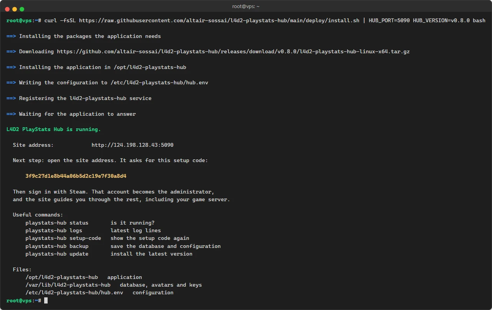

3. Abra a porta `5090`. Com o UFW ativo, o instalador já fez isso; senão rode `sudo ufw allow 5090/tcp`. Nesta VPS o UFW está desligado. Se o seu provedor de hospedagem tem um firewall próprio, abra a porta nele também.

O instalador só acrescenta a aplicação: `/opt/l4d2-playstats-hub`, os dados em `/var/lib/l4d2-playstats-hub`, a configuração em `/etc/l4d2-playstats-hub/hub.env`, o serviço `l4d2-playstats-hub` e o comando `playstats-hub`. O site antigo, a API do anti-cheat e o nginx continuam nas portas deles:

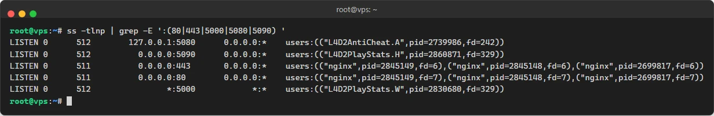

[Instalação em uma VPS Linux](install-linux.pt.md) explica cada passo do instalador e os comandos `playstats-hub`.

### O assistente de configuração

Abra `http://124.198.128.43:5090`. O assistente é explicado em [Configuração inicial](manual/first-run.pt.md); estes são os valores usados no l4d2.com.br.

1. Cole o código de configuração que o instalador mostrou e entre com a Steam. Essa conta vira o primeiro administrador.

   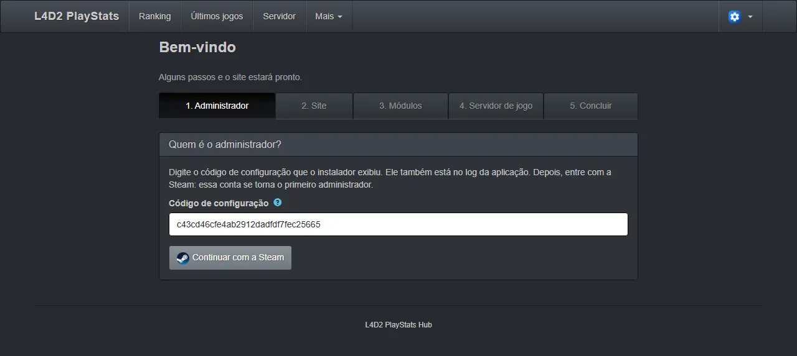

2. O site:

   | Campo | Valor | De onde vem |
   |---|---|---|
   | Nome do site | `L4D2 Competitive` | O nome no título das páginas antigas. |
   | Logo do site | `logo.png` | O logo do site antigo, `wwwroot/imgs/logo.png` no `l4d2-playstats-web`. |
   | Idioma padrão | Português | |
   | Fuso horário | `America/Sao_Paulo` | |
   | Duração da temporada, em meses | `2` | O site antigo começava um ranking novo a cada dois meses. |
   | Chave da Steam Web API | A primeira chave de `SteamApiKey` | `/home/l4d2-playstats-web/appsettings.json`. O site antigo guarda duas chaves separadas por `;`; o site novo usa uma. |

   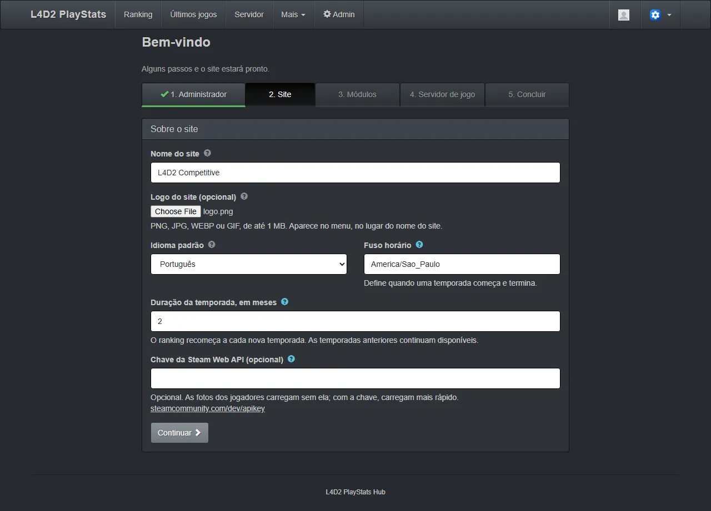

3. Os módulos: tudo o que o site antigo tinha. O ranking da comunidade fica desligado, porque o site antigo não tinha.

   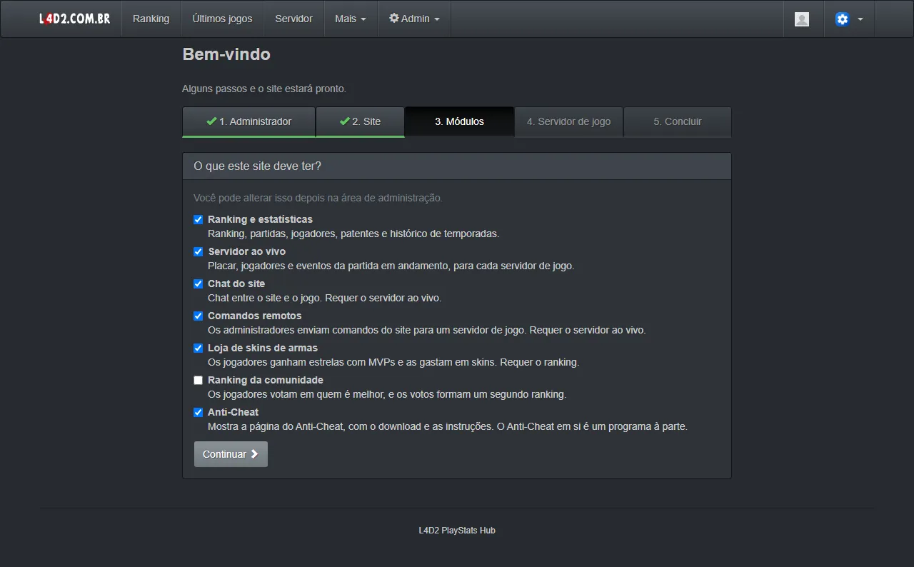

4. O servidor de jogo: o nome `l4d2.com.br | Competitive`, o mesmo do site antigo, e o endereço `124.198.128.93:27015`, o IP de `server.l4d2.com.br` e a porta do servidor de jogo.

   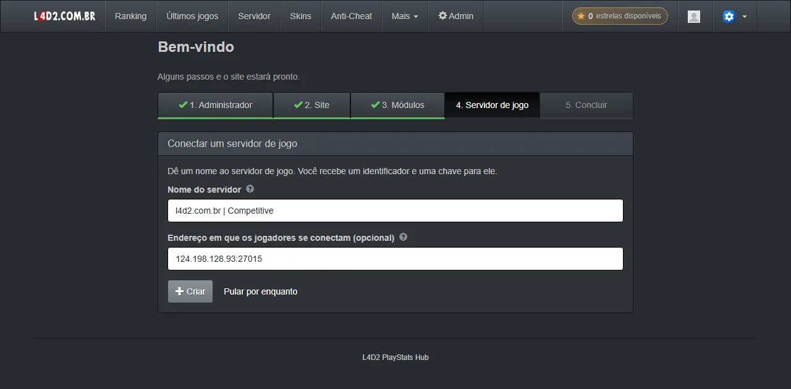

5. **Criar** mostra as duas linhas para o servidor de jogo. Copie o token agora: ele aparece só uma vez. No l4d2.com.br ele foi guardado na VPS em `/root/l4d2-playstats-hub-server-token.txt`, que só o `root` lê. Ele é usado para trazer os dados antigos, logo abaixo, e na [Parte 2](#parte-2-teste-com-um-servidor-de-jogo).

   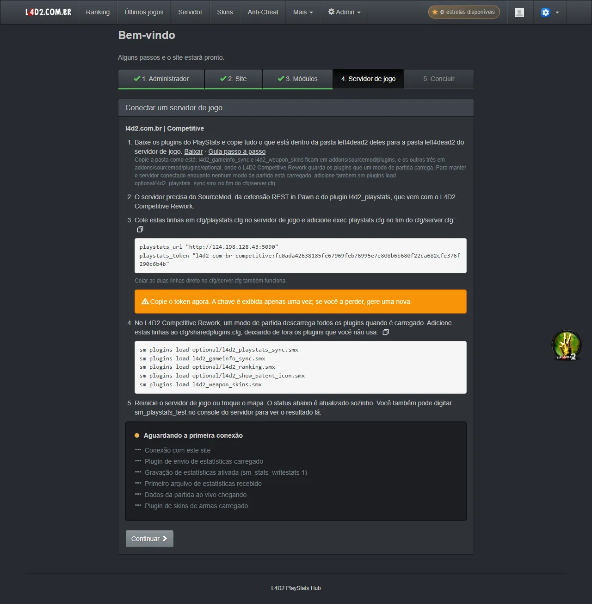

6. **Continuar** e **Concluir**. O site abre a área de administração.

   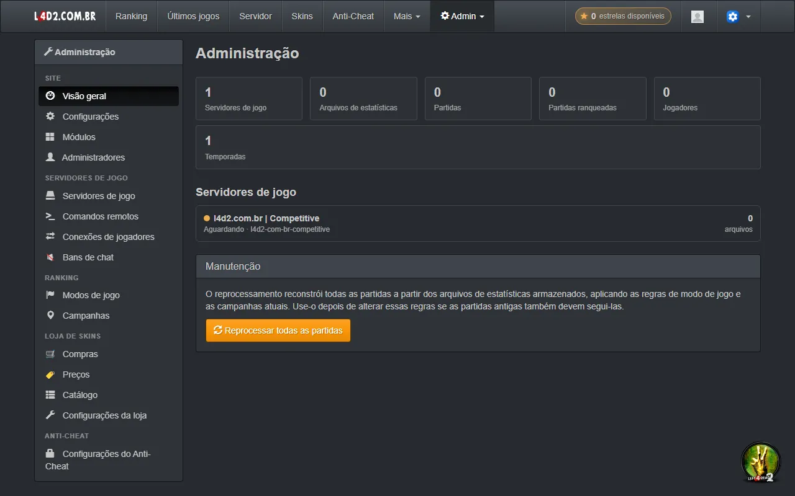

### O resto da administração

| Página | O que foi definido | De onde vem |
|---|---|---|
| **Configurações → Aparência** | Os três links do rodapé do site antigo (Server repository, GitHub, Steam), as palavras-chave para buscadores e o ID do Google Analytics `G-4QMNBJLQST`. | O `_Layout.cshtml` antigo. Com o mesmo ID do Google Analytics, as visitas continuam no mesmo relatório. |
| **Configurações → Site** | O **Endereço público do site** fica vazio até a [Parte 3](#parte-3-a-troca). | |
| **Configurações → Privacidade** | Contas relacionadas vistas por todos, o padrão. | O site antigo mostrava para todos. |
| **Administradores** | As três contas de `ServerAdmins`. | `/home/l4d2-playstats-web/appsettings.json`. |
| **Servidores de jogo → l4d2.com.br \| Competitive** | Endereço alternativo `server.l4d2.com.br`. | O `ServerDns` do site antigo. A página do servidor ao vivo mostra os dois endereços, como a antiga. |
| **Modos de jogo** | Uma regra para cada um de `ZoneMod v*`, `NeoMod Tourney *` e `VanillaMod *`: 4 jogadores por time, pelo menos 2 mapas, contando para o ranking. A regra `*` de um site novo fica como **Outras configurações**, sem contar. | O `ConfigurationName` do servidor antigo, `^(NeoMod Tourney\|ZoneMod\|VanillaMod) v?\d+\.\d+(?:\.\d+)?[a-z]?$`: só essas três configurações entravam no ranking. |
| **Configurações do Anti-Cheat** | Serviço `https://aac.l4d2.com.br` e download `https://l4d2playstats.blob.core.windows.net/anti-cheat/L4D2AntiCheat.exe`. | Os endereços que o site antigo usava. |
| **Catálogo** da loja de skins | Nada a fazer: as 196 skins do site antigo foram importadas quando a loja foi ligada. | |

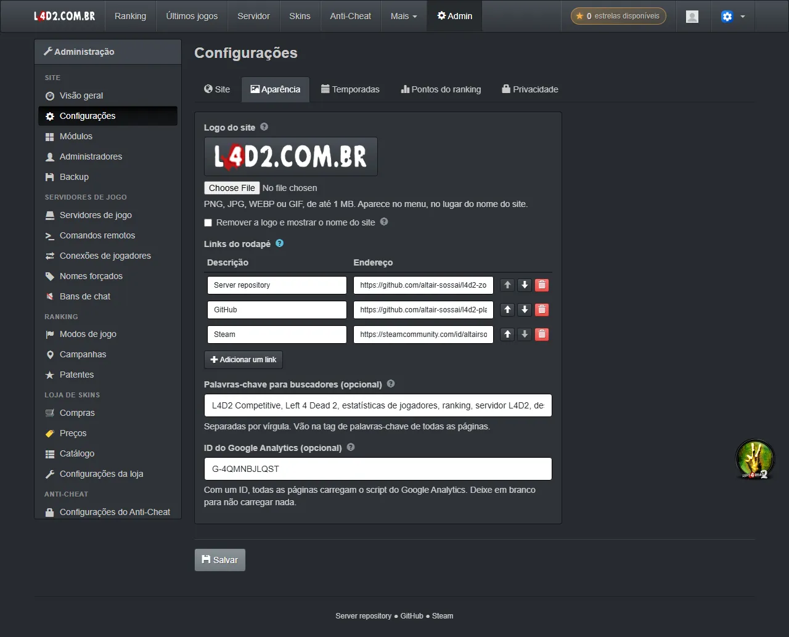

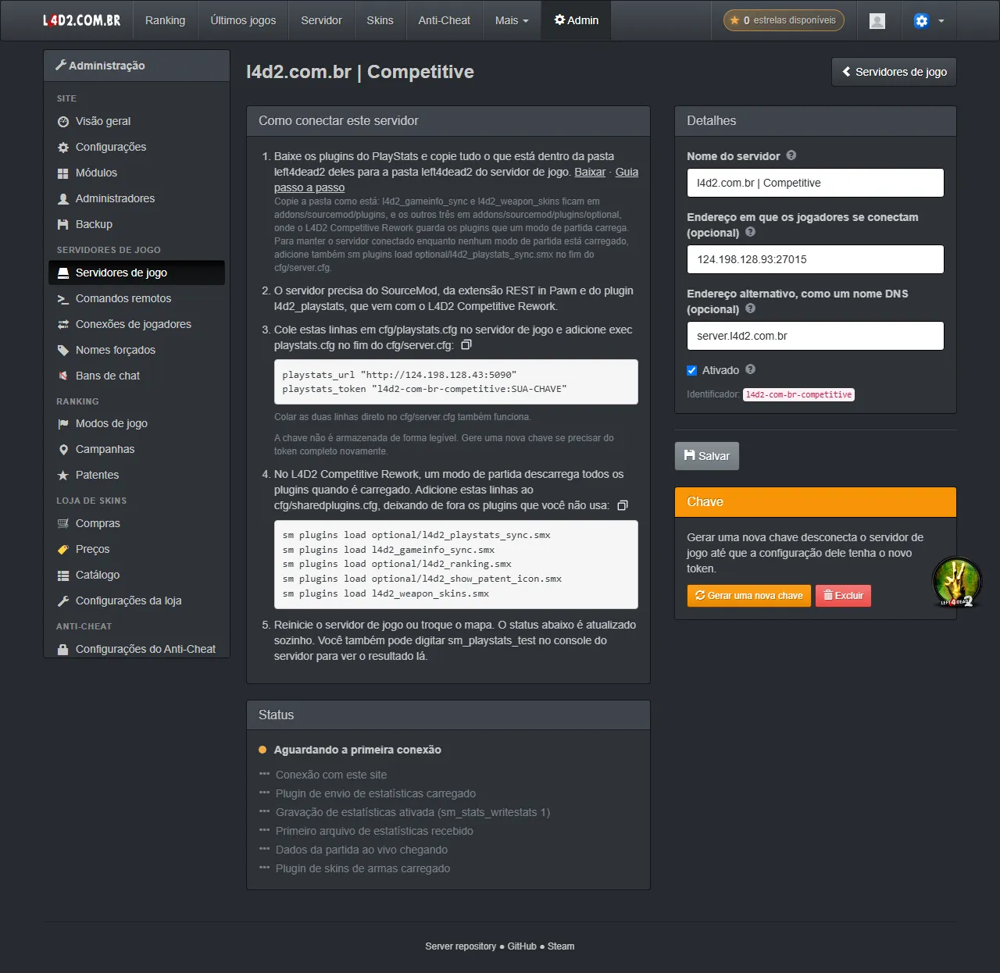

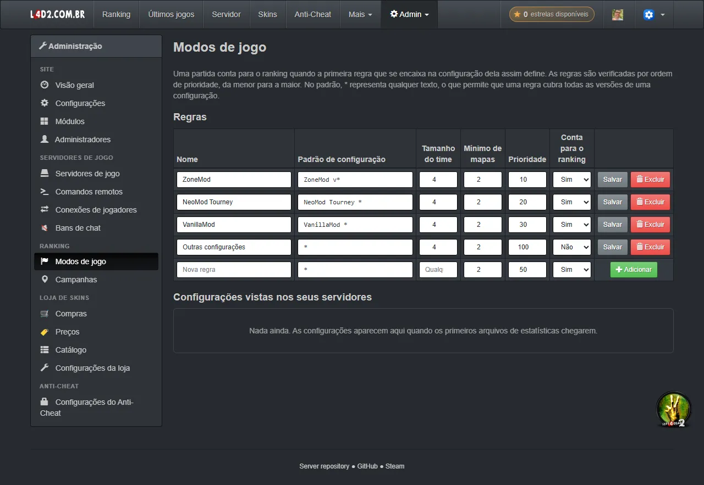

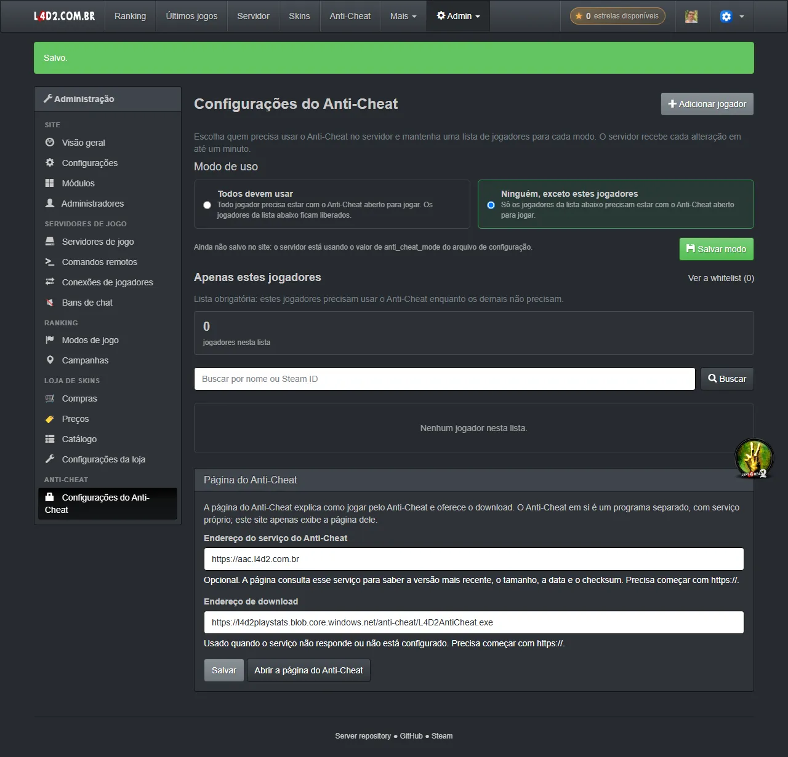

### Traga os dados do site antigo

O ranking, as partidas e o histórico são montados a partir dos arquivos de estatísticas que a API antiga guardava na tabela `Statistics` do armazenamento do Azure. Um programa à parte, o `l4d2-playstats-importer` (fora deste repositório), lê essa tabela sem alterá-la e envia cada arquivo para `POST /api/statistics` com o token do servidor de jogo, o mesmo caminho que os plugins usam:

```bash
dotnet run -c Release -- dump ./dump --settings local.settings.json
dotnet run -c Release -- upload ./dump http://124.198.128.43:5090 "<token do servidor de jogo>"
```

O `dump` pega a string de conexão do armazenamento em `Values:AzureWebJobsStorage` do `local.settings.json` do `l4d2-playstats-api`. Em 19 de novembro de 2026 ele gravou 6.648 arquivos, até as partidas de 17 de novembro, e todos foram aceitos: 1.835 partidas, 1.769 delas ranqueadas, 859 jogadores e 15 temporadas. O ranking da temporada atual mostrou os mesmos jogadores, na mesma ordem, que o site antigo.

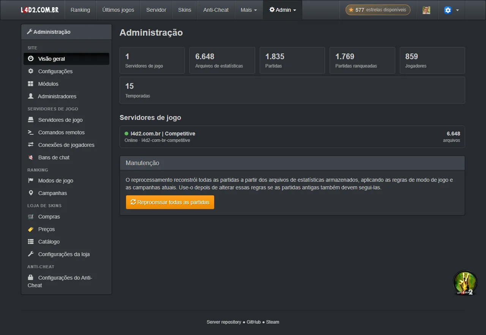

Rode os dois comandos de novo logo antes da [Parte 3](#parte-3-a-troca). Um arquivo que o site já tem é substituído, não entra duas vezes, então só as partidas jogadas desde o último envio são novas.

Nada mais do site antigo é copiado: as compras de skins, os presentes e as skins equipadas, os bans de chat e as listas do Anti-Cheat começam vazios. Cadastre de novo os bans de chat e os jogadores do Anti-Cheat no site novo.

### Confira

```bash
playstats-hub status
```

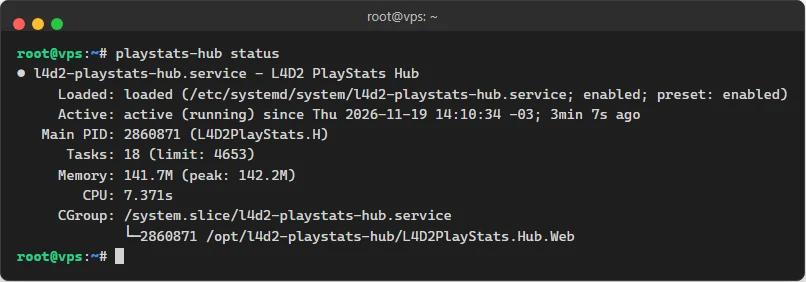

## Parte 2: teste com um servidor de jogo

Um servidor de jogo envia as partidas para um site só. Enquanto ele aponta para o site novo, as partidas dele não chegam mais ao antigo, e não vão para lá depois. Teste com um segundo servidor de jogo se você tiver um, ou num horário tranquilo com o principal.

### Faça backup do que os plugins substituem

No servidor de jogo, guarde uma cópia dos arquivos que os novos plugins substituem, para a [Parte 4](#parte-4-voltando-atrás):

```bash
cd /path/to/the/server/left4dead2
tar -czf ~/playstats-plugins-backup.tar.gz addons/sourcemod/plugins addons/sourcemod/translations addons/sourcemod/configs/weapon_skins.cfg cfg
```

Se o servidor de jogo é instalado a partir de um repositório, como o `l4d2-zone-server`, faça as mudanças abaixo no repositório também, senão a próxima instalação traz de volta os plugins e as configurações antigas.

### Copie os plugins

Copie tudo o que está dentro da pasta `left4dead2` dos plugins (no zip da release `l4d2-playstats-hub-plugins.zip`, ou em [plugins/left4dead2](../plugins/left4dead2) neste repositório) por cima da pasta `left4dead2` do servidor:

| Arquivo | O que ele substitui |
|---|---|
| `addons/sourcemod/plugins/l4d2_gameinfo_sync.smx` e `l4d2_weapon_skins.smx` | Os antigos no mesmo lugar. |
| `addons/sourcemod/plugins/optional/l4d2_playstats_sync.smx`, `l4d2_ranking.smx` e `l4d2_show_patent_icon.smx` | Os antigos no mesmo lugar, que o `shared_plugins.cfg` dos modos de partida já carrega. |
| `addons/sourcemod/translations/**` | Os textos das versões antigas. Copie junto com os arquivos `.smx`: os textos do ranking mudaram. |
| `addons/sourcemod/configs/weapon_skins.cfg` | As mesmas armas e skins. |
| `addons/sourcemod/scripting/**` | Os fontes, usados só para compilar. |
| `cfg/playstats.cfg` | Nada: ele é novo. |

Precisa existir só uma cópia de cada plugin. Nenhum dos cinco pode ficar em outra pasta, como um `l4d2_playstats_sync.smx` antigo na própria `addons/sourcemod/plugins/`.

### Mude as configurações

| Arquivo | Mudança |
|---|---|
| `cfg/cfgogl/zonemod/shared_cvars.cfg` e `cfg/cfgogl/neomod/shared_cvars.cfg` | Apague `confogl_addcvar playstats_url ...`, a API antiga, que faria os cinco plugins apontarem de volta para ela em toda partida, e `confogl_addcvar ranking_url ...`, que não existe mais. Mantenha as outras linhas: `patent_icon_enabled`, `weapon_skins_*`, `gameinfo_*` e `anti_cheat_*` funcionam como antes. |
| `cfg/server_secrets.cfg` | Apague `playstats_access_token`. Adicione `playstats_url` e `playstats_token` (abaixo). Defina `l4d2_web_secret` com o mesmo token do `playstats_token`. |
| `cfg/server.cfg` | Defina `l4d2_web_url` com o endereço do site novo. Se quiser, adicione `sm plugins load optional/l4d2_playstats_sync.smx` no fim, para que o site veja o servidor enquanto nenhum modo de partida está carregado. |
| `cfg/sharedplugins.cfg` | Opcional: as linhas `sm plugins load` do [Passo 5](game-server.pt.md#passo-5-carregue-os-plugins-nos-seus-modos-de-partida), para os modos de partida que ainda não carregam estes plugins (no `l4d2-zone-server`, todos os modos menos ZoneMod e NeoMod). |

As linhas para o `cfg/server_secrets.cfg`, com o token do servidor de jogo (no l4d2.com.br, em `/root/l4d2-playstats-hub-server-token.txt` na VPS) no lugar do exemplo:

```text
playstats_url "http://124.198.128.43:5090"
playstats_token "l4d2-com-br-competitive:3f9c…"
l4d2_web_secret "l4d2-com-br-competitive:3f9c…"
```

E a linha para o `cfg/server.cfg`:

```text
sm_cvar l4d2_web_url "http://124.198.128.43:5090"
```

- `playstats_url` é um endereço HTTP simples, então o navegador dentro do jogo também o abre e o `playstats_ingame_url` pode ficar vazio.
- `l4d2_web_url` e `l4d2_web_secret` são lidos só pelo plugin de anti-cheat (1.5.0 ou mais novo), para as listas de [Quem precisa usar o Anti-Cheat](manual/anti-cheat.pt.md#quem-precisa-usar-o-anti-cheat). As listas antigas não são copiadas: adicione os jogadores de novo no site novo antes de ligar o anti-cheat.
- Deixe o `playstats_public_url` desligado por enquanto. Ele é definido na Parte 3; antes disso, o chat mandaria os jogadores para a loja do site antigo.
- Com estas linhas no arquivo de segredos, você não precisa do `exec playstats.cfg`: o resto do `cfg/playstats.cfg` só mostra os padrões, e os modos de partida do `l4d2-zone-server` já definem o `sm_stats_writestats`.
- Nunca defina `playstats_token` ou `l4d2_web_secret` com `confogl_addcvar`: o Confogl mostra no chat os valores que ele acompanha.

### Confira

1. Reinicie o servidor de jogo enquanto ele está vazio e carregue um modo de partida, por exemplo com `!match`.
2. No console do servidor, `sm plugins list` precisa mostrar os cinco plugins, nenhum com falha e nenhum duas vezes. Depois, `sm_playstats_test` precisa responder `Connected to the site`.
3. No site novo, abra **Administração → Servidores de jogo** e o servidor. Ele precisa dizer **Conectado**, com a lista de conferência do [Passo 6](game-server.pt.md#passo-6-verifique-a-conexão).
4. Jogue um mapa completo. A partida aparece em **Partidas**, a rodada em **Servidor**, e o chat do site chega ao jogo.
5. No jogo, `!ranking` abre o painel do ranking. Com `weapon_skins_enabled 1`, `!skin status` responde; com `patent_icon_enabled 1`, os ícones das patentes aparecem antes da partida.

## Parte 3: a troca

No l4d2.com.br a troca foi feita em 19 de novembro de 2026. Os pipelines `l4d2-playstats-web` e `l4d2-playstats-api` e a release `l4d2-playstats-api` foram apagados do Azure DevOps, então nada publica de novo o site antigo ou a API antiga.

Faça enquanto ninguém está jogando. Depois disso os dois sites escutam na porta `5000`, então o antigo para primeiro.

1. Traga as partidas jogadas desde a importação: rode de novo os dois comandos de [Traga os dados do site antigo](#traga-os-dados-do-site-antigo).
2. Pare o site antigo, mantendo os arquivos dele: `sudo screen -S l4d2-playstats-web -X quit`. Ele roda num `screen` do `root`, então `sudo screen -ls` o mostra ao lado do `l4d2-anticheat-api`, que continua.
3. Impeça que ele inicie no boot: rode `sudo crontab -e` e coloque `#` na frente de `@reboot /home/l4d2-playstats-web/bash/bootstrap.sh`. Mantenha a linha do `l4d2-anticheat-api`.
4. Desligue a publicação automática do site antigo, o pipeline do Azure Pipelines do `l4d2-playstats-web`. Senão um push o inicia de novo na porta `5000`.
5. Passe o site novo para a porta `5000`: no `/etc/l4d2-playstats-hub/hub.env`, troque `ASPNETCORE_URLS=http://0.0.0.0:5090` por `ASPNETCORE_URLS=http://0.0.0.0:5000`, depois rode `sudo playstats-hub restart` e `playstats-hub status`.
6. Confira: `curl -s http://127.0.0.1:5000/api/ping` responde, `https://l4d2.com.br` e `http://124.198.128.43:5000` mostram o site novo, e o login com a Steam funciona em `https://l4d2.com.br`.
7. Em **Administração → Configurações → Site**, defina o **Endereço público do site** como `https://l4d2.com.br`.
8. No servidor de jogo, aponte tudo para a porta `5000` e defina o endereço que os jogadores leem no chat: as duas primeiras linhas no `cfg/server_secrets.cfg`, a última no `cfg/server.cfg`. Depois troque o mapa ou reinicie o servidor, e rode o `sm_playstats_test` de novo:

   ```text
   playstats_url "http://124.198.128.43:5000"
   playstats_public_url "https://l4d2.com.br"
   sm_cvar l4d2_web_url "http://124.198.128.43:5000"
   ```

9. Feche a porta `5090`, que não é mais usada: `sudo ufw delete allow 5090/tcp` com o UFW ativo, e no firewall do provedor se você a abriu lá.

Os plugins também poderiam usar `https://l4d2.com.br`; o endereço simples os mantém funcionando aconteça o que acontecer com o certificado. O nginx não precisa de mudança: ele continua repassando `https://l4d2.com.br` para a porta `5000`, e o site novo acredita nos cabeçalhos `X-Forwarded-*` de um proxy na mesma máquina. Se o login com a Steam voltar para um endereço `http://` ou para o endereço IP, o `location` do nginx precisa repassar estes cabeçalhos:

```nginx
proxy_set_header Host $host;
proxy_set_header X-Forwarded-For $proxy_add_x_forwarded_for;
proxy_set_header X-Forwarded-Proto $scheme;
```

A [página do servidor ao vivo](manual/live-server.pt.md) recebe as atualizações por um WebSocket em `/hubs/live`. O nginx só repassa WebSockets com estas linhas no mesmo `location`; as outras páginas continuam funcionando como antes com elas. Sem elas a página passa para Server-Sent Events ou long polling, que funcionam mas pesam mais:

```nginx
proxy_http_version 1.1;
proxy_set_header Upgrade $http_upgrade;
proxy_set_header Connection $connection_upgrade;
```

O `$connection_upgrade` vem deste `map`, escrito uma vez no bloco `http` (em `/etc/nginx/nginx.conf`, ou num arquivo em `/etc/nginx/conf.d/`) se ainda não existir. Depois confira e recarregue com `sudo nginx -t && sudo systemctl reload nginx`:

```nginx
map $http_upgrade $connection_upgrade {
    default upgrade;
    ''      close;
}
```

## Deploy automático

No l4d2.com.br uma release deste repositório atualiza o site e os plugins do servidor de jogo:

| O quê | Como |
|---|---|
| O site | O pipeline `l4d2-playstats-hub` do Azure Pipelines, do [deploy/azure-pipelines.yml](../deploy/azure-pipelines.yml), roda a cada tag `v*`. Pela conexão SSH da VPS, ele espera o pacote Linux da release e roda o instalador com essa versão. Os dados e o `/etc/l4d2-playstats-hub/hub.env` são mantidos, então o site continua na porta `5000`. |
| Os plugins | O pipeline do `l4d2-zone-server` roda depois dele, e a cada push no `master` dele. Ele baixa o `l4d2-playstats-hub-plugins.zip` da mesma release (a mais recente, num push), copia as pastas `plugins`, `translations` e `configs` por cima do `addons` do repositório, grava o `cfg/playstats_token.cfg` a partir da variável secreta `PLAYSTATS_TOKEN` do pipeline e publica. Os cinco plugins não ficam mais no `l4d2-zone-server`. |

O servidor de jogo lê o token no `cfg/playstats_token.cfg`, que o `cfg/server.cfg` roda logo depois do `server_secrets.cfg`, e os endereços no `cfg/server.cfg`:

```text
playstats_url "http://124.198.128.43:5000"
playstats_public_url "https://l4d2.com.br"
sm_cvar l4d2_web_url "https://l4d2.com.br"
```

## Parte 4: voltando atrás

Se algo não funcionar e não der para corrigir na hora:

1. Pare o site novo e impeça que ele inicie no boot: `sudo systemctl disable --now l4d2-playstats-hub`. Os dados dele ficam em `/var/lib/l4d2-playstats-hub`.
2. Inicie o site antigo como antes: `sudo /home/l4d2-playstats-web/bash/bootstrap.sh`. Tire o `#` da linha `@reboot` dele e ligue o pipeline dele de novo.
3. No servidor de jogo, extraia o backup na pasta `left4dead2` (`tar -xzf ~/playstats-plugins-backup.tar.gz`) e reinicie o servidor. Isso traz de volta os plugins antigos e todas as configurações em `cfg`.

As partidas jogadas enquanto o servidor de jogo apontava para o site novo ficam só nele; o site antigo não as recebe. Para tentar de novo depois, volte o `ASPNETCORE_URLS` para a porta `5090` no `/etc/l4d2-playstats-hub/hub.env` e rode `sudo systemctl enable --now l4d2-playstats-hub`.
